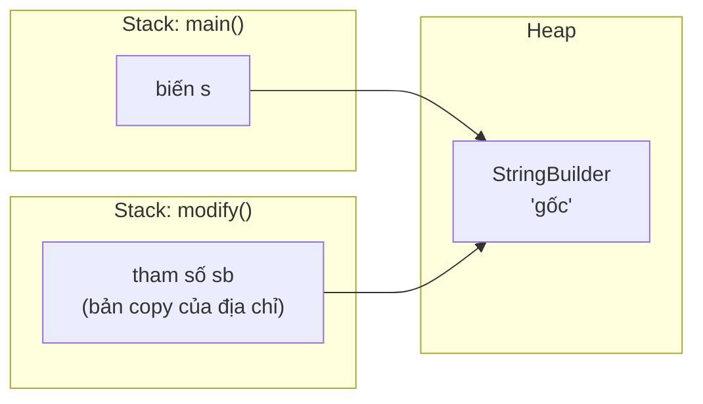

# OOP & SOLID

> **Tuần 1 · Ngày 1** · Thuộc [[02 - Java Core, Collections & Stream API]] · Lộ trình: [[01 - Lộ trình 8 tuần]] · Bài sau: [[02.02 - equals, hashCode & String]]
> Mỗi chủ đề gồm: **Hiểu bản chất → Code minh hoạ → Bẫy hay gặp → Trả lời mẫu (~60 giây) → Câu hỏi xoáy**.
> Cách học: đọc phần giải thích, **tự gõ và chạy lại code** (đừng chỉ đọc), rồi luyện nói phần "Trả lời mẫu" bằng lời của bạn. Đáp án câu hỏi xoáy được gập lại: tự trả lời trước rồi mới mở.

**Mục lục**
1. [[#1. Bốn tính chất của OOP|Bốn tính chất của OOP]]
2. [[#2. Abstraction khác Encapsulation thế nào|Abstraction khác Encapsulation thế nào]]
3. [[#3. Composition over Inheritance|Composition over Inheritance]]
4. [[#4. Interface vs Abstract class|Interface vs Abstract class]]
5. [[#5. Overloading vs Overriding|Overloading vs Overriding]]
6. [[#6. Java luôn pass-by-value|Java luôn pass-by-value]]
7. [[#7. SOLID|SOLID]]
8. [[#8. Kịch bản Feynman hôm nay|Kịch bản Feynman hôm nay]]

---

## 1. Bốn tính chất của OOP

### Hiểu bản chất

OOP tổ chức chương trình thành các **object**. Mỗi object gồm **dữ liệu (state)** và **hành vi (method)** thao tác trên dữ liệu đó. Bốn tính chất trả lời bốn câu hỏi thiết kế:

| Tính chất | Câu hỏi nó trả lời | Một câu dễ nhớ |
|---|---|---|
| **Encapsulation** (đóng gói) | Ai được phép **sửa dữ liệu**, và sửa theo quy tắc nào? | Giấu dữ liệu, chỉ cho thay đổi qua method có kiểm tra |
| **Abstraction** (trừu tượng) | Người dùng cần biết **cái gì**, và được phép **không cần biết** cái gì? | Lộ ra "làm được gì", giấu đi "làm thế nào" |
| **Inheritance** (kế thừa) | Làm sao **tái sử dụng** code giữa các class có quan hệ "là một" (is-a)? | `Dog` **là một** `Animal` |
| **Polymorphism** (đa hình) | Làm sao **cùng một lời gọi** cho ra hành vi khác nhau tuỳ object thực tế? | Gọi `send()`, object nào thì gửi kiểu của object đó |

### Code minh hoạ

**Encapsulation:** dữ liệu `private`, mọi thay đổi đi qua method có kiểm tra nghiệp vụ.

```java
public class BankAccount {
    private BigDecimal balance = BigDecimal.ZERO;   // không ai sửa trực tiếp được

    public void deposit(BigDecimal amount) {
        if (amount.signum() <= 0) throw new IllegalArgumentException("Số tiền phải > 0");
        balance = balance.add(amount);
    }

    public void withdraw(BigDecimal amount) {
        if (amount.compareTo(balance) > 0) throw new IllegalStateException("Không đủ số dư");
        balance = balance.subtract(amount);
    }

    public BigDecimal getBalance() { return balance; }
    // KHÔNG có setBalance(): nếu có, ai cũng đặt được số dư âm → mất ý nghĩa đóng gói
}
```

> Đóng gói **không phải** là "field private + getter/setter cho mọi field". Nếu field nào cũng có setter thì dữ liệu vẫn bị sửa tuỳ ý, chỉ là đi đường vòng.

**Abstraction:** bên gọi chỉ biết `charge()`. Gọi HTTP, ký chữ ký, retry thế nào thì bên gọi không cần biết.

```java
public interface PaymentGateway {
    PaymentResult charge(PaymentRequest request);
}
```

**Inheritance + Polymorphism:**

```java
interface NotificationSender {
    void send(String to, String message);
}

class EmailSender implements NotificationSender {
    public void send(String to, String message) { System.out.println("Email tới " + to + ": " + message); }
}

class SmsSender implements NotificationSender {
    public void send(String to, String message) { System.out.println("SMS tới " + to + ": " + message); }
}

List<NotificationSender> senders = List.of(new EmailSender(), new SmsSender());
for (NotificationSender s: senders) {
    s.send("khách A", "Đơn hàng đã giao");   // cùng 1 dòng code, 2 hành vi khác nhau
}
// Email tới khách A: Đơn hàng đã giao
// SMS tới khách A: Đơn hàng đã giao
```

**Cơ chế bên dưới:** biến `s` có kiểu khai báo là `NotificationSender`. Khi chạy, JVM nhìn **kiểu thực tế của object** (`EmailSender` hay `SmsSender`) để chọn method. Đây là **dynamic dispatch**, và là lý do overriding được quyết định lúc **runtime**.

Polymorphism có 2 loại:
- **Compile-time** (static): overloading. Compiler chọn method dựa trên tham số lúc biên dịch.
- **Runtime** (dynamic): overriding. JVM chọn method dựa trên object thực tế lúc chạy.

### Bẫy hay gặp
- Nói "encapsulation = private + getter/setter". Người phỏng vấn sẽ hỏi lại "vậy có setter cho mọi field thì còn đóng gói không?".
- Nhầm polymorphism với Dependency Injection. DI (Spring inject bean) chỉ **tận dụng** polymorphism, không phải chính nó.

### Trả lời mẫu (~60 giây)

> "OOP có 4 tính chất. **Encapsulation** là giấu dữ liệu bên trong object, chỉ cho thay đổi qua method có kiểm tra quy tắc. Ví dụ `BankAccount` chỉ có `deposit`/`withdraw`, không có `setBalance`, nên số dư không bao giờ âm. **Abstraction** là chỉ lộ ra object *làm được gì*, giấu *làm thế nào*, như interface `PaymentGateway` chỉ có `charge()`. **Inheritance** là class con tái sử dụng code của class cha theo quan hệ is-a. **Polymorphism** là cùng một lời gọi nhưng hành vi khác nhau tuỳ object thực tế. Ở dự án em, `NotificationService` giữ danh sách `NotificationSender`, gọi `send()` thì email hay SMS tự chạy đúng cách của nó; muốn thêm Zalo chỉ cần thêm một class mới."

### Câu hỏi xoáy

**Q1.** Có getter/setter cho tất cả field thì có còn là encapsulation không?
> [!success]- Gợi ý trả lời
> Về hình thức thì có, nhưng về bản chất rất yếu: ai cũng đặt được giá trị không hợp lệ. Đóng gói thật sự là object **tự bảo vệ quy tắc của nó** (invariant): chỉ cung cấp hành vi có ý nghĩa nghiệp vụ (`withdraw`), không cung cấp setter tuỳ tiện.

**Q2.** Polymorphism được hiện thực thế nào trong JVM?
> [!success]- Gợi ý trả lời
> Lời gọi method instance (không phải `static`, `private` hay `final`) được JVM **gửi tới implementation của kiểu thực tế** của object lúc chạy (dynamic dispatch, thường cài bằng bảng method ảo, vtable). Overloading thì compiler đã chọn sẵn method lúc biên dịch.

---

## 2. Abstraction khác Encapsulation thế nào

Đây là câu hỏi **rất hay gặp**, vì hai khái niệm đều có ý "che giấu" nên dễ lẫn.

| | Abstraction | Encapsulation |
|---|---|---|
| Che giấu cái gì | **Độ phức tạp**: cách làm bên trong | **Dữ liệu**: state bên trong |
| Mục đích | Đơn giản hoá cách **sử dụng** | **Bảo vệ** dữ liệu khỏi bị sửa sai |
| Ở tầng | **Thiết kế**: chọn lộ ra những gì | **Hiện thực**: dùng `private`, kiểm tra trong method |
| Công cụ Java | `interface`, `abstract class` | Access modifier (`private`, `protected`…) |

**Ví dụ ô tô:**
- **Abstraction**: tài xế chỉ cần biết vô lăng, chân ga, chân phanh. Không cần biết hệ thống phun xăng hay hộp số hoạt động ra sao.
- **Encapsulation**: động cơ nằm trong khoang đóng kín. Tài xế không thể tự chỉnh lượng xăng phun vào xi-lanh, mà chỉ tác động gián tiếp qua chân ga, và chân ga có giới hạn an toàn.

> **Trả lời mẫu:** "Abstraction giấu **độ phức tạp**, quyết định người dùng *thấy* gì, ví dụ interface `PaymentGateway` chỉ có `charge()`. Encapsulation giấu **dữ liệu**, quyết định ai được *sửa* gì và theo quy tắc nào, ví dụ `balance` là private và chỉ thay đổi qua `withdraw()` có kiểm tra số dư. Hai cái bổ trợ nhau: abstraction là ở mức thiết kế, encapsulation là cách hiện thực để bảo vệ thiết kế đó."

---

## 3. Composition over Inheritance

### Hiểu bản chất
- **Inheritance** (is-a): `class B extends A`. B thừa hưởng **toàn bộ** A, kể cả các chi tiết hiện thực của A. Đây là quan hệ **ràng buộc chặt**.
- **Composition** (has-a): B **chứa** một A và gọi A khi cần. B chỉ phụ thuộc vào phần A công khai ra ngoài. Đây là quan hệ **ràng buộc lỏng**.

### Code minh hoạ: kế thừa làm hỏng logic (ví dụ kinh điển từ sách *Effective Java*)

Yêu cầu: đếm tổng số phần tử từng được thêm vào một `HashSet`.

```java
public class InstrumentedHashSet<E> extends HashSet<E> {
    private int addCount = 0;

    @Override public boolean add(E e) {
        addCount++;
        return super.add(e);
    }

    @Override public boolean addAll(Collection<? extends E> c) {
        addCount += c.size();
        return super.addAll(c);
    }

    public int getAddCount() { return addCount; }
}

var set = new InstrumentedHashSet<String>();
set.addAll(List.of("a", "b", "c"));
System.out.println(set.getAddCount());   // 6 ❌ (kỳ vọng 3)
```

**Vì sao ra 6?** Bên trong, `HashSet.addAll()` (kế thừa từ `AbstractCollection`) gọi `add()` cho từng phần tử, và `add()` lại là method **đã bị override**, nên mỗi phần tử bị đếm 2 lần. Class con bị phụ thuộc vào **chi tiết hiện thực bên trong** của class cha, thứ mà tài liệu public không hề hứa hẹn. Nếu phiên bản JDK sau thay đổi cách cài `addAll`, code sẽ lại hỏng theo kiểu khác.

**Sửa bằng composition:**

```java
public class InstrumentedSet<E> {
    private final Set<E> delegate;      // CHỨA một Set, không kế thừa
    private int addCount = 0;

    public InstrumentedSet(Set<E> delegate) { this.delegate = delegate; }

    public boolean add(E e) {
        addCount++;
        return delegate.add(e);
    }

    public boolean addAll(Collection<? extends E> c) {
        addCount += c.size();
        return delegate.addAll(c);      // delegate.addAll không gọi ngược lại add() của mình
    }

    public int getAddCount() { return addCount; }
}
// → 3 ✓. Bản đầy đủ sẽ implements Set<E> và chuyển tiếp mọi method sang delegate.
```

Bonus: dùng được với **bất kỳ** `Set` nào (`HashSet`, `TreeSet`…), không bị gắn cứng vào một class.

### Khi nào dùng inheritance?
Chỉ khi thoả **cả hai** điều kiện:
1. Đúng là quan hệ **is-a** thật sự.
2. Class con **thay thế được** class cha ở mọi nơi mà không phá hành vi (nguyên lý Liskov, xem [[#7. SOLID|SOLID]]).

Trong code Spring hằng ngày, gần như luôn dùng composition: service **inject** các service hoặc repository khác thay vì `extends`.

> **Trả lời mẫu:** "Kế thừa ràng buộc chặt: class con phụ thuộc cả chi tiết hiện thực của class cha, nên cha thay đổi thì con dễ hỏng. Ví dụ kinh điển là kế thừa `HashSet` để đếm số phần tử thêm vào: vì `addAll` bên trong gọi `add`, kết quả bị đếm gấp đôi. Composition thì class chứa object kia và chỉ gọi qua API công khai, nên lỏng hơn và linh hoạt hơn. Em chỉ dùng kế thừa khi đúng quan hệ is-a và class con thay thế được class cha. Còn lại em ưu tiên composition, và trong Spring thì chính là inject dependency."

### Câu hỏi xoáy

**Q1.** Vì sao Java không cho một class kế thừa nhiều class?
> [!success]- Gợi ý trả lời
> Để tránh **diamond problem** với *state và implementation*: nếu B và C cùng kế thừa A và cùng override `m()`, thì class D extends B, C sẽ không biết dùng `m()` và field của bên nào. Java cho implement nhiều interface vì interface không có state. Nếu hai default method trùng tên thì compiler **bắt buộc** bạn tự giải quyết (xem mục 4).

**Q2.** Constructor của class con chạy theo thứ tự nào?
> [!success]- Gợi ý trả lời
> Constructor con **luôn gọi constructor cha trước** (`super(...)` ngầm định hoặc tường minh, phải là lệnh đầu tiên). Thứ tự khởi tạo đi từ trên xuống: `Object` → cha → con. Nếu cha không có constructor không tham số thì con bắt buộc gọi `super(args)`.

---

## 4. Interface vs Abstract class

### Hiểu bản chất
- **Interface** = **hợp đồng / khả năng**: "class nào implement thì **làm được** việc này". Không giữ state.
- **Abstract class** = **bộ khung dùng chung** cho một họ class gần nhau: có sẵn state và code chung, để lại vài chỗ cho class con điền vào.

### Interface hiện đại (Java 8+) có những gì

```java
public interface PaymentGateway {

    BigDecimal MAX_AMOUNT = new BigDecimal("500000000");   // luôn là public static final (hằng số)

    PaymentResult charge(PaymentRequest request);           // abstract: class con bắt buộc cài

    // Java 8: default method có thân sẵn, class con có thể override
    default boolean supports(String currency) {
        return "VND".equals(normalize(currency));
    }

    // Java 8: static method gọi qua tên interface, không kế thừa xuống class con
    static PaymentGateway alwaysSuccess() {
        return request -> PaymentResult.success();          // dùng được lambda vì chỉ có 1 abstract method
    }

    private String normalize(String currency) {             // Java 9: helper dùng nội bộ cho các default method
        return currency == null ? "": currency.trim().toUpperCase();
    }
}
```

**Vì sao Java 8 thêm `default` method?** Để **mở rộng interface cũ mà không phá code đang có**. Ví dụ `List` thêm `sort()` và `Collection` thêm `stream()`: nếu là abstract method thì mọi class implement `List` trên thế giới sẽ lỗi biên dịch.

### Abstract class: khi cần state, constructor và khung xử lý chung (Template Method)

```java
public abstract class ReportExporter {
    private final Clock clock;                                  // state dùng chung

    protected ReportExporter(Clock clock) { this.clock = clock; }   // có constructor

    // khung xử lý cố định: final để class con không phá thứ tự các bước
    public final byte[] export(List<Order> orders) {
        if (orders.isEmpty()) throw new IllegalArgumentException("Không có dữ liệu");
        String header = "Generated at " + clock.instant();
        return render(header, orders);                         // bước riêng do class con quyết định
    }

    protected abstract byte[] render(String header, List<Order> orders);
}

public class CsvExporter extends ReportExporter {
    public CsvExporter(Clock clock) { super(clock); }
    @Override protected byte[] render(String header, List<Order> orders) { /* ghi CSV */ return new byte[0]; }
}
```

**Abstract class có constructor để làm gì khi không `new` được?** Để **khởi tạo phần state chung**. Constructor này được gọi qua `super(...)` từ class con.

### So sánh

| | Interface | Abstract class |
|---|---|---|
| Kế thừa | Một class implement **nhiều** interface | Chỉ `extends` **1** class |
| State (field instance) | ✗ (chỉ hằng số `public static final`) | ✓ |
| Constructor | ✗ | ✓ |
| Method | abstract, `default`, `static` (Java 8), `private` (Java 9) | Mọi loại, mọi access modifier |
| Quan hệ | "**làm được**" (can-do) | "**là một**" (is-a), cùng họ |
| Ví dụ JDK / Spring | `Comparable`, `Runnable`, `List`, `HandlerInterceptor` | `AbstractList`, `HttpServlet` |

**Cách chọn trong thực tế:**
1. **Mặc định chọn interface**, vì linh hoạt và dễ mock khi test.
2. Khi nhiều implementation **trùng code và state** thì thêm một abstract class *implement* interface đó. JDK làm đúng như vậy: `List` (interface) + `AbstractList` (khung dùng chung) + `ArrayList`.

### Diamond problem với default method

```java
interface A { default String hello() { return "A"; } }
interface B { default String hello() { return "B"; } }

class C implements A, B {
    @Override
    public String hello() {                   // KHÔNG override → lỗi biên dịch
        return A.super.hello() + B.super.hello();   // tự chọn hoặc kết hợp: "AB"
    }
}
```

Quy tắc ưu tiên khi trùng method:
1. **Class thắng interface**: method của class cha được ưu tiên hơn default method của interface.
2. Interface **con cụ thể hơn** thắng interface cha.
3. Nếu vẫn còn mơ hồ: **bắt buộc override**.

> **Trả lời mẫu:** "Interface là hợp đồng, mô tả class *làm được gì*. Một class implement được nhiều interface, và interface không có state hay constructor. Từ Java 8 interface có default và static method, Java 9 thêm private method. Default method sinh ra để mở rộng interface cũ mà không phá các class đang implement nó. Abstract class là khung chung cho một họ class: có field, constructor, và thường dùng Template Method, tức cố định các bước xử lý và để class con cài một vài bước. Em mặc định chọn interface; khi nhiều implementation trùng code thì thêm abstract class implement interface đó, giống `List` và `AbstractList` trong JDK."

### Câu hỏi xoáy

**Q1.** Có default method rồi thì interface còn khác abstract class không?
> [!success]- Gợi ý trả lời
> Vẫn khác ở 3 điểm cốt lõi: interface **không có state** (field instance) và **không có constructor**; một class implement được **nhiều** interface nhưng chỉ extends **1** class; method trong interface luôn `public` (trừ `private` helper), còn abstract class dùng được `protected` và package-private.

**Q2.** Static method của interface có được class implement kế thừa không?
> [!success]- Gợi ý trả lời
> **Không**. Phải gọi qua tên interface: `PaymentGateway.alwaysSuccess()`. Điều này tránh xung đột khi một class implement nhiều interface có static method trùng tên.

**Q3.** Class cha có `hello()` và interface có default `hello()`. Class con extends cha và implements interface. Gọi `hello()` chạy bản nào?
> [!success]- Gợi ý trả lời
> Bản của **class cha**, theo quy tắc "class thắng interface".

---

## 5. Overloading vs Overriding

### Hiểu bản chất

| | Overloading (nạp chồng) | Overriding (ghi đè) |
|---|---|---|
| Là gì | **Cùng tên, khác danh sách tham số** trong cùng class (hoặc class con) | Class con **cài lại** method của cha, **cùng chữ ký** |
| Quyết định lúc | **Compile time**: theo **kiểu khai báo** của đối số | **Runtime**: theo **kiểu thực tế** của object |
| Loại polymorphism | Static | Dynamic |
| Return type | Tuỳ ý (nhưng không thể chỉ khác return type) | Giống hệt, hoặc là **kiểu con** (covariant) |

### Code minh hoạ: overloading được quyết định theo kiểu **khai báo**

```java
static void greet(Object o) { System.out.println("Object"); }
static void greet(String s) { System.out.println("String"); }

Object o = "hello";
greet(o);          // "Object": dù thực tế là String! Compiler chỉ thấy kiểu khai báo là Object
greet("hello");    // "String"
```

### Code minh hoạ: overriding được quyết định theo kiểu **thực tế**

```java
class Animal { String sound() { return "..."; } }
class Dog extends Animal { @Override String sound() { return "Gâu"; } }

Animal a = new Dog();
System.out.println(a.sound());   // "Gâu": JVM nhìn object thực tế là Dog
```

### Quy tắc khi override
1. **Cùng tên và cùng danh sách tham số.**
2. **Return type** giống hệt, hoặc là **kiểu con** (covariant return). Ví dụ cha trả `Animal` thì con được trả `Dog`.
3. **Không thu hẹp quyền truy cập**: cha `public` thì con phải `public`; cha `protected` thì con được `protected` hoặc `public`.
4. **Không ném thêm checked exception mới hoặc rộng hơn**: cha ném `IOException` thì con được ném `FileNotFoundException` (hẹp hơn) hoặc không ném gì, nhưng không được ném `Exception`. Unchecked exception thì không bị giới hạn.
5. **Không override được**: method `final`, `private` (class con không nhìn thấy), `static` (chỉ bị "che", xem bên dưới).

### Bẫy 1: static method không override, chỉ bị "che" (hiding)

```java
class Parent {
    static String who()  { return "Parent"; }
    String name()        { return "Parent"; }
}
class Child extends Parent {
    static String who()  { return "Child"; }          // hiding, KHÔNG phải override
    @Override String name() { return "Child"; }
}

Parent p = new Child();
System.out.println(p.who());    // "Parent": static: theo kiểu KHAI BÁO (compile time)
System.out.println(p.name());   // "Child": instance: theo kiểu THỰC TẾ (runtime)
```

Field cũng không có polymorphism: `p.someField` luôn lấy field theo kiểu khai báo.

### Bẫy 2: tưởng override nhưng thực ra là overload, và vì sao luôn dùng `@Override`

```java
class User {
    private String email;

    public boolean equals(User other) {        // ❌ tham số là User, không phải Object → OVERLOAD
        return other != null && email.equals(other.email);
    }
}
// HashSet, HashMap gọi equals(Object) → vẫn dùng Object.equals (so sánh tham chiếu) → logic của bạn bị bỏ qua
```

Thêm `@Override` vào thì compiler báo lỗi ngay: *method does not override or implement a method from a supertype*. **Luôn đặt `@Override`** để compiler kiểm tra giúp. (Và nhớ override cả `hashCode()`, sẽ học ở Ngày 2.)

### Bẫy 3: thứ tự chọn method khi overload (overload resolution)

Compiler thử theo **3 giai đoạn**, dừng ngay ở giai đoạn đầu tiên tìm được method phù hợp:
1. Khớp chính xác hoặc **nới rộng kiểu primitive** (widening: `byte → int → long`), **không** boxing.
2. Cho phép **boxing/unboxing** (`int ↔ Integer`).
3. Cho phép **varargs** (`int...`).

```java
static void print(int x)      { System.out.println("int"); }
static void print(long x)     { System.out.println("long"); }
static void print(Integer x)  { System.out.println("Integer"); }
static void print(int... x)   { System.out.println("varargs"); }

byte b = 1;
print(b);                    // "int": giai đoạn 1: widening byte → int (int cụ thể hơn long)
print(5L);                   // "long"
print(Integer.valueOf(5));   // "Integer": khớp chính xác
print();                     // "varargs"
```

> **Trả lời mẫu:** "Overloading là nhiều method cùng tên khác tham số; compiler chọn method lúc **biên dịch** dựa trên **kiểu khai báo** của đối số, nên đây là static polymorphism. Overriding là class con cài lại method của cha với cùng chữ ký; JVM chọn lúc **chạy** dựa trên **kiểu thực tế** của object, là dynamic polymorphism. Khi override thì không được thu hẹp access modifier, không ném checked exception rộng hơn, return type có thể là kiểu con. Static method không override được mà chỉ bị che. Em luôn đặt `@Override` để tránh lỗi tưởng override nhưng thực ra là overload, ví dụ viết `equals(User)` thay vì `equals(Object)`."

### Câu hỏi xoáy

**Q1.** Có thể overload chỉ bằng cách đổi return type không?
> [!success]- Gợi ý trả lời
> **Không**. Chữ ký method (dùng để phân biệt overload) chỉ gồm **tên + danh sách kiểu tham số**. Hai method chỉ khác return type sẽ gây lỗi biên dịch.

**Q2.** Có override được constructor không? Overload thì sao?
> [!success]- Gợi ý trả lời
> Constructor **không kế thừa** nên không override được. Overload thì được: nhiều constructor khác tham số, và có thể gọi nhau bằng `this(...)`.

**Q3.** `Parent p = new Child(); p.who()` với `who()` là static. Kết quả theo class nào? Vì sao?
> [!success]- Gợi ý trả lời
> Theo **Parent**. Static method gắn với class, không gắn với object, nên compiler chọn theo **kiểu khai báo** của biến. Đây là hiding, không phải overriding.

---

## 6. Java luôn pass-by-value

### Hiểu bản chất
Khi gọi method, Java **copy giá trị của biến** vào tham số:
- Biến **primitive** (`int`, `double`…): copy **giá trị số**.
- Biến **object**: giá trị của biến chính là **địa chỉ (tham chiếu)** tới object trên heap, nên Java **copy địa chỉ đó**. Hai biến (bên ngoài và tham số) cùng trỏ tới **một object**, nhưng bản thân chúng là **hai biến riêng biệt**.



### Code minh hoạ

```java
static void increment(int x)              { x++; }
// sửa OBJECT mà cả hai biến cùng trỏ tới
static void modify(StringBuilder sb)      { sb.append(" + sửa"); }
static void reassign(StringBuilder sb)    { sb = new StringBuilder("mới"); } // chỉ đổi biến copy

int n = 1;
increment(n);
System.out.println(n);   // 1: x chỉ là bản copy

StringBuilder s = new StringBuilder("gốc");
modify(s);
System.out.println(s);   // "gốc + sửa": object bị sửa thật
reassign(s);
System.out.println(s);   // "gốc + sửa": gán lại sb không ảnh hưởng biến s
```

**Phép thử nhanh:** nếu Java là pass-by-reference thì bạn viết được hàm `swap(a, b)` hoán đổi 2 object của bên gọi. Trong Java **không làm được**, vì method chỉ đổi được bản copy của tham chiếu.

### Bẫy hay gặp
- `Integer`/`String` là **immutable**: `void inc(Integer x) { x++; }` tạo ra object `Integer` mới gán cho biến copy, nên bên gọi **không thay đổi**.
- Hệ quả thực tế: truyền một `List` vào method, method `add`/`remove` thì **list của bên gọi bị đổi**. Muốn an toàn thì method tạo bản copy (`new ArrayList<>(list)`, `List.copyOf(list)`). Tương tự, getter trả thẳng `List` nội bộ là **phá đóng gói**, vì bên ngoài sửa được dữ liệu bên trong object.

> **Trả lời mẫu:** "Java luôn là pass-by-value. Với primitive thì copy giá trị. Với object thì giá trị của biến là tham chiếu, nên Java copy tham chiếu, và hai biến cùng trỏ tới một object. Vì vậy method **sửa được nội dung** object, nhưng **gán lại tham số** sang object khác thì bên gọi không bị ảnh hưởng, nên trong Java không viết được hàm swap hai object. Trong thực tế điều này quan trọng khi truyền collection: method sửa list thì list của bên gọi cũng bị đổi, nên em hay dùng `List.copyOf` để phòng."

---

## 7. SOLID

Năm nguyên lý thiết kế giúp code **dễ thay đổi, dễ test, ít ảnh hưởng dây chuyền**. Khi phỏng vấn, mỗi nguyên lý cần trả lời được: **định nghĩa 1 câu, vấn đề nó giải quyết, ví dụ thật**.

### S: Single Responsibility Principle

**Một class chỉ nên có một lý do để thay đổi.** "Lý do" ở đây là **một nhóm người hay một nghiệp vụ yêu cầu thay đổi**, không phải "chỉ có 1 method".

```java
// ❌ Trước: một class, ba lý do thay đổi
class OrderService {
    void placeOrder(Order o) { /* tính tiền, lưu DB */ }
    void sendConfirmationEmail(Order o) { /* template email: marketing hay đòi đổi */ }
    byte[] exportInvoicePdf(Order o) { /* format hoá đơn: kế toán hay đòi đổi */ }
}

// ✓ Sau: tách theo lý do thay đổi
class OrderService        { void placeOrder(Order o) { ... } }
class OrderMailer         { void sendConfirmation(Order o) { ... } }
class InvoicePdfExporter  { byte[] export(Order o) { ... } }
```

Lợi ích: sửa template email không có nguy cơ làm hỏng logic tính tiền, và test từng phần độc lập.

### O: Open/Closed Principle

**Mở để mở rộng, đóng để sửa đổi**: thêm tính năng bằng cách **thêm code mới**, không sửa code cũ đang chạy ổn.

```java
// ❌ Trước: mỗi loại khách mới lại phải sửa method này
BigDecimal price(Customer c, BigDecimal total) {
    if (c.isVip())          return total.multiply(new BigDecimal("0.8"));
    else if (c.isStudent()) return total.multiply(new BigDecimal("0.9"));
    return total;
}

// ✓ Sau: mỗi chính sách là một class; Spring tự inject tất cả
public interface DiscountPolicy {
    boolean supports(Customer c);
    BigDecimal apply(BigDecimal total);
}

@Component
class VipDiscount implements DiscountPolicy {
    public boolean supports(Customer c) { return c.isVip(); }
    public BigDecimal apply(BigDecimal total) { return total.multiply(new BigDecimal("0.8")); }
}

@Service
class PricingService {
    private final List<DiscountPolicy> policies;
    PricingService(List<DiscountPolicy> policies) { this.policies = policies; }

    BigDecimal price(Customer c, BigDecimal total) {
        return policies.stream()
                .filter(p -> p.supports(c))
                .findFirst()
                .map(p -> p.apply(total))
                .orElse(total);
    }
}
// Thêm chính sách "khách hàng mới" = thêm 1 class @Component, KHÔNG sửa PricingService
```

### L: Liskov Substitution Principle

**Object của class con phải thay được object của class cha ở mọi nơi mà chương trình vẫn đúng.** Class con không được "phá lời hứa" (hành vi mong đợi) của class cha.

```java
class Rectangle {
    protected int width, height;
    void setWidth(int w)  { this.width = w; }
    void setHeight(int h) { this.height = h; }
    int area()            { return width * height; }
}

class Square extends Rectangle {               // "hình vuông là hình chữ nhật": đúng về toán học…
    @Override void setWidth(int w)  { this.width = w; this.height = w; }
    @Override void setHeight(int h) { this.width = h; this.height = h; }
}

void resize(Rectangle r) {
    r.setWidth(5);
    r.setHeight(4);
    System.out.println(r.area());              // code này kỳ vọng 20
}

resize(new Rectangle());   // 20 ✓
resize(new Square());      // 16 ❌: Square phá lời hứa "đổi chiều cao không ảnh hưởng chiều rộng"
```

**Ví dụ hay gặp trong dự án:** class con override method rồi `throw new UnsupportedOperationException()` (ví dụ `ReadOnlyOrderRepository extends OrderRepository` mà `save()` ném lỗi). Code nào đang dùng `OrderRepository` sẽ hỏng khi nhận class con, nên đây là vi phạm LSP. Cách sửa là tách interface đọc và ghi riêng (xem ISP).

### I: Interface Segregation Principle

**Không ép client phụ thuộc vào những method nó không dùng.** Nên dùng nhiều interface nhỏ, đúng vai trò, thay vì một interface "toàn năng".

```java
// ❌ Trước: job báo cáo chỉ cần đọc nhưng phải phụ thuộc cả create/delete/resetPassword…
interface UserService {
    User findById(Long id);
    List<User> findAll();
    User create(CreateUserRequest r);
    void delete(Long id);
    void resetPassword(Long id);
}

// ✓ Sau: tách theo vai trò sử dụng
interface UserReader { User findById(Long id); List<User> findAll(); }
interface UserWriter { User create(CreateUserRequest r); void delete(Long id); }

class UserServiceImpl implements UserReader, UserWriter { ... }
class MonthlyReportJob { private final UserReader users; ... }   // chỉ thấy đúng thứ nó cần
```

Ví dụ có sẵn trong Spring Data: chuỗi `Repository` → `CrudRepository` → `PagingAndSortingRepository`. Bạn có thể chỉ `extends Repository<User, Long>` và khai báo đúng các method cần, không bắt buộc kéo theo cả `deleteAll()`.

### D: Dependency Inversion Principle

**Module cấp cao (nghiệp vụ) không phụ thuộc module cấp thấp (chi tiết kỹ thuật); cả hai cùng phụ thuộc vào abstraction.**

```java
// ❌ Trước: nghiệp vụ dính chặt vào một nhà cung cấp cụ thể
class CheckoutService {
    private final VnPayClient client = new VnPayClient();   // đổi sang Momo = sửa class này; unit test khó mock
}

// ✓ Sau: phụ thuộc interface; implementation được "tiêm" từ ngoài vào
class CheckoutService {
    private final PaymentGateway gateway;
    CheckoutService(PaymentGateway gateway) { this.gateway = gateway; }
}
// Test: new CheckoutService(mockGateway). Production: Spring inject VnPayGateway hoặc MomoGateway.
```

**Phân biệt 3 khái niệm hay bị hỏi chung:**
- **DIP** (nguyên lý thiết kế): *nên* phụ thuộc vào abstraction.
- **DI** (kỹ thuật): đưa dependency từ ngoài vào qua constructor hoặc setter, thay vì tự `new`.
- **IoC** (mô hình): framework (Spring container) điều khiển việc tạo và nối object thay cho code của bạn.

> **Trả lời mẫu SOLID (~90 giây):** "SOLID là 5 nguyên lý giúp code dễ thay đổi và dễ test. **S**: mỗi class một lý do thay đổi, ví dụ tách gửi email và xuất hoá đơn ra khỏi `OrderService`. **O**: thêm tính năng bằng cách thêm code chứ không sửa code cũ; ở dự án em, mỗi chính sách giảm giá là một bean implement `DiscountPolicy`, thêm loại mới chỉ cần thêm class. **L**: class con phải thay được class cha mà không phá hành vi; ví dụ kinh điển là `Square extends Rectangle`, còn trong thực tế là class con ném `UnsupportedOperationException`. **I**: tách interface lớn thành interface nhỏ theo vai trò, như `UserReader`/`UserWriter`. **D**: nghiệp vụ phụ thuộc interface như `PaymentGateway`, Spring inject implementation; nhờ vậy đổi nhà cung cấp hay mock khi test đều dễ."

### Câu hỏi xoáy

**Q1.** SRP có nghĩa là mỗi class chỉ có một method?
> [!success]- Gợi ý trả lời
> Không. SRP là **một lý do để thay đổi**, tức một trách nhiệm hoặc một nhóm yêu cầu nghiệp vụ. Một class có thể có nhiều method nếu tất cả phục vụ cùng một trách nhiệm.

**Q2.** Áp dụng SOLID quá mức có hại gì?
> [!success]- Gợi ý trả lời
> Sinh ra quá nhiều interface và class nhỏ, khó đọc (over-engineering). Ví dụ tạo interface cho một class chỉ có đúng một implementation và chưa thấy nhu cầu thay đổi. Nên áp dụng khi có **nhu cầu thay đổi hoặc test thực tế** (YAGNI).

**Q3.** DIP và DI khác nhau thế nào?
> [!success]- Gợi ý trả lời
> DIP là **nguyên lý**: phụ thuộc vào abstraction. DI là **kỹ thuật** đưa dependency từ ngoài vào. Có thể làm DI mà vẫn vi phạm DIP, ví dụ inject thẳng class cụ thể `VnPayClient` thay vì interface.

---

## 8. Kịch bản Feynman hôm nay

**20 phút cuối buổi.** Gấp tài liệu lại, bật ghi âm, mỗi câu nói 2–3 phút:

1. "Interface khác abstract class thế nào từ Java 8? Khi nào chọn cái nào?"
2. "Overloading khác overriding thế nào? Vì sao gọi là compile-time và runtime? Cho ví dụ static method."
3. "Polymorphism là gì? Cho một ví dụ trong dự án của bạn."
4. *(Nếu còn thời gian)* "Vì sao nên ưu tiên composition hơn inheritance?"

Nghe lại và tự chấm:
- [ ] Có ví dụ code hoặc ví dụ dự án cụ thể, không chỉ nói định nghĩa
- [ ] Giải thích được **vì sao** (compile-time hay runtime, class thắng interface…)
- [ ] Không ấp úng ở thuật ngữ: dynamic dispatch, covariant, hiding
- [ ] Mỗi câu trả lời không quá 90 giây

Sau đó ghi vào [[08 - Nhật ký học tập]]: tóm tắt 3–5 dòng, chỗ hổng, ví dụ dự án.

## Tự kiểm tra nhanh (không mở tài liệu)

- [ ] Phân biệt Abstraction và Encapsulation bằng ví dụ ô tô
- [ ] Giải thích vì sao `InstrumentedHashSet` đếm ra 6
- [ ] Viết code diamond default method và cách giải quyết
- [ ] `Object o = "hi"; greet(o);` gọi bản `greet(Object)` hay `greet(String)`? Vì sao?
- [ ] `Parent p = new Child(); p.who()` (static) ra gì?
- [ ] Vì sao Java không viết được hàm `swap(a, b)` cho object?
- [ ] Mỗi chữ trong SOLID: 1 câu + 1 ví dụ
