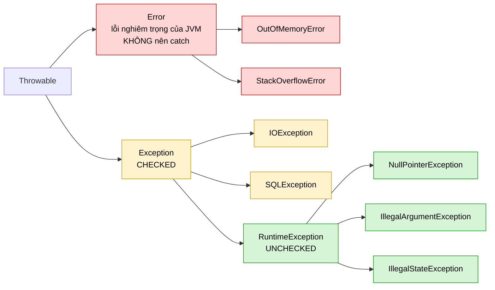

# Exception Handling

> **Tuần 1 · Ngày 3** · Thuộc [[02 - Java Core, Collections & Stream API]] · Bài trước: [[02.02 - equals, hashCode & String]] · Bài sau: [[02.04 - HashMap Internals]]
> Mỗi chủ đề gồm: **Hiểu bản chất → Code minh hoạ → Bẫy hay gặp → Trả lời mẫu (~60 giây) → Câu hỏi xoáy**.
> Toàn bộ output trong bài đã được chạy thử trên JDK 21.

**Mục lục**
1. [[#1. Cây phân cấp exception|Cây phân cấp exception]]
2. [[#2. Checked vs Unchecked: khi nào dùng loại nào|Checked vs Unchecked: khi nào dùng loại nào]]
3. [[#3. try, catch, finally: thứ tự chạy và bẫy|try, catch, finally: thứ tự chạy và bẫy]]
4. [[#4. try-with-resources|try-with-resources]]
5. [[#5. Thiết kế custom exception trong dự án Spring|Thiết kế custom exception trong dự án Spring]]
6. [[#6. Anti-pattern hay gặp|Anti-pattern hay gặp]]
7. [[#7. final, finally, finalize|final, finally, finalize]]
8. [[#8. Kịch bản Feynman hôm nay|Kịch bản Feynman hôm nay]]

---

## 1. Cây phân cấp exception



🟥 Error · 🟨 Checked · 🟩 Unchecked

- Chỉ `Throwable` và các class con của nó mới `throw` được.
- **Checked** = `Exception` và mọi class con của nó, **trừ** nhánh `RuntimeException`.
- **Unchecked** = `RuntimeException` (và con của nó) cộng với `Error`.

---

## 2. Checked vs Unchecked: khi nào dùng loại nào

### Hiểu bản chất

| | Checked | Unchecked |
|---|---|---|
| Compiler bắt buộc | **Có**: phải `catch` hoặc khai báo `throws` | Không |
| Ý nghĩa | Tình huống **bên ngoài, có thể dự đoán và phục hồi** (file không tồn tại, mất kết nối) | **Lỗi lập trình** hoặc **vi phạm nghiệp vụ** (null, tham số sai, trạng thái sai) |
| Ví dụ | `IOException`, `SQLException`, `InterruptedException` | `NullPointerException`, `IllegalArgumentException`, custom `BusinessException` |

### Thực tế trong các dự án Spring hiện đại

**Xu hướng chung là dùng unchecked exception.**
- Checked exception buộc mọi tầng trung gian phải khai báo `throws` hoặc bắt rồi bọc lại, khiến code rườm rà, và **không dùng được trong lambda/stream** (các functional interface như `Function` không khai báo `throws`).
- Spring tự bọc lỗi DB (`SQLException` là checked) thành `DataAccessException` (unchecked).
- **Điểm nối quan trọng với Tuần 5:** `@Transactional` mặc định **chỉ rollback khi gặp unchecked exception**. Ném checked exception thì transaction vẫn **commit**. Đây là một lý do nữa để custom exception nghiệp vụ nên `extends RuntimeException`.

### Code minh hoạ: checked exception trong lambda

```java
// ❌ Không compile: Files.readString ném IOException (checked) nhưng Function.apply không khai báo throws
List<String> contents = paths.stream().map(p -> Files.readString(p)).toList();

// ✓ Bọc thành unchecked
List<String> contents = paths.stream().map(p -> {
    try { return Files.readString(p); }
    catch (IOException e) { throw new UncheckedIOException(e); }
}).toList();
```

> **Trả lời mẫu:** "Checked exception là `Exception` và các class con ngoại trừ `RuntimeException`; compiler bắt buộc phải catch hoặc khai báo throws. Nó dành cho tình huống bên ngoài có thể phục hồi như IO, network. Unchecked là `RuntimeException`, dùng cho lỗi lập trình hoặc vi phạm nghiệp vụ. Trong dự án Spring em ưu tiên unchecked: checked làm code rườm rà, không dùng được trong lambda, và quan trọng là `@Transactional` mặc định chỉ rollback với unchecked. Ném checked thì transaction vẫn commit. Vì vậy custom exception nghiệp vụ của em đều extends `RuntimeException`."

### Câu hỏi xoáy

**Q1.** Có nên catch `Error` (ví dụ `OutOfMemoryError`) không?
> [!success]- Gợi ý trả lời
> Nói chung là **không**. Khi đó JVM đang ở trạng thái không đáng tin cậy, cách đúng là để process chết, ghi heap dump (`-XX:+HeapDumpOnOutOfMemoryError`) rồi điều tra. Ngoại lệ hiếm: framework ở tầng ngoài cùng bắt `Throwable` để log trước khi dừng.

**Q2.** `InterruptedException` nên xử lý thế nào?
> [!success]- Gợi ý trả lời
> Không nuốt im lặng. Hoặc ném tiếp lên, hoặc **khôi phục cờ interrupt**: `Thread.currentThread().interrupt();` rồi kết thúc công việc. Nếu nuốt mất, code bên ngoài sẽ không biết thread đã được yêu cầu dừng.

---

## 3. try, catch, finally: thứ tự chạy và bẫy

### Quy tắc
- `finally` **luôn chạy** sau `try`/`catch`, kể cả khi có `return` hay exception. Ngoại lệ: `System.exit()`, JVM crash, hoặc thread bị kill.
- Có nhiều `catch` thì **exception cụ thể đặt trước**, tổng quát đặt sau. Đặt ngược thì lỗi biên dịch (*exception has already been caught*).
- **Multi-catch** (Java 7): `catch (IOException | SQLException e)`.

### Bẫy 1: return trong finally ghi đè kết quả và nuốt exception

```java
static int returnInFinally() {
    try { return 1; }
    finally { return 2; }          // ⚠ ghi đè giá trị return của try
}
// returnInFinally() → 2

static int swallowed() {
    try { throw new IllegalStateException("lỗi quan trọng"); }
    finally { return 0; }          // ⚠ exception BIẾN MẤT, bên gọi nhận 0 như thể không có gì
}
// swallowed() → 0, không có exception nào được ném ra
```

**Không bao giờ `return` hay `throw` trong `finally`.** `finally` chỉ nên dùng để dọn dẹp tài nguyên.

### Bẫy 2: finally không làm thay đổi giá trị đã return

```java
static int counter() {
    int x = 1;
    try { return x; }      // giá trị 1 được "chốt" để trả về ngay tại đây
    finally { x = 99; }    // sửa biến x nhưng không ảnh hưởng giá trị đã chốt
}
// counter() → 1
```

> **Trả lời mẫu:** "`finally` luôn chạy sau try/catch, kể cả khi có return hay exception, trừ khi gọi `System.exit` hoặc JVM crash. Hai bẫy cần nhớ: `return` trong `finally` sẽ ghi đè giá trị return của `try` và **nuốt mất exception**, nên tuyệt đối không return trong finally; và sửa biến trong finally không làm đổi giá trị đã được return. Finally chỉ dùng để dọn tài nguyên, mà từ Java 7 thì em dùng try-with-resources thay cho việc đó."

---

## 4. try-with-resources

### Hiểu bản chất
Mọi class implement `AutoCloseable` (connection, stream, file…) khai báo trong `try (...)` sẽ được **tự động `close()`** khi ra khỏi khối, dù có exception hay không.

- Nhiều resource thì được đóng theo **thứ tự ngược** với thứ tự mở.
- Nếu cả thân `try` lẫn `close()` đều ném exception: exception của **thân try là exception chính**, còn exception của `close()` được gắn vào dạng **suppressed** (`e.getSuppressed()`), nên **không bị mất**. Đây là điểm hơn hẳn so với tự viết `finally { close(); }`, vì cách đó làm exception lúc close **đè mất** exception gốc.

### Code minh hoạ

```java
static class Res implements AutoCloseable {
    private final String name;
    Res(String name) { this.name = name; System.out.println("open " + name); }
    @Override public void close() {
        System.out.println("close " + name);
        throw new IllegalStateException("close failed " + name);
    }
}

try (Res a = new Res("A"); Res b = new Res("B")) {
    throw new RuntimeException("body failed");
} catch (RuntimeException e) {
    System.out.println("main: " + e.getMessage());
    for (Throwable s: e.getSuppressed()) System.out.println("suppressed: " + s.getMessage());
}
```

Output:
```text
open A
open B
close B
close A
main: body failed
suppressed: close failed B
suppressed: close failed A
```

Dùng trong thực tế: `Connection`/`PreparedStatement`/`ResultSet` khi viết JDBC thuần, `InputStream`, `BufferedReader`, `ExecutorService` (Java 19+ là `AutoCloseable`).

> **Trả lời mẫu:** "try-with-resources tự động gọi `close()` cho mọi resource implement `AutoCloseable`, đóng theo thứ tự ngược với lúc mở. Điểm quan trọng là nếu cả thân try và close đều lỗi, exception của thân try được giữ làm exception chính, còn lỗi lúc close được gắn vào dạng suppressed. Còn tự viết `finally { close(); }` thì lỗi lúc close sẽ đè mất lỗi gốc, rất khó debug."

---

## 5. Thiết kế custom exception trong dự án Spring

### Mẫu phổ biến

```java
// Exception gốc của nghiệp vụ: unchecked, mang mã lỗi để client xử lý
public abstract class BusinessException extends RuntimeException {
    private final String errorCode;
    protected BusinessException(String errorCode, String message) {
        super(message);
        this.errorCode = errorCode;
    }
    public String getErrorCode() { return errorCode; }
}

public class ResourceNotFoundException extends BusinessException {
    public ResourceNotFoundException(String resource, Object id) {
        super("NOT_FOUND", resource + " " + id + " không tồn tại");
    }
}

public class InsufficientBalanceException extends BusinessException {
    public InsufficientBalanceException(BigDecimal balance, BigDecimal amount) {
        super("INSUFFICIENT_BALANCE", "Số dư " + balance + " không đủ để trừ " + amount);
    }
}
```

Sau đó map **tập trung** sang HTTP status bằng `@RestControllerAdvice`: `ResourceNotFoundException` thành 404, `BusinessException` thành 422 hoặc 400. Chi tiết ở [[04 - Spring Core, Boot & MVC]] câu 18.

### Exception chaining: luôn giữ lại nguyên nhân gốc

```java
try {
    paymentClient.charge(request);
} catch (IOException e) {
    throw new PaymentFailedException("Gọi cổng thanh toán thất bại", e);   // ✓ truyền e làm cause
    // throw new PaymentFailedException("Gọi cổng thanh toán thất bại");   // ❌ mất stack trace gốc
}
```

Khi đọc log sẽ thấy dòng `Caused by: java.io.IOException …`, nhờ vậy truy ra được lỗi thật.

---

## 6. Anti-pattern hay gặp

| Anti-pattern | Vì sao tệ | Cách đúng |
|---|---|---|
| **Nuốt exception**: `catch (Exception e) {}` | Lỗi biến mất, dữ liệu sai mà không ai biết | Xử lý thật, hoặc log rồi ném lại |
| **Catch quá rộng**: `catch (Exception e)` ở tầng giữa | Bắt nhầm cả bug lập trình (NPE) và xử lý như lỗi nghiệp vụ | Catch exception cụ thể; để handler tập trung bắt phần còn lại |
| **Log rồi ném lại** ở mọi tầng | Một lỗi bị in 5 lần trong log, rất rối | Hoặc log, hoặc ném; log **một lần** ở tầng ngoài cùng (`@RestControllerAdvice`) |
| **Mất cause** khi bọc | Mất stack trace gốc | `new XxxException("msg", e)` |
| **Dùng exception để điều khiển luồng** | Tạo exception tốn kém (thu thập stack trace), code khó đọc | Kiểm tra điều kiện trước (`Optional`, `if`) |
| `e.printStackTrace()` | Ghi ra stderr, không qua hệ thống log, mất traceId | `log.error("context…", e)` |
| Ném `Exception`/`RuntimeException` trần | Bên gọi không phân biệt được loại lỗi | Exception có tên rõ nghĩa |

> **Trả lời mẫu cho câu "Bạn xử lý exception trong dự án thế nào?":** "Em dùng unchecked exception cho nghiệp vụ, có một class gốc `BusinessException` mang mã lỗi, và các class con cụ thể như `ResourceNotFoundException`. Service chỉ ném exception, không tự bắt bừa. Ở tầng web có một `@RestControllerAdvice` map từng loại exception sang HTTP status và format lỗi thống nhất, đồng thời log **một lần** ở đó kèm traceId. Khi bọc exception kỹ thuật như IOException, em luôn truyền cause để giữ stack trace gốc. Em tránh nuốt exception và tránh catch `Exception` ở tầng giữa."

### Câu hỏi xoáy

**Q1.** Vì sao tạo exception lại tốn kém?
> [!success]- Gợi ý trả lời
> Constructor của `Throwable` gọi `fillInStackTrace()` để thu thập toàn bộ call stack, mà stack càng sâu (Spring có rất nhiều tầng proxy) thì càng tốn. Vì vậy không nên dùng exception cho luồng xử lý bình thường.

**Q2.** Method override có được ném checked exception rộng hơn method cha không?
> [!success]- Gợi ý trả lời
> Không. Chỉ được ném checked exception **bằng hoặc hẹp hơn**, hoặc không ném gì. Lý do là code gọi qua kiểu cha chỉ chuẩn bị xử lý những exception mà cha đã khai báo (xem [[02.01 - OOP & SOLID]] mục 5).

---

## 7. final, finally, finalize

Ba từ chỉ giống nhau về tên, hoàn toàn không liên quan đến nhau:

| | Là gì | Dùng để |
|---|---|---|
| `final` | **Keyword** | Biến: không gán lại được · Method: không override được · Class: không kế thừa được |
| `finally` | **Khối lệnh** sau `try` | Dọn dẹp, luôn chạy |
| `finalize()` | **Method** của `Object` | Từng được GC gọi trước khi thu hồi object. **Deprecated từ Java 9, đánh dấu for removal từ Java 18**: không đảm bảo thời điểm chạy, thậm chí có thể không chạy, gây chậm GC. Thay bằng try-with-resources hoặc `java.lang.ref.Cleaner` |

---

## 8. Kịch bản Feynman hôm nay

Gấp tài liệu lại, bật ghi âm, mỗi câu 2–3 phút:
1. "Checked khác unchecked exception thế nào? Dự án Spring nên dùng loại nào, vì sao?"
2. "try-with-resources có lợi gì so với tự đóng resource trong finally?"
3. "Bạn thiết kế và xử lý exception trong dự án như thế nào?"

Sau đó ghi vào [[08 - Nhật ký học tập]].

## Tự kiểm tra nhanh (không mở tài liệu)

- [ ] Vẽ cây Throwable → Error / Exception → RuntimeException
- [ ] `try { return 1; } finally { return 2; }` trả về gì? Exception trong try có bị mất không?
- [ ] Nhiều resource trong try-with-resources đóng theo thứ tự nào? Lỗi lúc close đi đâu?
- [ ] Vì sao checked exception không dùng được trực tiếp trong lambda?
- [ ] Liên hệ: checked exception với `@Transactional` thì commit hay rollback?
- [ ] Kể 4 anti-pattern xử lý exception
