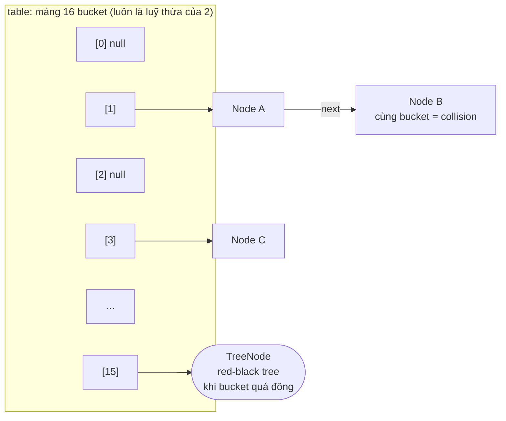

# HashMap Internals

> **Tuần 1 · Ngày 4** · Thuộc [[02 - Java Core, Collections & Stream API]] · Bài trước: [[02.03 - Exception Handling]] · Bài sau: [[02.05 - Collections Framework]]
> Đây là câu hỏi **gần như chắc chắn bị hỏi** ở level 2 năm. Học kỹ, tự vẽ lại sơ đồ `HashMap.put()` trong [[06 - Sơ đồ cơ chế cốt lõi]] (mục 6).
> Mọi con số trong bài đều đã được **đo thực tế trên JDK 21** bằng reflection.

**Mục lục**
1. [[#1. Cấu trúc bên trong|Cấu trúc bên trong]]
2. [[#2. Từ key đến bucket: hash() và index|Từ key đến bucket: hash() và index]]
3. [[#3. put() và get() chạy thế nào|put() và get() chạy thế nào]]
4. [[#4. Collision và treeify|Collision và treeify]]
5. [[#5. Resize|Resize]]
6. [[#6. null key, thứ tự duyệt, thread-safety|null key, thứ tự duyệt, thread-safety]]
7. [[#7. Bẫy: key bị thay đổi sau khi put|Bẫy: key bị thay đổi sau khi put]]
8. [[#8. Trả lời mẫu tổng hợp|Trả lời mẫu tổng hợp]]
9. [[#9. Câu hỏi xoáy|Câu hỏi xoáy]]

---

## 1. Cấu trúc bên trong

![[hashmap-buckets.svg]]



Mỗi phần tử trong `table` là một **bucket**. Mỗi `Node` lưu 4 thứ:

```java
static class Node<K,V> {
    final int hash;     // hash đã tính sẵn, để khỏi tính lại khi so sánh hay resize
    final K key;
    V value;
    Node<K,V> next;     // trỏ sang node tiếp theo trong cùng bucket
}
```

`HashSet` bên trong chính là một `HashMap`: phần tử của set là **key**, value là một object giả dùng chung (`PRESENT`).

---

## 2. Từ key đến bucket: hash() và index

### Bước 1: trộn bit của hashCode

```java
static final int hash(Object key) {
    int h;
    return (key == null) ? 0: (h = key.hashCode()) ^ (h >>> 16);
}
```

**Vì sao phải trộn?** Bước sau chỉ dùng **vài bit thấp** của hash để chọn bucket (table 16 ô thì chỉ dùng 4 bit cuối). Nếu nhiều key có hashCode chỉ khác nhau ở **bit cao**, chúng sẽ dồn vào cùng bucket. Phép `h ^ (h >>> 16)` kéo 16 bit cao xuống trộn vào 16 bit thấp, nên **bit cao cũng ảnh hưởng tới vị trí bucket**.

### Bước 2: tính index

```java
index = (n - 1) & hash      // n = độ dài table
```

Với `n = 16`: `n - 1 = 15 = 0b1111`, nên phép AND giữ lại **4 bit cuối** của hash, cho kết quả từ 0 đến 15.

**Vì sao capacity luôn là luỹ thừa của 2?**
- Khi `n` là luỹ thừa của 2, `(n - 1) & hash` cho **cùng kết quả với `hash % n`** (với hash không âm) nhưng **nhanh hơn nhiều**, vì AND bit rẻ hơn phép chia.
- Mọi bit của `n - 1` đều là 1, nên các bucket được dùng đều nhau.
- Resize gấp đôi rất rẻ (xem mục 5).

Vì vậy dù bạn truyền `new HashMap<>(10)`, HashMap vẫn làm tròn lên **16**.

Ví dụ thực tế (đã chạy):
```java
int h = "hello".hashCode();          // 99162322
int spread = h ^ (h >>> 16);         // 99163451
int index = 15 & spread;             // 11 → "hello" nằm ở bucket 11 khi table có 16 ô
```

---

## 3. put() và get() chạy thế nào

### put(key, value)

1. **Lần put đầu tiên** mới tạo `table` (lazy init). Map mới tạo chưa tốn bộ nhớ cho mảng.
2. Tính `hash(key)`, rồi `index = (n - 1) & hash`.
3. Bucket **rỗng**: tạo `Node` mới đặt vào.
4. Bucket **đã có node**: duyệt các node trong bucket:
   - Gặp node có `hash` bằng nhau **và** (`key == k` hoặc `key.equals(k)`): **ghi đè value** và **trả về value cũ**.
   - Không gặp: thêm node mới vào **cuối** list (hoặc vào tree).
   - Nếu list **vượt quá 8 node** (vừa thêm node thứ 9) thì xét **treeify** (mục 4).
5. Tăng `size`. Nếu `size > threshold` (= capacity × load factor) thì **resize**.

```java
Map<String, Integer> map = new HashMap<>();
System.out.println(map.put("k", 1));   // null: trước đó chưa có
System.out.println(map.put("k", 2));   // 1: trả về value cũ, value mới là 2
```

### get(key)
Tính hash → tìm bucket → duyệt list hoặc tree, so sánh `hash` trước (rẻ) rồi mới `equals` (đắt hơn) → trả value hoặc `null`.

**Đây là lý do contract equals/hashCode quan trọng** ([[02.02 - equals, hashCode & String]]): `hashCode` dẫn tới đúng bucket, `equals` chọn đúng node.

### Độ phức tạp

| | Trung bình | Xấu nhất (mọi key cùng bucket) |
|---|---|---|
| `get`/`put`/`remove` | **O(1)** | O(n) nếu bucket là list · **O(log n)** nếu bucket đã treeify (Java 8+) |

---

## 4. Collision và treeify

**Collision** xảy ra khi nhiều key khác nhau rơi vào cùng bucket. Collision **không làm sai kết quả**, chỉ làm **chậm**, vì phải duyệt nhiều node hơn.

Ví dụ (đã chạy): 1000 key **cùng `hashCode() = 42`** vẫn cho kết quả đúng (`size = 1000`, `get` tìm đúng), chỉ là tất cả dồn vào **một bucket**.

### Treeify (Java 8)
Khi một bucket quá đông, linked list (tìm kiếm O(n)) được chuyển thành **red-black tree** (O(log n)):

| Ngưỡng | Giá trị | Ý nghĩa |
|---|---|---|
| `TREEIFY_THRESHOLD` | **8** | Bucket **vượt quá 8** node, tức lúc thêm node thứ 9, thì xét chuyển thành tree |
| `MIN_TREEIFY_CAPACITY` | **64** | Nhưng nếu table **< 64 ô** thì **resize** thay vì treeify, vì table còn nhỏ nên giãn ra sẽ tự giảm collision |
| `UNTREEIFY_THRESHOLD` | **6** | Tree còn ≤ 6 node (ví dụ sau khi resize tách bucket) thì chuyển lại thành list |

Đo thực tế trên JDK 21, dồn các key có cùng hashCode vào một bucket:

| Kích thước table | Node thứ 1–8 | Node thứ 9 | Node thứ 10 | Node thứ 11 |
|---|---|---|---|---|
| 64 ô | list | **→ TreeNode** | TreeNode | TreeNode |
| 16 ô | list | resize lên 32 | resize lên 64 | **→ TreeNode** |

Câu trả lời ngắn khi phỏng vấn: **"bucket vượt quá 8 node và table ≥ 64 thì treeify"**.

**Vì sao chọn 8?** Với hàm hash tốt, số node trong một bucket tuân theo phân phối Poisson; xác suất một bucket có tới 8 node là khoảng **6 phần trăm triệu**. Treeify vì vậy gần như chỉ xảy ra khi hashCode **tệ** hoặc bị **cố tình tấn công** (hash flooding: kẻ tấn công gửi hàng loạt key cùng hash để làm server chậm). Đó là một lớp phòng thủ, không phải trường hợp thường gặp.

**Vì sao 8 lên mà 6 mới xuống?** Khoảng đệm giữa 6 và 8 tránh việc chuyển qua lại liên tục khi số node dao động quanh một ngưỡng.

---

## 5. Resize

### Khi nào resize?
`threshold = capacity × loadFactor`. Mặc định `16 × 0.75 = 12`, nên **phần tử thứ 13** sẽ kích hoạt resize lên **32** (threshold mới là 24).

Đã đo thực tế:

| Thời điểm | Capacity | Threshold |
|---|---|---|
| `new HashMap<>()` | 0 (chưa tạo table) | chưa có |
| Sau `put` thứ 1 | 16 | 12 |
| Sau `put` thứ 12 | 16 | 12 |
| Sau `put` thứ 13 | **32** | 24 |
| `new HashMap<>(10)` + 1 `put` | 16 (làm tròn lên) | 12 |

### Resize làm gì?
1. Tạo table mới **gấp đôi**.
2. Chuyển từng node sang table mới. Java 8 có một mẹo: **không cần tính lại index từ đầu**. Mỗi node chỉ có 2 khả năng:
   - **Ở nguyên index cũ** `i`, nếu `(hash & oldCap) == 0`
   - **Chuyển sang** `i + oldCap`, nếu `(hash & oldCap) != 0`

Ví dụ: hash 5 và 21 đều ở bucket 5 khi capacity 16. Sau resize lên 32: hash 5 ở lại bucket **5**, hash 21 chuyển sang bucket **21** (= 5 + 16).

### Load factor 0.75: vì sao?
- **Lớn hơn** (ví dụ 1.0): tiết kiệm bộ nhớ nhưng nhiều collision hơn, tra cứu chậm hơn.
- **Nhỏ hơn** (ví dụ 0.5): ít collision nhưng tốn bộ nhớ và resize nhiều hơn.
- 0.75 là điểm cân bằng giữa thời gian và bộ nhớ.

### Biết trước số phần tử → khai báo capacity

Resize tốn chi phí (cấp phát mảng mới, chuyển toàn bộ node). Đổ 100 phần tử vào map mặc định sẽ resize **4 lần** (16 → 32 → 64 → 128 → 256).

```java
// Java 19+: tự tính capacity đủ chứa, không resize giữa chừng
Map<Long, User> byId = HashMap.newHashMap(users.size());
// Java cũ: new HashMap<>((int) (expected / 0.75f) + 1)
```

Lưu ý: `new HashMap<>(100)` **không** có nghĩa là "chứa được 100 phần tử mà không resize". Đó là capacity, và threshold chỉ bằng 75% capacity.

---

## 6. null key, thứ tự duyệt, thread-safety

- **null key:** cho phép **đúng 1** key `null`. `hash(null) = 0` nên luôn nằm ở **bucket 0**. Value `null` thì không giới hạn. (`Hashtable` và `ConcurrentHashMap` **không** cho null; `Hashtable.put(null, …)` ném NPE.)
- **Thứ tự duyệt không được đảm bảo**, và có thể **thay đổi sau resize**. Cần thứ tự chèn thì dùng `LinkedHashMap`; cần sắp xếp thì dùng `TreeMap` ([[02.05 - Collections Framework]]).
- **Không thread-safe:**
  - Nhiều thread `put` cùng lúc có thể **mất dữ liệu** (hai thread cùng ghi vào một bucket rỗng, một bên đè bên kia) và `size` sai.
  - Java 7 chèn node vào **đầu** list, nên resize đồng thời có thể tạo **vòng lặp vô hạn** (CPU 100%). Java 8 chèn vào **cuối** nên hết lỗi này, nhưng vẫn **không an toàn**.
  - Dùng `ConcurrentHashMap` khi có nhiều thread (học ở Tuần 3).

---

## 7. Bẫy: key bị thay đổi sau khi put

```java
Map<List<String>, String> map = new HashMap<>();
List<String> key = new ArrayList<>(List.of("a"));
map.put(key, "value");

key.add("b");                                 // sửa key SAU khi đã put → hashCode của key thay đổi

System.out.println(map.get(key));             // null: hash mới dẫn tới bucket khác
System.out.println(map.containsKey(key));     // false
System.out.println(map.size());               // 1: entry vẫn nằm trong map
System.out.println(map.get(List.of("a")));    // null: đúng bucket cũ nhưng equals không còn khớp
```

Entry bị **"mất tích"**: vẫn chiếm bộ nhớ nhưng không bao giờ lấy ra được nữa, dẫn tới **memory leak**.

**Quy tắc:** key của HashMap (và phần tử của HashSet) phải là **immutable**, hoặc ít nhất các field dùng trong `hashCode`/`equals` không bao giờ thay đổi. Key tốt: `String`, `Integer`, `Long`, `UUID`, enum, `record` có field immutable.

Bẫy tương tự với **JPA entity** dùng `id` sinh tự động trong `hashCode`: trước khi persist `id = null`, sau khi persist `id` có giá trị, nên entity đã bỏ vào `HashSet` sẽ bị "mất tích" (xem [[05 - Transaction & JPA]] câu 21).

---

## 8. Trả lời mẫu tổng hợp

> **"HashMap hoạt động như thế nào?" (~90 giây)**
> "Bên trong HashMap là một mảng bucket có độ dài luôn là luỹ thừa của 2. Khi `put`, nó lấy `hashCode` của key, trộn 16 bit cao xuống bit thấp, rồi tính index bằng `(n - 1) & hash`, tương đương phép chia lấy dư nhưng nhanh hơn. Bucket rỗng thì đặt node vào; nếu đã có node thì duyệt và so `hash` rồi `equals`: trùng key thì ghi đè value, không trùng thì nối vào cuối list. Đó là lý do phải override equals và hashCode cùng nhau.
> Từ Java 8, khi một bucket vượt quá 8 node và table từ 64 ô trở lên thì list chuyển thành red-black tree, nên trường hợp xấu nhất còn O(log n) thay vì O(n).
> Khi số phần tử vượt capacity nhân load factor 0.75 thì resize gấp đôi; mặc định là lúc thêm phần tử thứ 13. Khi resize, mỗi node hoặc ở nguyên index hoặc chuyển sang index cộng capacity cũ.
> HashMap cho một key null, không đảm bảo thứ tự duyệt, và không thread-safe; nhiều thread thì em dùng ConcurrentHashMap. Trong thực tế em lưu ý key phải immutable, và khi biết trước số phần tử thì khai báo capacity để tránh resize."

---

## 9. Câu hỏi xoáy

**Q1.** Nếu mọi key có cùng `hashCode` thì HashMap còn đúng không? Hiệu năng ra sao?
> [!success]- Gợi ý trả lời
> **Vẫn đúng**, vì `equals` phân biệt các key. Nhưng tất cả dồn vào một bucket: trước Java 8 tra cứu là O(n); từ Java 8 bucket được treeify nên còn O(log n). Nếu key implement `Comparable`, tree tận dụng `compareTo` để sắp xếp nên tìm kiếm hiệu quả hơn.

**Q2.** Vì sao bucket chuyển thành tree mà không dùng tree ngay từ đầu?
> [!success]- Gợi ý trả lời
> `TreeNode` tốn **gấp khoảng đôi bộ nhớ** so với `Node` thường, và với vài phần tử thì duyệt list nhanh hơn. Với hash tốt, bucket hầu như chỉ có 0–2 node, nên tree chỉ đáng dùng khi bucket bất thường đông.

**Q3.** Vì sao table < 64 thì resize thay vì treeify?
> [!success]- Gợi ý trả lời
> Khi table còn nhỏ, bucket đông thường là do **thiếu chỗ** chứ không phải do hash tệ. Giãn table ra sẽ tự phân tán node và rẻ hơn việc dựng tree.

**Q4.** `new HashMap<>(1000)` có cho capacity đúng 1000 không? Chứa 1000 phần tử có bị resize không?
> [!success]- Gợi ý trả lời
> Capacity được làm tròn lên luỹ thừa của 2 là **1024**, threshold = 1024 × 0.75 = **768**, nên phần tử thứ 769 sẽ gây resize. Muốn chứa 1000 phần tử không resize thì dùng `HashMap.newHashMap(1000)` (Java 19+) hoặc tự tính `1000 / 0.75 + 1`.

**Q5.** HashMap khác Hashtable thế nào?
> [!success]- Gợi ý trả lời
> `Hashtable` là class cũ (Java 1.0): mọi method `synchronized` (khoá cả map, nên chậm), **không cho null** key/value, không có treeify. `HashMap` không đồng bộ, cho 1 null key. Ngày nay không dùng `Hashtable`; cần thread-safe thì dùng `ConcurrentHashMap`.

**Q6.** Vì sao Java 8 đổi từ chèn đầu list sang chèn cuối list?
> [!success]- Gợi ý trả lời
> Chèn đầu khi resize **đảo ngược thứ tự** node trong bucket. Nếu hai thread resize đồng thời, các node có thể trỏ vòng vào nhau, tạo **vòng lặp vô hạn** khi `get` (CPU 100%). Chèn cuối giữ nguyên thứ tự nên loại bỏ lỗi này, dù HashMap vẫn không thread-safe.

---

## Kịch bản Feynman hôm nay

1. **Vẽ lại sơ đồ `put()` ra giấy** (không nhìn [[06 - Sơ đồ cơ chế cốt lõi]]), rồi đối chiếu.
2. Ghi âm câu trả lời "HashMap hoạt động như thế nào?" trong tối đa 2 phút, phải có đủ: bucket → hash/index → equals → treeify 8/64 → resize 0.75 → không thread-safe.
3. Giải thích bằng lời vì sao key bị sửa sau khi `put` thì "mất tích".

Ghi vào [[08 - Nhật ký học tập]].

## Tự kiểm tra nhanh (không mở tài liệu)

- [ ] Vì sao capacity luôn là luỹ thừa của 2?
- [ ] `hash ^ (hash >>> 16)` để làm gì?
- [ ] Map mặc định resize ở phần tử thứ mấy? Lên capacity bao nhiêu?
- [ ] 3 ngưỡng 8 / 64 / 6 nghĩa là gì?
- [ ] Khi resize, một node có thể đi đâu?
- [ ] `put` trả về gì?
- [ ] Vì sao key phải immutable?
- [ ] HashMap vs Hashtable: 3 điểm khác
