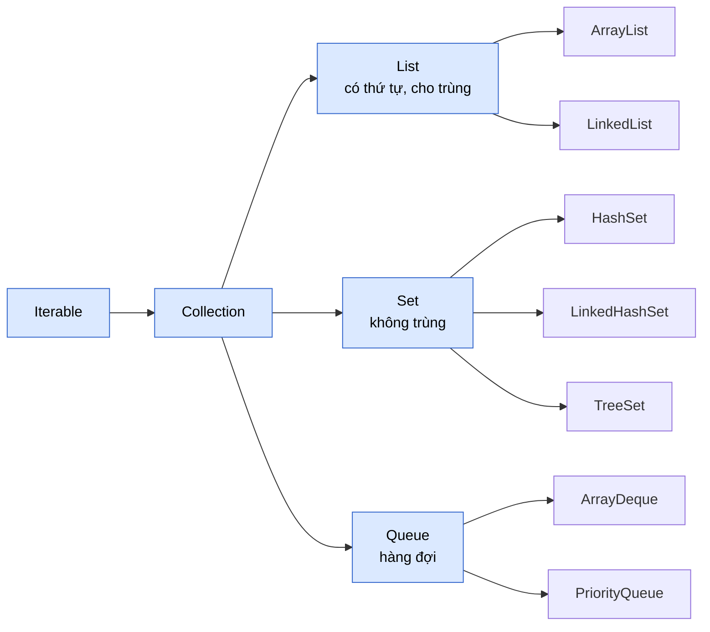
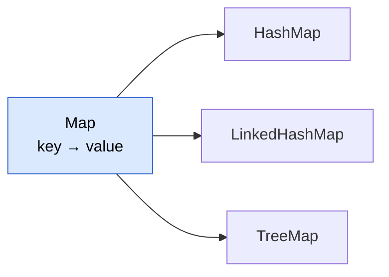

# Collections Framework

> **Tuần 1 · Ngày 5** · Thuộc [[02 - Java Core, Collections & Stream API]] · Bài trước: [[02.04 - HashMap Internals]]
> Mỗi chủ đề gồm: **Hiểu bản chất → Code minh hoạ → Bẫy hay gặp → Trả lời mẫu → Câu hỏi xoáy**.
> Toàn bộ output trong bài đã được chạy thử trên JDK 21.

**Mục lục**
1. [[#1. Bản đồ Collections: chọn cấu trúc nào|Bản đồ Collections: chọn cấu trúc nào]]
2. [[#2. ArrayList vs LinkedList|ArrayList vs LinkedList]]
3. [[#3. Set: HashSet, LinkedHashSet, TreeSet|Set: HashSet, LinkedHashSet, TreeSet]]
4. [[#4. LinkedHashMap và TreeMap|LinkedHashMap và TreeMap]]
5. [[#5. Queue, Deque, PriorityQueue|Queue, Deque, PriorityQueue]]
6. [[#6. Fail-fast và ConcurrentModificationException|Fail-fast và ConcurrentModificationException]]
7. [[#7. Comparable vs Comparator|Comparable vs Comparator]]
8. [[#8. List.of vs Arrays.asList vs unmodifiableList|List.of vs Arrays.asList vs unmodifiableList]]
9. [[#9. Kịch bản Feynman hôm nay|Kịch bản Feynman hôm nay]]

---

## 1. Bản đồ Collections: chọn cấu trúc nào



`Map` là một nhánh **riêng**, không kế thừa `Collection` (vì lưu cặp key → value chứ không phải từng phần tử):



🟦 Interface · còn lại là class implementation

**Bảng chọn nhanh, dùng cả khi trả lời phỏng vấn lẫn khi code:**

| Bạn cần | Dùng |
|---|---|
| Danh sách thông thường | `ArrayList` |
| Loại trùng, không quan tâm thứ tự | `HashSet` |
| Loại trùng, **giữ thứ tự chèn** | `LinkedHashSet` |
| Loại trùng, **luôn sắp xếp** / tìm theo khoảng | `TreeSet` |
| Tra cứu key → value | `HashMap` |
| Key → value, **giữ thứ tự chèn** / làm **LRU cache** | `LinkedHashMap` |
| Key → value **sắp xếp theo key** / tìm "gần nhất" | `TreeMap` |
| Stack hoặc queue | `ArrayDeque` |
| Luôn lấy phần tử nhỏ nhất/lớn nhất, top-K | `PriorityQueue` |
| Nhiều thread cùng truy cập | `ConcurrentHashMap`, `CopyOnWriteArrayList`… (Tuần 3) |

---

## 2. ArrayList vs LinkedList

### Hiểu bản chất
- **ArrayList**: bên trong là **mảng** `Object[]`. Phần tử nằm liền nhau trong bộ nhớ.
- **LinkedList**: **danh sách liên kết đôi**. Mỗi phần tử là một node riêng có con trỏ `prev` và `next`.

| Thao tác | ArrayList | LinkedList |
|---|---|---|
| `get(i)` | **O(1)**: tính thẳng vị trí trong mảng | O(n): phải đi từng node |
| Thêm cuối | O(1) amortized (thỉnh thoảng phải nới mảng) | O(1) |
| Thêm/xoá ở giữa | O(n): dịch các phần tử phía sau | O(n) để **tìm tới** vị trí, rồi O(1) để nối lại |
| Bộ nhớ | Gọn | Mỗi phần tử thêm 1 object node + 2 con trỏ |

### ArrayList tăng kích thước thế nào (đã đo thực tế)

| Thời điểm | Capacity |
|---|---|
| `new ArrayList<>()` | 0 (chưa cấp phát) |
| `add` phần tử thứ 1 | 10 |
| `add` phần tử thứ 11 | **15** (10 + 10/2) |
| `add` phần tử thứ 16 | **22** (15 + 15/2) |

Mỗi lần đầy, capacity tăng **khoảng 1.5 lần** (`old + old >> 1`) và **toàn bộ mảng được copy** sang mảng mới. Biết trước số phần tử thì khai báo `new ArrayList<>(expectedSize)` để tránh copy nhiều lần.

### Vì sao thực tế hầu như luôn dùng ArrayList?
- "LinkedList thêm/xoá giữa nhanh hơn" chỉ đúng khi **đã đứng sẵn** ở vị trí đó (qua `ListIterator`). Nếu phải `get(i)` để tìm tới thì vẫn mất O(n).
- Mảng nằm liền nhau nên **tận dụng CPU cache** rất tốt. LinkedList nhảy lung tung trong bộ nhớ nên chậm hơn nhiều, ngay cả ở các thao tác mà lý thuyết nói là bằng nhau.
- Cần stack hoặc queue thì `ArrayDeque` nhanh hơn `LinkedList`.

### Bẫy: `remove(int)` và `remove(Object)` với `List<Integer>`

```java
List<Integer> list = new ArrayList<>(List.of(10, 20, 30));
list.remove(1);                    // xoá theo INDEX 1    → [10, 30]
list.remove(Integer.valueOf(10));  // xoá theo GIÁ TRỊ 10 → [30]
```

`remove(1)` khớp chính xác với `remove(int index)`, nên compiler chọn bản theo index (nhớ lại thứ tự overload resolution ở [[02.01 - OOP & SOLID]] mục 5).

> **Trả lời mẫu:** "ArrayList dùng mảng động: `get` theo index là O(1), thêm cuối O(1) amortized, và khi đầy thì tăng khoảng 1.5 lần rồi copy mảng. LinkedList là danh sách liên kết đôi: `get` là O(n). Nhiều người nói LinkedList thêm/xoá giữa nhanh hơn, nhưng phải tìm tới vị trí đó mất O(n), và LinkedList không tận dụng được CPU cache. Vì vậy thực tế em gần như luôn dùng ArrayList, khai báo capacity nếu biết trước kích thước; cần stack hay queue thì dùng ArrayDeque."

---

## 3. Set: HashSet, LinkedHashSet, TreeSet

| | HashSet | LinkedHashSet | TreeSet |
|---|---|---|---|
| Bên trong | `HashMap` | `LinkedHashMap` | `TreeMap` (red-black tree) |
| Thứ tự duyệt | Không đảm bảo | **Thứ tự chèn** | **Sắp xếp** |
| add/contains/remove | O(1) | O(1) | O(log n) |
| null | 1 phần tử null | 1 phần tử null | ✗ với thứ tự tự nhiên (NPE khi so sánh) |
| Xác định trùng bằng | `hashCode` + `equals` | `hashCode` + `equals` | **`compareTo`/`Comparator`** (không dùng equals!) |

### Bẫy: TreeSet xác định trùng bằng Comparator

```java
Set<String> set = new TreeSet<>(String.CASE_INSENSITIVE_ORDER);
set.add("Java");
set.add("JAVA");
System.out.println(set.size());   // 1: comparator coi "Java" và "JAVA" là bằng nhau
```

`TreeSet`/`TreeMap` coi hai phần tử là trùng khi `compare(a, b) == 0`, **không gọi `equals`**. Nếu comparator **không nhất quán với `equals`**, phần tử có thể "biến mất" một cách bất ngờ.

---

## 4. LinkedHashMap và TreeMap

### LinkedHashMap: HashMap + thứ tự

Là `HashMap` có thêm một **linked list đôi** nối các entry, nhờ vậy giữ được thứ tự:
- Mặc định là **thứ tự chèn**: `put("z"), put("a"), put("m")` thì duyệt ra `[z, a, m]`.
- Constructor với `accessOrder = true`: thứ tự theo **lần truy cập gần nhất**, đây là nền tảng của **LRU cache**.

### Cài LRU cache trong vài dòng (câu hỏi phỏng vấn kinh điển)

```java
class LruCache<K, V> extends LinkedHashMap<K, V> {
    private final int maxSize;

    LruCache(int maxSize) {
        super(16, 0.75f, true);              // true = sắp xếp theo thứ tự TRUY CẬP
        this.maxSize = maxSize;
    }

    @Override
    protected boolean removeEldestEntry(Map.Entry<K, V> eldest) {
        return size() > maxSize;             // vượt sức chứa → tự xoá phần tử lâu nhất không dùng
    }
}

LruCache<String, Integer> cache = new LruCache<>(3);
cache.put("a", 1); cache.put("b", 2); cache.put("c", 3);
cache.get("a");                 // "a" vừa được dùng → chuyển về cuối (mới nhất)
cache.put("d", 4);              // vượt 3 → xoá phần tử lâu nhất không dùng là "b"
System.out.println(cache.keySet());   // [c, a, d]
```

Lưu ý: class này **không thread-safe**. Trong production nên dùng thư viện cache như **Caffeine** (có giới hạn kích thước, TTL, thread-safe).

### TreeMap: map sắp xếp theo key, tìm "gần nhất"

```java
TreeMap<Integer, String> prices = new TreeMap<>(Map.of(10, "10đ", 20, "20đ", 30, "30đ"));
prices.floorKey(25);     // 20: key lớn nhất ≤ 25
prices.ceilingKey(25);   // 30: key nhỏ nhất ≥ 25
prices.headMap(20);      // {10=10đ}: các key < 20
prices.firstKey();       // 10
```

Use case thực tế: bảng giá hay thuế theo bậc (tìm bậc áp dụng bằng `floorKey`), lịch theo thời gian, xếp hạng.

---

## 5. Queue, Deque, PriorityQueue

### ArrayDeque: stack và queue

```java
Deque<Integer> stack = new ArrayDeque<>();
stack.push(1); stack.push(2);
stack.pop();                     // 2: LIFO

Deque<Integer> queue = new ArrayDeque<>();
queue.offer(1); queue.offer(2);
queue.poll();                    // 1: FIFO
```

- Thay thế cho class `Stack` cũ (kế thừa `Vector`, mọi method synchronized nên chậm) và nhanh hơn `LinkedList`.
- `ArrayDeque` **không cho phần tử null** (ném NPE), vì `null` được dùng làm tín hiệu "rỗng" khi `poll`.

### PriorityQueue: luôn lấy ra phần tử nhỏ nhất (min-heap)

Bên trong là **binary heap**: `offer`/`poll` là O(log n), `peek` là O(1). Mặc định lấy **nhỏ nhất** trước; dùng `Comparator.reverseOrder()` để lấy lớn nhất trước.

**Bài kinh điển: top-K phần tử lớn nhất.** Giữ một min-heap kích thước K, và khi vượt K thì bỏ phần tử nhỏ nhất:

```java
int[] nums = {5, 1, 9, 3, 7, 8, 2};
PriorityQueue<Integer> heap = new PriorityQueue<>();      // min-heap
for (int n: nums) {
    heap.offer(n);
    if (heap.size() > 3) heap.poll();                      // bỏ phần tử nhỏ nhất
}
// heap chứa 3 phần tử lớn nhất: 9, 8, 7: O(n log k) thay vì sort toàn bộ O(n log n)
```

Lưu ý: duyệt `PriorityQueue` bằng for-each **không** ra thứ tự sắp xếp. Chỉ `poll()` lần lượt mới ra đúng thứ tự.

---

## 6. Fail-fast và ConcurrentModificationException

### Hiểu bản chất
`ArrayList`, `HashMap`… có một bộ đếm `modCount`, tăng mỗi khi cấu trúc collection thay đổi (thêm/xoá). Iterator ghi nhớ giá trị `modCount` lúc được tạo; mỗi lần `next()` nó kiểm tra lại, và nếu thấy khác thì ném **`ConcurrentModificationException`** ngay. Đó là **fail-fast**: báo lỗi sớm thay vì chạy tiếp với dữ liệu sai.

Lưu ý: tên "Concurrent" dễ gây hiểu lầm. Lỗi này xảy ra **ngay cả với 1 thread** khi bạn sửa collection lúc đang duyệt.

### Code minh hoạ

```java
List<String> names = new ArrayList<>(List.of("an", "", "binh", ""));

for (String s: names) {
    if (s.isBlank()) names.remove(s);       // ❌ ConcurrentModificationException
}

names.removeIf(String::isBlank);            // ✓ cách gọn nhất → [an, binh]

Iterator<String> it = names.iterator();     // ✓ xoá qua chính iterator
while (it.hasNext()) {
    if (it.next().isBlank()) it.remove();
}
```

### Bẫy: không phải lúc nào cũng ném CME

```java
List<String> list = new ArrayList<>(List.of("a", "b", "c"));
for (String s: list) {
    if (s.equals("b")) list.remove(s);      // xoá phần tử ÁP CHÓT
}
System.out.println(list);                   // [a, c]: KHÔNG có exception!
```

Sau khi xoá "b", size còn 2 và con trỏ của iterator cũng đang ở 2, nên `hasNext()` trả `false` và vòng lặp dừng trước khi kịp kiểm tra `modCount`, đồng thời **bỏ qua luôn "c"**. Fail-fast chỉ là **"cố gắng hết sức"**, không phải đảm bảo, nên đừng dựa vào nó để phát hiện lỗi.

### Fail-safe / weakly consistent
`CopyOnWriteArrayList`, `ConcurrentHashMap`: iterator duyệt trên **snapshot** hoặc chấp nhận thấy một phần thay đổi, nên **không ném CME**. Học ở Tuần 3.

> **Trả lời mẫu:** "Các collection như ArrayList, HashMap có bộ đếm modCount. Iterator ghi nhớ nó và nếu thấy collection bị sửa ngoài iterator thì ném ConcurrentModificationException. Đó là fail-fast, và nó xảy ra ngay cả với một thread. Cách xoá đúng khi duyệt là `removeIf` hoặc `iterator.remove()`. Fail-fast chỉ là best-effort: xoá phần tử áp chót trong for-each sẽ không ném lỗi mà âm thầm bỏ qua phần tử cuối. Các collection concurrent như ConcurrentHashMap thì weakly consistent, không ném CME."

---

## 7. Comparable vs Comparator

| | `Comparable<T>` | `Comparator<T>` |
|---|---|---|
| Cài ở đâu | **Trong chính class** (`implements Comparable`) | **Bên ngoài** class |
| Method | `compareTo(T other)` | `compare(T a, T b)` |
| Số cách sắp | Một: **thứ tự tự nhiên** | Bao nhiêu cũng được |
| Ví dụ | `String`, `Integer`, `LocalDate` | Sắp `User` theo tên, theo tuổi… |

Quy ước giá trị trả về: **âm** nếu a đứng trước, **0** nếu bằng nhau, **dương** nếu a đứng sau.

### Viết Comparator hiện đại

```java
users.sort(Comparator.comparing(User::lastName)                       // 1. theo họ A→Z
        .thenComparing(User::age, Comparator.reverseOrder())           // 2. cùng họ: tuổi giảm dần
        .thenComparing(User::email, Comparator.nullsLast(Comparator.naturalOrder())));  // 3. email null xếp cuối
```

Kết quả với dữ liệu mẫu:
```text
Nguyen, 30, a@x
Nguyen, 30, null
Nguyen, 25, null
Tran,   30, b@x
```

### Bẫy: so sánh bằng phép trừ bị tràn số

```java
Comparator<Integer> bad = (a, b) -> a - b;
bad.compare(Integer.MIN_VALUE, 1);        // 2147483647 (dương!) → kết luận sai: MIN_VALUE "lớn hơn" 1
Integer.compare(Integer.MIN_VALUE, 1);    // -1 ✓
```

Luôn dùng `Integer.compare`, `Comparator.comparingInt(...)`, hoặc `Comparator.comparing(...)`.

### Nhất quán với equals
Nên đảm bảo `compareTo(...) == 0` khi và chỉ khi `equals` là true. Nếu không, `TreeSet`/`TreeMap` sẽ hành xử khác `HashSet`/`HashMap` (ví dụ `BigDecimal("1.0")` và `BigDecimal("1.00")`: `compareTo` bằng 0 nhưng `equals` là false).

---

## 8. List.of vs Arrays.asList vs unmodifiableList

| | `set()` | `add`/`remove` | Chứa `null` | Bản chất |
|---|---|---|---|---|
| `List.of(...)` (Java 9) | ✗ | ✗ | ✗ (NPE, kể cả `contains(null)`!) | **Immutable** thật sự |
| `List.copyOf(list)` (Java 10) | ✗ | ✗ | ✗ | **Bản copy** immutable |
| `Arrays.asList(arr)` | ✓ | ✗ | ✓ | **View** kích thước cố định của mảng gốc: sửa list thì mảng đổi theo |
| `Collections.unmodifiableList(l)` | ✗ | ✗ | ✓ | **View** chỉ đọc: list gốc đổi thì view đổi theo |
| `stream.toList()` (Java 16) | ✗ | ✗ | ✓ | Unmodifiable |
| `new ArrayList<>(...)` | ✓ | ✓ | ✓ | Sửa thoải mái |

Đã chạy thử:
```java
List<String> base = new ArrayList<>(List.of("a"));
List<String> view = Collections.unmodifiableList(base);
List<String> copy = List.copyOf(base);
base.add("b");
// view = [a, b]  ← bị ảnh hưởng
// copy = [a]     ← độc lập
```

### Bẫy với Arrays.asList và mảng primitive

```java
Arrays.asList(new int[]{1, 2, 3}).size();       // 1 ❌: list có 1 phần tử là cả mảng int[]
Arrays.asList(new Integer[]{1, 2, 3}).size();   // 3 ✓
```

Generic không nhận kiểu primitive, nên `int[]` được coi là **một object**. Với mảng primitive, dùng `IntStream.of(arr).boxed().toList()`.

### Java 21: Sequenced Collections

```java
List.of(1, 2, 3).getFirst();                  // 1
new ArrayList<>(List.of(1, 2, 3)).reversed(); // [3, 2, 1]: view đảo ngược
```

`List`, `Deque`, `LinkedHashSet` có chung bộ method `getFirst()`, `getLast()`, `reversed()`… (Deque vốn đã có `getFirst`/`getLast` từ trước). `LinkedHashMap` thì có `firstEntry()`, `lastEntry()`, `reversed()` của `SequencedMap`.

> **Trả lời mẫu:** "`List.of` tạo list immutable thật, không cho null, kể cả `contains(null)` cũng ném NPE. `Arrays.asList` là view kích thước cố định của mảng: `set` được nhưng không `add`/`remove`, và sửa list thì mảng gốc đổi theo. `Collections.unmodifiableList` chỉ là view chỉ đọc: list gốc thay đổi thì view thay đổi theo. Vì vậy khi cần giữ dữ liệu an toàn, ví dụ trong immutable class, em dùng `List.copyOf` để có bản copy độc lập."

---

## 9. Kịch bản Feynman hôm nay

Gấp tài liệu lại, bật ghi âm:
1. "ArrayList khác LinkedList thế nào? Vì sao thực tế gần như luôn dùng ArrayList?"
2. "Cài LRU cache bằng Java thế nào?" (viết code ra giấy)
3. "ConcurrentModificationException là gì? Xoá phần tử khi đang duyệt thế nào cho đúng?"
4. "`List.of`, `Arrays.asList` và `unmodifiableList` khác nhau thế nào?"

Ghi vào [[08 - Nhật ký học tập]]. **Ngày mai (Ngày 6) là lab thực hành Tuần 1**: xem [[01 - Lộ trình 8 tuần]].

## Tự kiểm tra nhanh (không mở tài liệu)

- [ ] ArrayList: capacity ban đầu, khi nào cấp phát, tăng bao nhiêu lần?
- [ ] `list.remove(1)` với `List<Integer>` xoá theo index hay giá trị?
- [ ] TreeSet xác định phần tử trùng bằng gì?
- [ ] Viết LRU cache bằng LinkedHashMap
- [ ] Tìm top-K lớn nhất bằng PriorityQueue; độ phức tạp?
- [ ] Vì sao xoá phần tử áp chót trong for-each không ném CME?
- [ ] Vì sao không dùng `a - b` trong Comparator?
- [ ] `Arrays.asList(new int[]{1,2,3}).size()` bằng mấy?
