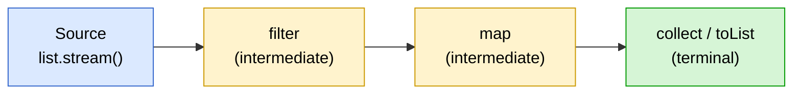

# Lambda & Stream API

> **Tuần 2 · Ngày 8** · Thuộc [[02 - Java Core, Collections & Stream API]] · Bài trước: [[02.05 - Collections Framework]] · Bài sau: [[02.07 - Collectors]]
> Mỗi chủ đề gồm: **Hiểu bản chất → Code minh hoạ → Bẫy hay gặp → Trả lời mẫu → Câu hỏi xoáy**.
> Toàn bộ output trong bài đã được chạy thử trên JDK 21.

**Mục lục**
1. [[#1. Functional interface|Functional interface]]
2. [[#2. Lambda và method reference|Lambda và method reference]]
3. [[#3. Stream là gì|Stream là gì]]
4. [[#4. Lazy: stream chạy như thế nào|Lazy: stream chạy như thế nào]]
5. [[#5. map, flatMap và primitive stream|map, flatMap và primitive stream]]
6. [[#6. Khi nào dùng stream, khi nào dùng vòng for|Khi nào dùng stream, khi nào dùng vòng for]]
7. [[#7. Kịch bản Feynman hôm nay|Kịch bản Feynman hôm nay]]

---

## 1. Functional interface

### Hiểu bản chất
**Functional interface** là interface có **đúng 1 abstract method**. Chỉ cần vậy là Java cho phép viết **lambda** thay vì tạo class implement.

```java
// không bắt buộc, nhưng compiler sẽ báo lỗi nếu bạn lỡ thêm abstract method thứ 2
@FunctionalInterface
interface PriceRule {
    BigDecimal apply(BigDecimal price);
    default String name() { return "rule"; }   // default method không tính
}

PriceRule tenPercentOff = price -> price.multiply(new BigDecimal("0.9"));
```

Trước Java 8 phải viết cả một anonymous class 5 dòng chỉ để truyền một hành vi. Lambda cho phép **truyền hành vi như truyền dữ liệu**.

### Các functional interface có sẵn cần thuộc

| Interface | Method | Nhận → Trả | Ví dụ dùng |
|---|---|---|---|
| `Function<T, R>` | `apply` | T → R | `map(User::getName)` |
| `Predicate<T>` | `test` | T → boolean | `filter(u -> u.isActive())` |
| `Supplier<T>` | `get` | () → T | `orElseGet(() -> loadDefault())` |
| `Consumer<T>` | `accept` | T → void | `forEach(System.out::println)` |
| `BiFunction<T, U, R>` | `apply` | (T, U) → R | `merge(key, 1, Integer::sum)` |
| `UnaryOperator<T>` | `apply` | T → T | `replaceAll(String::trim)` |
| `BinaryOperator<T>` | `apply` | (T, T) → T | `reduce(0, Integer::sum)` |
| `Runnable` | `run` | () → void | `executor.execute(() -> ...)` |
| `Callable<V>` | `call` | () → V, được ném checked exception | `executor.submit(() -> ...)` |

Mẹo nhớ: **Function** biến đổi, **Predicate** kiểm tra, **Supplier** cung cấp, **Consumer** tiêu thụ.

---

## 2. Lambda và method reference

### Cú pháp lambda

```java
(a, b) -> a + b                         // nhiều tham số
x -> x * 2                              // 1 tham số: bỏ được ngoặc
() -> "hello"                           // không tham số
(String s) -> { log(s); return s.length(); }   // nhiều lệnh: cần { } và return
```

### Biến dùng trong lambda phải "effectively final"

```java
int discount = 10;
list.forEach(p -> System.out.println(p - discount));   // ✓ discount không bị gán lại
discount = 20;                                           // ❌ thêm dòng này → lỗi biên dịch ở dòng trên
```

**Vì sao?** Lambda **copy giá trị** của biến local tại thời điểm tạo, và có thể chạy **sau đó** hoặc ở **thread khác**. Nếu biến còn bị gán lại thì không rõ lambda sẽ thấy giá trị nào. Java chặn từ đầu để tránh lỗi khó đoán.

Lưu ý: "effectively final" chỉ cấm **gán lại biến**. Mẹo `int[] counter = {0}` rồi `counter[0] += x` trong lambda vẫn chạy (đã thử, ra 6), nhưng đó là **lách luật**: sửa state bên ngoài từ lambda, rất dễ sai khi chạy song song. Muốn tính tổng thì dùng `sum()` hoặc `reduce()`.

### Method reference: viết gọn lambda khi chỉ gọi một method

| Loại | Cú pháp | Tương đương lambda |
|---|---|---|
| Static method | `Integer::parseInt` | `s -> Integer.parseInt(s)` |
| Method của object cụ thể | `System.out::println` | `x -> System.out.println(x)` |
| Method của tham số đầu tiên | `String::toUpperCase` | `s -> s.toUpperCase()` |
| Constructor | `ArrayList::new` | `() -> new ArrayList<>()` |

> **Trả lời mẫu:** "Functional interface là interface có đúng một abstract method, nhờ đó viết được lambda thay cho anonymous class, tức là truyền hành vi như truyền dữ liệu. Bốn loại hay dùng nhất là Function để biến đổi, Predicate để kiểm tra, Supplier để cung cấp giá trị, Consumer để tiêu thụ. Biến local dùng trong lambda phải effectively final, vì lambda copy giá trị và có thể chạy sau hoặc ở thread khác; nếu cho gán lại thì không biết lambda thấy giá trị nào."

### Câu hỏi xoáy

**Q1.** Lambda có phải là anonymous class không?
> [!success]- Gợi ý trả lời
> Không. Anonymous class tạo ra một class thật (file `Outer$1.class`). Lambda được compile thành `invokedynamic`, và JVM sinh implementation lúc runtime. Khác biệt dễ thấy: trong anonymous class, `this` là chính object anonymous; trong lambda, `this` là object bao ngoài.

**Q2.** Vì sao lambda không ném được checked exception trong `stream().map(...)`?
> [!success]- Gợi ý trả lời
> Vì `Function.apply` không khai báo `throws`. Phải bắt trong lambda và bọc thành unchecked (xem [[02.03 - Exception Handling]] mục 2).

---

## 3. Stream là gì

### Hiểu bản chất
- Stream **không phải cấu trúc dữ liệu** và **không lưu dữ liệu**. Nó là một **dây chuyền xử lý** chạy trên dữ liệu lấy từ nguồn (list, mảng, file…).
- Stream **không sửa collection gốc**: mọi thao tác tạo ra kết quả mới.
- Stream **chỉ dùng được 1 lần**.

Một pipeline có 3 phần:



| Phần | Vai trò | Ví dụ |
|---|---|---|
| **Source** | Nơi lấy dữ liệu | `list.stream()`, `Arrays.stream(arr)`, `Stream.of(...)`, `IntStream.range(0, 10)` |
| **Intermediate** | Biến đổi, trả về stream mới, **lazy** | `filter`, `map`, `flatMap`, `distinct`, `sorted`, `limit`, `skip`, `peek` |
| **Terminal** | **Kích hoạt** chạy, trả kết quả | `collect`, `toList`, `forEach`, `count`, `reduce`, `findFirst`, `anyMatch`, `min`, `max` |

### Ví dụ thực tế

```java
// Lấy email của 3 khách VIP chi tiêu nhiều nhất
List<String> emails = customers.stream()
        .filter(Customer::isVip)
        .sorted(Comparator.comparing(Customer::getTotalSpent).reversed())
        .limit(3)
        .map(Customer::getEmail)
        .toList();
```

Đọc như một câu: *lọc khách VIP, sắp theo chi tiêu giảm dần, lấy 3 người, lấy email*.

---

## 4. Lazy: stream chạy như thế nào

Đây là phần **người phỏng vấn hay hỏi xoáy nhất** về stream.

### Không có terminal operation thì không chạy gì

```java
Stream<Integer> s = Stream.of(1, 2, 3, 4)
        .filter(x -> { System.out.println("filter " + x); return x % 2 == 0; });
// Không in ra gì cả: mới chỉ "lắp dây chuyền", chưa bật máy
```

### Mỗi phần tử đi hết dây chuyền rồi mới tới phần tử sau, và dừng sớm được

```java
Optional<Integer> first = Stream.of(1, 2, 3, 4, 5, 6)
        .filter(x -> { System.out.println("filter " + x); return x % 2 == 0; })
        .map(x -> { System.out.println("map " + x); return x * 10; })
        .findFirst();
```

Output thật:

| Bước | In ra | Giải thích |
|---|---|---|
| 1 | `filter 1` | 1 lẻ, bị loại, chuyển sang phần tử tiếp theo |
| 2 | `filter 2` | 2 chẵn, đi tiếp xuống `map` |
| 3 | `map 2` | Biến thành 20 |
| 4 | `result 20` | `findFirst` đã có kết quả, **dừng luôn**: 3, 4, 5, 6 **không bao giờ được xử lý** |

Hai điều quan trọng rút ra:
1. Stream xử lý **theo chiều dọc** (từng phần tử đi hết pipeline), **không** phải chạy hết `filter` cho cả list rồi mới tới `map`.
2. **Short-circuit**: `findFirst`, `anyMatch`, `limit`… dừng ngay khi đủ kết quả. Với nguồn lớn, điều này tiết kiệm rất nhiều.

### Ngoại lệ: thao tác "stateful" phải gom hết dữ liệu trước

```java
Stream.of(3, 1, 2)
        .peek(x -> System.out.println("peek " + x))
        .sorted()
        .forEach(x -> System.out.println("out " + x));
// peek 3, peek 1, peek 2  ← sorted phải nhận ĐỦ cả 3 phần tử mới sắp được
// out 1, out 2, out 3
```

`sorted()` và `distinct()` là **stateful**: phải giữ dữ liệu lại, tốn bộ nhớ, và không thể short-circuit trước khi thấy hết dữ liệu. `filter` và `map` là **stateless**.

### Stream chỉ dùng 1 lần

```java
Stream<String> s = Stream.of("a");
s.count();
s.count();   // IllegalStateException: stream has already been operated upon or closed
```

Muốn dùng lại thì tạo stream mới từ nguồn (`list.stream()` lần nữa), hoặc giữ một `Supplier<Stream<T>>`.

> **Trả lời mẫu:** "Stream là dây chuyền xử lý gồm source, các intermediate operation và một terminal operation. Intermediate là lazy: chỉ khi gọi terminal như `collect` hay `findFirst` thì stream mới chạy. Khi chạy, từng phần tử đi hết pipeline rồi mới tới phần tử sau, nên các thao tác như `findFirst`, `limit`, `anyMatch` dừng được sớm. Ví dụ filter số chẵn rồi findFirst trên 1 đến 6 thì chỉ xử lý tới số 2. Ngoại lệ là `sorted` và `distinct`, phải gom đủ dữ liệu. Stream không sửa collection gốc và chỉ dùng được một lần."

### Câu hỏi xoáy

**Q1.** `peek` dùng để làm gì? Có nên dùng để sửa dữ liệu không?
> [!success]- Gợi ý trả lời
> `peek` chủ yếu để **debug** (xem phần tử đi qua). Không nên dùng để sửa state hay gọi nghiệp vụ, vì nó chỉ chạy khi có terminal operation, và có thể bị bỏ qua: ví dụ `List.of(1,2,3).stream().peek(...).count()` trả về 3 mà **không in gì** (đã chạy thử), vì từ Java 9 `count()` biết trước kích thước nguồn nên bỏ qua cả pipeline.

**Q2.** `Stream.iterate(1, x -> x + 1)` tạo stream vô hạn. Làm sao dùng an toàn?
> [!success]- Gợi ý trả lời
> Kết hợp short-circuit: `.limit(10)`, `.takeWhile(x -> x < 100)` (Java 9), hoặc `Stream.iterate(1, x -> x < 100, x -> x + 1)`. Nếu gọi `sorted()` hay `collect()` trên stream vô hạn thì chạy mãi cho tới khi hết bộ nhớ.

---

## 5. map, flatMap và primitive stream

### map vs flatMap

| | `map` | `flatMap` |
|---|---|---|
| Hàm truyền vào | T → R | T → **Stream** của R |
| Kết quả | Mỗi phần tử thành **1** phần tử | Mỗi phần tử thành **0..n** phần tử, rồi **làm phẳng** thành 1 stream |

```java
List<List<String>> nested = List.of(List.of("a", "b"), List.of("c"));
nested.stream().flatMap(List::stream).toList();     // [a, b, c]

// Thực tế: tổng tiền mọi item của mọi đơn hàng
double total = orders.stream()
        .flatMap(o -> o.getItems().stream())        // Stream<Order> → Stream<Item>
        .mapToDouble(Item::getPrice)
        .sum();
```

### Primitive stream: tránh boxing

`Stream<Integer>` phải bọc mỗi số thành object `Integer` (boxing), nên tốn bộ nhớ và chậm hơn. `IntStream`, `LongStream`, `DoubleStream` làm việc thẳng với số nguyên thuỷ và có sẵn `sum()`, `average()`, `summaryStatistics()`:

```java
IntStream.rangeClosed(1, 5).sum();                                  // 15
Stream.of("aa", "b").mapToInt(String::length).summaryStatistics();
// IntSummaryStatistics{count=2, sum=3, min=1, average=1.5, max=2}
```

Chuyển qua lại: `mapToInt(...)` để vào primitive stream; `.boxed()` để quay lại `Stream<Integer>`.

---

## 6. Khi nào dùng stream, khi nào dùng vòng for

| Dùng stream khi | Dùng vòng for khi |
|---|---|
| Biến đổi, lọc, gom nhóm dữ liệu (code ngắn, đọc như câu) | Logic có nhiều nhánh, `break`/`continue` phức tạp |
| Pipeline rõ ràng: filter → map → collect | Cần sửa nhiều biến bên ngoài trong vòng lặp |
| Muốn short-circuit hoặc dễ chuyển sang parallel | Có checked exception (IO) ở mỗi bước |
| | Code nóng cần hiệu năng tối đa với dữ liệu nhỏ (stream có chi phí khởi tạo) |

**Anti-pattern hay gặp:**

```java
// ❌ Dùng stream như vòng for có side effect
List<String> names = new ArrayList<>();
users.stream().forEach(u -> names.add(u.getName()));

// ✓
List<String> names = users.stream().map(User::getName).toList();
```

> **Trả lời mẫu:** "Em dùng stream cho các thao tác biến đổi dữ liệu dạng filter, map, gom nhóm, vì code ngắn và đọc như câu. Em tránh dùng `forEach` để add vào list bên ngoài, mà dùng `collect` hoặc `toList`. Còn logic phức tạp, nhiều nhánh, có checked exception hay cần break sớm theo nhiều điều kiện, em dùng vòng for cho dễ đọc và dễ debug."

---

## 7. Kịch bản Feynman hôm nay

Gấp tài liệu, bật ghi âm:
1. "Functional interface là gì? Kể 4 cái hay dùng."
2. "Vì sao biến trong lambda phải effectively final?"
3. "Stream lazy nghĩa là gì? Giải thích output của ví dụ `filter` + `map` + `findFirst`."
4. "`map` khác `flatMap` thế nào? Cho ví dụ order và item."

Ghi vào [[08 - Nhật ký học tập]].

## Tự kiểm tra nhanh (không mở tài liệu)

- [ ] Viết tay bảng Function / Predicate / Supplier / Consumer
- [ ] 4 loại method reference
- [ ] Stream có sửa collection gốc không? Dùng lại được không?
- [ ] Ví dụ 1..6, filter chẵn, map ×10, findFirst: in ra những dòng nào?
- [ ] Vì sao `sorted()` khác `filter()` về cách chạy?
- [ ] Khi nào dùng `mapToInt` thay vì `map`?
