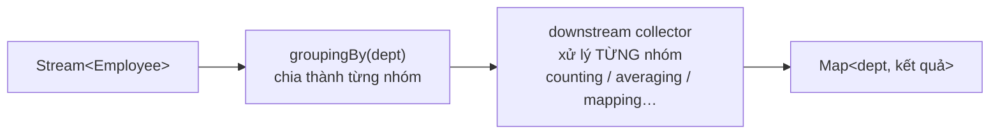

# Collectors

> **Tuần 2 · Ngày 9** · Thuộc [[02 - Java Core, Collections & Stream API]] · Bài trước: [[02.06 - Lambda & Stream API]] · Bài sau: [[02.08 - Optional & Parallel Stream]]
> Hôm nay **luyện tay là chính**: phỏng vấn thường bắt viết stream trên giấy hoặc trên màn hình chia sẻ, không có IDE gợi ý.
> Toàn bộ output trong bài đã được chạy thử trên JDK 21.

**Mục lục**
1. [[#1. Dữ liệu mẫu|Dữ liệu mẫu]]
2. [[#2. collect và Collectors là gì|collect và Collectors là gì]]
3. [[#3. toList, toSet, toMap|toList, toSet, toMap]]
4. [[#4. groupingBy: gom nhóm|groupingBy: gom nhóm]]
5. [[#5. partitioningBy, joining, teeing|partitioningBy, joining, teeing]]
6. [[#6. reduce khác collect thế nào|reduce khác collect thế nào]]
7. [[#7. 10 bài luyện viết tay|10 bài luyện viết tay]]

---

## 1. Dữ liệu mẫu

Mọi ví dụ trong bài dùng chung dữ liệu này:

```java
record Employee(String name, String dept, double salary, int years) {}

List<Employee> emps = List.of(
        new Employee("An",   "IT",    2000, 5),
        new Employee("Bình", "IT",    3000, 2),
        new Employee("Chi",  "HR",    1500, 7),
        new Employee("Dũng", "HR",    1800, 1),
        new Employee("Em",   "Sales", 2500, 3));
```

| name | dept | salary | years |
|---|---|---|---|
| An | IT | 2000 | 5 |
| Bình | IT | 3000 | 2 |
| Chi | HR | 1500 | 7 |
| Dũng | HR | 1800 | 1 |
| Em | Sales | 2500 | 3 |

---

## 2. collect và Collectors là gì

- `collect(...)` là terminal operation **gom các phần tử của stream lại thành một kết quả** (list, map, chuỗi, con số…).
- `Collectors` là class chứa sẵn các "công thức gom" phổ biến.
- Nhiều collector nhận thêm một **downstream collector**: một collector con để xử lý tiếp **từng nhóm**. Đây là chìa khoá để viết các truy vấn phức tạp, giống `GROUP BY` trong SQL.



**So sánh với SQL** giúp nhớ nhanh:

| SQL | Stream |
|---|---|
| `SELECT dept, COUNT(*) GROUP BY dept` | `groupingBy(Employee::dept, counting())` |
| `SELECT dept, AVG(salary) GROUP BY dept` | `groupingBy(Employee::dept, averagingDouble(Employee::salary))` |
| `SELECT dept, SUM(salary) GROUP BY dept` | `groupingBy(Employee::dept, summingDouble(Employee::salary))` |
| `WHERE` | `filter(...)` |
| `ORDER BY salary DESC LIMIT 3` | `sorted(comparing(...).reversed()).limit(3)` |

---

## 3. toList, toSet, toMap

```java
List<String> names = emps.stream().map(Employee::name).toList();                // Java 16+, unmodifiable
List<String> mutable = emps.stream().map(Employee::name).collect(Collectors.toList());
Set<String> depts = emps.stream().map(Employee::dept).collect(Collectors.toSet());
```

### toMap: 2 cái bẫy kinh điển

**Bẫy 1: key trùng thì ném exception**

```java
emps.stream().collect(Collectors.toMap(Employee::dept, Employee::name));
// IllegalStateException: Duplicate key IT (attempted merging values An and Bình)
```

Sửa bằng **merge function** (tham số thứ 3), quyết định khi trùng key thì làm gì:

```java
Map<String, Double> salaryByDept = emps.stream()
        .collect(Collectors.toMap(Employee::dept, Employee::salary, Double::sum, TreeMap::new));
// {HR=3300.0, IT=5000.0, Sales=2500.0}
```

Tham số thứ 4 (`TreeMap::new`) chọn loại Map trả về; ở đây dùng TreeMap để key được sắp xếp.

**Bẫy 2: value null thì ném NullPointerException**

```java
Stream.of("a").collect(Collectors.toMap(k -> k, k -> null));   // NPE
```

`toMap` không nhận value null: bản 2 tham số kiểm tra `Objects.requireNonNull(value)`, bản có merge function thì dùng `Map.merge`, mà `merge` cũng không nhận null. Nếu value có thể null thì lọc trước, hoặc dùng vòng for với `map.put`.

---

## 4. groupingBy: gom nhóm

### Cơ bản

```java
Map<String, List<Employee>> byDept = emps.stream()
        .collect(Collectors.groupingBy(Employee::dept));
```

Mặc định trả về **`HashMap`** (đã kiểm tra), nên thứ tự key không đảm bảo. Muốn key sắp xếp thì truyền `TreeMap::new` như các ví dụ dưới.

### Với downstream collector

```java
// Đếm số người mỗi phòng
emps.stream().collect(Collectors.groupingBy(Employee::dept, TreeMap::new, Collectors.counting()));
// {HR=2, IT=2, Sales=1}

// Lương trung bình mỗi phòng
emps.stream().collect(Collectors.groupingBy(Employee::dept, TreeMap::new,
        Collectors.averagingDouble(Employee::salary)));
// {HR=1650.0, IT=2500.0, Sales=2500.0}

// Chỉ lấy TÊN nhân viên mỗi phòng (không lấy cả object)
emps.stream().collect(Collectors.groupingBy(Employee::dept, TreeMap::new,
        Collectors.mapping(Employee::name, Collectors.toList())));
// {HR=[Chi, Dũng], IT=[An, Bình], Sales=[Em]}

// Tên người lương cao nhất mỗi phòng
emps.stream().collect(Collectors.groupingBy(Employee::dept, TreeMap::new,
        Collectors.collectingAndThen(
                Collectors.maxBy(Comparator.comparingDouble(Employee::salary)),
                opt -> opt.get().name())));
// {HR=Dũng, IT=Bình, Sales=Em}
```

**Vì sao cần `collectingAndThen`?** `maxBy` trả về `Optional<Employee>` (vì về lý thuyết nhóm có thể rỗng). `collectingAndThen` cho phép **xử lý thêm kết quả** của downstream, ở đây là mở Optional và lấy tên. Trong `groupingBy`, mỗi nhóm luôn có ít nhất 1 phần tử nên `get()` an toàn.

### Các downstream collector hay dùng

| Collector | Kết quả cho mỗi nhóm |
|---|---|
| `counting()` | Số phần tử (`Long`) |
| `summingInt/Long/Double(f)` | Tổng |
| `averagingInt/Long/Double(f)` | Trung bình |
| `maxBy(cmp)` / `minBy(cmp)` | `Optional` phần tử lớn nhất/nhỏ nhất |
| `mapping(f, downstream)` | Biến đổi từng phần tử rồi gom tiếp |
| `toSet()`, `toList()` | Tập hợp |
| `collectingAndThen(c, f)` | Kết quả của `c` sau khi áp dụng thêm `f` |

---

## 5. partitioningBy, joining, teeing

### partitioningBy: chia đúng 2 nhóm true/false

```java
emps.stream().collect(Collectors.partitioningBy(e -> e.years() >= 5,
        Collectors.mapping(Employee::name, Collectors.toList())));
// {false=[Bình, Dũng, Em], true=[An, Chi]}
```

Khác `groupingBy(e -> e.years() >= 5)` ở chỗ: `partitioningBy` **luôn có đủ cả 2 key** `true` và `false`, kể cả khi rỗng:

```java
emps.stream().filter(e -> e.years() > 100).collect(Collectors.partitioningBy(e -> e.salary() > 0));
// {false=[], true=[]}   ← groupingBy sẽ trả về map rỗng {}
```

### joining: nối chuỗi

```java
emps.stream().map(Employee::name).collect(Collectors.joining(", ", "[", "]"));
// [An, Bình, Chi, Dũng, Em]
```

### teeing (Java 12): chạy 2 collector cùng lúc rồi gộp

```java
double avg = emps.stream().collect(Collectors.teeing(
        Collectors.counting(),
        Collectors.summingDouble(Employee::salary),
        (count, sum) -> sum / count));
// 2160.0
```

---

## 6. reduce khác collect thế nào

| | `reduce` | `collect` |
|---|---|---|
| Ý tưởng | Gộp dần thành **một giá trị bất biến** | Gom vào một **container có thể thay đổi** (List, Map, StringBuilder) |
| Ví dụ hợp | Tổng, tích, max | List, Map, nhóm, chuỗi |

```java
double total = emps.stream().map(Employee::salary).reduce(0.0, Double::sum);   // 10800.0
// Gọn và nhanh hơn (không boxing):
double total2 = emps.stream().mapToDouble(Employee::salary).sum();
```

Không dùng `reduce` để gom vào List, vì mỗi bước sẽ tạo list mới và rất chậm. Gom vào container thì dùng `collect`.

> **Trả lời mẫu:** "`collect` gom phần tử stream thành một kết quả bằng các công thức có sẵn trong `Collectors`. Em hay dùng `groupingBy` kèm downstream collector như `counting`, `averagingDouble`, `mapping`, giống `GROUP BY` trong SQL. Hai bẫy của `toMap` là key trùng thì ném `IllegalStateException` (phải truyền merge function) và value null thì ném NPE. `partitioningBy` khác `groupingBy` ở chỗ luôn có đủ hai key true và false. `reduce` dùng để gộp thành một giá trị như tổng; gom vào List hay Map thì dùng `collect`."

### Câu hỏi xoáy

**Q1.** `groupingBy` mặc định trả về Map loại gì? Thứ tự key thế nào?
> [!success]- Gợi ý trả lời
> `HashMap`, nên thứ tự không đảm bảo. Muốn sắp xếp theo key thì dùng `groupingBy(f, TreeMap::new, downstream)`; muốn giữ thứ tự xuất hiện thì dùng `LinkedHashMap::new`.

**Q2.** Muốn lấy luôn `Employee` lương cao nhất mỗi phòng (không bọc trong Optional) thì làm sao?
> [!success]- Gợi ý trả lời
> Dùng `collectingAndThen(maxBy(...), Optional::get)`, hoặc dùng `toMap(Employee::dept, Function.identity(), BinaryOperator.maxBy(Comparator.comparingDouble(Employee::salary)))`.

---

## 7. 10 bài luyện viết tay

Tự viết trên giấy trước, rồi mới mở đáp án. Đáp án là code đã chạy và ra đúng kết quả ghi bên dưới.

**Bài 1.** Danh sách tên nhân viên phòng IT.
> [!success]- Đáp án
> ```java
> emps.stream().filter(e -> e.dept().equals("IT")).map(Employee::name).toList();   // [An, Bình]
> ```

**Bài 2.** Tổng lương toàn công ty.
> [!success]- Đáp án
> ```java
> emps.stream().mapToDouble(Employee::salary).sum();   // 10800.0
> ```

**Bài 3.** Số nhân viên mỗi phòng.
> [!success]- Đáp án
> ```java
> emps.stream().collect(Collectors.groupingBy(Employee::dept, Collectors.counting()));   // HR=2, IT=2, Sales=1
> ```

**Bài 4.** Lương trung bình mỗi phòng.
> [!success]- Đáp án
> ```java
> emps.stream().collect(Collectors.groupingBy(Employee::dept, Collectors.averagingDouble(Employee::salary)));
> // HR=1650.0, IT=2500.0, Sales=2500.0
> ```

**Bài 5.** Tên 3 người lương cao nhất.
> [!success]- Đáp án
> ```java
> emps.stream()
>     .sorted(Comparator.comparingDouble(Employee::salary).reversed())
>     .limit(3).map(Employee::name).toList();   // [Bình, Em, An]
> ```

**Bài 6.** Mức lương cao thứ 2 (các mức lương bằng nhau tính là một).
> [!success]- Đáp án
> ```java
> emps.stream().map(Employee::salary).distinct()
>     .sorted(Comparator.reverseOrder()).skip(1).findFirst().orElseThrow();   // 2500.0
> ```

**Bài 7.** Tên người lương cao nhất mỗi phòng.
> [!success]- Đáp án
> ```java
> emps.stream().collect(Collectors.groupingBy(Employee::dept,
>     Collectors.collectingAndThen(Collectors.maxBy(Comparator.comparingDouble(Employee::salary)),
>                                  o -> o.get().name())));   // HR=Dũng, IT=Bình, Sales=Em
> ```

**Bài 8.** Chia nhân viên thành 2 nhóm: từ 5 năm kinh nghiệm trở lên và dưới 5 năm (chỉ lấy tên).
> [!success]- Đáp án
> ```java
> emps.stream().collect(Collectors.partitioningBy(e -> e.years() >= 5,
>     Collectors.mapping(Employee::name, Collectors.toList())));   // false=[Bình, Dũng, Em], true=[An, Chi]
> ```

**Bài 9.** Đếm số lần xuất hiện của mỗi từ trong câu `"the cat and the hat"`.
> [!success]- Đáp án
> ```java
> Arrays.stream("the cat and the hat".split(" "))
>     .collect(Collectors.groupingBy(Function.identity(), TreeMap::new, Collectors.counting()));
> // {and=1, cat=1, hat=1, the=2}
> ```

**Bài 10.** Map từ phòng ban sang tổng lương, key sắp xếp A→Z.
> [!success]- Đáp án
> ```java
> emps.stream().collect(Collectors.toMap(Employee::dept, Employee::salary, Double::sum, TreeMap::new));
> // {HR=3300.0, IT=5000.0, Sales=2500.0}
> ```

---

## Kịch bản Feynman hôm nay

1. Giải thích "downstream collector" bằng ví dụ SQL `GROUP BY`.
2. Hai bẫy của `toMap` và cách sửa.
3. `partitioningBy` khác `groupingBy` ở đâu?
4. Viết lại **bài 7 và bài 9** không nhìn tài liệu.

Ghi vào [[08 - Nhật ký học tập]].
