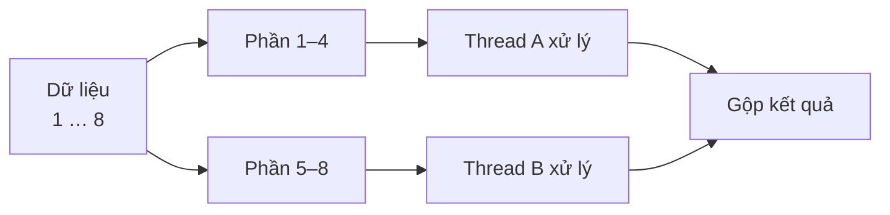

# Optional & Parallel Stream

> **Tuần 2 · Ngày 10** · Thuộc [[02 - Java Core, Collections & Stream API]] · Bài trước: [[02.07 - Collectors]] · Bài sau: [[02.09 - Java 17 & 21]]
> Mỗi chủ đề gồm: **Hiểu bản chất → Code minh hoạ → Bẫy hay gặp → Trả lời mẫu → Câu hỏi xoáy**.
> Toàn bộ output trong bài đã được chạy thử trên JDK 21 (máy 8 CPU).

**Mục lục**
1. [[#1. Optional giải quyết vấn đề gì|Optional giải quyết vấn đề gì]]
2. [[#2. Tạo và dùng Optional|Tạo và dùng Optional]]
3. [[#3. orElse vs orElseGet|orElse vs orElseGet]]
4. [[#4. Anti-pattern với Optional|Anti-pattern với Optional]]
5. [[#5. Parallel stream chạy thế nào|Parallel stream chạy thế nào]]
6. [[#6. Khi nào KHÔNG dùng parallel stream|Khi nào KHÔNG dùng parallel stream]]
7. [[#7. Kịch bản Feynman hôm nay|Kịch bản Feynman hôm nay]]

---

## 1. Optional giải quyết vấn đề gì

### Hiểu bản chất
Trước Java 8, method trả về `null` khi "không có kết quả", và bên gọi **rất dễ quên kiểm tra**, dẫn tới `NullPointerException` ở một nơi xa chỗ gây ra lỗi.

`Optional<T>` là một "cái hộp" **có thể chứa 1 giá trị hoặc rỗng**. Khi một method trả về `Optional`, **chữ ký method đã nói rõ** "có thể không có kết quả", và bên gọi **buộc phải xử lý** trường hợp rỗng trước khi lấy được giá trị.

Ví dụ quen thuộc nhất trong Spring: `userRepository.findById(id)` trả về `Optional<User>`.

---

## 2. Tạo và dùng Optional

### Tạo

| Cách tạo | Khi nào | Lưu ý |
|---|---|---|
| `Optional.of(value)` | Chắc chắn value **khác null** | `Optional.of(null)` ném **NPE** ngay |
| `Optional.ofNullable(value)` | Value **có thể** null | null thành `Optional.empty()` |
| `Optional.empty()` | Trả về "không có gì" | |

### Dùng theo kiểu chuỗi xử lý

```java
// Lấy tên thành phố của user; thiếu bất kỳ bước nào thì trả "UNKNOWN"
String city = userRepository.findById(id)
        .map(User::getAddress)          // Optional<Address>; address null → empty
        .map(Address::getCity)          // Optional<String>
        .orElse("UNKNOWN");

// Không tìm thấy → ném exception có ý nghĩa (rất hay dùng ở tầng service)
User user = userRepository.findById(id)
        .orElseThrow(() -> new ResourceNotFoundException("User", id));
```

So với cách cũ, không còn chuỗi `if (x != null) { if (x.getY() != null) ... }` lồng nhau.

### Các method hay dùng

| Method | Làm gì | Ví dụ (đã chạy) |
|---|---|---|
| `map(f)` | Biến đổi giá trị nếu có | `Optional.ofNullable(null).map(Object::toString).orElse("empty")` → `empty` |
| `filter(p)` | Giữ lại nếu thoả điều kiện | `Optional.of("  hi ").map(String::trim).filter(s -> !s.isEmpty()).orElse("blank")` → `hi` |
| `flatMap(f)` | Như `map` nhưng `f` trả về Optional, tránh `Optional<Optional<T>>` | `findUser(id).flatMap(u -> findProfile(u))` |
| `orElse(x)` / `orElseGet(() -> x)` | Giá trị mặc định | Xem mục 3 |
| `orElseThrow(...)` | Ném exception nếu rỗng | Như ví dụ trên |
| `ifPresent(c)` / `ifPresentOrElse(c, r)` | Làm gì đó nếu có / nếu không có | `opt.ifPresentOrElse(this::send, () -> log.warn("missing"))` |
| `or(() -> otherOptional)` (Java 9) | Thử nguồn khác nếu rỗng | `cache.get(id).or(() -> db.find(id))` |
| `stream()` (Java 9) | Optional thành stream 0 hoặc 1 phần tử | Lọc các Optional có giá trị: `[Optional(1), empty, Optional(3)]` → `[1, 3]` |

---

## 3. orElse vs orElseGet

**Câu hỏi bẫy rất hay gặp.**

```java
static String load(String tag) {
    System.out.println("load() called for " + tag);
    return "DEFAULT";
}

Optional<String> present = Optional.of("x");     // ĐÃ CÓ giá trị

present.orElse(load("orElse"));                  // in: "load() called for orElse"  ← vẫn bị gọi!
present.orElseGet(() -> load("orElseGet"));      // không in gì                       ← không bị gọi
```

**Vì sao?** `orElse(x)` là một method bình thường: Java **tính tham số trước** rồi mới gọi method, nên `load(...)` luôn chạy. `orElseGet` nhận một **Supplier** (một hành vi), và chỉ gọi nó khi Optional rỗng.

**Hậu quả thực tế:** `orElse(callDatabase())` hay `orElse(createNewUser())` sẽ gọi DB hoặc **tạo bản ghi mới** ngay cả khi đã tìm thấy kết quả.

| Dùng | Khi |
|---|---|
| `orElse(x)` | `x` là hằng số hoặc giá trị **đã có sẵn**, rẻ (`"UNKNOWN"`, `0`, `List.of()`) |
| `orElseGet(() -> ...)` | Giá trị mặc định **tốn kém** hoặc có **side effect** (gọi DB, tạo object, gọi API) |

---

## 4. Anti-pattern với Optional

| ❌ Không nên | Vì sao | ✓ Nên |
|---|---|---|
| `opt.get()` khi chưa chắc có giá trị | Ném `NoSuchElementException`, chẳng khác gì NPE | `orElseThrow()`, `orElse`, `map` |
| `if (opt.isPresent()) { x = opt.get(); }` | Dài dòng, chỉ là `null` check đội lốt | `opt.map(...)`, `opt.ifPresent(...)` |
| Field kiểu `Optional` trong entity/DTO | Optional không `Serializable`, Jackson và JPA không xử lý tốt | Field thường, getter trả `Optional` nếu cần |
| Tham số method kiểu `Optional` | Bên gọi phải bọc `Optional.of(...)`, rườm rà; vẫn có thể truyền `null` | Overload method, hoặc tham số nullable có ghi chú rõ |
| `Optional<List<T>>` | Thừa: dùng list rỗng là đủ để diễn tả "không có gì" | Trả `List.of()` |
| Trả `null` từ method có kiểu `Optional` | Phá hoàn toàn ý nghĩa của Optional | Trả `Optional.empty()` |

**Quy tắc ngắn:** Optional dùng làm **kiểu trả về** của method có thể không có kết quả. Không dùng ở chỗ khác.

> **Trả lời mẫu:** "Optional là hộp có thể chứa giá trị hoặc rỗng. Dùng làm kiểu trả về giúp chữ ký method nói rõ 'có thể không có kết quả' và buộc bên gọi xử lý, tránh NPE. Em hay dùng `findById(id).orElseThrow(...)` ở service và chuỗi `map` để tránh if-null lồng nhau. Bẫy quan trọng là `orElse` luôn tính tham số kể cả khi đã có giá trị, nên với giá trị mặc định tốn kém như gọi DB thì phải dùng `orElseGet`. Em không dùng Optional cho field, tham số hay bọc collection, và tránh `get()` khi chưa kiểm tra."

### Câu hỏi xoáy

**Q1.** `Optional.of(null)` và `Optional.ofNullable(null)` khác nhau thế nào?
> [!success]- Gợi ý trả lời
> `of(null)` ném NPE ngay lập tức (dùng khi bạn **khẳng định** không null, nên nếu null thì phát hiện lỗi sớm). `ofNullable(null)` trả về `Optional.empty()`.

**Q2.** `map` và `flatMap` của Optional khác nhau thế nào?
> [!success]- Gợi ý trả lời
> `map(f)` với `f` trả về giá trị thường. Nếu `f` đã trả về `Optional` thì `map` cho ra `Optional<Optional<T>>`. Khi đó dùng `flatMap` để "làm phẳng" thành `Optional<T>`. Giống hệt sự khác nhau giữa `map` và `flatMap` của Stream.

---

## 5. Parallel stream chạy thế nào

### Hiểu bản chất
`list.parallelStream()` hoặc `stream.parallel()` chia dữ liệu thành nhiều phần, xử lý **song song trên nhiều thread**, rồi gộp kết quả lại.



- Các thread lấy từ **`ForkJoinPool.commonPool()`**: một pool **dùng chung cho cả JVM**. Kích thước mặc định = số CPU − 1 (đo thực tế: máy 8 CPU có commonPool **7 thread**; thread gọi stream cũng tham gia xử lý).
- `CompletableFuture.supplyAsync(...)` không truyền executor cũng dùng **chính pool này**.

### Bẫy 1: ghi vào collection không thread-safe

```java
List<Integer> list = new ArrayList<>();
IntStream.range(0, 10_000).parallel().forEach(list::add);
// Đo thực tế 2 đợt: sai 20/20 lần, rồi sai 21/30 lần (size thiếu, có lúc ném exception).
// Kết quả thay đổi mỗi lần chạy: đó chính là race condition, không đoán trước được.

List<Integer> ok = IntStream.range(0, 10_000).parallel().boxed().toList();   // ✓ luôn đủ 10000
```

Nhiều thread cùng `add` vào một `ArrayList` gây **race condition**. Với parallel stream, **luôn gom kết quả bằng `collect`/`toList`**, không sửa state bên ngoài.

### Bẫy 2: thứ tự không được đảm bảo

```java
IntStream.range(0, 8).parallel().forEach(...);          // đo được: 54762310 (thứ tự lộn xộn)
// 01234567: giữ thứ tự, nhưng mất bớt lợi ích song song
IntStream.range(0, 8).parallel().forEachOrdered(...);
```

---

## 6. Khi nào KHÔNG dùng parallel stream

| Nên dùng | Không nên dùng |
|---|---|
| Dữ liệu **lớn** (hàng trăm nghìn phần tử trở lên) | Dữ liệu nhỏ: chi phí chia và gộp lớn hơn lợi ích |
| Tác vụ **CPU-bound** (tính toán thuần) | Tác vụ **I/O** (gọi DB, gọi HTTP, đọc file) |
| Nguồn dễ chia: `ArrayList`, mảng, `IntStream.range` | `LinkedList`, `Stream.iterate`: chia rất kém |
| Không có shared mutable state | Có sửa biến hay collection bên ngoài |
| Thứ tự không quan trọng | Cần giữ thứ tự (`findFirst`, `forEachOrdered` làm chậm) |

**Vì sao đặc biệt không dùng cho I/O trong web app?** commonPool chỉ có khoảng (số CPU − 1) thread và **dùng chung cả JVM**. Một request làm parallel stream gọi DB sẽ chiếm hết các thread này để **chờ I/O**, khiến mọi parallel stream và `CompletableFuture` khác trong ứng dụng bị nghẽn theo.

**Muốn gọi nhiều API song song thì sao?** Dùng `CompletableFuture` với **executor riêng** có kích thước phù hợp cho I/O (học ở Tuần 3, [[03 - Concurrency, SQL, REST & Security]]).

> **Trả lời mẫu:** "Parallel stream chia dữ liệu và xử lý trên các thread của `ForkJoinPool.commonPool()`, pool này dùng chung cả JVM và có khoảng số CPU trừ 1 thread. Nó chỉ có lợi khi dữ liệu lớn, tác vụ CPU-bound, nguồn dễ chia như ArrayList hay mảng, và không có shared state. Em không dùng nó trong web app cho tác vụ I/O, vì sẽ chặn commonPool và ảnh hưởng mọi nơi khác. Với I/O song song em dùng CompletableFuture với executor riêng. Ngoài ra phải gom kết quả bằng `collect`, không add vào ArrayList bên ngoài: em đã thử và phần lớn số lần chạy cho kết quả sai, mỗi lần sai một kiểu."

### Câu hỏi xoáy

**Q1.** Có cho parallel stream chạy trên pool riêng được không?
> [!success]- Gợi ý trả lời
> Có một mẹo: chạy stream bên trong `customForkJoinPool.submit(() -> list.parallelStream()...).get()` thì các task sẽ chạy trên pool đó. Nhưng đây là hành vi ngầm, không được document chính thức. Thực tế nên dùng `CompletableFuture` hoặc `ExecutorService` với pool riêng.

**Q2.** `reduce` trong parallel stream cần lưu ý gì?
> [!success]- Gợi ý trả lời
> Hàm gộp phải **có tính kết hợp** (associative), và giá trị khởi tạo phải là **phần tử đơn vị** (identity). Ví dụ `reduce(0, Integer::sum)` đúng; `reduce(10, Integer::sum)` sai khi chạy song song, vì mỗi phần dữ liệu đều được cộng thêm 10. Đo thực tế với 1..4: chạy tuần tự ra **20**, chạy song song ra **50**.

---

## 7. Kịch bản Feynman hôm nay

1. "Optional giải quyết vấn đề gì? Dùng ở đâu, không dùng ở đâu?"
2. "Giải thích `orElse` vs `orElseGet` bằng ví dụ có gọi DB."
3. "Parallel stream chạy trên thread pool nào? Vì sao không dùng cho I/O trong web app?"
4. "Vì sao `parallel().forEach(list::add)` cho kết quả sai?"

Ghi vào [[08 - Nhật ký học tập]].

## Tự kiểm tra nhanh (không mở tài liệu)

- [ ] `Optional.of(null)` thì sao?
- [ ] Viết `findById(id).orElseThrow(...)` và chuỗi `map` lấy city
- [ ] `orElse(load())` khi Optional có giá trị: `load()` có chạy không?
- [ ] Kể 4 anti-pattern với Optional
- [ ] Kích thước commonPool trên máy 8 CPU?
- [ ] 5 điều kiện để parallel stream có lợi
