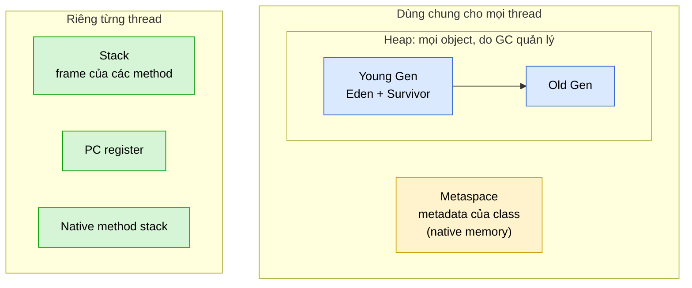
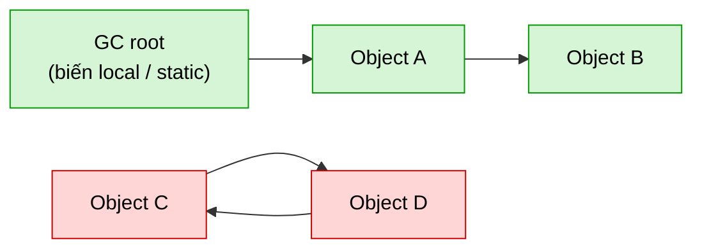
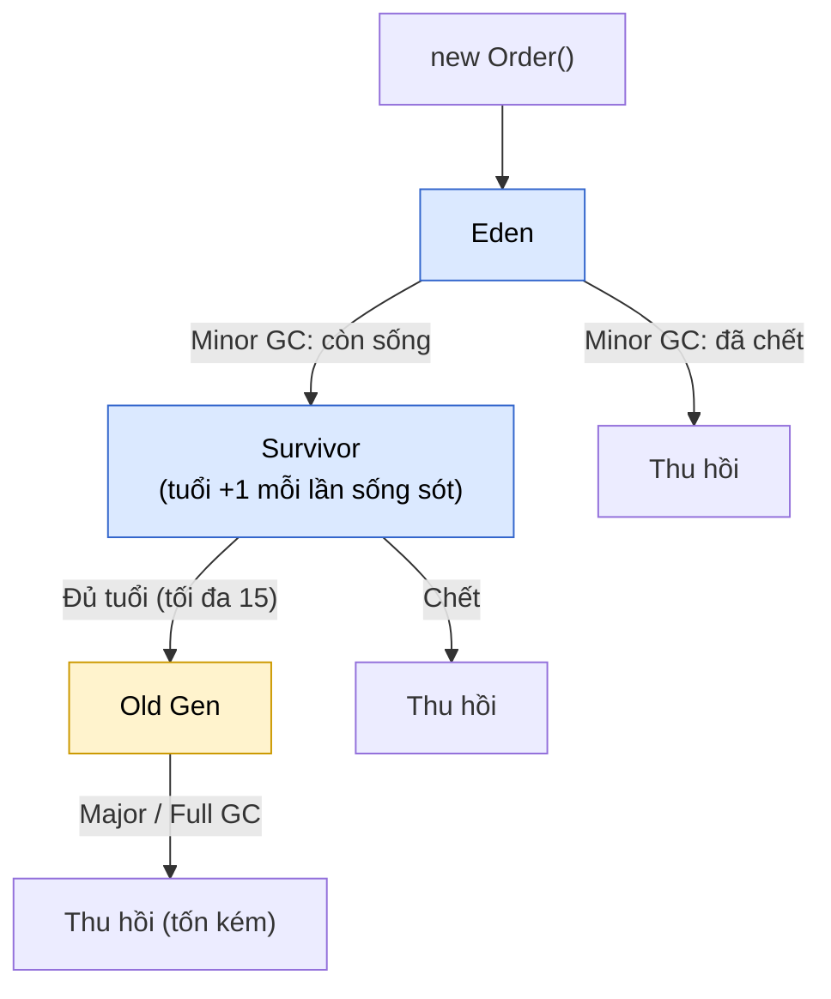
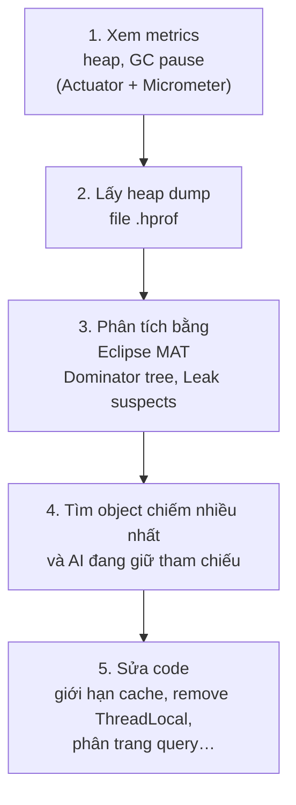

# JVM Memory & Garbage Collection

> **Tuần 2 · Ngày 12** · Thuộc [[02 - Java Core, Collections & Stream API]] · Bài trước: [[02.09 - Java 17 & 21]]
> Ở level 2 năm, người phỏng vấn không đòi tuning GC chuyên sâu. Họ muốn bạn **hiểu bộ nhớ chia thế nào, GC hoạt động ra sao, và biết điều tra khi ứng dụng bị OutOfMemoryError**.
> Số liệu "đo thực tế" trong bài lấy từ JDK 21 trên máy 16 GB RAM, 8 CPU.

**Mục lục**
1. [[#1. Các vùng nhớ của JVM|Các vùng nhớ của JVM]]
2. [[#2. Stack và Heap|Stack và Heap]]
3. [[#3. GC quyết định object nào là rác|GC quyết định object nào là rác]]
4. [[#4. Generational GC: vòng đời một object|Generational GC: vòng đời một object]]
5. [[#5. Các loại Garbage Collector|Các loại Garbage Collector]]
6. [[#6. OutOfMemoryError và memory leak|OutOfMemoryError và memory leak]]
7. [[#7. Cấu hình heap và điều tra sự cố|Cấu hình heap và điều tra sự cố]]
8. [[#8. Kịch bản Feynman hôm nay|Kịch bản Feynman hôm nay]]

---

## 1. Các vùng nhớ của JVM



| Vùng | Chứa gì | Phạm vi | Lỗi khi đầy |
|---|---|---|---|
| **Heap** | Mọi object và mảng (kể cả String pool từ Java 7) | Dùng chung | `OutOfMemoryError: Java heap space` |
| **Stack** | Mỗi lời gọi method là 1 **frame**: biến local, tham số, tham chiếu | Mỗi thread 1 stack | `StackOverflowError` |
| **Metaspace** (Java 8, thay PermGen) | Thông tin class: tên, method, field, bytecode | Dùng chung, nằm ở native memory | `OutOfMemoryError: Metaspace` |
| PC register, native stack | Lệnh đang chạy, code native | Mỗi thread | |

---

## 2. Stack và Heap

### Ví dụ: cái gì nằm ở đâu?

```java
public void placeOrder() {
    int quantity = 2;                       // primitive local → nằm TRONG frame trên stack
    Order order = new Order("O1");          // biến "order" (tham chiếu) → stack
                                            // object Order thật → HEAP
    order.addItem(new Item("book"));        // object Item → heap; Order giữ tham chiếu tới nó
}   // method kết thúc → frame bị xoá khỏi stack → biến quantity, order biến mất
    // object Order và Item trên heap không còn ai tham chiếu → GC sẽ thu hồi sau
```

| | Stack | Heap |
|---|---|---|
| Chứa | Biến local, tham số, tham chiếu | Object |
| Phạm vi | Riêng từng thread, nên **thread-safe tự nhiên** | Dùng chung, nên **cần đồng bộ** khi nhiều thread sửa |
| Giải phóng | Tự động khi method kết thúc (pop frame) | Do **GC** |
| Tốc độ cấp phát | Rất nhanh | Nhanh (cấp phát tuần tự trong Eden), nhưng tốn chi phí GC |
| Kích thước | Nhỏ (`-Xss`, mặc định khoảng 1 MB mỗi thread) | Lớn (`-Xmx`) |

### StackOverflowError
Đệ quy không có điểm dừng sẽ đẩy frame liên tục cho tới khi stack đầy. Đo thực tế: một hàm đệ quy rỗng chạy được khoảng **47.000 tầng** rồi ném `StackOverflowError`. Nguyên nhân thường gặp: đệ quy sai điều kiện dừng; `toString()`/`equals()`/`hashCode()` của hai entity gọi vòng sang nhau (ví dụ Lombok `@Data` trên quan hệ hai chiều); Jackson serialize quan hệ hai chiều.

> **Trả lời mẫu:** "Stack là bộ nhớ riêng của từng thread, mỗi lời gọi method là một frame chứa biến local và tham chiếu; method kết thúc thì frame tự bị xoá. Heap là vùng dùng chung chứa mọi object và do GC quản lý. Ví dụ `Order order = new Order()`: biến `order` nằm trên stack, object Order nằm trên heap. Vì stack riêng từng thread nên biến local thread-safe tự nhiên, còn object trên heap thì nhiều thread cùng thấy nên phải đồng bộ khi sửa."

---

## 3. GC quyết định object nào là rác

### Reachability (khả năng tiếp cận)
GC bắt đầu từ các **GC roots** rồi lần theo mọi tham chiếu. Object nào **không lần tới được** thì là rác.

**GC roots** gồm: biến local và tham số trên stack của các thread đang chạy; field `static`; các thread đang sống; tham chiếu từ JNI.



A và B **còn sống** vì đi được từ root. C và D tham chiếu **vòng** lẫn nhau nhưng không root nào tới được, nên **vẫn là rác** và vẫn bị thu hồi. Java **không** dùng reference counting, vì vậy tham chiếu vòng không gây leak.

### Mark, Sweep, Compact
1. **Mark**: đánh dấu mọi object còn sống (lần từ roots).
2. **Sweep**: thu hồi vùng nhớ của object không được đánh dấu.
3. **Compact**: dồn các object sống lại sát nhau để tránh phân mảnh, giúp cấp phát object mới nhanh.

**Stop-the-world (STW):** một số pha phải **tạm dừng mọi thread ứng dụng** để object graph không thay đổi trong lúc GC làm việc. Thời gian dừng này là **GC pause**; pause dài khiến request bị chậm đột biến (tăng độ trễ p99). Mục tiêu của các GC hiện đại là **giảm pause**.

---

## 4. Generational GC: vòng đời một object

### Giả thuyết thế hệ (generational hypothesis)
**Đa số object chết rất trẻ**: DTO của một request, String tạm, iterator… chỉ sống vài mili giây. Vì vậy heap được chia làm 2 thế hệ, và vùng trẻ được dọn **thường xuyên với chi phí thấp**.



| Loại GC | Dọn vùng nào | Tần suất | Chi phí |
|---|---|---|---|
| **Minor GC** | Young Gen | Rất thường xuyên | Thấp: phần lớn object đã chết, chỉ cần copy số ít object sống |
| **Major GC** | Old Gen | Ít hơn | Cao hơn |
| **Full GC** | Toàn bộ heap (và Metaspace) | Hiếm, và **nên hiếm** | Cao nhất, pause dài |

Full GC xảy ra thường xuyên là **dấu hiệu bất thường**: heap quá nhỏ, memory leak, hoặc tạo quá nhiều object sống lâu.

---

## 5. Các loại Garbage Collector

| Collector | Đặc điểm | Khi nào dùng |
|---|---|---|
| Serial | 1 thread, pause dài | Ứng dụng rất nhỏ, container ít CPU |
| Parallel | Nhiều thread, ưu tiên **throughput** | Batch job, không quan tâm pause |
| **G1** | **Mặc định từ Java 9**. Chia heap thành nhiều **region** nhỏ, ưu tiên dọn region nhiều rác trước, đặt mục tiêu pause (`-XX:MaxGCPauseMillis`, mặc định 200ms) | **Hầu hết ứng dụng web**, lựa chọn an toàn |
| **ZGC** | Pause **dưới 1ms** bất kể heap lớn cỡ nào; generational từ Java 21 | Heap rất lớn, cần độ trễ thấp |
| Shenandoah | Tương tự ZGC (pause thấp) | Tương tự ZGC |

Đo thực tế trên JDK 21 không cấu hình gì: JVM chọn `-XX:+UseG1GC`, và các GC bean là `G1 Young Generation`, `G1 Old Generation`, `G1 Concurrent GC`.

**Câu trả lời an toàn ở level 2 năm:** "Em để mặc định G1, nó phù hợp đa số ứng dụng Spring Boot. Chỉ đổi khi có số liệu cho thấy GC pause là vấn đề, ví dụ chuyển ZGC khi heap lớn và cần độ trễ thấp."

---

## 6. OutOfMemoryError và memory leak

### Các loại OOM

| Thông báo | Nghĩa | Nguyên nhân thường gặp |
|---|---|---|
| `Java heap space` | Heap đầy | Memory leak; load quá nhiều dữ liệu một lúc (query cả bảng, file lớn vào RAM); `-Xmx` quá nhỏ |
| `GC overhead limit exceeded` | GC chạy gần như liên tục mà thu hồi được rất ít | Gần hết heap, thường do leak |
| `Metaspace` | Quá nhiều class | Tạo class động liên tục (proxy, script), classloader leak khi redeploy |
| `unable to create native thread` | Không tạo thêm được thread | Tạo thread không giới hạn (`newCachedThreadPool`, `new Thread` trong vòng lặp) |
| `Direct buffer memory` | Hết vùng nhớ off-heap | Netty/NIO buffer không được giải phóng |

### Java vẫn có memory leak
GC chỉ thu hồi object **không còn tham chiếu**. Leak xảy ra khi bạn **vô tình giữ tham chiếu** tới object không còn cần:

| Leak hay gặp | Ví dụ |
|---|---|
| Collection `static` lớn dần | `static Map<String, Object> CACHE` chỉ put, không bao giờ xoá |
| Cache không giới hạn | Tự viết cache bằng `HashMap` không có TTL hay giới hạn kích thước (nên dùng Caffeine) |
| `ThreadLocal` không `remove()` | Trong thread pool, thread sống mãi nên giữ dữ liệu mãi |
| Queue không giới hạn | `Executors.newFixedThreadPool` dùng queue vô hạn; task dồn ứ khi xử lý chậm |
| Key HashMap bị sửa | Entry "mất tích" nhưng vẫn chiếm bộ nhớ ([[02.04 - HashMap Internals]] mục 7) |
| Load quá nhiều vào persistence context | Đọc 1 triệu entity trong một transaction mà không `clear()` (Tuần 6) |
| Listener không huỷ đăng ký | Đăng ký callback rồi quên gỡ |

---

## 7. Cấu hình heap và điều tra sự cố

### Tham số cần biết

| Tham số | Ý nghĩa |
|---|---|
| `-Xms` / `-Xmx` | Heap ban đầu / tối đa. Server thường đặt bằng nhau để tránh resize heap |
| `-Xss` | Kích thước stack mỗi thread |
| `-XX:MaxRAMPercentage=75` | **Trong container**: heap tối đa = 75% memory limit của container |
| `-XX:+HeapDumpOnOutOfMemoryError` + `-XX:HeapDumpPath=...` | Tự ghi heap dump khi OOM, **luôn nên bật ở production** |

**Bẫy hay gặp khi chạy Docker/Kubernetes:** nếu không cấu hình, heap tối đa mặc định chỉ bằng **1/4 bộ nhớ** mà JVM thấy được. Đo thực tế trên máy 16 GB: `maxMemory` = **4096 MB**. Pod có limit 2 GB thì heap tối đa chỉ khoảng 512 MB, rất dễ OOM dù pod còn nhiều RAM trống. Cách sửa phổ biến là đặt `-XX:MaxRAMPercentage=75`.

### Các bước điều tra khi production bị OOM hoặc chậm do GC



| Công cụ | Dùng để |
|---|---|
| `jcmd <pid> GC.heap_info` | Xem tình trạng heap |
| `jcmd <pid> GC.heap_dump /tmp/heap.hprof` | Lấy heap dump khi ứng dụng đang chạy |
| `jstat -gcutil <pid> 1000` | Theo dõi % các vùng và số lần GC mỗi giây |
| `jstack <pid>` | Thread dump (deadlock, thread bị treo) |
| Eclipse MAT, VisualVM | Phân tích heap dump |
| JFR (Java Flight Recorder) | Ghi lại hoạt động JVM với overhead thấp, dùng được ở production |
| Spring Boot Actuator | `/actuator/metrics/jvm.memory.used`, `jvm.gc.pause`, `/actuator/heapdump` (không public endpoint này) |

> **Trả lời mẫu cho câu "Ứng dụng bị OOM, bạn xử lý thế nào?":** "Trước hết em xem metrics heap và GC pause trên dashboard để biết heap tăng dần đều (dấu hiệu leak) hay tăng vọt (load quá nhiều dữ liệu một lúc). Production luôn bật `HeapDumpOnOutOfMemoryError`, nên em lấy file heap dump và mở bằng Eclipse MAT, xem dominator tree để biết object nào chiếm nhiều nhất và ai đang giữ tham chiếu tới nó. Nguyên nhân hay gặp là cache tự viết không giới hạn, ThreadLocal không remove, hoặc query load cả bảng vào RAM. Nếu chạy trong container, em kiểm tra thêm `MaxRAMPercentage`, vì mặc định heap chỉ bằng 1/4 bộ nhớ."

### Câu hỏi xoáy

**Q1.** Java có GC rồi thì sao vẫn bị memory leak?
> [!success]- Gợi ý trả lời
> GC chỉ thu hồi object **không còn được tham chiếu**. Nếu code vô tình giữ tham chiếu (static collection, cache không giới hạn, ThreadLocal, listener), object vẫn "reachable" nên GC không được phép thu hồi, dù về logic nó không còn được dùng.

**Q2.** Gọi `System.gc()` có chắc chắn chạy GC không?
> [!success]- Gợi ý trả lời
> Không. Đó chỉ là **gợi ý**; JVM có thể bỏ qua (và bị tắt hẳn bằng `-XX:+DisableExplicitGC`). Không nên gọi trong code ứng dụng: nếu JVM làm theo thì thường gây ra full GC với pause dài.

**Q3.** Minor GC có stop-the-world không?
> [!success]- Gợi ý trả lời
> Có, nhưng thường rất ngắn vì Young Gen nhỏ và phần lớn object đã chết; chỉ cần copy số ít object còn sống.

**Q4.** Vì sao chạy trong Docker hay bị OOM dù máy còn nhiều RAM?
> [!success]- Gợi ý trả lời
> Hai lý do. (1) Heap mặc định chỉ bằng 1/4 bộ nhớ container, nên heap nhỏ hơn bạn nghĩ. (2) Ngược lại, nếu đặt `-Xmx` sát bằng memory limit, thì **heap cộng metaspace, stack các thread, direct buffer** vượt limit và container bị kill (OOMKilled, exit code 137). Nên dùng `MaxRAMPercentage` khoảng 70–75% để chừa chỗ cho phần ngoài heap.

---

## 8. Kịch bản Feynman hôm nay

1. **Vẽ lại sơ đồ các vùng nhớ JVM** ra giấy, rồi giải thích `Order order = new Order()` nằm ở đâu.
2. "GC xác định rác thế nào? Tham chiếu vòng có bị leak không?"
3. "Vòng đời một object: Eden, Survivor, Old. Minor GC khác Full GC thế nào?"
4. "Production bị OOM, bạn làm gì?" (trả lời theo 5 bước)

Ghi vào [[08 - Nhật ký học tập]]. **Ngày mai (Ngày 13) là lab thực hành Tuần 2**: xem [[01 - Lộ trình 8 tuần]].

## Tự kiểm tra nhanh (không mở tài liệu)

- [ ] 3 vùng nhớ chính và lỗi tương ứng khi đầy
- [ ] Biến local và object nằm ở đâu? Vì sao biến local thread-safe?
- [ ] GC roots gồm những gì?
- [ ] Generational hypothesis là gì? Object đi từ đâu tới đâu?
- [ ] GC mặc định từ Java 9? Đặc điểm chính?
- [ ] Kể 4 nguyên nhân memory leak trong Java
- [ ] Bẫy heap mặc định trong container và cách sửa
