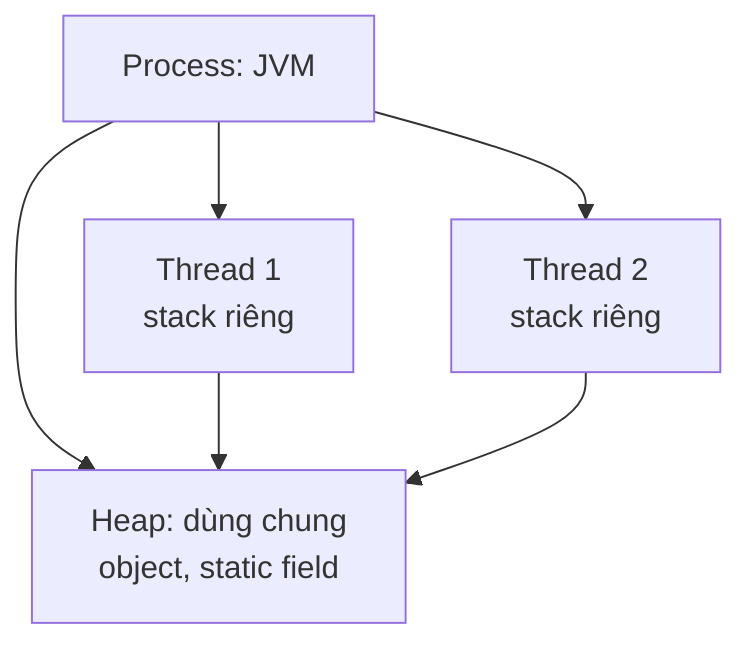
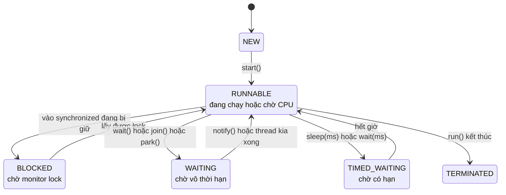

# Thread Basics

> **Tuần 3 · Ngày 15** · Thuộc [[03 - Concurrency, SQL, REST & Security]] · Bài trước: [[02.10 - JVM Memory & GC]] · Bài sau: [[03.02 - ThreadPoolExecutor]]
> Concurrency là phần phân loại ứng viên 2 năm rất rõ: ai chỉ "biết dùng @Async" và ai hiểu thread thật sự chạy thế nào. Bài này là nền móng cho cả tuần.
> Toàn bộ output trong bài đã được chạy thử trên JDK 21 (máy 8 CPU).

**Mục lục**
1. [[#1. Process vs Thread|Process vs Thread]]
2. [[#2. Tạo thread: Thread, Runnable, Callable|Tạo thread: Thread, Runnable, Callable]]
3. [[#3. Vòng đời thread: Thread.State|Vòng đời thread: Thread.State]]
4. [[#4. start() vs run() và join()|start() vs run() và join()]]
5. [[#5. Daemon thread|Daemon thread]]
6. [[#6. Interrupt: dừng thread một cách lịch sự|Interrupt: dừng thread một cách lịch sự]]
7. [[#7. Kịch bản Feynman hôm nay|Kịch bản Feynman hôm nay]]

---

## 1. Process vs Thread

### Hiểu bản chất
- **Process** là một chương trình đang chạy, được hệ điều hành cấp **không gian bộ nhớ riêng**. Mỗi lần bạn chạy `java -jar app.jar` là một process. Hai process không đọc được bộ nhớ của nhau; muốn nói chuyện phải qua mạng, file, pipe.
- **Thread** là một **luồng thực thi bên trong process**. Mọi thread trong cùng JVM **dùng chung heap** (object, static field), nhưng **mỗi thread có stack riêng** (biến local, lời gọi method).

Hình dung: process là **một căn nhà**, thread là **những người sống trong nhà**. Mọi người dùng chung tủ lạnh (heap), mỗi người có cuốn sổ tay riêng (stack). Dùng chung tủ lạnh thì tiện, nhưng hai người cùng lấy hộp sữa cuối cùng là chuyện xảy ra: đó chính là **race condition**.



| | Process | Thread |
|---|---|---|
| Bộ nhớ | Riêng biệt | Chung heap, riêng stack |
| Chi phí tạo / chuyển đổi | Đắt | Rẻ hơn nhiều |
| Giao tiếp | Qua mạng, file, IPC | Qua biến chung trên heap |
| Một cái chết thì sao | Không ảnh hưởng process khác | Exception chỉ kết thúc thread đó, nhưng lỗi như OOM ảnh hưởng cả JVM |

### Bẫy hay gặp
- Nói "thread có heap riêng" là sai. Heap chung, **stack riêng**. Biến local nằm trên stack nên **tự nhiên thread-safe**; field của object và static field thì **không**.
- Một exception không bắt trong thread con **không** làm chết `main`. Đã chạy: thread `crasher` ném `RuntimeException`, JVM in stack trace ra stderr rồi `main` vẫn chạy tiếp bình thường.

> **Trả lời mẫu:** "Process là chương trình đang chạy với vùng nhớ riêng do hệ điều hành cấp, còn thread là luồng thực thi bên trong process. Các thread trong cùng JVM chia sẻ heap nhưng mỗi thread có stack riêng, nên biến local an toàn còn field dùng chung thì phải đồng bộ. Thread rẻ hơn process và giao tiếp dễ hơn vì chung bộ nhớ, đổi lại phát sinh race condition. Ví dụ ở dự án em, một Spring Boot app là một process, Tomcat dùng khoảng 200 thread để phục vụ request, và mọi singleton bean được các thread đó dùng chung, nên bean không được giữ state thay đổi theo request."

### Câu hỏi xoáy

**Q1.** Vì sao Spring singleton bean phải stateless?
> [!success]- Gợi ý trả lời
> Mỗi request chạy trên một thread khác nhau của Tomcat, nhưng tất cả dùng **chung một instance** bean nằm trên heap. Nếu bean có field kiểu `private User currentUser`, request A ghi, request B ghi đè, request A đọc ra user của B. Dữ liệu theo request phải là biến local, tham số method, hoặc `ThreadLocal` (bài [[03.05 - Deadlock, ThreadLocal & Virtual Threads]]).

**Q2.** Biến local có bao giờ không thread-safe không?
> [!success]- Gợi ý trả lời
> Bản thân biến local (tham chiếu) nằm trên stack nên an toàn. Nhưng nếu biến local **trỏ tới object dùng chung** (ví dụ lấy từ field, hoặc truyền cho thread khác qua lambda) thì object đó vẫn có thể bị nhiều thread sửa cùng lúc.

---

## 2. Tạo thread: Thread, Runnable, Callable

### Hiểu bản chất
Có 3 cách mô tả "việc cần làm":

| | `Runnable` | `Callable<V>` | Kế thừa `Thread` |
|---|---|---|---|
| Method | `void run()` | `V call() throws Exception` | override `run()` |
| Trả kết quả | Không | Có, qua `Future<V>` | Không |
| Ném checked exception | Không | Có | Không |
| Dùng khi | Việc "bắn rồi quên" | Cần kết quả hoặc cần biết lỗi | Gần như không dùng: tốn mất quyền extends class khác |

`Runnable`/`Callable` chỉ là **công việc**. `Thread` là **người làm việc**. Tách hai thứ ra cho phép đưa cùng một công việc cho thread pool (bài sau) thay vì tự tạo thread.

### Code minh hoạ

```java
// Runnable: giao cho một Thread
Thread t = new Thread(() -> System.out.println("run in " + Thread.currentThread().getName()),
        "my-thread");
t.start();                                     // in: run in my-thread

// Callable: giao cho executor, nhận Future
ExecutorService ex = Executors.newSingleThreadExecutor();
Future<Integer> f = ex.submit(() -> 6 * 7);
System.out.println(f.get());                   // 42 (get() chặn tới khi có kết quả)

Future<?> bad = ex.submit(() -> { throw new IllegalStateException("boom"); });
try {
    bad.get();
} catch (ExecutionException e) {
    System.out.println(e.getCause());          // java.lang.IllegalStateException: boom
}
```

### Bẫy hay gặp
- **`submit()` nuốt exception.** Lỗi trong task được cất vào `Future`; nếu không ai gọi `get()` thì **không có dòng log nào**. Đã chạy: `submit` một task ném exception rồi không `get()`: im lặng hoàn toàn. Còn `execute()` thì lỗi bay lên thread và JVM in `Exception in thread "pool-1-thread-1"` ra stderr. Ở dự án thật, đây là nguồn của những bug "job chạy ngầm không làm gì mà không có log".
- `Future.get()` **chặn** thread gọi. Gọi `get()` ngay sau `submit()` thì chẳng khác gì chạy tuần tự.
- Trong ứng dụng thật **không tự `new Thread()`** cho mỗi việc: không giới hạn số thread, không tái sử dụng, khó tắt gọn. Dùng `ExecutorService` hoặc executor do Spring quản lý.

> **Trả lời mẫu:** "Runnable có `run()` không trả kết quả và không ném checked exception; Callable có `call()` trả kết quả và ném được exception, khi submit vào executor thì nhận về Future. Runnable và Callable chỉ mô tả công việc, còn Thread là thứ thực thi. Trong dự án em không tự `new Thread()` mà dùng executor có cấu hình. Một bẫy em từng gặp là `submit()` nuốt exception nếu không gọi `get()`, nên với job chạy nền em luôn bắt lỗi và log ngay trong task."

### Câu hỏi xoáy

**Q1.** Có cách nào để Runnable trả kết quả không?
> [!success]- Gợi ý trả lời
> Không trực tiếp. Có thể ghi vào một biến dùng chung (phải đồng bộ), hoặc dùng `executor.submit(runnable, result)` để Future trả về giá trị cố định. Cách tự nhiên là dùng `Callable` hoặc `CompletableFuture.supplyAsync` (bài [[03.03 - CompletableFuture]]).

**Q2.** Vì sao `Callable` được ném checked exception còn `Runnable` thì không?
> [!success]- Gợi ý trả lời
> Do chữ ký method: `run()` không khai báo `throws`, còn `call()` khai báo `throws Exception`. Executor bắt exception từ `call()` và bọc vào `ExecutionException` khi bạn gọi `Future.get()`.

---

## 3. Vòng đời thread: Thread.State

### Hiểu bản chất
`Thread.State` có **đúng 6 giá trị**. Câu hỏi bẫy kinh điển: **Java không có trạng thái RUNNING**. Thread đang chạy trên CPU hay đang xếp hàng chờ CPU đều là `RUNNABLE`, vì việc cấp CPU là chuyện của hệ điều hành, JVM không phân biệt.



| Trạng thái | Khi nào | Ví dụ |
|---|---|---|
| `NEW` | Đã tạo, chưa `start()` | `new Thread(...)` |
| `RUNNABLE` | Đang chạy hoặc sẵn sàng chạy | Đang tính toán, đang đọc socket |
| `BLOCKED` | Chờ lấy **monitor lock** của `synchronized` | Thread khác đang ở trong block `synchronized` cùng object |
| `WAITING` | Chờ vô thời hạn tới khi được đánh thức | `wait()`, `join()`, `LockSupport.park()` |
| `TIMED_WAITING` | Chờ có giới hạn thời gian | `sleep(ms)`, `wait(ms)`, `join(ms)` |
| `TERMINATED` | `run()` đã kết thúc (bình thường hoặc do exception) | |

### Code minh hoạ
Một thread được dẫn đi qua đủ 6 trạng thái (rút gọn, bản đầy đủ đã chạy):

```java
Object lock = new Object();
Thread t = new Thread(() -> {
    busyLoop();                                   // RUNNABLE
    synchronized (lock) { }                       // BLOCKED: main đang giữ lock
    synchronized (lock) {
        try { lock.wait(); } catch (InterruptedException e) { }   // WAITING
    }
    try { Thread.sleep(300); } catch (InterruptedException e) { } // TIMED_WAITING
}, "worker");
// main lần lượt in t.getState() ở từng thời điểm
```

| Thời điểm main kiểm tra | `t.getState()` đo được |
|---|---|
| Trước `start()` | `NEW` |
| Ngay sau `start()`, thread đang chạy vòng lặp | `RUNNABLE` |
| main đang giữ `lock` | `BLOCKED` |
| Thread đã gọi `lock.wait()` | `WAITING` |
| Sau `notifyAll()`, thread đang `sleep(300)` | `TIMED_WAITING` |
| Sau `join()` | `TERMINATED` |

### Bẫy hay gặp
- **Thread đang chờ I/O (đọc socket, query DB) có trạng thái `RUNNABLE`**, không phải `WAITING`. Khi đọc thread dump thấy 200 thread Tomcat `RUNNABLE` với stack trace dừng ở hàm đọc socket của JDBC driver, đó là chúng đang chờ DB trả lời, không phải đang ngốn CPU.
- `BLOCKED` chỉ dành cho **`synchronized`**. Thread chờ `ReentrantLock.lock()` hiện là `WAITING` (vì bên trong dùng `LockSupport.park()`).
- `sleep()` **không nhả lock** đang giữ; `wait()` **nhả lock** của object đó.

> **Trả lời mẫu:** "Java có 6 trạng thái: NEW, RUNNABLE, BLOCKED, WAITING, TIMED_WAITING và TERMINATED, không có RUNNING. Thread đang chạy hay đang chờ CPU đều là RUNNABLE, vì phân chia CPU là việc của hệ điều hành. BLOCKED là chờ monitor lock của synchronized; WAITING là chờ vô hạn như `wait()` hay `join()`; TIMED_WAITING là có hạn như `sleep(ms)`. Kiến thức này em dùng khi đọc thread dump: ví dụ nhiều thread BLOCKED trên cùng một lock là dấu hiệu nghẽn ở một đoạn synchronized."

### Câu hỏi xoáy

**Q1.** `sleep()` và `wait()` khác nhau thế nào?
> [!success]- Gợi ý trả lời
> `sleep` là method static của `Thread`, **giữ nguyên lock**, tự dậy khi hết giờ. `wait` là method của `Object`, **phải gọi trong `synchronized`** trên chính object đó (nếu không sẽ ném `IllegalMonitorStateException`), **nhả lock** trong lúc chờ, và dậy khi có `notify`/`notifyAll` hoặc hết timeout.

**Q2.** Một thread đã `TERMINATED` có chạy lại được không?
> [!success]- Gợi ý trả lời
> Không. Gọi `start()` lần hai ném `IllegalThreadStateException` (đã chạy). Muốn chạy lại thì tạo thread mới, hoặc đúng hơn là submit task vào thread pool.

**Q3.** Thread dump cho thấy rất nhiều thread `WAITING (parking)` ở `ThreadPoolExecutor.getTask`. Có vấn đề không?
> [!success]- Gợi ý trả lời
> Thường là bình thường: đó là thread rảnh trong pool đang chờ task mới từ queue. Đáng lo là khi nhiều thread `BLOCKED` cùng chờ một lock, hoặc thread request bị kẹt `WAITING` trên `HikariPool.getConnection` (hết connection DB).

---

## 4. start() vs run() và join()

### Hiểu bản chất
- `start()` yêu cầu JVM **tạo thread mới**, rồi thread mới đó gọi `run()`.
- Gọi `run()` trực tiếp chỉ là **gọi method bình thường** trên thread hiện tại. Không có thread mới nào cả.
- `join()` làm thread hiện tại **chờ** thread kia kết thúc. Ngoài ra, sau khi `join()` trả về, mọi thay đổi của thread kia đều **nhìn thấy được** (quy tắc happens-before, bài [[03.04 - synchronized, volatile, Atomic & ConcurrentHashMap]]).

### Code minh hoạ

```java
Thread r = new Thread(() -> System.out.println("run in " + Thread.currentThread().getName()),
        "my-thread");
r.run();      // run in main       ← chạy ngay trên main, không có thread mới
r.start();    // run in my-thread  ← thread mới
r.join();     // main chờ my-thread xong
r.start();    // IllegalThreadStateException: không start lại được
```

### Bẫy hay gặp
- Code review gặp `thread.run()` là lỗi kinh điển: code vẫn "chạy đúng" nhưng **tuần tự**, mất hết song song, và không ai phát hiện vì không có exception.
- Gọi `join()` ngay sau từng `start()` trong vòng lặp cũng biến song song thành tuần tự. Phải `start()` hết rồi mới `join()` hết.

> **Trả lời mẫu:** "`start()` tạo một thread mới và thread đó gọi `run()`. Gọi `run()` trực tiếp chỉ là gọi method trên thread hiện tại, không có song song. Một thread chỉ `start()` được một lần, lần hai ném IllegalThreadStateException. `join()` để chờ thread khác kết thúc và đảm bảo nhìn thấy kết quả nó ghi."

### Câu hỏi xoáy

**Q1.** Viết code chạy 3 việc song song rồi chờ cả 3 xong.
> [!success]- Gợi ý trả lời
> Tạo list thread, `start()` tất cả trong một vòng lặp, rồi `join()` tất cả trong vòng lặp thứ hai. Trong code thật thì dùng executor + `invokeAll`, hoặc `CompletableFuture.allOf` (bài [[03.03 - CompletableFuture]]).

---

## 5. Daemon thread

### Hiểu bản chất
JVM **chỉ thoát khi không còn thread non-daemon nào chạy**. Daemon thread là thread "phục vụ nền" (GC là ví dụ): JVM thoát mà **không chờ** chúng, chúng bị dừng ngang giữa chừng.

Thread mới tạo **kế thừa** cờ daemon của thread tạo ra nó; từ `main` thì mặc định là non-daemon (đã chạy: `isDaemon() = false`). **Virtual thread luôn là daemon.**

### Code minh hoạ
Thread con in `tick` mỗi 200 ms, 5 lần; `main` ngủ 500 ms rồi kết thúc:

```java
Thread t = new Thread(() -> {
    for (int i = 1; i <= 5; i++) { sleep(200); System.out.println("tick " + i); }
});
t.setDaemon(daemon);    // phải gọi TRƯỚC start()
t.start();
Thread.sleep(500);
System.out.println("main ends");
```

| `daemon` | Output đo được |
|---|---|
| `false` | tick 1, tick 2, main ends, tick 3, tick 4, tick 5: JVM chờ thread con chạy xong |
| `true` | tick 1, tick 2, main ends, rồi JVM thoát luôn: tick 3–5 không bao giờ in |

### Bẫy hay gặp
- Đừng làm việc quan trọng (ghi file, gửi message) trên daemon thread: JVM tắt là mất giữa chừng, không có `finally` nào chắc chắn được chạy.
- Ngược lại, quên đóng một pool thread non-daemon sẽ làm **ứng dụng console không chịu thoát**.

> **Trả lời mẫu:** "Daemon thread là thread nền; JVM thoát khi chỉ còn daemon thread và không chờ chúng xong. Thread thường thì JVM phải chờ. Em đã thử: cùng một thread in 5 dòng, để non-daemon thì in đủ 5, để daemon thì main kết thúc là JVM thoát, chỉ in được 2 dòng. Nên việc cần hoàn tất thì không đặt lên daemon thread."

### Câu hỏi xoáy

**Q1.** Gọi `setDaemon(true)` sau `start()` thì sao?
> [!success]- Gợi ý trả lời
> Nếu thread đang chạy (`isAlive()`) thì ném `IllegalThreadStateException`, nên luôn gọi trước `start()`. Thread đã kết thúc thì JDK 21 không ném lỗi, nhưng cờ đó cũng chẳng còn tác dụng.

---

## 6. Interrupt: dừng thread một cách lịch sự

### Hiểu bản chất
Java **không có cách an toàn để giết một thread** (`Thread.stop()` đã bị bỏ vì có thể để object ở trạng thái hỏng). Thay vào đó là cơ chế **hợp tác**: `t.interrupt()` chỉ **bật một cờ** trên thread `t`. Thread `t` phải tự kiểm tra và tự dừng.

- Nếu `t` đang **chặn** ở `sleep`, `wait`, `join`, `BlockingQueue.take`...: nó bị đánh thức ngay bằng `InterruptedException`, và **cờ bị xoá** về `false`.
- Nếu `t` đang **chạy tính toán**: không có gì xảy ra, trừ khi code tự kiểm tra `Thread.currentThread().isInterrupted()`.

### Code minh hoạ

```java
Thread sleeper = new Thread(() -> {
    try {
        Thread.sleep(10_000);
    } catch (InterruptedException e) {
        System.out.println(Thread.currentThread().isInterrupted());   // false: cờ đã bị xoá
        Thread.currentThread().interrupt();                            // khôi phục cờ
        System.out.println(Thread.currentThread().isInterrupted());   // true
    }
});
sleeper.start(); Thread.sleep(100); sleeper.interrupt();
// đo được: sleeper kết thúc sau ~106 ms, không phải 10 giây

Thread busy = new Thread(() -> {
    while (!Thread.currentThread().isInterrupted()) { /* tính toán */ }
    System.out.println("busy loop saw interrupt");                     // có in
});
```

### Bẫy hay gặp
- **Nuốt `InterruptedException`** bằng `catch (InterruptedException e) {}` là lỗi rất phổ biến. Cờ đã bị xoá, nên code phía trên (ví dụ executor đang `shutdownNow()`) không còn biết thread được yêu cầu dừng. Quy tắc: hoặc **ném tiếp**, hoặc **gọi lại `Thread.currentThread().interrupt()`**.
- `executor.shutdownNow()` và `future.cancel(true)` hoạt động **bằng interrupt**. Task không phản hồi interrupt thì không dừng được.

> **Trả lời mẫu:** "Java dừng thread theo kiểu hợp tác: `interrupt()` chỉ bật cờ. Nếu thread đang sleep hay wait thì nó bị đánh thức bằng InterruptedException và cờ bị xoá; nếu đang tính toán thì nó phải tự kiểm tra `isInterrupted()`. Khi bắt InterruptedException em không nuốt mà gọi lại `interrupt()` để khôi phục cờ, vì `shutdownNow()` của executor dựa vào cơ chế này để dừng task khi tắt ứng dụng."

### Câu hỏi xoáy

**Q1.** `Thread.interrupted()` và `isInterrupted()` khác nhau thế nào?
> [!success]- Gợi ý trả lời
> `Thread.interrupted()` là method static, kiểm tra cờ của thread hiện tại **và xoá cờ**. `isInterrupted()` là method instance, chỉ đọc, **không xoá**. Dùng nhầm có thể làm mất tín hiệu dừng.

**Q2.** Thread đang chặn ở `socket.read()` kiểu cũ có bị interrupt đánh thức không?
> [!success]- Gợi ý trả lời
> Với `java.net.Socket` cổ điển thì **không**: thread vẫn chờ tới khi có dữ liệu hoặc timeout. Vì vậy mọi lời gọi mạng (HTTP client, JDBC) phải có **timeout** riêng, không trông vào interrupt.

---

## 7. Kịch bản Feynman hôm nay

1. Giải thích cho một bạn mới đi làm: "Vì sao singleton bean trong Spring không được có field lưu dữ liệu của request?" (dùng hình ảnh căn nhà và tủ lạnh).
2. Vẽ lại sơ đồ 6 trạng thái thread ra giấy, nói ví dụ cụ thể làm thread chuyển sang từng trạng thái.
3. Giải thích "gọi `run()` thay vì `start()`" sai ở đâu, và vì sao bug này khó phát hiện.
4. Giải thích interrupt là cơ chế "hợp tác", và việc nuốt `InterruptedException` gây hậu quả gì.

Ghi vào [[08 - Nhật ký học tập]].

## Tự kiểm tra nhanh (không mở tài liệu)

- [ ] Thread chia sẻ gì và không chia sẻ gì với thread khác trong cùng process?
- [ ] Runnable vs Callable: 2 điểm khác
- [ ] Kể 6 trạng thái thread. Có RUNNING không?
- [ ] Thread đang chờ DB trả kết quả có trạng thái gì?
- [ ] `sleep` vs `wait`: cái nào nhả lock?
- [ ] Gọi `start()` hai lần thì sao?
- [ ] Daemon thread khác thread thường ở điểm nào khi JVM tắt?
- [ ] Bắt `InterruptedException` xong thì nên làm gì?
