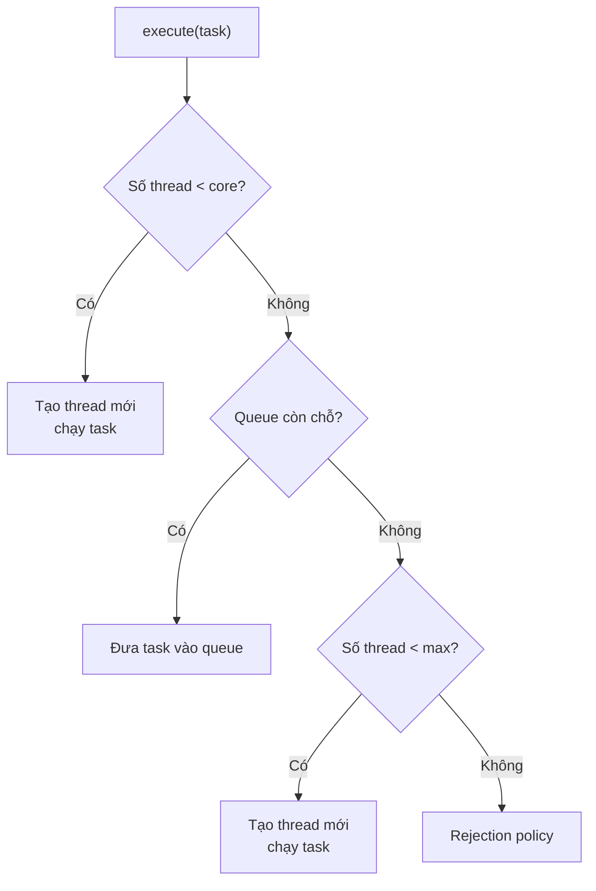

# ThreadPoolExecutor

> **Tuần 3 · Ngày 16** · Thuộc [[03 - Concurrency, SQL, REST & Security]] · Bài trước: [[03.01 - Thread Basics]] · Bài sau: [[03.03 - CompletableFuture]]
> Câu "core = 2, max = 4, queue = 10, submit 20 task thì sao?" và "vì sao `newFixedThreadPool` nguy hiểm?" xuất hiện rất thường xuyên. Trả lời sai thứ tự core → queue → max là mất điểm ngay.
> Toàn bộ output trong bài đã được chạy thử trên JDK 21 (máy 8 CPU).

**Mục lục**
1. [[#1. Vì sao cần thread pool|Vì sao cần thread pool]]
2. [[#2. Các tham số của ThreadPoolExecutor|Các tham số của ThreadPoolExecutor]]
3. [[#3. Luồng xử lý: core, queue, max, reject|Luồng xử lý: core, queue, max, reject]]
4. [[#4. Rejection policy|Rejection policy]]
5. [[#5. Bẫy của các factory trong Executors|Bẫy của các factory trong Executors]]
6. [[#6. Chọn kích thước pool|Chọn kích thước pool]]
7. [[#7. Tắt pool đúng cách|Tắt pool đúng cách]]
8. [[#8. ThreadPoolTaskExecutor trong Spring|ThreadPoolTaskExecutor trong Spring]]
9. [[#9. Kịch bản Feynman hôm nay|Kịch bản Feynman hôm nay]]

---

## 1. Vì sao cần thread pool

### Hiểu bản chất
Mỗi platform thread là một thread của hệ điều hành: tạo tốn thời gian, mỗi cái giữ một stack (mặc định khoảng 1 MB vùng nhớ dành sẵn). Nếu mỗi request hay mỗi việc lại `new Thread()`:
- Tải tăng đột biến thì số thread tăng không giới hạn, hệ điều hành và JVM chết trước.
- Không tái sử dụng: tạo xong, chạy 5 ms, huỷ, lặp lại.

**Thread pool** giống một **quầy giao dịch ngân hàng**: số giao dịch viên cố định (thread), khách mới đến thì **xếp hàng** (queue), đông quá thì mở thêm quầy phụ (max), vẫn đông nữa thì **từ chối** (reject). Số người làm việc có giới hạn nên hệ thống không sập vì quá tải.

`ExecutorService` là interface; `ThreadPoolExecutor` là bản cài đặt chính. Tomcat, `@Async`, HikariCP... đều dựa trên ý tưởng này.

---

## 2. Các tham số của ThreadPoolExecutor

### Code minh hoạ

```java
ThreadPoolExecutor pool = new ThreadPoolExecutor(
        4,                                       // corePoolSize
        8,                                       // maximumPoolSize
        60, TimeUnit.SECONDS,                    // keepAliveTime cho thread vượt core
        new ArrayBlockingQueue<>(100),           // workQueue: CÓ giới hạn
        Thread.ofPlatform().name("report-", 0).factory(),   // threadFactory: đặt tên thread
        new ThreadPoolExecutor.CallerRunsPolicy());          // handler khi quá tải
```

| Tham số | Ý nghĩa | Ghi chú thực tế |
|---|---|---|
| `corePoolSize` | Số thread "thường trực" | Mặc định không bị huỷ khi rảnh (trừ khi `allowCoreThreadTimeOut(true)`) |
| `maximumPoolSize` | Số thread tối đa | Chỉ dùng tới khi **queue đầy** |
| `keepAliveTime` | Thread vượt core rảnh quá lâu thì bị huỷ | |
| `workQueue` | Hàng đợi task | Quyết định gần như toàn bộ hành vi của pool |
| `threadFactory` | Cách tạo thread | Đặt tên thread để đọc log và thread dump |
| `handler` | Làm gì khi không nhận thêm được | Xem mục 4 |

Các loại queue hay gặp:

| Queue | Đặc điểm | Hệ quả |
|---|---|---|
| `ArrayBlockingQueue(n)` | Có giới hạn, mảng cố định | Lựa chọn an toàn cho production |
| `LinkedBlockingQueue()` | **Không giới hạn** nếu không truyền capacity | `max` vô nghĩa, có thể OOM |
| `SynchronousQueue` | Không chứa gì, phải có thread nhận ngay | Mỗi task không có thread rảnh sẽ tạo thread mới |
| `PriorityBlockingQueue` | Không giới hạn, sắp xếp theo ưu tiên | Ít dùng |

---

## 3. Luồng xử lý: core, queue, max, reject

### Hiểu bản chất
Khi gọi `execute(task)`:



Điểm phản trực giác: pool **lấp đầy queue trước rồi mới tăng thread lên max**, chứ không tăng thread trước. Nhiều người đoán ngược.

### Code minh hoạ
Đúng câu hỏi trong bộ ôn tập: core 2, max 4, `ArrayBlockingQueue(10)`, submit liên tục 20 task, mỗi task ngủ 1 giây.

```java
ThreadPoolExecutor pool = new ThreadPoolExecutor(2, 4, 60, TimeUnit.SECONDS,
        new ArrayBlockingQueue<>(10));
for (int i = 1; i <= 20; i++) {
    try {
        pool.execute(slowTask);
        System.out.println(i + ": threads=" + pool.getPoolSize()
                + ", queue=" + pool.getQueue().size());
    } catch (RejectedExecutionException e) {
        System.out.println(i + ": REJECTED");
    }
}
```

Kết quả đo được:

| Task | Số thread | Số task trong queue | Chuyện gì xảy ra |
|---|---|---|---|
| 1 | 1 | 0 | Tạo thread core thứ nhất |
| 2 | 2 | 0 | Tạo thread core thứ hai |
| 3 → 12 | 2 | 1 → 10 | Vào queue |
| 13 | 3 | 10 | Queue đầy, tạo thread vượt core |
| 14 | 4 | 10 | Đạt max |
| 15 → 20 | 4 | 10 | **REJECTED** (6 task, `RejectedExecutionException`) |

Tổng kết: 4 task đang chạy, 10 task trong queue, 6 task bị từ chối. Sau `shutdown()` và `awaitTermination`, pool hoàn tất đúng **14** task trong khoảng **4 giây** (14 task × 1 s chia cho 4 thread, làm tròn lên 4 đợt).

### Bẫy hay gặp
- **Task đến sau lại chạy trước.** Đo thứ tự bắt đầu với cùng cấu hình (14 task): `[1, 2, 13, 14, 3, 4, 5, ..., 12]`. Thread vượt core được tạo ra kèm luôn task vừa submit, nên task 13 và 14 "chen hàng" lên trước task 3–12 đang chờ trong queue. Nếu nghiệp vụ cần thứ tự, đừng dựa vào thread pool.
- **Thread core được tạo mới dù thread cũ đang rảnh.** Đo được: pool core 4, submit 2 task ngắn cách nhau 100 ms (task đầu đã xong), `getPoolSize()` vẫn là **2**. Chưa đủ core thì luôn tạo thread mới.
- Với queue không giới hạn, bước "queue đầy" không bao giờ xảy ra, nên **pool không bao giờ vượt core**.

> **Trả lời mẫu:** "ThreadPoolExecutor xử lý task theo thứ tự: chưa đủ core thread thì tạo thread mới; đủ core thì đẩy vào queue; queue đầy mà chưa tới max thì tạo thêm thread; đã max thì áp dụng rejection policy, mặc định là AbortPolicy ném RejectedExecutionException. Ví dụ core 2, max 4, queue 10, submit 20 task chạy lâu thì 4 task chạy, 10 nằm trong queue, 6 bị reject; em đã chạy thử và ra đúng như vậy. Vì thứ tự này, ở dự án em luôn dùng queue có giới hạn, nếu không max chẳng bao giờ được dùng và queue có thể phình tới OOM."

### Câu hỏi xoáy

**Q1.** Muốn pool tăng thread lên max **trước** khi xếp hàng thì làm sao?
> [!success]- Gợi ý trả lời
> Cách đơn giản: đặt `core = max` và bật `allowCoreThreadTimeOut(true)` để thread rảnh vẫn được thu hồi. Cách phức tạp hơn là queue tuỳ biến từ chối `offer` khi còn có thể tạo thread (Tomcat làm như vậy với `TaskQueue` của nó).

**Q2.** Cùng cấu hình nhưng mỗi task chỉ chạy 1 ms thì còn bị reject không?
> [!success]- Gợi ý trả lời
> Có thể không, hoặc ít hơn nhiều: task xong nhanh thì thread rảnh lấy task từ queue, queue không kịp đầy. Con số "6 bị reject" chỉ đúng khi task chạy lâu hơn thời gian submit cả 20 task.

---

## 4. Rejection policy

### Hiểu bản chất

| Policy | Hành vi | Khi nào dùng |
|---|---|---|
| `AbortPolicy` (mặc định) | Ném `RejectedExecutionException` | Muốn bên gọi biết ngay là quá tải (trả 503, retry sau) |
| `CallerRunsPolicy` | **Thread gọi `execute` tự chạy task** | Back-pressure: làm chậm bên gửi, không mất task |
| `DiscardPolicy` | Lặng lẽ bỏ task mới | Task không quan trọng (metric, log phụ) |
| `DiscardOldestPolicy` | Bỏ task **cũ nhất** trong queue, thử lại task mới | Chỉ cần dữ liệu mới nhất |

### Code minh hoạ
Pool 1 thread, queue 2, submit 5 task (mỗi task 100 ms, ghi lại id khi xong):

| Policy | Task được chạy (đo được) |
|---|---|
| `DiscardPolicy` | `[1, 2, 3]`: task 4, 5 biến mất, không lỗi, không log |
| `DiscardOldestPolicy` | `[1, 4, 5]`: task 2, 3 trong queue bị đẩy ra |

Với `CallerRunsPolicy` (pool 1 thread, queue 1, submit 3 task ngủ 1 giây): vòng lặp submit mất **1006 ms** thay vì gần 0, và task đã chạy trên cả `pool-2-thread-1` **lẫn `main`**. Bên gửi bị kéo chậm lại: đó chính là back-pressure.

### Bẫy hay gặp
- `CallerRunsPolicy` trong web app: thread chạy task là **thread Tomcat của request**, nên request đó chậm hẳn. Chấp nhận được với job nền, cần cân nhắc với API.
- `DiscardPolicy` không có log: mất dữ liệu mà không ai biết. Nếu dùng, nên tự viết handler có log và metric.

> **Trả lời mẫu:** "Có 4 policy có sẵn: Abort ném exception, là mặc định; CallerRuns để thread gọi tự chạy task, tạo back-pressure; Discard bỏ task mới; DiscardOldest bỏ task cũ nhất trong queue. Em hay dùng CallerRuns cho job nền như gửi email hàng loạt để không mất task mà tự làm chậm bên đẩy, còn với API thì Abort rồi trả 503 để client retry."

### Câu hỏi xoáy

**Q1.** Ngoài lúc quá tải, khi nào pool còn từ chối task?
> [!success]- Gợi ý trả lời
> Sau khi đã gọi `shutdown()`. Đã chạy: `execute` sau `shutdownNow()` ném `RejectedExecutionException`.

---

## 5. Bẫy của các factory trong Executors

### Hiểu bản chất
Các factory method tiện nhưng giấu cấu hình nguy hiểm (Alibaba Java Guidelines cấm dùng chúng trong production vì lý do này):

| Factory | Bên trong | Rủi ro |
|---|---|---|
| `newFixedThreadPool(n)` | core = max = n, `LinkedBlockingQueue` **không giới hạn** | Task dồn vô hạn trong queue, OOM |
| `newSingleThreadExecutor()` | 1 thread, queue không giới hạn | Như trên |
| `newCachedThreadPool()` | core 0, max `Integer.MAX_VALUE`, `SynchronousQueue` | Tạo thread không giới hạn |
| `newScheduledThreadPool(n)` | Queue delay không giới hạn | Như trên |

### Code minh hoạ

```java
ThreadPoolExecutor fixed = (ThreadPoolExecutor) Executors.newFixedThreadPool(10);
fixed.getQueue().remainingCapacity();     // 2147483647
for (int i = 0; i < 100_000; i++) fixed.execute(slowTask);
// đo được: threads=10, queue=99990, không exception nào

ThreadPoolExecutor cached = (ThreadPoolExecutor) Executors.newCachedThreadPool();
for (int i = 0; i < 2000; i++) cached.execute(sleep5s);
// đo được 3 lần: threads=2000 cả 3 lần
```

100.000 task được "nhận" ngon lành, không lỗi, nhưng nằm chờ trong RAM. Ở production, khi downstream chậm, queue cứ thế phình (mỗi task giữ cả request, payload) tới khi OOM. Còn cached pool thì cứ mỗi task chưa có thread rảnh là thêm một thread hệ điều hành.

### Bẫy hay gặp
- Hỏi lại: "`newFixedThreadPool(10)` có max là bao nhiêu?" Max là 10 nhưng **không bao giờ cần tới**, vì queue không bao giờ đầy, nên cũng **không bao giờ reject**. Đây là điều làm nó nguy hiểm: quá tải mà không có tín hiệu.

> **Trả lời mẫu:** "`newFixedThreadPool` dùng LinkedBlockingQueue không giới hạn, nên khi task tới nhanh hơn tốc độ xử lý thì queue phình mãi tới OOM và không bao giờ reject. Em thử submit 100 nghìn task chậm vào pool 10 thread: không lỗi gì, 99.990 task nằm chờ trong bộ nhớ. `newCachedThreadPool` thì ngược lại, max là Integer.MAX_VALUE nên tạo thread không giới hạn; thử 2000 task ngủ 5 giây là ra 2000 thread. Production em tự cấu hình ThreadPoolExecutor hoặc ThreadPoolTaskExecutor với queue có giới hạn và rejection policy rõ ràng."

### Câu hỏi xoáy

**Q1.** Vậy có khi nào dùng `newFixedThreadPool` được không?
> [!success]- Gợi ý trả lời
> Với tool nội bộ, test, batch mà số task **biết trước và nhỏ** thì chấp nhận được. Điều quan trọng là hiểu rủi ro chứ không phải cấm tuyệt đối.

---

## 6. Chọn kích thước pool

### Hiểu bản chất
- **CPU-bound** (tính toán, nén, mã hoá): thread luôn bận CPU, thêm thread quá số core chỉ tốn chi phí chuyển ngữ cảnh. Chọn khoảng **số core** (hoặc core + 1).
- **I/O-bound** (gọi API, query DB): thread phần lớn thời gian **ngồi chờ**, nên cần nhiều thread hơn core. Công thức ước lượng (Brian Goetz):

```text
threads ≈ số core × (1 + thời gian chờ / thời gian xử lý CPU)
```

Ví dụ: máy 8 core, mỗi lần gọi API chờ 200 ms và xử lý CPU 10 ms: `8 × (1 + 20) = 168` thread.

### Bẫy hay gặp
- Công thức chỉ là **điểm xuất phát**. Phải load test rồi chỉnh theo latency và CPU thực tế.
- **Tài nguyên phía sau mới là giới hạn thật.** Pool 168 thread cùng query DB qua HikariCP có 10 connection thì 158 thread chỉ đứng chờ connection. Kích thước pool phải nhìn cả connection pool, rate limit của API đối tác.
- `Runtime.getRuntime().availableProcessors()` trong container trả về số CPU theo giới hạn của container (JDK hiện đại có hỗ trợ cgroup), không phải số CPU của máy chủ vật lý.

> **Trả lời mẫu:** "Với tác vụ CPU-bound em đặt khoảng bằng số core vì thêm thread chỉ tăng context switch. Với I/O-bound thì nhiều hơn, ước lượng bằng số core nhân (1 + thời gian chờ chia thời gian xử lý). Nhưng em luôn đối chiếu với tài nguyên phía sau: nếu task query DB mà Hikari chỉ có 10 connection thì để pool 100 thread cũng không nhanh hơn. Cuối cùng đo bằng load test rồi chỉnh."

### Câu hỏi xoáy

**Q1.** Một pool dùng chung cho cả việc CPU-bound và gọi API có ổn không?
> [!success]- Gợi ý trả lời
> Không nên. Việc gọi API chậm sẽ chiếm hết thread làm việc tính toán phải chờ. Nên **tách pool theo loại việc** (bulkhead), để một downstream chậm không kéo sập phần khác.

---

## 7. Tắt pool đúng cách

### Hiểu bản chất

| Method | Hành vi |
|---|---|
| `shutdown()` | Không nhận task mới, **vẫn chạy hết** task đang chạy và task trong queue. Không chờ, trả về ngay |
| `shutdownNow()` | Không nhận task mới, **interrupt** task đang chạy, **trả về list task trong queue** chưa chạy |
| `awaitTermination(t)` | Chặn tới khi pool tắt xong hoặc hết thời gian, trả `true`/`false` |

### Code minh hoạ
Mẫu chuẩn (theo Javadoc của `ExecutorService`):

```java
void stop(ExecutorService pool) {
    pool.shutdown();                                   // 1. ngừng nhận việc mới
    try {
        if (!pool.awaitTermination(30, TimeUnit.SECONDS)) {
            List<Runnable> dropped = pool.shutdownNow();   // 2. hết kiên nhẫn: interrupt
            log.warn("Dropped {} queued tasks", dropped.size());
        }
    } catch (InterruptedException e) {
        pool.shutdownNow();
        Thread.currentThread().interrupt();
    }
}
```

Đo được: pool 1 thread, 5 task ngủ 1 giây; sau 50 ms gọi `shutdownNow()`: trả về **4** task chưa chạy, **1** task đang chạy nhận `InterruptedException`.

### Bẫy hay gặp
- `shutdown()` **không chờ**. Gọi xong rồi thoát `main` ngay thì có thể chưa xong việc; phải `awaitTermination`.
- Quên `shutdown()` một pool tự tạo: thread core là non-daemon nên ứng dụng console không thoát (xem [[03.01 - Thread Basics]] mục 5).
- Java 19+ `ExecutorService` là `AutoCloseable`: `try (var ex = ...) { }` sẽ tự `shutdown` và chờ khi ra khỏi block.

> **Trả lời mẫu:** "`shutdown` ngừng nhận task mới nhưng vẫn chạy nốt task đang chạy và trong queue, còn `shutdownNow` interrupt task đang chạy và trả về những task chưa chạy. Em dùng mẫu: shutdown, chờ awaitTermination một khoảng, nếu chưa xong mới shutdownNow. Với bean Spring thì ThreadPoolTaskExecutor tự làm việc này khi context đóng, em chỉ cấu hình cho nó chờ task xong."

### Câu hỏi xoáy

**Q1.** `shutdownNow()` có chắc chắn dừng task đang chạy không?
> [!success]- Gợi ý trả lời
> Không. Nó chỉ gọi `interrupt()`. Task đang tính toán mà không kiểm tra cờ interrupt, hoặc nuốt `InterruptedException`, sẽ chạy tiếp tới khi xong.

---

## 8. ThreadPoolTaskExecutor trong Spring

### Hiểu bản chất
Spring bọc `ThreadPoolExecutor` thành bean `ThreadPoolTaskExecutor`, được Spring quản lý vòng đời (tự shutdown khi tắt app) và dùng cho `@Async`.

```java
@Bean
ThreadPoolTaskExecutor reportExecutor() {
    ThreadPoolTaskExecutor ex = new ThreadPoolTaskExecutor();
    ex.setCorePoolSize(4);
    ex.setMaxPoolSize(8);
    ex.setQueueCapacity(100);                          // có giới hạn
    ex.setThreadNamePrefix("report-");
    ex.setRejectedExecutionHandler(new ThreadPoolExecutor.CallerRunsPolicy());
    ex.setWaitForTasksToCompleteOnShutdown(true);
    ex.setAwaitTerminationSeconds(30);
    return ex;
}

@Async("reportExecutor")
public CompletableFuture<Report> build(long id) { ... }
```

### Bẫy hay gặp
- Bản thân `ThreadPoolTaskExecutor` mặc định `queueCapacity = Integer.MAX_VALUE`, tức **mắc đúng bẫy queue không giới hạn**. Executor mặc định Spring Boot tạo cho `@Async` (`applicationTaskExecutor`) cũng có queue không giới hạn theo mặc định; chỉnh qua `spring.task.execution.pool.*`.
- `@Async` gọi từ chính class đó (self-invocation) không chạy bất đồng bộ, vì đi vòng qua proxy (sẽ học ở Tuần 4–5).
- `ThreadLocal` như `SecurityContext`, MDC **không tự sang** thread của executor; dùng `TaskDecorator` để copy (bài [[03.05 - Deadlock, ThreadLocal & Virtual Threads]]).

> **Trả lời mẫu:** "Trong Spring em khai báo ThreadPoolTaskExecutor làm bean với core, max, queue capacity có giới hạn, thread name prefix và rejection policy, rồi dùng `@Async` kèm tên bean đó. Em không để mặc định vì queue capacity mặc định là Integer.MAX_VALUE. Em cũng bật chờ task xong khi shutdown để deploy không cắt ngang job."

### Câu hỏi xoáy

**Q1.** Vì sao nên đặt `threadNamePrefix`?
> [!success]- Gợi ý trả lời
> Khi đọc log hoặc thread dump, tên `report-3` cho biết ngay thread thuộc pool nào. Tên `pool-7-thread-3` thì không giúp gì khi cần tìm pool nào đang nghẽn.

---

## 9. Kịch bản Feynman hôm nay

1. Kể lại quy trình core → queue → max → reject bằng hình ảnh quầy ngân hàng, rồi tự giải câu "core 2, max 4, queue 10, 20 task" không nhìn bài.
2. Giải thích vì sao task 13 lại chạy trước task 3.
3. Thuyết phục một đồng nghiệp bỏ `Executors.newFixedThreadPool` trong code production.
4. Tính kích thước pool cho service gọi API mất 300 ms, xử lý 15 ms, chạy trên container 4 CPU, và nói vì sao còn phải nhìn connection pool.

Ghi vào [[08 - Nhật ký học tập]].

## Tự kiểm tra nhanh (không mở tài liệu)

- [ ] Vẽ lại sơ đồ 4 bước khi `execute(task)`
- [ ] Core 2, max 4, queue 10, 20 task chạy lâu: bao nhiêu chạy, bao nhiêu chờ, bao nhiêu reject?
- [ ] Kể 4 rejection policy và một trường hợp dùng mỗi cái
- [ ] Vì sao `newFixedThreadPool` không bao giờ reject? Vì sao điều đó nguy hiểm?
- [ ] `newCachedThreadPool` nguy hiểm ở điểm nào?
- [ ] Công thức kích thước pool cho I/O-bound
- [ ] `shutdown` vs `shutdownNow`
- [ ] Giá trị mặc định nguy hiểm của `ThreadPoolTaskExecutor` là gì?
