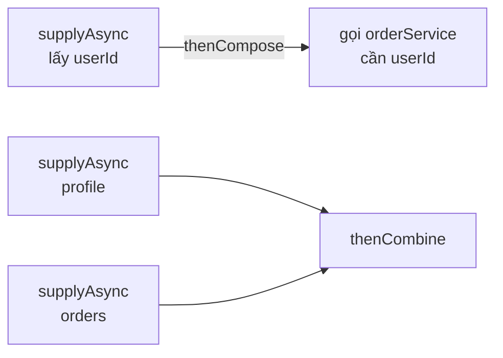
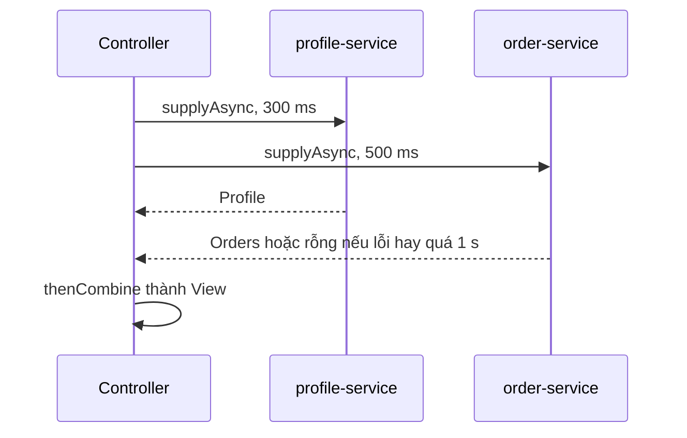

# CompletableFuture

> **Tuần 3 · Ngày 17** · Thuộc [[03 - Concurrency, SQL, REST & Security]] · Bài trước: [[03.02 - ThreadPoolExecutor]] · Bài sau: [[03.04 - synchronized, volatile, Atomic & ConcurrentHashMap]]
> Câu hỏi thực tế nhất của tuần: "Màn hình cần dữ liệu từ 2–3 service, làm sao gọi song song, có timeout và fallback?" Biết `thenCombine` + executor riêng + timeout là ghi điểm rõ rệt.
> Toàn bộ output trong bài đã được chạy thử trên JDK 21 (máy 8 CPU). Thời gian đo bằng `System.nanoTime()`, lệch vài ms giữa các lần chạy.

**Mục lục**
1. [[#1. Vì sao cần CompletableFuture|Vì sao cần CompletableFuture]]
2. [[#2. supplyAsync và executor riêng|supplyAsync và executor riêng]]
3. [[#3. thenApply, thenCompose, thenCombine|thenApply, thenCompose, thenCombine]]
4. [[#4. allOf và anyOf|allOf và anyOf]]
5. [[#5. Xử lý lỗi: exceptionally, handle, whenComplete|Xử lý lỗi: exceptionally, handle, whenComplete]]
6. [[#6. Timeout: orTimeout và completeOnTimeout|Timeout: orTimeout và completeOnTimeout]]
7. [[#7. join() vs get()|join() vs get()]]
8. [[#8. Ví dụ thực tế: dashboard gộp 2 service|Ví dụ thực tế: dashboard gộp 2 service]]
9. [[#9. Kịch bản Feynman hôm nay|Kịch bản Feynman hôm nay]]

---

## 1. Vì sao cần CompletableFuture

### Hiểu bản chất
`Future` (bài [[03.02 - ThreadPoolExecutor]]) chỉ cho bạn **chờ** kết quả bằng `get()`, và `get()` chặn thread. Không có cách nói "khi có kết quả thì làm tiếp việc này", không gộp được 2 Future, không có xử lý lỗi kiểu chuỗi.

`CompletableFuture` (Java 8) là một Future **có thể lắp thành dây chuyền**: mỗi bước khai báo "khi bước trước xong thì làm gì". Hình dung một **dây chuyền lắp ráp**: bạn mô tả các trạm, còn sản phẩm chạy qua các trạm khi sẵn sàng, bạn không phải đứng canh từng trạm.

Nếu đã học Stream thì sẽ thấy quen: `thenApply` giống `map`, `thenCompose` giống `flatMap`.

---

## 2. supplyAsync và executor riêng

### Hiểu bản chất

| Method | Task | Kết quả |
|---|---|---|
| `supplyAsync(supplier)` | Trả về giá trị | `CompletableFuture<T>` |
| `runAsync(runnable)` | Không trả gì | `CompletableFuture<Void>` |
| Bản có tham số `executor` | Chạy trên executor bạn truyền | |
| Bản **không** có `executor` | Chạy trên `ForkJoinPool.commonPool()` | |

### Code minh hoạ

```java
CompletableFuture.supplyAsync(() -> Thread.currentThread().getName()).join();
// ForkJoinPool.commonPool-worker-1
ForkJoinPool.commonPool().getParallelism();   // 7 trên máy 8 CPU
```

Thử chặn commonPool: 14 task, mỗi task `sleep(1000)` giả lập gọi API.

| Chạy trên | Thời gian đo được |
|---|---|
| `commonPool()` (7 thread) | **2013 ms**: chạy 2 đợt, 7 task mỗi đợt |
| Pool riêng 20 thread | **1049 ms**: chạy 1 đợt |

### Bẫy hay gặp
- **commonPool dùng chung cả JVM**: parallel stream ([[02.08 - Optional & Parallel Stream]]) và mọi `supplyAsync` không truyền executor đều tranh nhau 7 thread này. Một chỗ gọi API chậm trên commonPool là cả ứng dụng chậm theo.
- Quy tắc: **tác vụ I/O luôn truyền executor riêng**, có kích thước phù hợp và queue có giới hạn.
- Các method không có hậu tố `Async` (`thenApply`, `thenCombine`...) chạy trên **thread hoàn thành bước trước**, hoặc trên **thread gọi** nếu bước trước đã xong sẵn. Đã chạy: `completedFuture(1).thenApply(...)` chạy trên `main`; `thenApplyAsync(fn, io)` chạy trên `pool-1-thread-8`. Bước nào nặng thì dùng bản `...Async(fn, executor)`.

> **Trả lời mẫu:** "`supplyAsync` không truyền executor thì chạy trên ForkJoinPool.commonPool, pool dùng chung cả JVM với kích thước khoảng số CPU trừ 1, máy 8 CPU là 7 thread. Nếu đem gọi API hay DB lên đó thì chặn luôn parallel stream và các nơi khác. Em đã thử 14 task chờ 1 giây: commonPool mất 2 giây, pool riêng 20 thread mất 1 giây. Nên ở dự án em luôn truyền executor riêng cho tác vụ I/O."

### Câu hỏi xoáy

**Q1.** Trong Spring, executor riêng lấy ở đâu?
> [!success]- Gợi ý trả lời
> Khai báo bean `ThreadPoolTaskExecutor` (hoặc `ExecutorService`) với cấu hình rõ ràng rồi inject vào service, truyền vào `supplyAsync(..., executor)`. Hoặc dùng `@Async("tênExecutor")` trả về `CompletableFuture`.

---

## 3. thenApply, thenCompose, thenCombine

### Hiểu bản chất

| Method | Nhận vào | Dùng khi | Tương tự Stream |
|---|---|---|---|
| `thenApply(fn)` | `T -> U` | Biến đổi kết quả | `map` |
| `thenCompose(fn)` | `T -> CompletableFuture<U>` | Bước sau **phụ thuộc** kết quả bước trước và cũng async | `flatMap` |
| `thenCombine(other, fn)` | CF khác + `(T, U) -> R` | Gộp 2 việc **độc lập** chạy song song | `zip` |
| `thenAccept(c)` / `thenRun(r)` | Consumer / Runnable | Bước cuối không trả gì | `forEach` |

### Code minh hoạ

```java
// thenApply với hàm trả CF → bị lồng
CompletableFuture<CompletableFuture<List<String>>> nested = supplyAsync(() -> 1L, io)
        .thenApply(id -> supplyAsync(() -> orders(id), io));
// thenCompose → phẳng
CompletableFuture<List<String>> flat = supplyAsync(() -> 1L, io)
        .thenCompose(id -> supplyAsync(() -> orders(id), io));
flat.join();                                    // [o1, o2]

// thenCombine: user 300 ms và orders 500 ms chạy song song
String d = supplyAsync(() -> user(1), io)
        .thenCombine(supplyAsync(() -> orders(1), io),
                (u, o) -> u + " has " + o.size() + " orders")
        .join();                                // user-1 has 2 orders, mất 520 ms
```

`nested.join()` trả về một `CompletableFuture` chứ không phải list: phải `join()` thêm lần nữa.



### Bẫy hay gặp
- Dùng `thenCompose` cho 2 việc **độc lập** biến chúng thành tuần tự. Độc lập thì tạo cả 2 CF trước, rồi `thenCombine`.
- Gọi `join()` ở giữa chuỗi (ví dụ trong `thenApply`) là chặn thread của pool, mất ý nghĩa bất đồng bộ.

> **Trả lời mẫu:** "`thenApply` dùng khi biến đổi kết quả bằng một hàm thường, giống map. `thenCompose` dùng khi bước sau lại là một tác vụ async phụ thuộc kết quả bước trước, nó làm phẳng thay vì cho ra CompletableFuture lồng nhau, giống flatMap. `thenCombine` gộp hai CF độc lập chạy song song. Ví dụ ở dự án em, lấy profile và đơn hàng của user là hai việc độc lập nên em khởi chạy cả hai rồi `thenCombine`, thời gian còn bằng việc chậm hơn chứ không phải tổng."

### Câu hỏi xoáy

**Q1.** Khi nào chọn `thenCompose` thay vì `thenCombine`?
> [!success]- Gợi ý trả lời
> Khi bước 2 **cần kết quả** bước 1 (lấy user rồi mới biết gọi order theo `customerId`). Nếu không cần thì `thenCombine` để chạy song song.

---

## 4. allOf và anyOf

### Hiểu bản chất
- `allOf(cf1, cf2, ...)`: xong khi **tất cả** xong. Kiểu trả về là `CompletableFuture<Void>`, nên phải tự `join()` từng CF để lấy kết quả (lúc đó không chặn nữa vì đã xong).
- `anyOf(...)`: xong khi **một cái bất kỳ** xong, trả `CompletableFuture<Object>`.

### Code minh hoạ

```java
List<CompletableFuture<String>> fs = List.of(200, 400, 600).stream()
        .map(t -> supplyAsync(() -> { sleep(t); return "s" + t; }, io))
        .toList();
List<String> all = CompletableFuture.allOf(fs.toArray(new CompletableFuture[0]))
        .thenApply(v -> fs.stream().map(CompletableFuture::join).toList())
        .join();                          // [s200, s400, s600], 623 ms (≈ việc lâu nhất)

Object any = CompletableFuture.anyOf(
        supplyAsync(() -> { sleep(600); return "slow"; }, io),
        supplyAsync(() -> { sleep(200); return "fast"; }, io)).join();   // fast, 208 ms
```

### Bẫy hay gặp
- Nếu một CF trong `allOf` lỗi thì `allOf` cũng lỗi, nhưng **phải chờ tất cả xong** mới báo. Muốn "lỗi một cái là dừng" phải tự xử lý.
- `anyOf` trả về kết quả đầu tiên, **kể cả lỗi**: nếu cái nhanh nhất ném exception thì `anyOf` lỗi.

> **Trả lời mẫu:** "`allOf` chờ tất cả xong, trả CompletableFuture<Void> nên em gom kết quả bằng cách join từng CF sau đó; tổng thời gian xấp xỉ việc lâu nhất. `anyOf` lấy kết quả đầu tiên, hợp khi gọi nhiều nguồn dự phòng. Lưu ý một CF lỗi thì allOf lỗi, nên em gắn `exceptionally` cho từng CF trước để có fallback riêng."

### Câu hỏi xoáy

**Q1.** Gọi song song 100 API bằng `allOf` có vấn đề gì?
> [!success]- Gợi ý trả lời
> Phụ thuộc executor: pool 10 thread thì vẫn chỉ 10 cái chạy cùng lúc, còn lại chờ trong queue (queue không đủ chỗ thì bị reject). Ngoài ra còn rate limit của bên kia. Nên giới hạn mức song song có chủ đích, không bắn hết một lần.

---

## 5. Xử lý lỗi: exceptionally, handle, whenComplete

### Hiểu bản chất
Khi một bước ném exception, các bước `thenApply`/`thenCompose` phía sau **bị bỏ qua**, lỗi trôi xuống tới bước xử lý lỗi đầu tiên.

| Method | Được gọi khi | Đổi được kết quả? | Dùng để |
|---|---|---|---|
| `exceptionally(ex -> v)` | Chỉ khi lỗi | Có: trả giá trị fallback | Fallback |
| `handle((v, ex) -> r)` | Luôn luôn | Có | Xử lý cả 2 nhánh ở một chỗ |
| `whenComplete((v, ex) -> ...)` | Luôn luôn | **Không**: lỗi vẫn trôi tiếp | Log, metric |

### Code minh hoạ

```java
CompletableFuture<Integer> failing = supplyAsync(() -> {
    throw new IllegalStateException("svc down");
}, io);

failing.thenApply(x -> x * 2)                 // bị bỏ qua, không chạy
       .exceptionally(ex -> -1)               // ex là CompletionException, cause = "svc down"
       .join();                               // -1

failing.handle((v, ex) -> ex == null ? "ok " + v : "fallback").join();   // fallback

failing.whenComplete((v, ex) -> log.warn("failed", ex))
       .join();                               // vẫn ném CompletionException
```

### Bẫy hay gặp
- Exception nhận được trong `exceptionally`/`handle` thường là **`CompletionException` bọc lỗi gốc** (đã chạy: lỗi ném trong `supplyAsync` tới `exceptionally` dưới dạng `CompletionException`). Muốn kiểm tra loại lỗi thì xét `ex.getCause()`. Chỉ khi CF bị `completeExceptionally(e)` trực tiếp thì mới nhận đúng `e`.
- Nghĩ `whenComplete` "bắt" được lỗi là sai: nó chỉ quan sát.
- Không gắn bất kỳ xử lý lỗi nào và không ai `join()`: lỗi **biến mất không dấu vết**, giống `submit()` ở [[03.01 - Thread Basics]].

> **Trả lời mẫu:** "Lỗi ở một bước làm các bước sau bị bỏ qua cho tới bước xử lý lỗi. `exceptionally` chỉ chạy khi lỗi và trả giá trị fallback; `handle` luôn chạy, nhận cả kết quả và exception nên đổi được kết quả ở cả hai nhánh; `whenComplete` cũng luôn chạy nhưng không đổi kết quả, em dùng để log. Lưu ý exception thường bị bọc trong CompletionException nên em kiểm tra `getCause()`."

### Câu hỏi xoáy

**Q1.** Đặt `exceptionally` ở đầu chuỗi và ở cuối chuỗi khác nhau thế nào?
> [!success]- Gợi ý trả lời
> Ở ngay sau một CF: chỉ bắt lỗi của CF đó, các bước sau tiếp tục với giá trị fallback. Ở cuối chuỗi: bắt lỗi của **bất kỳ** bước nào phía trên, và mọi bước giữa đã bị bỏ qua. Với dashboard, nên gắn fallback cho **từng nguồn** để một nguồn lỗi không xoá cả màn hình.

---

## 6. Timeout: orTimeout và completeOnTimeout

### Hiểu bản chất
Java 9 thêm 2 method:
- `orTimeout(t, unit)`: quá giờ thì CF **lỗi** với `TimeoutException`.
- `completeOnTimeout(value, t, unit)`: quá giờ thì CF **hoàn thành với giá trị mặc định**.

### Code minh hoạ

```java
supplyAsync(() -> { sleep(2000); return "late"; }, io)
        .orTimeout(500, TimeUnit.MILLISECONDS)
        .join();          // CompletionException, cause = TimeoutException, sau 513 ms

supplyAsync(() -> { sleep(2000); return "late"; }, io)
        .completeOnTimeout("cached-default", 500, TimeUnit.MILLISECONDS)
        .join();          // "cached-default", sau 504 ms
```

### Bẫy hay gặp
- **Timeout không dừng task bên dưới.** Đã đo: sau khi `completeOnTimeout` trả giá trị mặc định, task vẫn chạy tiếp đủ 2 giây và hoàn tất. Thread của pool vẫn bị chiếm. Vì vậy vẫn phải đặt **timeout ở tầng HTTP client / JDBC**; timeout của CF chỉ là để bên gọi không phải chờ.
- `cancel(true)` cũng không interrupt task. Đã chạy: `cancel(true)` trả `true`, `join()` ném `CancellationException`, nhưng task vẫn chạy xong và không nhận interrupt nào. (Khác với `Future` của `ExecutorService`.)
- Trước Java 9 không có 2 method này; trả lời "dùng `get(timeout)`" là cách cũ và chặn thread.

> **Trả lời mẫu:** "Từ Java 9 có `orTimeout` làm CF lỗi với TimeoutException khi quá giờ, và `completeOnTimeout` trả giá trị mặc định. Em hay dùng completeOnTimeout cho phần không quan trọng của màn hình. Nhưng cả hai không huỷ task thật bên dưới, em đã thử và task vẫn chạy tới cùng, nên em vẫn cấu hình connect và read timeout cho RestClient hay WebClient."

### Câu hỏi xoáy

**Q1.** Vậy làm sao để task thật sự dừng khi timeout?
> [!success]- Gợi ý trả lời
> Đặt timeout ngay tại nguồn chặn: read timeout của HTTP client, `queryTimeout` của JDBC. Khi đó lời gọi bên dưới tự ném exception và giải phóng thread.

---

## 7. join() vs get()

### Hiểu bản chất

| | `get()` | `join()` |
|---|---|---|
| Exception khi task lỗi | `ExecutionException` (checked) | `CompletionException` (unchecked) |
| Khi bị interrupt lúc chờ | Ném `InterruptedException` (checked) | Không ném, tiếp tục chờ |
| Có bản timeout | `get(t, unit)` | Không (dùng `orTimeout`) |
| Dùng trong lambda/stream | Bất tiện vì checked exception | Gọn |

Đã chạy với task ném `IllegalStateException`: `join()` ném `CompletionException`, `get()` ném `ExecutionException`, cả hai có `getCause()` là `IllegalStateException`.

### Bẫy hay gặp
- Cả hai đều **chặn**. Gọi ngay sau `supplyAsync` là mất song song.
- Trong controller Spring MVC có thể **trả thẳng `CompletableFuture`** thay vì `join()`; Spring xử lý bất đồng bộ và giải phóng thread Tomcat trong lúc chờ.

> **Trả lời mẫu:** "`get()` ném checked exception là ExecutionException và InterruptedException, có bản có timeout. `join()` ném unchecked CompletionException nên dùng gọn trong stream và lambda. Cả hai đều chặn thread nên em chỉ gọi ở cuối, sau khi đã khởi chạy hết các việc song song."

### Câu hỏi xoáy

**Q1.** `getNow(default)` làm gì?
> [!success]- Gợi ý trả lời
> Không chặn: nếu CF đã xong thì trả kết quả, chưa xong thì trả `default` ngay.

---

## 8. Ví dụ thực tế: dashboard gộp 2 service

### Hiểu bản chất
Màn hình "Tài khoản của tôi" cần profile (300 ms) và danh sách đơn hàng (500 ms). Gọi tuần tự thì người dùng chờ **tổng**; gọi song song thì chờ **việc lâu nhất**. Thêm 2 lớp bảo vệ: order-service lỗi hoặc chậm quá 1 giây thì vẫn hiện profile với danh sách rỗng.



### Code minh hoạ

```java
static final ExecutorService IO = new ThreadPoolExecutor(16, 16, 0, TimeUnit.SECONDS,
        new ArrayBlockingQueue<>(200), Thread.ofPlatform().name("io-", 0).factory());

static View load(long id) {
    CompletableFuture<Profile> profileF =
            CompletableFuture.supplyAsync(() -> profileService(id), IO);
    CompletableFuture<Orders> ordersF =
            CompletableFuture.supplyAsync(() -> orderService(id), IO)
                    .completeOnTimeout(Orders.empty(), 1, TimeUnit.SECONDS)
                    .exceptionally(ex -> Orders.empty());     // lỗi: vẫn hiện profile
    return profileF.thenCombine(ordersF, View::new).join();
}
```

Kết quả đo (2 lần chạy cho cùng kết quả, lệch vài ms):

| Kịch bản | Thời gian | orders |
|---|---|---|
| Gọi tuần tự 300 + 500 ms | **805 ms** (≈ tổng) | `[o1, o2]` |
| Song song, order-service 500 ms | **501 ms** (≈ max) | `[o1, o2]` |
| Song song, order-service ném lỗi sau 500 ms | 505 ms | `[]` (fallback) |
| Song song, order-service mất 3000 ms | **1008 ms** (bị cắt ở 1 s) | `[]` (fallback) |

### Bẫy hay gặp
- Ở kịch bản cuối, thread `io-*` vẫn bị order-service giữ thêm 2 giây sau khi màn hình đã trả về (xem mục 6). Nếu order-service chậm kéo dài, pool `IO` sẽ cạn dần: đó là lý do cần timeout ở HTTP client và circuit breaker (Resilience4j).
- Thứ tự `completeOnTimeout` rồi `exceptionally` có chủ đích: timeout và lỗi đều dẫn về `Orders.empty()`.
- Nhớ truyền MDC/trace id sang thread `io-*` nếu muốn log liền mạch (bài [[03.05 - Deadlock, ThreadLocal & Virtual Threads]]).

> **Trả lời mẫu:** "Ở dự án em có màn hình tổng hợp cần dữ liệu từ profile-service và order-service. Em tạo hai CompletableFuture bằng `supplyAsync` với executor riêng có queue giới hạn, gắn `completeOnTimeout` và `exceptionally` cho phần đơn hàng để nó lỗi hay chậm thì trả danh sách rỗng, rồi `thenCombine` hai kết quả. Thời gian phản hồi bằng service chậm nhất chứ không phải tổng: em đo được 805 ms giảm còn khoảng 500 ms, và khi order-service treo thì màn hình vẫn trả về sau 1 giây. Bên dưới em vẫn đặt read timeout cho HTTP client vì timeout của CompletableFuture không huỷ được lời gọi thật."

### Câu hỏi xoáy

**Q1.** Với virtual threads (Java 21) còn cần CompletableFuture không?
> [!success]- Gợi ý trả lời
> Vẫn hữu ích để **gộp kết quả, timeout, fallback**. Virtual thread làm rẻ việc chặn thread, nên có thể dùng `Executors.newVirtualThreadPerTaskExecutor()` làm executor cho `supplyAsync`. Java 21 cũng có structured concurrency nhưng còn là preview.

**Q2.** Nếu cả profile-service cũng lỗi thì sao?
> [!success]- Gợi ý trả lời
> `profileF` không có fallback nên `thenCombine` lỗi theo và `join()` ném `CompletionException`. Tuỳ nghiệp vụ: profile là phần bắt buộc thì để lỗi lên `@ControllerAdvice` trả 503; nếu không thì thêm fallback giống orders.

---

## 9. Kịch bản Feynman hôm nay

1. Giải thích vì sao gọi song song thì thời gian ≈ max thay vì tổng, rồi nói con số đo được 805 ms và 501 ms.
2. Phân biệt `thenApply` / `thenCompose` / `thenCombine` bằng 3 ví dụ nghiệp vụ.
3. "supplyAsync không truyền executor thì sao?": trả lời trong 45 giây, có con số 7 thread và 2013 ms.
4. Giải thích vì sao `orTimeout` không thay được read timeout của HTTP client.

Ghi vào [[08 - Nhật ký học tập]].

## Tự kiểm tra nhanh (không mở tài liệu)

- [ ] Viết lại hàm `load()` của dashboard có timeout và fallback
- [ ] `supplyAsync` mặc định chạy ở pool nào, bao nhiêu thread trên máy 8 CPU?
- [ ] `thenApply` với hàm trả CF thì kiểu kết quả là gì?
- [ ] `allOf` trả kiểu gì, lấy kết quả từng CF ra sao?
- [ ] `exceptionally` vs `handle` vs `whenComplete`
- [ ] `orTimeout` vs `completeOnTimeout`; task bên dưới có dừng không?
- [ ] `join()` vs `get()`: exception khác nhau thế nào?
