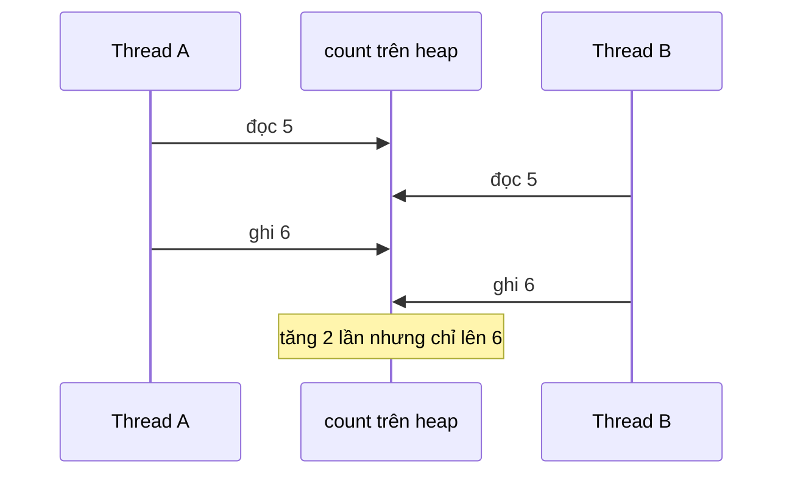
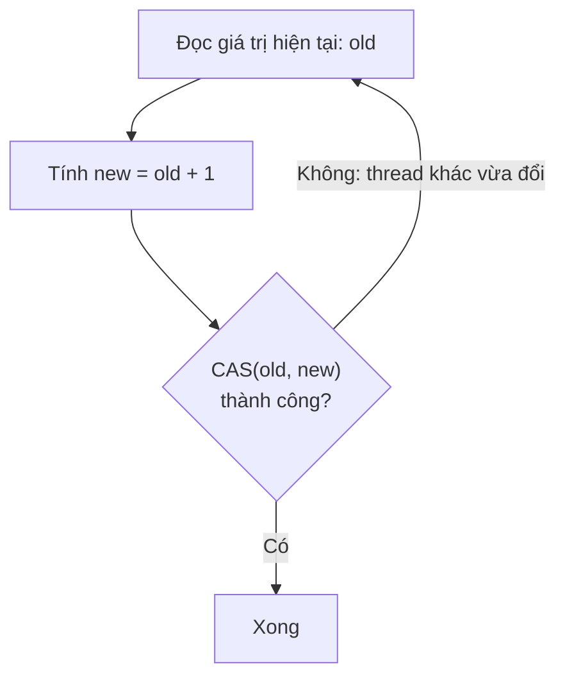
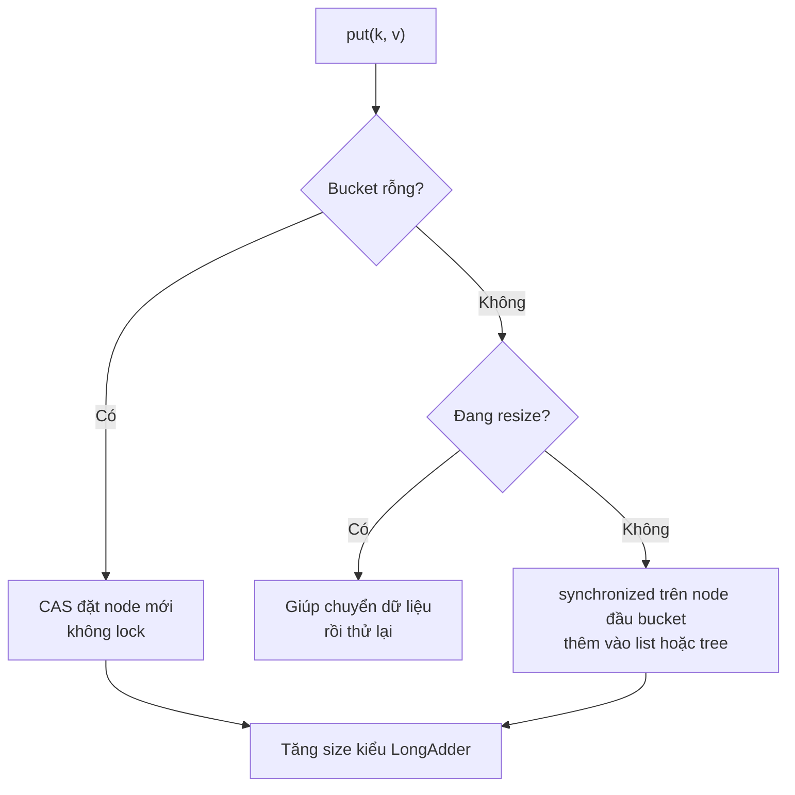

# synchronized, volatile, Atomic & ConcurrentHashMap

> **Tuần 3 · Ngày 18** · Thuộc [[03 - Concurrency, SQL, REST & Security]] · Bài trước: [[03.03 - CompletableFuture]] · Bài sau: [[03.05 - Deadlock, ThreadLocal & Virtual Threads]]
> "volatile có làm `count++` an toàn không?" và "ConcurrentHashMap khác Hashtable thế nào?" là hai câu gần như chắc chắn gặp. Bài này trả lời bằng số liệu tự đo, không học thuộc.
> Toàn bộ output trong bài đã được chạy thử trên JDK 21 (máy 8 CPU). Kết quả race condition thay đổi mỗi lần chạy; bài ghi rõ số lần sai trên số lần chạy.

**Mục lục**
1. [[#1. Race condition: vì sao count++ sai|Race condition: vì sao count++ sai]]
2. [[#2. synchronized: monitor lock|synchronized: monitor lock]]
3. [[#3. volatile: chỉ đảm bảo visibility|volatile: chỉ đảm bảo visibility]]
4. [[#4. Happens-before|Happens-before]]
5. [[#5. Atomic, CAS và LongAdder|Atomic, CAS và LongAdder]]
6. [[#6. ReentrantLock và ReadWriteLock|ReentrantLock và ReadWriteLock]]
7. [[#7. ConcurrentHashMap bên trong|ConcurrentHashMap bên trong]]
8. [[#8. ConcurrentHashMap: thao tác nguyên tử và các bẫy|ConcurrentHashMap: thao tác nguyên tử và các bẫy]]
9. [[#9. Kịch bản Feynman hôm nay|Kịch bản Feynman hôm nay]]

---

## 1. Race condition: vì sao count++ sai

### Hiểu bản chất
`count++` trông như một lệnh, nhưng thật ra là **3 bước**: đọc giá trị, cộng 1, ghi lại. Hai thread có thể chen vào giữa:



**Race condition** là khi kết quả phụ thuộc vào thứ tự chen nhau của các thread. Nguy hiểm vì nó **không xảy ra mọi lần**: test local thường qua, lên production tải cao mới lộ.

### Code minh hoạ
Đúng bài lab của tuần: 100 thread, mỗi thread `count++` 1000 lần (kỳ vọng 100.000). Mọi thread chờ một `CountDownLatch` để xuất phát cùng lúc.

```java
static int plain;
static volatile int vol;

run(100, 1000, () -> plain++);
run(100, 1000, () -> vol++);
```

| Biến | Số lần sai (4 đợt, mỗi đợt 20 lần chạy) | Ví dụ giá trị sai |
|---|---|---|
| `int` thường | 5/20, 6/20, 3/20, 4/20 | 97172, 86303, 98222 |
| `volatile int` | 20/20, 19/20, 16/20, 15/20 | |

Tăng tải lên **8 thread × 5 triệu lần**: biến thường sai **2/2 lần**, chỉ còn 15.808.697 và 12.923.641 trên 40.000.000 (mất hơn một nửa).

### Bẫy hay gặp
- Với 100 × 1000, biến thường **đúng ở phần lớn số lần chạy**. Mỗi thread chỉ chạy 1000 vòng nên thường xong trước khi thread khác kịp chen vào, và JIT có thể giữ biến trong register. "Chạy thử thấy đúng" **không chứng minh** code thread-safe.
- Kết quả đo được bất ngờ: `volatile` sai **thường xuyên hơn** biến thường. Lý do hợp lý: `volatile` buộc mỗi lần tăng phải đọc và ghi bộ nhớ thật, tạo nhiều "khe" cho thread khác chen vào hơn. Dù sao kết luận vẫn là: **volatile không sửa được race condition**.

> **Trả lời mẫu:** "Race condition là khi nhiều thread cùng đọc và ghi dữ liệu chung, kết quả phụ thuộc thứ tự chen nhau. `count++` gồm đọc, cộng, ghi nên hai thread có thể cùng đọc 5 và cùng ghi 6. Em đã thử 100 thread mỗi thread tăng 1000 lần: phần lớn lần chạy vẫn đúng 100 nghìn nhưng cứ vài lần lại sai, còn 8 thread mỗi thread 5 triệu lần thì mất hơn một nửa. Chính vì lúc đúng lúc sai nên race condition rất khó phát hiện bằng test thông thường."

### Câu hỏi xoáy

**Q1.** Ngoài `count++`, kể một race condition hay gặp trong service Spring.
> [!success]- Gợi ý trả lời
> **Check-then-act**: "kiểm tra tồn kho còn > 0 rồi trừ", "kiểm tra email chưa tồn tại rồi insert". Hai request cùng kiểm tra, cùng thấy hợp lệ, cùng ghi. Nếu chạy nhiều instance thì lock trong JVM không đủ (bài [[03.05 - Deadlock, ThreadLocal & Virtual Threads]] mục 6).

---

## 2. synchronized: monitor lock

### Hiểu bản chất
Mỗi object Java có một **monitor lock**. `synchronized` đảm bảo tại một thời điểm **chỉ một thread** ở trong đoạn code được khoá bởi cùng một object, giống **phòng thử đồ có một chìa khoá**: ai cầm chìa thì vào, người khác đứng chờ (trạng thái `BLOCKED`).

| Cách viết | Khoá trên object nào |
|---|---|
| `synchronized void m()` | `this` |
| `static synchronized void m()` | `ClassName.class` |
| `synchronized (lock) { ... }` | `lock` (nên dùng object `private final` riêng) |

`synchronized` đảm bảo 2 điều: **mutual exclusion** (một thread một lúc) và **visibility** (thread vào sau thấy mọi thay đổi của thread ra trước).

### Code minh hoạ

```java
private static final Object LOCK = new Object();
synchronized (LOCK) { count++; }      // 8 thread × 5 triệu: luôn đúng 40.000.000

static synchronized String outer() { return inner(); }
static synchronized String inner() { return "inner ok"; }
// outer() gọi inner() cùng lock: chạy bình thường, không tự deadlock
```

**Reentrant**: thread đang giữ lock có thể vào lại một đoạn `synchronized` khác **cùng lock** mà không bị chặn. JVM đếm số lần vào và chỉ nhả lock khi ra hết.

### Bẫy hay gặp
- Khoá trên **object khác nhau** thì không bảo vệ gì: `synchronized` method instance trên 2 instance khác nhau chạy song song thoải mái.
- Không khoá trên `String` literal hay `Integer`: chúng có thể được dùng chung ở chỗ khác (string pool, cache Integer), gây nghẽn hoặc deadlock khó hiểu.
- Lock tự nhả khi ra khỏi block **kể cả khi có exception**, đây là ưu điểm so với `Lock` phải tự `unlock()`.
- Trong Spring, `synchronized` trên method của bean có `@Transactional` không bảo vệ được: lock nhả khi method return, nhưng transaction commit **sau đó** ở proxy, nên thread khác vẫn đọc được dữ liệu cũ.

> **Trả lời mẫu:** "synchronized dùng monitor lock của một object, đảm bảo một thời điểm chỉ một thread vào đoạn code được bảo vệ, và đảm bảo visibility: thread vào sau thấy thay đổi của thread trước. Nó reentrant nên method synchronized gọi method synchronized khác cùng lock không tự khoá mình, và lock tự nhả kể cả khi có exception. Em lưu ý phải khoá trên cùng một object, nên dùng một field `private final Object lock` riêng."

### Câu hỏi xoáy

**Q1.** `synchronized` trên static method và instance method của cùng class có loại trừ nhau không?
> [!success]- Gợi ý trả lời
> Không. Static khoá trên `Class` object, instance khoá trên `this`: hai lock khác nhau nên chạy song song được.

---

## 3. volatile: chỉ đảm bảo visibility

### Hiểu bản chất
Mỗi CPU core có cache riêng, còn JIT có thể giữ biến trong register hoặc đổi thứ tự lệnh. Không có đồng bộ thì **thread khác có thể không bao giờ thấy** giá trị bạn vừa ghi.

`volatile` đảm bảo:
- **Visibility**: ghi xong thì thread khác đọc thấy ngay.
- **Chống reorder** quanh lệnh đọc/ghi biến đó.

`volatile` **không** đảm bảo tính nguyên tử: `count++` vẫn sai (mục 1).

### Code minh hoạ
Cờ dừng: `main` đổi `running = false` sau 1 giây, rồi chờ worker tối đa 3 giây.

```java
static boolean running = true;            // thử lại với: static volatile boolean running

Thread worker = new Thread(() -> {
    long n = 0;
    while (running) n++;                  // vòng lặp bận, không gọi method nào
});
worker.start();
Thread.sleep(1000);
running = false;
worker.join(3000);
System.out.println(worker.isAlive());
```

| Khai báo | Kết quả (5 lần chạy mỗi loại) |
|---|---|
| `boolean running` | Worker **không dừng** trong 3 giây, 5/5 lần: nhiều khả năng JIT đã đưa việc đọc `running` ra khỏi vòng lặp |
| `volatile boolean running` | Worker dừng ngay 5/5 lần |

### Bẫy hay gặp
- Trả lời "volatile làm biến thread-safe" là sai. Đúng: volatile hợp cho **một thread ghi, nhiều thread đọc**, hoặc cờ trạng thái; không hợp cho đọc-sửa-ghi.
- Bỏ `volatile` mà thêm `System.out.println` vào vòng lặp thì có thể "tự dưng chạy đúng" (vì `println` có lock bên trong, và lock tạo ra happens-before). Không được dựa vào điều đó.
- `volatile` cần cho double-checked locking của singleton lazy, để tránh thread khác thấy object chưa khởi tạo xong.

> **Trả lời mẫu:** "volatile đảm bảo visibility và chống reorder: ghi vào biến volatile thì thread khác đọc thấy ngay. Nhưng nó không đảm bảo nguyên tử nên `count++` trên biến volatile vẫn sai, em đã thử 100 thread và đa số lần chạy ra kết quả thiếu. Chỗ dùng đúng là cờ dừng: em thử một vòng lặp chờ cờ `running`, không volatile thì cả 5 lần chạy thread vẫn quay sau 3 giây chờ, thêm volatile thì dừng ngay."

### Câu hỏi xoáy

**Q1.** `volatile int count; count++` trên 10 thread có đúng không?
> [!success]- Gợi ý trả lời
> Không. `count++` là đọc, cộng, ghi; volatile chỉ làm mỗi bước đọc/ghi nhìn thấy được, không gộp 3 bước thành một. Dùng `AtomicInteger`, `LongAdder` hoặc `synchronized`.

**Q2.** Vậy `volatile long` có ý nghĩa gì đặc biệt?
> [!success]- Gợi ý trả lời
> Theo JLS, ghi `long`/`double` thường có thể bị tách thành hai lần ghi 32 bit (trên JVM 32 bit). `volatile` đảm bảo đọc/ghi `long`/`double` là nguyên tử. Phép `++` thì vẫn không.

---

## 4. Happens-before

### Hiểu bản chất
Java Memory Model không hứa "ghi xong là thread khác thấy ngay". Nó chỉ hứa: **nếu A happens-before B thì B chắc chắn thấy mọi thứ A đã ghi**. Không có quan hệ này thì được phép thấy giá trị cũ (đúng như cờ `running` ở mục 3).

Các quy tắc đủ dùng khi phỏng vấn:

| Quy tắc | Nghĩa là |
|---|---|
| Unlock monitor → lock tiếp theo cùng monitor | Ra khỏi `synchronized` rồi thread khác vào thì thấy hết |
| Ghi `volatile` → đọc sau đó của cùng biến | Cờ volatile "kéo theo" cả các biến ghi trước nó |
| `Thread.start()` → mọi lệnh trong thread mới | Dữ liệu chuẩn bị trước `start()` thì thread con thấy |
| Mọi lệnh trong thread → `join()` trả về | Sau `join()` thấy hết kết quả thread con |
| Hoàn thành `Future` → `get()`/`join()` trả về | Kết quả qua executor an toàn |

Ví dụ "kéo theo": thread A ghi `data = 42` rồi ghi `volatile ready = true`. Thread B thấy `ready == true` thì **chắc chắn** thấy `data == 42`, dù `data` không volatile.

> **Trả lời mẫu:** "Happens-before là quy tắc của Java Memory Model: nếu A happens-before B thì B nhìn thấy mọi ghi của A. Các quy tắc chính là unlock trước lock tiếp theo trên cùng monitor, ghi volatile trước đọc volatile sau đó, `start()` trước mọi lệnh trong thread con, và mọi lệnh trong thread trước khi `join()` trả về. Không có quan hệ này thì do cache CPU và reorder của compiler, thread khác có thể thấy giá trị cũ mãi mãi, như ví dụ cờ dừng không volatile."

### Câu hỏi xoáy

**Q1.** Vì sao dùng `ConcurrentHashMap` hay `BlockingQueue` để chuyển object giữa thread thì không cần volatile?
> [!success]- Gợi ý trả lời
> Các collection trong `java.util.concurrent` cam kết happens-before: đưa object vào collection happens-before lấy nó ra ở thread khác. Nên thread nhận thấy trạng thái đầy đủ của object.

---

## 5. Atomic, CAS và LongAdder

### Hiểu bản chất
`AtomicInteger` không dùng lock mà dùng lệnh CPU **CAS (compare-and-swap)**: "nếu giá trị hiện tại vẫn là `old` thì đổi thành `new`, nếu không thì báo thất bại". Thất bại thì đọc lại và thử lại.



**LongAdder** giải quyết điểm yếu của CAS khi tranh chấp cao: thay vì mọi thread tranh **một** ô nhớ, nó chia thành nhiều ô (cell), mỗi thread cộng vào ô của mình, `sum()` mới cộng dồn lại.

### Code minh hoạ
8 thread × 5 triệu lần tăng (2 lần đo):

| Cách | Kết quả | Thời gian |
|---|---|---|
| `int` thường | 15.808.697 / 12.923.641 (sai) | |
| `synchronized` | 40.000.000 | 1372 / 1510 ms |
| `AtomicInteger.incrementAndGet()` | 40.000.000 | 1606 / 1627 ms |
| `LongAdder.increment()` | 40.000.000 | **355 / 145 ms** |

### Bẫy hay gặp
- "CAS luôn nhanh hơn lock" không đúng khi tranh chấp cao: trong phép đo này `AtomicInteger` còn chậm hơn `synchronized` một chút, vì 8 thread liên tục CAS thất bại và thử lại. `LongAdder` nhanh hơn rõ rệt.
- `LongAdder` không có `incrementAndGet()` và `sum()` **không phải snapshot nguyên tử** khi đang có thread cộng. Hợp cho **counter, metric**; không hợp khi cần giá trị chính xác tại một thời điểm để quyết định (ví dụ cấp số thứ tự).
- Nhiều biến atomic riêng lẻ không làm **một nhóm thao tác** thành nguyên tử: `a.incrementAndGet(); b.decrementAndGet();` vẫn có thể bị chen giữa.

> **Trả lời mẫu:** "AtomicInteger dùng CAS: so sánh giá trị hiện tại với giá trị đã đọc, khớp thì ghi, không khớp thì thử lại, không cần lock. Khi tranh chấp cao, nhiều thread CAS thất bại liên tục; em đo 8 thread mỗi thread tăng 5 triệu lần thì AtomicInteger khoảng 1,6 giây, synchronized khoảng 1,4 giây, còn LongAdder chỉ 150 đến 350 ms vì nó chia ra nhiều cell. Nên em dùng LongAdder cho counter thống kê, AtomicInteger khi cần giá trị chính xác ngay như sinh id."

### Câu hỏi xoáy

**Q1.** ABA problem là gì?
> [!success]- Gợi ý trả lời
> Thread 1 đọc A; thread 2 đổi A → B → A; thread 1 CAS thấy vẫn là A nên tưởng không ai đổi. Với counter thì vô hại, với cấu trúc liên kết (stack lock-free) có thể sai. Giải pháp: `AtomicStampedReference` gắn thêm số phiên bản, giống ý tưởng `@Version` của JPA.

---

## 6. ReentrantLock và ReadWriteLock

### Hiểu bản chất
`ReentrantLock` làm được mọi thứ `synchronized` làm, cộng thêm:

| Tính năng | `synchronized` | `ReentrantLock` |
|---|---|---|
| Tự nhả khi có exception | Có | **Không**: phải `unlock()` trong `finally` |
| Thử lấy lock, không chờ mãi | Không | `tryLock()`, `tryLock(timeout)` |
| Chờ lock nhưng huỷ được bằng interrupt | Không | `lockInterruptibly()` |
| Fair lock (ai chờ lâu được trước) | Không | `new ReentrantLock(true)` |
| Nhiều điều kiện chờ | Một (`wait/notify`) | Nhiều `Condition` |

`ReadWriteLock` cho **nhiều reader đồng thời** nhưng **một writer độc quyền**: hợp với dữ liệu đọc nhiều, ghi ít (cấu hình, cache nhỏ).

### Code minh hoạ

```java
ReentrantLock lock = new ReentrantLock();
if (lock.tryLock(500, TimeUnit.MILLISECONDS)) {
    try {
        // vùng được bảo vệ
    } finally {
        lock.unlock();
    }
} else {
    // không lấy được trong 500 ms: báo bận, thử lại sau
}
```

Đo được: một thread khác giữ lock 2 giây, `tryLock(500 ms)` trả `false` sau **505 ms** thay vì treo.

4 thread cùng đọc, mỗi lần giữ lock 300 ms:

| Lock | Thời gian |
|---|---|
| `ReentrantReadWriteLock.readLock()` | **315 ms**: 4 reader chạy cùng lúc |
| `ReentrantLock` | **1231 ms**: lần lượt từng người |

### Bẫy hay gặp
- Quên `unlock()` trong `finally`: một exception là lock bị giữ vĩnh viễn, mọi thread khác treo.
- Gọi `lock()` **bên trong** `try`: nếu `lock()` lỗi thì `finally` lại `unlock()` một lock chưa giữ, ném `IllegalMonitorStateException`. Đặt `lock()` ngay **trước** `try`.
- Không nâng cấp được read lock lên write lock (giữ read rồi xin write sẽ tự deadlock).

> **Trả lời mẫu:** "ReentrantLock có thêm tryLock với timeout, lockInterruptibly, fair lock và nhiều Condition, đổi lại phải unlock trong finally. Em dùng tryLock khi không muốn thread chờ vô hạn, ví dụ thao tác cần hai lock thì tryLock có timeout để tránh deadlock. ReadWriteLock cho nhiều reader đồng thời: em đo 4 reader giữ lock 300 ms mỗi người, ReadWriteLock mất khoảng 315 ms còn lock thường mất hơn 1,2 giây."

### Câu hỏi xoáy

**Q1.** Vậy khi nào vẫn chọn `synchronized`?
> [!success]- Gợi ý trả lời
> Khi không cần tính năng thêm: code ngắn gọn, không thể quên nhả lock. Hiệu năng hai bên hiện nay tương đương. Riêng với virtual thread trên Java 21–23, `ReentrantLock` tránh được pinning (bài [[03.05 - Deadlock, ThreadLocal & Virtual Threads]]).

---

## 7. ConcurrentHashMap bên trong

### Hiểu bản chất
Ôn lại [[02.04 - HashMap Internals]]: HashMap là mảng bucket. Các cách làm map thread-safe:

| | `Hashtable` / `Collections.synchronizedMap` | `ConcurrentHashMap` Java 7 | `ConcurrentHashMap` Java 8+ |
|---|---|---|---|
| Khoá | **Cả map** một lock | Chia 16 **Segment**, mỗi segment một lock | **Từng bucket**: CAS hoặc `synchronized` trên node đầu |
| Đọc | Phải lấy lock | Gần như không lock | **Không lock** (đọc field `volatile`) |
| null | Hashtable cấm; synchronizedMap theo map gốc | Cấm | Cấm |

`put` trong Java 8+:



Hai thread ghi vào **hai bucket khác nhau** không chặn nhau. Chỉ khi cùng bucket mới phải chờ. Treeify (8 / 64) giống HashMap. Resize được nhiều thread **cùng giúp** chuyển dữ liệu.

> **Trả lời mẫu:** "Hashtable và synchronizedMap khoá cả map nên mọi thao tác xếp hàng. ConcurrentHashMap Java 7 chia map thành segment, mỗi segment một lock. Từ Java 8 khoá còn mịn hơn: bucket rỗng thì đặt node bằng CAS, không lock; bucket đã có node thì synchronized trên node đầu của bucket đó, nên hai thread ghi hai bucket khác nhau không chặn nhau. Đọc không lock vì các field là volatile. Size được đếm theo kiểu LongAdder."

### Câu hỏi xoáy

**Q1.** Vì sao Java 8 bỏ Segment?
> [!success]- Gợi ý trả lời
> Segment cố định số mức song song (mặc định 16) và tốn bộ nhớ. Khoá theo từng bucket cho mức song song bằng số bucket, và `synchronized` trên node đầu hiện đã rất rẻ khi ít tranh chấp.

**Q2.** `size()` của ConcurrentHashMap có chính xác không?
> [!success]- Gợi ý trả lời
> Chính xác khi không có ai đang ghi. Khi đang có thread ghi, nó chỉ là **ước lượng tại thời điểm gọi**, vì không khoá cả map để đếm. Đừng dùng `size()` để ra quyết định nghiệp vụ trong môi trường đồng thời.

---

## 8. ConcurrentHashMap: thao tác nguyên tử và các bẫy

### Hiểu bản chất
ConcurrentHashMap đảm bảo **từng method** an toàn, không đảm bảo **chuỗi nhiều method** của bạn an toàn. `get` rồi `put` là hai thao tác, thread khác chen vào giữa được. Muốn nguyên tử thì dùng method gộp sẵn: `merge`, `compute`, `computeIfAbsent`, `putIfAbsent`.

### Code minh hoạ
8 thread, mỗi thread tăng counter của key `"k"` 10.000 lần (kỳ vọng 80.000), chạy 20 lần:

```java
// ❌ check-then-act: get rồi put
Integer v = map.get("k");
map.put("k", v == null ? 1 : v + 1);

// ✓ nguyên tử
map.merge("k", 1, Integer::sum);
```

| Cách | Số lần sai trên 20 lần chạy | Ví dụ |
|---|---|---|
| `get` + `put` | **20/20** | 10.289 thay vì 80.000 |
| `merge` | 0/20 | |

Cache nạp một lần: 8 thread cùng xin key `"cfg"`, hàm nạp mất 50 ms:

| Cách | Số lần gọi hàm nạp (đo được) |
|---|---|
| `if (!map.containsKey(k)) { load(); map.put(k, v); }` | **8** |
| `map.computeIfAbsent(k, key -> load())` | **1** |

Các hành vi khác (đã chạy):

```java
new ConcurrentHashMap<String, String>().put("k", null);   // NullPointerException
new ConcurrentHashMap<String, String>().put(null, "v");   // NullPointerException

for (Integer k : hashMap.keySet()) hashMap.put(k + 10, 0);   // ConcurrentModificationException
for (Integer k : chm.keySet()) chm.put(k + 10, 0);           // không lỗi
```

**Weakly consistent iterator**: duyệt CHM trong lúc map bị sửa không ném CME; iterator có thể thấy hoặc không thấy phần tử mới thêm (lần đo này: thấy cả 3 key mới, duyệt 6 phần tử).

**CopyOnWriteArrayList**: mỗi lần ghi **copy cả mảng**, iterator duyệt trên **snapshot** cũ. Đã chạy: duyệt `[1, 2, 3]` và `add` trong lúc duyệt: vòng lặp chạy đúng 3 lần, list cuối là `[1, 2, 3, 10, 20, 30]`. Hợp với list **đọc rất nhiều, ghi rất ít** như danh sách listener; ghi nhiều thì rất tốn.

### Bẫy hay gặp
- **Vì sao cấm null?** Ở HashMap, `get(k) == null` có thể là "không có key" hoặc "value là null", phân biệt bằng `containsKey`. Ở môi trường đồng thời, giữa `get` và `containsKey` thread khác có thể sửa map, nên không bao giờ phân biệt chắc chắn. Cấm null loại bỏ sự mơ hồ: `null` luôn nghĩa là "không có".
- Hàm trong `computeIfAbsent`/`compute` chạy **trong lúc giữ lock của bucket**: phải ngắn, không gọi DB/HTTP lâu, và **không được sửa chính map đó** (có thể ném `IllegalStateException: Recursive update` hoặc treo).
- `Collections.synchronizedMap` khi duyệt vẫn phải tự `synchronized (map) { ... }`, nếu không vẫn dính CME.

> **Trả lời mẫu:** "ConcurrentHashMap an toàn cho từng method, nhưng chuỗi get rồi put hay containsKey rồi put vẫn là race check-then-act. Em đã thử 8 thread tăng counter bằng get rồi put: sai cả 20 trên 20 lần; đổi sang `merge` thì đúng cả 20. Tương tự, nạp cache bằng containsKey rồi put làm hàm nạp chạy 8 lần, còn `computeIfAbsent` chỉ 1 lần. CHM không cho null key hay value vì trong môi trường đồng thời không phân biệt được không có key với value null. Iterator của nó weakly consistent nên không ném ConcurrentModificationException."

### Câu hỏi xoáy

**Q1.** ConcurrentHashMap có cho phép null key hoặc value không? Vì sao?
> [!success]- Gợi ý trả lời
> Không, cả hai đều ném NPE. Lý do là sự mơ hồ của `get()` trả `null` trong môi trường đồng thời: không thể kiểm tra `containsKey` nguyên tử cùng lúc với `get`.

**Q2.** Dùng `ConcurrentHashMap` làm cache trong service chạy 3 instance có ổn không?
> [!success]- Gợi ý trả lời
> Mỗi instance có cache riêng, dữ liệu giữa các instance có thể lệch nhau, và map không tự giới hạn kích thước nên có thể phình mãi. Cache cục bộ nên dùng Caffeine (có giới hạn, có hết hạn); cần dùng chung giữa instance thì Redis.

---

## 9. Kịch bản Feynman hôm nay

1. Vẽ sơ đồ 2 thread cùng `count++` và giải thích vì sao mất một lần tăng; nói con số đo được và vì sao "chạy thử thấy đúng" chưa đủ.
2. Giải thích volatile bằng ví dụ cờ dừng: vì sao không có volatile thì thread không dừng.
3. So sánh synchronized, AtomicInteger, LongAdder, ReentrantLock: mỗi cái dùng khi nào.
4. Giải thích `put` của ConcurrentHashMap Java 8 (CAS khi bucket rỗng, synchronized trên node đầu) và vì sao cấm null.

Ghi vào [[08 - Nhật ký học tập]].

## Tự kiểm tra nhanh (không mở tài liệu)

- [ ] `count++` gồm mấy bước? Vì sao `volatile` không cứu được?
- [ ] synchronized đảm bảo 2 điều gì? Reentrant nghĩa là gì?
- [ ] Kể 4 quy tắc happens-before
- [ ] CAS hoạt động thế nào? Vì sao LongAdder nhanh hơn khi tranh chấp cao?
- [ ] ReentrantLock làm được gì mà synchronized không làm được?
- [ ] ConcurrentHashMap Java 8 khoá ở mức nào? Java 7 thì sao?
- [ ] Viết lại counter bằng `merge` và cache bằng `computeIfAbsent`
- [ ] Vì sao ConcurrentHashMap cấm null?
