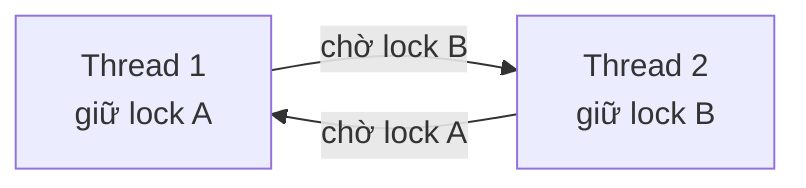
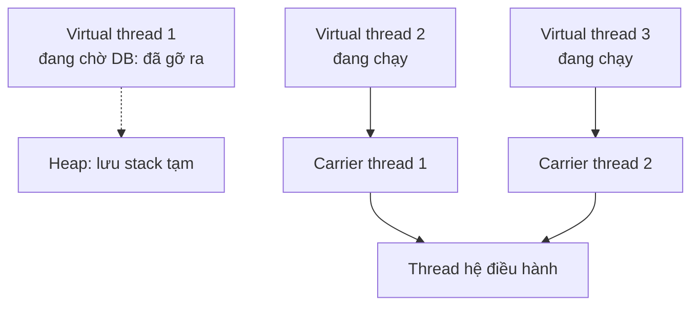
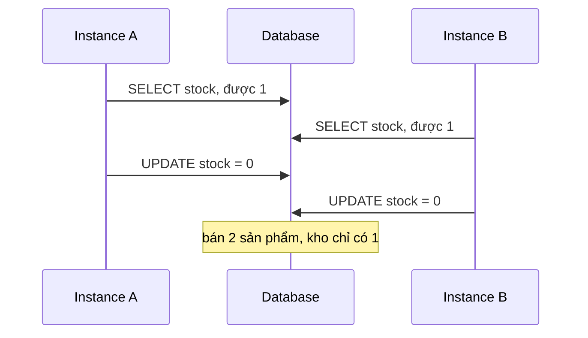

# Deadlock, ThreadLocal & Virtual Threads

> **Tuần 3 · Ngày 19** · Thuộc [[03 - Concurrency, SQL, REST & Security]] · Bài trước: [[03.04 - synchronized, volatile, Atomic & ConcurrentHashMap]] · Bài sau: [[04.01 - IoC & Dependency Injection]]
> Ba chủ đề nối Java với thực tế Spring: deadlock (cả trong JVM lẫn DB), ThreadLocal (đứng sau `@Transactional`, `SecurityContextHolder`, MDC) và virtual threads (điểm mới đáng nói nhất của Java 21).
> Toàn bộ output trong bài đã được chạy thử trên JDK 21 (máy 8 CPU). Phần cấu hình Spring Boot được mô tả theo tài liệu, không đo trong bài.

**Mục lục**
1. [[#1. Deadlock và 4 điều kiện Coffman|Deadlock và 4 điều kiện Coffman]]
2. [[#2. Phát hiện deadlock: jstack và ThreadMXBean|Phát hiện deadlock: jstack và ThreadMXBean]]
3. [[#3. Phòng tránh deadlock|Phòng tránh deadlock]]
4. [[#4. ThreadLocal|ThreadLocal]]
5. [[#5. Virtual threads|Virtual threads]]
6. [[#6. Pinning và các lưu ý khi dùng virtual threads|Pinning và các lưu ý khi dùng virtual threads]]
7. [[#7. Race condition khi chạy nhiều instance|Race condition khi chạy nhiều instance]]
8. [[#8. Kịch bản Feynman hôm nay|Kịch bản Feynman hôm nay]]

---

## 1. Deadlock và 4 điều kiện Coffman

### Hiểu bản chất
**Deadlock**: hai (hoặc nhiều) thread chờ nhau **mãi mãi**, mỗi bên giữ thứ bên kia cần. Giống hai xe gặp nhau trên cây cầu một làn, không ai chịu lùi.

Ví dụ kinh điển: chuyển tiền. Thread 1 chuyển từ tài khoản A sang B: khoá A rồi khoá B. Thread 2 chuyển từ B sang A: khoá B rồi khoá A.



Deadlock xảy ra khi có **đủ cả 4 điều kiện** (Coffman). Phá được **một** là hết deadlock:

| Điều kiện | Nghĩa | Cách phá |
|---|---|---|
| Mutual exclusion | Tài nguyên chỉ một thread giữ | Khó phá (bản chất của lock) |
| Hold and wait | Giữ cái này trong lúc chờ cái kia | Lấy tất cả lock một lần |
| No preemption | Không ai giật được lock đang giữ | `tryLock(timeout)`: tự bỏ lock nếu chờ quá lâu |
| **Circular wait** | Chờ nhau thành vòng | **Lấy lock theo thứ tự cố định** |

### Code minh hoạ

```java
Thread t1 = new Thread(() -> {
    synchronized (A) { sleep(100); synchronized (B) { System.out.println("t1 done"); } }
}, "transfer-1-to-2");
Thread t2 = new Thread(() -> {
    synchronized (B) { sleep(100); synchronized (A) { System.out.println("t2 done"); } }
}, "transfer-2-to-1");
t1.start(); t2.start();
// sau 500 ms: t1=BLOCKED t2=BLOCKED, không dòng "done" nào được in
```

`sleep(100)` chỉ để chắc chắn cả hai kịp lấy lock đầu tiên. Ở production không có `sleep`, deadlock chỉ xảy ra **thỉnh thoảng** khi hai request trùng thời điểm, nên rất khó tái hiện.

### Bẫy hay gặp
- Deadlock với `synchronized` **không tự hết**: không timeout, không exception, thread treo tới khi restart. CPU lại thấp (thread `BLOCKED` không tốn CPU), nên dễ bị chẩn đoán nhầm là "service chậm".
- Deadlock cũng xảy ra **không cần lock tường minh**: ví dụ task trong pool 1 thread `submit` thêm task vào chính pool đó rồi `get()` chờ (thread starvation deadlock).

> **Trả lời mẫu:** "Deadlock là khi các thread chờ nhau thành vòng, mỗi bên giữ lock bên kia cần nên không ai chạy tiếp. Cần đủ 4 điều kiện Coffman: mutual exclusion, hold and wait, no preemption và circular wait. Cách phổ biến nhất là phá circular wait bằng cách lấy lock theo thứ tự cố định, ví dụ chuyển tiền thì luôn khoá tài khoản có id nhỏ trước. Hoặc dùng tryLock có timeout để phá no preemption."

### Câu hỏi xoáy

**Q1.** Deadlock khác livelock và starvation thế nào?
> [!success]- Gợi ý trả lời
> **Deadlock**: các thread đứng yên chờ nhau. **Livelock**: các thread vẫn chạy nhưng liên tục nhường nhau nên không ai tiến triển (ví dụ cùng `tryLock` thất bại rồi cùng thử lại đúng nhịp). **Starvation**: một thread mãi không được tài nguyên vì thread khác luôn được ưu tiên.

---

## 2. Phát hiện deadlock: jstack và ThreadMXBean

### Hiểu bản chất
JVM tự phát hiện được deadlock trên monitor (`synchronized`) và `ReentrantLock`. Có hai cách hỏi nó:
- **Từ bên ngoài**: `jstack <pid>` (hoặc `jcmd <pid> Thread.print`), in thread dump; nếu có deadlock sẽ có đoạn "Found one Java-level deadlock".
- **Từ bên trong code**: `ThreadMXBean.findDeadlockedThreads()`, dùng để viết health check hoặc cảnh báo.

### Code minh hoạ
Chạy `jstack` lên process đang bị deadlock ở mục 1 (rút gọn):

```text
Found one Java-level deadlock:
"transfer-1-to-2": waiting to lock monitor ... which is held by "transfer-2-to-1"
"transfer-2-to-1": waiting to lock monitor ... which is held by "transfer-1-to-2"
"transfer-1-to-2": at Deadlock.lambda$main$0(Deadlock.java:12)
    - waiting to lock <0x...1c8>   - locked <0x...1b8>
```

```java
ThreadMXBean mx = ManagementFactory.getThreadMXBean();
long[] ids = mx.findDeadlockedThreads();          // null nếu không có deadlock
for (ThreadInfo ti : mx.getThreadInfo(ids)) {
    System.out.println(ti.getThreadName() + " waits " + ti.getLockName()
            + " held by " + ti.getLockOwnerName());
}
```

Output đo được: `deadlocked count=2`, `transfer-1-to-2 waits java.lang.Object@45c7e403 held by transfer-2-to-1` và dòng ngược lại cho thread kia.

### Bẫy hay gặp
- **Đặt tên thread** (như `transfer-1-to-2`) giúp đọc thread dump nhanh hơn rất nhiều so với `Thread-0`.
- Thread dump chỉ là ảnh chụp một thời điểm. Nghi nghẽn thì chụp **2–3 lần cách nhau vài giây**: thread nào đứng yên ở cùng chỗ qua các lần là thủ phạm.
- Spring Boot Actuator có endpoint `/actuator/threaddump` để lấy thread dump qua HTTP khi không vào được máy chủ.

> **Trả lời mẫu:** "Em dùng jstack hoặc jcmd Thread.print để lấy thread dump; nếu có deadlock JVM in sẵn đoạn Found one Java-level deadlock, ghi rõ thread nào giữ lock nào và chờ lock nào, kèm dòng code. Trong code có thể gọi ThreadMXBean.findDeadlockedThreads để làm health check. Em đã thử tạo deadlock hai lock và cả hai cách đều chỉ ra đúng hai thread, đúng dòng code."

### Câu hỏi xoáy

**Q1.** Service bị treo, CPU thấp, request timeout hàng loạt. Em kiểm tra gì?
> [!success]- Gợi ý trả lời
> Lấy thread dump 2–3 lần. Tìm deadlock trong JVM; thread `BLOCKED` chờ cùng một lock; thread `WAITING` ở `HikariPool.getConnection` (hết connection DB); thread `RUNNABLE` kẹt ở đọc socket (downstream chậm mà thiếu timeout). Song song xem metric của connection pool và log của DB.

---

## 3. Phòng tránh deadlock

### Code minh hoạ
**Cách 1: lấy lock theo thứ tự cố định** (phá circular wait):

```java
void transfer(Account from, Account to, BigDecimal amount) {
    Account first  = from.getId() < to.getId() ? from : to;
    Account second = from.getId() < to.getId() ? to : from;
    synchronized (first) {
        synchronized (second) {
            from.withdraw(amount);
            to.deposit(amount);
        }
    }
}
```

Đo được: hai giao dịch 1→2 và 2→1 chạy đồng thời đều xong sau **236 ms**.

**Cách 2: `tryLock` có timeout** (phá no preemption): không lấy được lock thứ hai trong 50 ms thì **nhả lock đang giữ**, chờ ngẫu nhiên rồi thử lại.

```java
while (true) {
    if (first.tryLock(50, TimeUnit.MILLISECONDS)) {
        try {
            if (second.tryLock(50, TimeUnit.MILLISECONDS)) {
                try { doTransfer(); return; } finally { second.unlock(); }
            }
        } finally { first.unlock(); }
    }
    Thread.sleep(ThreadLocalRandom.current().nextInt(10, 50));   // tránh livelock
}
```

Đo 2 lần: một thread xong ở lần thử 1, thread kia ở lần thử 2; tổng **324 ms** và **318 ms**.

### Deadlock ở database
Cùng bản chất, chỉ là lock nằm ở **row** của DB: transaction 1 `UPDATE account WHERE id = 1` rồi `id = 2`; transaction 2 làm ngược lại. Khác biệt quan trọng: **DB tự phát hiện** và rollback một transaction (MySQL báo lỗi 1213 "Deadlock found when trying to get lock", PostgreSQL báo "deadlock detected"). Spring dịch lỗi này thành một exception con của `PessimisticLockingFailureException`.

Cách xử lý giống hệt: **cập nhật row theo thứ tự cố định** (sắp theo id), transaction ngắn, và **retry** transaction bị chọn làm nạn nhân.

### Bẫy hay gặp
- Gọi code bên ngoài (callback, listener, HTTP) **trong lúc giữ lock** là công thức tạo deadlock khó thấy, vì không biết code đó sẽ lấy lock gì.
- Retry khi gặp deadlock DB phải bao **cả transaction**, không phải chỉ câu SQL lỗi.

> **Trả lời mẫu:** "Để tránh deadlock em lấy lock theo thứ tự cố định, ví dụ chuyển tiền thì khoá tài khoản có id nhỏ trước, như vậy không thể hình thành vòng chờ. Khi không áp thứ tự được thì dùng tryLock có timeout, thất bại thì nhả hết và thử lại sau một khoảng ngẫu nhiên. Em giữ lock ngắn và không gọi code bên ngoài khi đang giữ lock. Ở DB cũng vậy: update các row theo thứ tự id, và retry transaction khi DB báo deadlock."

### Câu hỏi xoáy

**Q1.** Vì sao cần `sleep` ngẫu nhiên trước khi thử lại?
> [!success]- Gợi ý trả lời
> Nếu hai thread thử lại **cùng nhịp**, chúng có thể mãi cùng lấy được lock đầu và cùng thất bại ở lock thứ hai: đó là livelock. Chờ ngẫu nhiên làm lệch nhịp để một bên thắng.

---

## 4. ThreadLocal

### Hiểu bản chất
`ThreadLocal<T>` cho **mỗi thread một bản sao riêng** của biến. Hình dung mỗi thread có một **ngăn tủ cá nhân**; `ThreadLocal` là cái nhãn, cùng một nhãn nhưng mỗi thread mở ra ngăn của mình. Kỹ thuật: mỗi `Thread` có một `ThreadLocalMap`, key là ThreadLocal, value là dữ liệu.

Spring dùng ThreadLocal ở nhiều chỗ quan trọng:

| Thành phần | Lưu gì theo thread |
|---|---|
| `SecurityContextHolder` | User đang đăng nhập của request |
| `TransactionSynchronizationManager` | Connection và transaction hiện tại của `@Transactional` |
| `RequestContextHolder` | Request hiện tại |
| MDC (Logback/SLF4J) | `traceId`, `userId` để in vào mọi dòng log |

Đó là lý do một request gắn với một thread: đổi thread giữa chừng là "mất" transaction và user.

### Code minh hoạ
Pool 1 thread (giống thread Tomcat được tái sử dụng):

```java
static final ThreadLocal<String> CURRENT_USER = new ThreadLocal<>();

pool.submit(() -> CURRENT_USER.set("alice")).get();        // request 1 quên remove
pool.submit(() -> CURRENT_USER.get()).get();                // request 2 thấy: "alice" ❌

pool.submit(() -> {
    CURRENT_USER.set("bob");
    try { /* xử lý request */ } finally { CURRENT_USER.remove(); }
}).get();
pool.submit(() -> CURRENT_USER.get()).get();                // null ✓

CURRENT_USER.set("carol");                                  // trên main
CompletableFuture.supplyAsync(() -> CURRENT_USER.get()).join();   // null: không sang
```

### Bẫy hay gặp
- **Rò dữ liệu giữa request**: thread pool tái sử dụng thread, nên request sau thấy dữ liệu request trước (đã chạy: request 2 thấy `alice`). Với tenant id hay user id, đây là **lỗi bảo mật**.
- **Memory leak**: value giữ trong `ThreadLocalMap` sống cùng thread; thread của pool sống cả đời ứng dụng. Quy tắc: **`set` thì phải `remove()` trong `finally`**.
- **Không tự sang thread khác** (`@Async`, `CompletableFuture`, executor): MDC mất traceId, `SecurityContext` rỗng. Giải pháp trong Spring là `TaskDecorator`:

```java
executor.setTaskDecorator(task -> {
    Map<String, String> mdc = MDC.getCopyOfContextMap();     // chụp trên thread gọi
    return () -> {
        if (mdc != null) MDC.setContextMap(mdc);
        try { task.run(); } finally { MDC.clear(); }          // dọn trên thread pool
    };
});
```

- `InheritableThreadLocal` chỉ copy khi **tạo** thread con; với pool, thread đã tạo sẵn nên giá trị bị cũ. Không phải giải pháp cho executor.

> **Trả lời mẫu:** "ThreadLocal cho mỗi thread một bản sao biến riêng. Spring dùng nó cho SecurityContextHolder, transaction của @Transactional và MDC. Bẫy lớn nhất là thread pool tái sử dụng thread: em thử pool một thread, request trước set user mà không remove thì request sau đọc được user cũ, vừa sai dữ liệu vừa leak bộ nhớ, nên luôn remove trong finally. ThreadLocal cũng không tự sang thread của @Async hay CompletableFuture, nên em dùng TaskDecorator để copy MDC và security context."

### Câu hỏi xoáy

**Q1.** Vì sao phải `remove()` khi chạy trong thread pool?
> [!success]- Gợi ý trả lời
> Thread được tái sử dụng: dữ liệu request trước rò sang request sau (sai user, sai tenant) và giá trị không bao giờ được GC vì thread còn sống mãi.

**Q2.** Trong `@Transactional`, gọi `CompletableFuture.supplyAsync(() -> repo.save(x))` thì `save` có nằm trong transaction không?
> [!success]- Gợi ý trả lời
> Không. Transaction gắn với thread gọi qua ThreadLocal; thread của pool không có transaction đó, nên `save` chạy trong transaction riêng (hoặc không có), không rollback theo transaction ngoài. Sẽ gặp lại ở Tuần 5.

---

## 5. Virtual threads

### Hiểu bản chất
Platform thread (thread thường) **gắn 1–1 với thread hệ điều hành**: tốn bộ nhớ, tạo đắt, nên phải dùng pool vài trăm cái. Khi thread chờ DB hay HTTP, thread hệ điều hành **ngồi không** mà vẫn bị giữ.

**Virtual thread** (Java 21, JEP 444) là thread **do JVM quản lý**, rất nhẹ. Nhiều virtual thread chạy trên một số ít **carrier thread** (mặc định bằng số CPU). Khi virtual thread chặn I/O hoặc `sleep`, JVM **gỡ nó khỏi carrier** (unmount), carrier rảnh để chạy virtual thread khác. Xong I/O thì gắn lại.



Ý nghĩa: viết code **blocking kiểu cũ**, dễ đọc, dễ debug, mà vẫn đạt throughput gần như code reactive.

### Code minh hoạ
10.000 task, mỗi task `sleep(100)` giả lập chờ I/O:

```java
try (var ex = Executors.newFixedThreadPool(200)) {          // platform
    for (int i = 0; i < 10_000; i++) ex.submit(() -> sleep(100));
}
try (var ex = Executors.newVirtualThreadPerTaskExecutor()) { // virtual: mỗi task 1 thread mới
    for (int i = 0; i < 10_000; i++) ex.submit(() -> sleep(100));
}
```

| Cách chạy | Thời gian (3 lần đo) |
|---|---|
| Pool 200 platform thread | 5269 / 5678 / 5326 ms (10.000 / 200 = 50 đợt × 100 ms) |
| Virtual thread per task | **140 / 165 / 141 ms** |
| Virtual, **100.000** task `sleep(1000)` | 1257 ms |

Nhưng với tác vụ **CPU-bound** (200 task tính toán thuần):

| Cách chạy | Thời gian (3 lần đo) |
|---|---|
| Pool 8 platform thread | 1144 / 3266 / 2968 ms |
| Virtual thread per task | 911 / 3044 / 2914 ms |

Ngang nhau (chênh lệch giữa các lần đo do máy, không do loại thread): vẫn chỉ có 8 CPU làm việc.

### Bẫy hay gặp
- Virtual thread **không làm code chạy nhanh hơn**, nó giúp **chờ rẻ hơn**, nên phục vụ được nhiều việc đang chờ cùng lúc hơn. Không có lợi cho CPU-bound.
- Virtual thread luôn là daemon (đã chạy: `isDaemon() = true`).

> **Trả lời mẫu:** "Virtual thread là thread nhẹ do JVM quản lý, chạy trên một số ít carrier thread. Khi nó chặn I/O, JVM gỡ nó khỏi carrier để carrier chạy việc khác, nên tạo hàng trăm nghìn cái vẫn được. Em đo 10 nghìn task mỗi task chờ 100 ms: pool 200 platform thread mất khoảng 5,3 giây, virtual thread mất khoảng 150 ms. Nhưng với tác vụ tính toán thì ngang nhau vì vẫn chỉ có 8 CPU. Nên virtual thread hợp với service I/O-bound nhiều request đồng thời, cho phép giữ code blocking dễ đọc thay vì chuyển sang reactive."

### Câu hỏi xoáy

**Q1.** Bật virtual threads trong Spring Boot thế nào?
> [!success]- Gợi ý trả lời
> Spring Boot 3.2+ chạy trên Java 21: `spring.threads.virtual.enabled=true`. Tomcat xử lý mỗi request trên một virtual thread, và executor mặc định cho `@Async` cũng dùng virtual thread.

**Q2.** Virtual thread có thay thế WebFlux không?
> [!success]- Gợi ý trả lời
> Với phần lớn service CRUD gọi DB/HTTP, virtual thread cho throughput tương đương mà code đơn giản hơn nhiều. WebFlux vẫn có chỗ đứng khi cần streaming, back-pressure, hoặc hệ thống đã reactive từ đầu tới cuối.

---

## 6. Pinning và các lưu ý khi dùng virtual threads

### Hiểu bản chất
**Pinning**: virtual thread **không gỡ được khỏi carrier** khi chặn, nên carrier cũng bị chặn theo, như platform thread. Ở **Java 21–23**, nguyên nhân chính là chặn I/O **bên trong `synchronized`**. **Java 24 (JEP 491)** đã sửa: `synchronized` không còn gây pinning.

### Code minh hoạ
100 virtual thread, mỗi cái giữ một lock **riêng** (không tranh chấp) rồi `sleep(100)`:

```java
// A: synchronized
Object lock = new Object();
synchronized (lock) { sleep(100); }

// B: ReentrantLock
ReentrantLock l = new ReentrantLock();
l.lock();
try { sleep(100); } finally { l.unlock(); }
```

| Cách khoá (JDK 21) | Thời gian (3 lần đo) |
|---|---|
| `synchronized` | **1340 / 1343 / 1373 ms**: bị pin, chỉ 8 carrier chạy, 100 / 8 ≈ 13 đợt × 100 ms |
| `ReentrantLock` | **108 / 105 / 109 ms** |

Bật `-Djdk.tracePinnedThreads=short` khi chạy, JVM in ra chỗ bị pin: `VirtualThread[#20]/runnable@ForkJoinPool-1-worker-1 reason:MONITOR`.

### Các lưu ý khác

| Lưu ý | Vì sao |
|---|---|
| **Không pool virtual thread** | Tạo rất rẻ; pool chỉ giới hạn nhầm chỗ. Dùng `newVirtualThreadPerTaskExecutor()` |
| Muốn giới hạn mức đồng thời thì dùng `Semaphore` | Giới hạn **tài nguyên**, không giới hạn thread |
| **DB connection pool vẫn là giới hạn thật** | Một triệu virtual thread vẫn chờ 10 connection |
| ThreadLocal vẫn hoạt động, nhưng cẩn thận | Mỗi virtual thread một bản; cache nặng trong ThreadLocal nhân với số lượng thread rất lớn |
| Không giúp CPU-bound | Mục 5 |

Đo giới hạn DB pool: 1000 virtual thread, mỗi cái "query" 50 ms qua `Semaphore(10)` giả lập 10 connection: mất **5433 ms**, đúng bằng 1000 / 10 × 50 ms. Virtual thread không làm DB nhanh hơn.

### Bẫy hay gặp
- Bật virtual threads cho ứng dụng có thư viện cũ dùng nhiều `synchronized` quanh I/O (một số JDBC driver cũ) trên Java 21 có thể **chậm hơn**. Kiểm tra bằng `jdk.tracePinnedThreads` hoặc JFR, nâng driver, hoặc lên Java 24+.
- Trước đây giới hạn tự nhiên là "pool 200 thread"; bỏ giới hạn đó thì **hàng nghìn request cùng lao vào DB**. Phải xem lại kích thước Hikari và timeout lấy connection.

> **Trả lời mẫu:** "Ở Java 21 đến 23, virtual thread chặn I/O bên trong synchronized sẽ bị pin vào carrier, mất lợi thế. Em đo 100 virtual thread sleep 100 ms trong synchronized mất khoảng 1,3 giây vì chỉ 8 carrier, đổi sang ReentrantLock còn khoảng 105 ms. Java 24 với JEP 491 đã sửa chuyện này. Ngoài ra không pool virtual thread, muốn giới hạn thì dùng Semaphore, và nhớ DB connection pool mới là giới hạn thật: 1000 virtual thread qua 10 connection vẫn mất 5 giây."

### Câu hỏi xoáy

**Q1.** Virtual threads giúp ích cho loại tác vụ nào? Kể 2 lưu ý.
> [!success]- Gợi ý trả lời
> I/O-bound với số lượng lớn (web request gọi DB/HTTP). Lưu ý: không pool virtual thread; DB connection pool vẫn là giới hạn thật; ở Java 21–23 `synchronized` quanh I/O gây pinning (Java 24 sửa qua JEP 491); không giúp CPU-bound.

---

## 7. Race condition khi chạy nhiều instance

### Hiểu bản chất
Bài toán: bán sản phẩm còn 1 trong kho. Service chạy **3 instance** sau load balancer. `synchronized` chỉ khoá **trong một JVM**, nên hai request vào hai instance khác nhau vẫn cùng thấy "còn 1" và cùng trừ.



### Code minh hoạ
Giải pháp nằm ở **nơi dữ liệu dùng chung**, tức DB:

```sql
-- Update nguyên tử có điều kiện: DB tự khoá row, chỉ một request thắng
UPDATE product SET stock = stock - 1 WHERE id = ? AND stock >= 1;
-- số row bị ảnh hưởng = 0 nghĩa là hết hàng
```

| Cách | Ý tưởng | Khi nào |
|---|---|---|
| Update có điều kiện | Kiểm tra và ghi trong một câu SQL | Đơn giản, nhanh nhất cho counter, tồn kho |
| `@Version` (optimistic lock) | Ghi kèm `WHERE version = ?`, lệch thì báo lỗi và retry | Ít tranh chấp |
| `SELECT ... FOR UPDATE` (pessimistic) | Khoá row trong transaction | Tranh chấp cao, logic phức tạp |
| Distributed lock (Redis, Redisson) | Lock dùng chung giữa các instance | Tài nguyên không nằm trong một DB |

### Bẫy hay gặp
- Distributed lock phải có **TTL** (instance chết thì lock tự hết hạn) và chỉ người giữ mới được nhả. Đây là công cụ cuối cùng, không phải mặc định.

> **Trả lời mẫu:** "synchronized chỉ có tác dụng trong một JVM, khi chạy 3 instance thì hai request vào hai instance khác nhau vẫn race. Em xử lý ở tầng DB: update nguyên tử có điều kiện như `stock = stock - 1 where stock >= 1` rồi kiểm tra số row bị ảnh hưởng, hoặc @Version cho optimistic locking, hoặc SELECT FOR UPDATE khi tranh chấp cao. Chỉ khi tài nguyên không nằm trong DB em mới dùng distributed lock bằng Redis, có TTL."

### Câu hỏi xoáy

**Q1.** Vì sao `synchronized` không đủ để chống bán vượt tồn kho khi chạy 3 instance?
> [!success]- Gợi ý trả lời
> Mỗi instance là một JVM riêng với lock riêng. Phải khoá ở nơi dùng chung: DB (update có điều kiện, `@Version`, `SELECT FOR UPDATE`) hoặc distributed lock. Sẽ học sâu ở Tuần 5–6 với JPA locking.

---

## 8. Kịch bản Feynman hôm nay

1. Giải thích deadlock bằng ví dụ chuyển tiền, kể 4 điều kiện Coffman, và vì sao "khoá id nhỏ trước" phá được deadlock.
2. Kể các bước bạn làm khi service treo mà CPU thấp (thread dump, đọc gì trong đó).
3. Giải thích vì sao quên `ThreadLocal.remove()` có thể làm user A thấy dữ liệu user B.
4. Giải thích virtual thread cho người chỉ biết thread pool: vì sao 10.000 task chờ 100 ms chỉ mất khoảng 150 ms, và vì sao DB pool vẫn là giới hạn.

Ghi vào [[08 - Nhật ký học tập]].

## Tự kiểm tra nhanh (không mở tài liệu)

- [ ] Kể 4 điều kiện Coffman và cách phá từng điều kiện
- [ ] Hai cách phát hiện deadlock trong JVM
- [ ] Viết `transfer()` khoá theo thứ tự id
- [ ] DB xử lý deadlock thế nào? Ứng dụng nên làm gì?
- [ ] Spring dùng ThreadLocal ở những đâu? Vì sao phải `remove()`?
- [ ] Làm sao truyền MDC sang thread của `@Async`?
- [ ] Virtual thread giúp gì, không giúp gì? Pinning là gì, sửa ở Java nào?
- [ ] Vì sao `synchronized` không chống được bán vượt kho khi chạy nhiều instance?
