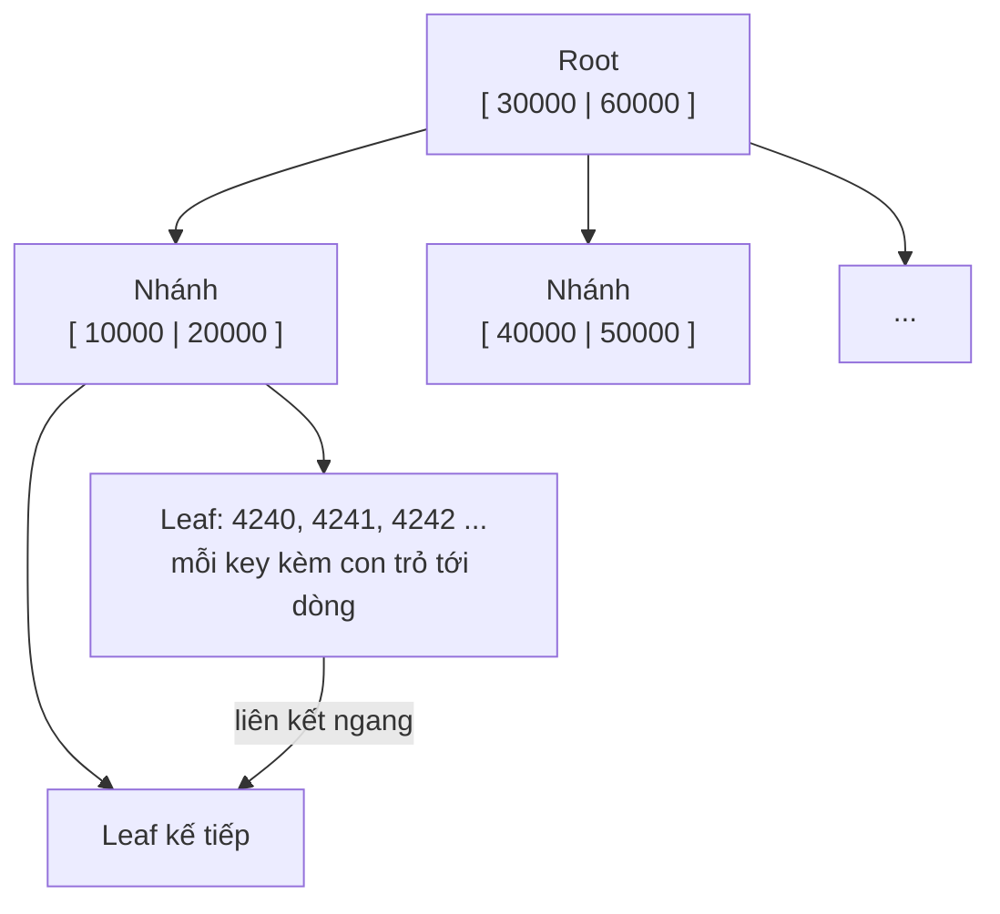

# Index & EXPLAIN

> **Tuần 6 · Ngày 39** · Thuộc [[03 - Concurrency, SQL, REST & Security]] · Bài trước: [[05.08 - Locking, Batch & Mapping]] · Bài sau: [[03.07 - SQL Queries & Pagination]]
> "API chậm, em xử lý thế nào?" Câu trả lời tốt luôn có: đọc EXPLAIN, thấy Seq Scan, thêm đúng index, đo lại. Bài này làm đúng quy trình đó trên dữ liệu thật.
> Mọi plan và thời gian trong bài đo trên **PostgreSQL 16.14** (Docker), bảng `orders` **1 000 000 dòng** và `customer` **100 000 dòng**. Để plan dễ đọc, em tắt parallel query (`max_parallel_workers_per_gather = 0`). Máy đo đang tải cao nên thời gian là lần chạy sau khi cache đã nóng, phần lớn lấy **lần tốt nhất trong 3 lần**; chỉ so sánh độ lớn, không so từng mili giây.

**Mục lục**
1. [[#1. Index là gì: B+Tree|Index là gì: B+Tree]]
2. [[#2. Đọc EXPLAIN và EXPLAIN ANALYZE|Đọc EXPLAIN và EXPLAIN ANALYZE]]
3. [[#3. Composite index và leftmost prefix|Composite index và leftmost prefix]]
4. [[#4. Khi nào index KHÔNG được dùng|Khi nào index KHÔNG được dùng]]
5. [[#5. Covering index và clustered index|Covering index và clustered index]]
6. [[#6. Cái giá của index và ACID|Cái giá của index và ACID]]
7. [[#7. Kịch bản Feynman hôm nay|Kịch bản Feynman hôm nay]]

Dữ liệu dùng trong bài:

```sql
create table orders(
  id bigserial primary key, customer_id int not null, status text not null,
  total numeric(12,2) not null, created_at timestamp not null);
-- 1 000 000 dòng: customer_id ngẫu nhiên 1..90 000, created_at rải trong ~700 ngày
-- status: PAID 70%, SHIPPED 20%, NEW 7%, CANCELLED 2.5%, REFUNDED 0.5%
```

---

## 1. Index là gì: B+Tree

### Hiểu bản chất
Không có index, tìm `customer_id = 4242` buộc DB **đọc từng dòng** của cả bảng (full table scan). Index giống **mục lục cuối sách**: các giá trị đã sắp xếp sẵn, mỗi giá trị trỏ tới vị trí dòng.

Kiểu index mặc định của PostgreSQL và MySQL là **B+Tree**:



- Cây **thấp và rộng**: mỗi node là một page (8 KB ở PostgreSQL, 16 KB ở InnoDB) chứa hàng trăm key, nên 1 triệu dòng chỉ cần 3–4 tầng. Tìm một giá trị là O(log n), vài lần đọc page.
- Dữ liệu thật chỉ nằm ở **leaf**, và các leaf **nối với nhau**: nhờ vậy B+Tree giỏi cả tìm chính xác (`=`), tìm khoảng (`BETWEEN`, `>`), và `ORDER BY` (đọc leaf theo thứ tự, không cần sort).

### Code minh hoạ (đã đo)

```sql
explain analyze select * from orders where customer_id = 4242;
```

Trước khi có index:

```text
Seq Scan on orders (actual rows=13)
  Filter: (customer_id = 4242)
  Rows Removed by Filter: 999987
Execution Time: 99.082 ms
```

Sau `create index idx_orders_customer_created on orders(customer_id, created_at)`:

```text
Bitmap Heap Scan on orders (actual rows=13)
  ->  Bitmap Index Scan on idx_orders_customer_created
        Index Cond: (customer_id = 4242)
Execution Time: 0.255 ms
```

Từ đọc **1 triệu dòng** xuống đọc **13 dòng**, khoảng **400 lần** nhanh hơn. Tạo index mất khoảng 11 giây trên máy đo, và index chiếm **30 MB** (bảng 59 MB).

> **Trả lời mẫu:** "Index phổ biến nhất là B+Tree: một cây cân bằng, thấp và rộng, giá trị đã sắp xếp, dữ liệu nằm ở các leaf nối với nhau. Nhờ vậy tìm theo `=`, theo khoảng và ORDER BY đều nhanh, O(log n). Em đã thử trên bảng 1 triệu order: không index thì Seq Scan bỏ qua gần 1 triệu dòng, mất khoảng 100 ms; có index thì đọc đúng 13 dòng, dưới 1 ms."

### Câu hỏi xoáy

**Q1.** Vì sao dùng B+Tree mà không dùng hash index cho mọi thứ?
> [!success]- Gợi ý trả lời
> Hash index chỉ hỗ trợ `=`. Không hỗ trợ khoảng, `ORDER BY`, hay prefix `LIKE 'abc%'`. B+Tree làm được tất cả với O(log n), rất gần O(1) khi cây chỉ 3–4 tầng. PostgreSQL có hash index nhưng ít khi đáng dùng.

**Q2.** Vì sao B+Tree chứ không phải binary tree?
> [!success]- Gợi ý trả lời
> Binary tree mỗi node chỉ 2 nhánh, 1 triệu phần tử cần khoảng 20 tầng, tức 20 lần đọc đĩa ngẫu nhiên. B+Tree mỗi node là một page chứa hàng trăm key nên chỉ 3–4 tầng. Đĩa đọc theo page nên tối ưu số page cần đọc là tối ưu tốc độ.

---

## 2. Đọc EXPLAIN và EXPLAIN ANALYZE

### Hiểu bản chất

| Lệnh | Làm gì |
|---|---|
| `EXPLAIN` | Chỉ lập kế hoạch, **không chạy**. Hiện cost và số dòng **ước lượng** |
| `EXPLAIN ANALYZE` | **Chạy thật**, hiện thêm thời gian và số dòng **thực tế**. Cẩn thận với `UPDATE/DELETE`: nó chạy thật, nên bọc trong `BEGIN ... ROLLBACK` |
| `EXPLAIN (ANALYZE, BUFFERS)` | Thêm số page đọc từ cache và từ đĩa |

Plan đọc **từ trong ra ngoài** (node thụt sâu nhất chạy trước). Các node hay gặp trên PostgreSQL:

| Node | Ý nghĩa | Tốt hay xấu |
|---|---|---|
| `Seq Scan` | Đọc cả bảng | Xấu với bảng lớn và ít dòng khớp; **bình thường** với bảng nhỏ hoặc lấy phần lớn bảng |
| `Index Scan` | Duyệt index, mỗi key nhảy sang bảng lấy dòng | Tốt khi ít dòng |
| `Bitmap Index Scan` + `Bitmap Heap Scan` | Gom vị trí từ index thành bitmap, rồi đọc bảng theo thứ tự page | Tốt khi số dòng vừa phải |
| `Index Only Scan` | Lấy đủ dữ liệu từ index, **không đụng bảng** | Tốt nhất |
| `Sort` | Phải sắp xếp | Để ý khi dữ liệu lớn (`Sort Method: external merge` là tràn ra đĩa) |

Những dòng cần nhìn: **loại scan**, **`Rows Removed by Filter`** (đọc thừa bao nhiêu), **rows ước lượng so với actual** (lệch nhiều là thống kê cũ, chạy `ANALYZE`), và **Execution Time**.

MySQL thì nhìn cột `type` (`ALL` là full scan, rồi `index`, `range`, `ref`, `const` tốt dần), `key` (index được chọn), `rows`, và `Extra` (`Using filesort`, `Using temporary` là dấu hiệu xấu, `Using index` là covering).

### Bẫy hay gặp
- `Index Cond` khác `Filter`. `Index Cond` là điều kiện dùng để **đi trong index**; `Filter` là điều kiện kiểm tra **sau khi** đã lấy dòng. Ví dụ đo được dưới đây: index chỉ giúp phần `customer_id`, phần năm chỉ là `Filter`:

```text
Bitmap Heap Scan on orders (actual rows=5)
  Recheck Cond: (customer_id = 4242)
  Filter: (EXTRACT(year FROM created_at) = '2026'::numeric)
  Rows Removed by Filter: 8
```

- Đo trên dev với 100 dòng: Seq Scan luôn thắng, kết luận sai. Phải đo trên lượng dữ liệu gần thật.

> **Trả lời mẫu:** "Em dùng `EXPLAIN ANALYZE` để chạy thật và xem plan. Em nhìn loại scan trước: Seq Scan trên bảng lớn mà chỉ lấy vài dòng là dấu hiệu thiếu index; rồi nhìn `Rows Removed by Filter` để biết đọc thừa bao nhiêu; so rows ước lượng với actual để phát hiện thống kê cũ; và phân biệt `Index Cond` với `Filter`, vì có index chưa chắc mọi điều kiện đều dùng index. Với UPDATE hay DELETE em bọc trong transaction rồi rollback, vì ANALYZE chạy thật."

### Câu hỏi xoáy

**Q1.** Có index rồi mà plan vẫn Seq Scan, nghĩ tới những nguyên nhân nào?
> [!success]- Gợi ý trả lời
> (1) Query lấy phần lớn bảng nên Seq Scan rẻ hơn (mục 4, selectivity); (2) điều kiện bọc hàm, ép kiểu, wildcard đầu, vi phạm leftmost prefix; (3) thống kê cũ làm optimizer ước lượng sai, chạy `ANALYZE`; (4) bảng quá nhỏ. Sau đó mới nghĩ tới ép index (PostgreSQL không có hint chuẩn, MySQL có `FORCE INDEX`).

---

## 3. Composite index và leftmost prefix

### Hiểu bản chất
Index `(customer_id, created_at)` được sắp xếp **theo `customer_id` trước**, trong cùng `customer_id` mới sắp theo `created_at`. Giống danh bạ sắp theo họ rồi tới tên: tìm theo họ thì nhanh, tìm theo họ và tên càng nhanh, nhưng chỉ biết tên thì phải lật cả cuốn.

### Code minh hoạ (đã đo)

| Query trên index `(customer_id, created_at)` | Plan | Thời gian |
|---|---|---|
| `where customer_id = 4242` | Bitmap Index Scan, `Index Cond: customer_id` | 0,26 ms |
| `where customer_id = 4242 and created_at >= '2026-01-01'` | Index Cond **cả hai cột** | 0,64 ms |
| `where customer_id = 4242 order by created_at desc limit 5` | `Index Scan Backward`, **không có node Sort** | 2,06 ms |
| `where created_at >= '2026-11-01' and created_at < '2026-11-02'` | **Seq Scan**, bỏ qua 998 616 dòng | 1 296 ms |

Dòng 3 đáng nhớ: index đã sắp `created_at` trong mỗi `customer_id`, nên "5 đơn mới nhất của khách" chỉ là đọc ngược 5 phần tử trong index. Dòng 4 vi phạm leftmost prefix: không có `customer_id` thì index này vô dụng.

### Quy tắc chọn thứ tự cột

| Index `(a, b, c)` | Dùng được? |
|---|---|
| `a = ?` | Có |
| `a = ? and b = ?` | Có |
| `a = ? and b = ? and c = ?` | Có |
| `a = ? order by b` | Có, không cần sort |
| `b = ?` hoặc `c = ?` | Không hiệu quả |
| `a = ? and b > ? and c = ?` | `a`, `b` dùng để đi trong index; `c` chỉ được lọc trong phạm vi đó |

1. Cột so sánh `=` đặt trước, cột range hoặc sort đặt sau.
2. Index phục vụ các query thật sự hay chạy nhất. Một index `(a, b)` thay được index `(a)` riêng.
3. Thứ tự của các điều kiện trong `WHERE` **không** quan trọng: `where b = ? and a = ?` vẫn dùng được `(a, b)`.

> **Trả lời mẫu:** "Composite index sắp xếp theo cột đầu trước, rồi tới cột sau trong cùng giá trị cột đầu, nên chỉ dùng được khi query có cột đầu tiên, đó là quy tắc leftmost prefix. Em đã đo với index `(customer_id, created_at)` trên 1 triệu dòng: lọc theo customer_id, hoặc customer_id cộng khoảng ngày, hay lấy 5 đơn mới nhất của một khách đều dưới vài mili giây, và câu cuối không cần sort; nhưng chỉ lọc theo created_at thì Seq Scan hơn 1 giây. Em đặt cột so sánh bằng trước, cột range hoặc sort sau."

### Câu hỏi xoáy

**Q1.** Có index `(status, created_at)`. Query nào dùng được: (a) `status = 'PAID'`; (b) `created_at > ?`; (c) `status = 'PAID' order by created_at`?
> [!success]- Gợi ý trả lời
> (a) và (c) đúng về leftmost prefix; (b) không. Nhưng lưu ý mục 4: `status = 'PAID'` chiếm 70% bảng, nên với (a) optimizer có thể vẫn chọn Seq Scan vì độ chọn lọc thấp. (c) có `LIMIT` thì index rất có lợi vì tránh sort.

**Q2.** Đã có index `(a, b)`, có cần thêm index `(a)` không?
> [!success]- Gợi ý trả lời
> Thường là không: `(a, b)` phục vụ mọi query theo `a`. Index `(a)` riêng chỉ tốn thêm chỗ và làm chậm ghi. Ngược lại `(b)` thì vẫn cần riêng nếu có query chỉ lọc theo `b`.

---

## 4. Khi nào index KHÔNG được dùng

### Code minh hoạ (đã đo)

Các bảng đều đã có index phù hợp trên cột được lọc.

| Điều kiện | Plan | Thời gian | Viết lại | Plan sau sửa |
|---|---|---|---|---|
| `customer_id + 0 = 4242` | Seq Scan | 63 ms | `customer_id = 4242` | Index, 0,26 ms |
| `created_at::date = '2026-11-01'` | Seq Scan | 181 ms | `created_at >= '2026-11-01' and created_at < '2026-11-02'` | Bitmap Index, 13 ms |
| `lower(email) = '...'` | Seq Scan (100k dòng) | 30 ms | Expression index `on customer(lower(email))` | Index Scan, 0,19 ms |
| `email like '%4242@mail.com'` | Seq Scan | 11 ms | Không sửa được bằng B+Tree: dùng `pg_trgm` hoặc full-text search | |
| `customer_id = 4242.0` | Seq Scan, `Filter: ((customer_id)::numeric = 4242.0)` | | Truyền đúng kiểu `int` | Index |
| `phone::bigint = 900004242` | Seq Scan | 11 ms | `phone = '0900004242'` (đúng kiểu `varchar`) | Index, 0,07 ms |

**Quy tắc chung:** index lưu **giá trị gốc của cột**. Bọc cột trong hàm, phép tính hay ép kiểu là tạo ra giá trị khác, index không còn tra được. Hãy biến đổi **phía hằng số**, đừng biến đổi **phía cột**.

**Ép kiểu ngầm:** dòng `customer_id = 4242.0` cho thấy PostgreSQL ép **cột** `int` sang `numeric` để so với hằng số thập phân. Còn so cột `varchar` với số (`phone = 900004242`) thì PostgreSQL báo lỗi luôn (`operator does not exist: character varying = integer`). MySQL thì **không báo lỗi** mà ép từng dòng sang số, và index không được dùng: đây là bẫy kinh điển khi số điện thoại lưu `VARCHAR` nhưng code truyền `Long`.

### Bẫy bất ngờ: LIKE prefix cũng không dùng index

```text
email like 'user4242%'  với index btree thường trên email
Seq Scan on customer, Rows Removed by Filter: 99989
```

Nhiều tài liệu nói "`LIKE 'abc%'` dùng được index". Đo trên PostgreSQL với database collation `en_US.utf8` (mặc định của image Docker): **không**. Index B+Tree thường sắp theo luật collation, không theo byte, nên không tra prefix được. Phải tạo index với `text_pattern_ops` (hoặc dùng collation `C`):

```sql
create index idx_customer_email_pattern on customer(email text_pattern_ops);
-- Index Scan, Index Cond: ((email ~>=~ 'user4242') AND (email ~<~ 'user4243')), 0.33 ms
```

### Selectivity: có index nhưng optimizer không dùng

| Query (có index trên `status`) | Số dòng khớp | Plan | Thời gian |
|---|---|---|---|
| `status = 'PAID'` | 700 182 (70%) | **Seq Scan** | 339 ms |
| `status = 'REFUNDED'` | 4 921 (0,5%) | Bitmap Index Scan | 34 ms |

Lấy 70% bảng qua index nghĩa là nhảy qua lại giữa index và bảng 700 nghìn lần, chậm hơn đọc tuần tự cả bảng. Optimizer biết điều này nhờ thống kê, nên chọn Seq Scan. **Đây không phải lỗi.** Index trên cột ít giá trị (status, gender, boolean) chỉ có ích khi query lọc giá trị **hiếm**, hoặc khi dùng làm cột đầu của composite index kèm cột khác.

### Bẫy hay gặp
- `OR` giữa hai cột khác nhau: thường phải có index trên cả hai cột (PostgreSQL có thể gộp bằng `BitmapOr`), không thì Seq Scan.
- `NOT IN`, `!=`, `IS NOT NULL` trên cột phổ biến: thường lấy phần lớn bảng nên không dùng index.
- Spring Data derived query `findByEmailIgnoreCase` sinh `upper(email) = upper(?)`, cần expression index tương ứng.

> **Trả lời mẫu:** "Index lưu giá trị gốc của cột, nên mọi biến đổi lên cột đều làm mất index: hàm như `lower` hay ép `::date`, phép tính, ép kiểu ngầm, và wildcard ở đầu. Em đã đo: `created_at::date = ...` là Seq Scan, viết lại thành khoảng `>=` và `<` thì dùng index; `lower(email)` cần expression index. Một điều em bất ngờ khi đo là trên PostgreSQL collation `en_US`, `LIKE 'abc%'` cũng không dùng index thường mà cần `text_pattern_ops`. Ngoài ra cột có độ chọn lọc thấp như status 70% là PAID thì optimizer cố ý chọn Seq Scan, và đó là đúng."

### Câu hỏi xoáy

**Q1.** `WHERE YEAR(created_at) = 2026` trong MySQL, viết lại thế nào?
> [!success]- Gợi ý trả lời
> `created_at >= '2026-01-01' AND created_at < '2027-01-01'`. Dùng `<` ngày đầu năm sau thay vì `<= '2026-12-31'` để không bỏ sót các bản ghi trong ngày 31/12 có giờ phút.

**Q2.** Tìm kiếm "chứa chuỗi" (`%abc%`) trên bảng lớn thì làm sao?
> [!success]- Gợi ý trả lời
> B+Tree không giúp được. PostgreSQL: extension `pg_trgm` với GIN index hỗ trợ `LIKE '%abc%'`, hoặc full-text search (`tsvector`). Quy mô lớn hoặc cần xếp hạng, gõ sai chính tả: Elasticsearch/OpenSearch.

---

## 5. Covering index và clustered index

### Covering index (đã đo)

Nếu index chứa **mọi cột** mà query cần, DB không phải sang bảng nữa:

| Query | Index | Plan | Thời gian |
|---|---|---|---|
| `select customer_id, created_at ... where customer_id = 4242` | `(customer_id, created_at)` | **Index Only Scan**, `Heap Fetches: 0` | 0,11 ms |
| Thêm cột `total` vào select | `(customer_id, created_at)` | Bitmap Heap Scan (phải đọc bảng) | 0,16 ms |
| Như trên | `(customer_id, created_at) include (total)` | **Index Only Scan**, `Heap Fetches: 0` | 0,12 ms |

`INCLUDE` (PostgreSQL 11+) thêm cột vào **leaf** của index chỉ để đọc, không dùng để sắp xếp hay tìm kiếm. Đây là lý do `select *` có hại: nó làm mọi covering index vô dụng.

### Clustered (InnoDB) vs heap (PostgreSQL)

| | MySQL InnoDB | PostgreSQL |
|---|---|---|
| Bảng lưu thế nào | **Bảng chính là B+Tree theo primary key** (clustered index): leaf chứa cả dòng | **Heap**: dòng nằm không theo thứ tự trong các page; mọi index đều là index phụ |
| Secondary index lưu gì | Giá trị **primary key** | Vị trí vật lý của dòng (ctid) |
| Tra qua secondary index | Tìm PK trong secondary, rồi **tra tiếp clustered index** theo PK | Nhảy thẳng tới vị trí dòng trong heap |
| Hệ quả | PK nên **ngắn và tăng dần** (BIGINT auto-increment). UUID ngẫu nhiên làm insert chen giữa cây, page split, phình index | PK ngẫu nhiên ít hại hơn cho bảng, nhưng index PK vẫn bị chen giữa |

Phần này em không đo trên MySQL, chỉ mô tả cơ chế.

> **Trả lời mẫu:** "Covering index là index chứa đủ cột query cần, DB đọc từ index mà không sang bảng. Em đo trên PostgreSQL: chọn đúng hai cột trong index thì ra Index Only Scan, thêm cột `total` thì phải đọc bảng, thêm `INCLUDE (total)` thì lại Index Only Scan. Về lưu trữ, InnoDB là clustered index: bảng chính là B+Tree theo primary key, secondary index lưu PK nên phải tra thêm một lần; vì vậy PK nên ngắn và tăng dần. PostgreSQL lưu bảng dạng heap, mọi index đều trỏ tới vị trí dòng."

### Câu hỏi xoáy

**Q1.** Vì sao dùng UUID v4 làm primary key trong MySQL bị chê?
> [!success]- Gợi ý trả lời
> Clustered index sắp theo PK. UUID ngẫu nhiên khiến mỗi insert rơi vào vị trí bất kỳ trong cây: page split nhiều, page chỉ đầy một phần, cache kém. Ngoài ra 16 byte được lặp lại trong **mọi** secondary index. Nếu cần UUID, dùng loại có thứ tự thời gian (UUID v7, ULID) hoặc giữ BIGINT làm PK nội bộ và UUID làm mã công khai.

---

## 6. Cái giá của index và ACID

### Index làm chậm ghi (đã đo)

Insert 200 000 dòng vào hai bảng giống nhau:

| Bảng | Lần 1 | Lần 2 |
|---|---|---|
| Chỉ có primary key | 2,8 s | 4,2 s |
| PK + 3 index nữa | 4,7 s | 10,5 s |

Mỗi INSERT phải cập nhật **mọi** index; UPDATE cột có index cũng vậy. Ngoài ra trên bảng 1 triệu dòng, tổng 4 index chiếm **80 MB**, lớn hơn cả bảng (**59 MB**).

**Quy tắc thực tế:**
- Index cho cột trong `WHERE`, `JOIN`, `ORDER BY` của **query hay chạy**, không đánh index "cho chắc".
- **Khoá ngoại**: PostgreSQL **không** tự tạo index cho cột FK (MySQL InnoDB thì có). Thiếu index trên `order_item.order_id` thì JOIN và xoá order đều chậm.
- Định kỳ xem index không dùng: `pg_stat_user_indexes` có `idx_scan = 0` lâu ngày là ứng viên xoá.
- Tạo index trên bảng production đang chạy: `create index concurrently` để không khoá ghi.

### ACID nhắc lại

| Chữ | Ý nghĩa | Cơ chế |
|---|---|---|
| **A**tomicity | Tất cả hoặc không gì cả | Undo log (InnoDB), MVCC + WAL (PostgreSQL) |
| **C**onsistency | Sau transaction, dữ liệu vẫn thoả mọi ràng buộc (PK, FK, unique, check) | Constraint, cộng logic ứng dụng |
| **I**solation | Transaction đồng thời không thấy trạng thái dở dang của nhau, tuỳ isolation level | Lock, MVCC (xem [[05 - Transaction & JPA]] câu 6) |
| **D**urability | Đã commit thì không mất khi crash | Ghi WAL / redo log xuống đĩa trước khi báo commit |

> **Trả lời mẫu:** "Index không miễn phí: mỗi INSERT và UPDATE phải cập nhật mọi index liên quan, và tốn dung lượng. Em đã đo insert 200 nghìn dòng: bảng có thêm 3 index chậm hơn gần gấp đôi đến hơn hai lần so với bảng chỉ có PK, và 4 index của bảng 1 triệu dòng còn nặng hơn chính bảng. Nên em chỉ đánh index cho query thật sự hay chạy, nhớ đánh index cột khoá ngoại trên PostgreSQL vì nó không tự tạo, và dùng `create index concurrently` trên production."

### Câu hỏi xoáy

**Q1.** Consistency trong ACID khác Consistency trong CAP thế nào?
> [!success]- Gợi ý trả lời
> ACID-C: dữ liệu thoả ràng buộc nghiệp vụ và schema sau mỗi transaction. CAP-C: mọi node trong hệ phân tán thấy cùng một dữ liệu tại cùng thời điểm (gần với linearizability). Hai khái niệm khác nhau, chỉ trùng tên.

---

## 7. Kịch bản Feynman hôm nay

1. Kể lại quy trình "API chậm" bằng ví dụ thật trong bài: EXPLAIN thấy Seq Scan bỏ 999 987 dòng, thêm index, còn 13 dòng, từ khoảng 100 ms xuống dưới 1 ms.
2. Giải thích leftmost prefix bằng ví dụ danh bạ, rồi nói vì sao `created_at` đứng một mình không dùng được index `(customer_id, created_at)`.
3. Liệt kê 5 lý do index không được dùng, mỗi lý do một câu viết lại.
4. Vì sao optimizer chọn Seq Scan cho `status = 'PAID'` dù có index, và vì sao đó là đúng.

Ghi vào [[08 - Nhật ký học tập]].

## Tự kiểm tra nhanh (không mở tài liệu)

- [ ] Vì sao B+Tree hợp với DB hơn binary tree và hash?
- [ ] `EXPLAIN` khác `EXPLAIN ANALYZE` thế nào? Cẩn thận gì với UPDATE?
- [ ] `Index Cond` khác `Filter` thế nào?
- [ ] Index `(a, b, c)`: query nào dùng được, query nào không?
- [ ] Viết lại `created_at::date = ?` để dùng index
- [ ] Vì sao `LIKE 'abc%'` có thể không dùng index trên PostgreSQL? Sửa thế nào?
- [ ] Covering index và `INCLUDE` là gì?
- [ ] InnoDB clustered index khác heap PostgreSQL ở đâu? Hệ quả cho việc chọn PK?
