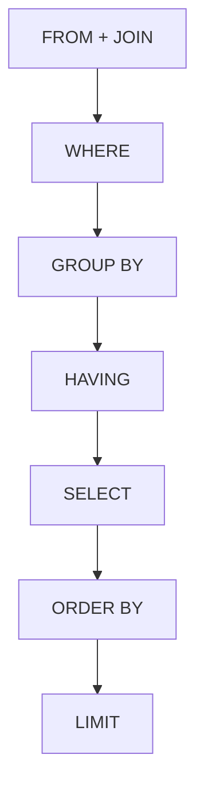

# SQL Queries & Pagination

> **Tuần 6 · Ngày 40** · Thuộc [[03 - Concurrency, SQL, REST & Security]] · Bài trước: [[03.06 - Index & EXPLAIN]] · Bài sau: [[03.08 - REST API Design]]
> Vòng phỏng vấn backend hay có phần "viết SQL lên bảng": lương cao thứ 2, top N mỗi nhóm, tìm bản ghi trùng, khách chưa đặt hàng. Sau đó là câu hỏi hệ thống: phân trang bảng lớn, connection pool cạn.
> Mọi kết quả chạy trên **PostgreSQL 16.14** (Docker). Câu truy vấn mẫu dùng bảng nhỏ `employee` (8 dòng) để dễ kiểm tra bằng mắt; phần phân trang dùng bảng `orders` **1 000 000 dòng** từ [[03.06 - Index & EXPLAIN]]. Lỗi HikariCP đo trên **Spring Boot 3.5.16**.

**Mục lục**
1. [[#1. JOIN: INNER, LEFT và bẫy NULL|JOIN: INNER, LEFT và bẫy NULL]]
2. [[#2. GROUP BY, WHERE vs HAVING|GROUP BY, WHERE vs HAVING]]
3. [[#3. Window function và top N mỗi nhóm|Window function và top N mỗi nhóm]]
4. [[#4. Các câu SQL kinh điển|Các câu SQL kinh điển]]
5. [[#5. Phân trang: OFFSET vs keyset|Phân trang: OFFSET vs keyset]]
6. [[#6. HikariCP và lỗi Connection is not available|HikariCP và lỗi Connection is not available]]
7. [[#7. SQL vs NoSQL|SQL vs NoSQL]]
8. [[#8. Kịch bản Feynman hôm nay|Kịch bản Feynman hôm nay]]

Dữ liệu mẫu:

```sql
create table dept(id int primary key, name text);
insert into dept values (1,'IT'), (2,'Sales'), (3,'HR');          -- HR chưa có ai

create table employee(id int primary key, name text, dept_id int, salary int, email text);
insert into employee values
 (1,'An',1,3000,'an@x.com'), (2,'Binh',1,3000,'binh@x.com'), (3,'Chi',1,2500,'chi@x.com'),
 (4,'Dung',1,2000,'an@x.com'),                                    -- email trùng với An
 (5,'Em',2,2800,'em@x.com'), (6,'Giang',2,2200,'giang@x.com'), (7,'Ha',2,2200,'ha@x.com'),
 (8,'Khoa',null,1800,'khoa@x.com');                               -- chưa thuộc phòng nào
```

---

## 1. JOIN: INNER, LEFT và bẫy NULL

### Hiểu bản chất

| JOIN | Giữ lại |
|---|---|
| `INNER JOIN` | Chỉ các dòng **khớp ở cả hai** bảng |
| `LEFT JOIN` | **Mọi dòng bảng trái**; bên phải không khớp thì cột bên phải là `NULL` |
| `RIGHT JOIN` | Ngược lại của LEFT (ít dùng, viết lại thành LEFT cho dễ đọc) |
| `FULL OUTER JOIN` | Mọi dòng của cả hai bảng |
| `CROSS JOIN` | Tích Descartes: mọi cặp dòng |

### Code minh hoạ (đã chạy)

```sql
select e.name, d.name from employee e left join dept d on d.id = e.dept_id
where e.id in (1, 8);

select e.name, d.name from employee e join dept d on d.id = e.dept_id
where e.id in (1, 8);
```

| Loại join | Kết quả |
|---|---|
| `LEFT JOIN` | `An / IT` và `Khoa / NULL` |
| `INNER JOIN` | Chỉ `An / IT`: Khoa **biến mất** vì `dept_id` là NULL |

Đếm nhân viên theo phòng:

| Query | Kết quả |
|---|---|
| `dept d left join employee e ... count(e.id)` | HR **0**, IT 4, Sales 3 |
| `dept d join employee e ... count(*)` | IT 4, Sales 3 (HR **mất**) |

Báo cáo "theo từng phòng" mà dùng INNER JOIN sẽ âm thầm bỏ các phòng không có dữ liệu. Với LEFT JOIN phải đếm `count(e.id)` chứ không `count(*)`, vì `count(*)` đếm cả dòng NULL thành 1.

### Bẫy hay gặp
- Điều kiện trên bảng phải đặt ở `WHERE` biến LEFT JOIN thành INNER JOIN: `left join employee e on ... where e.salary > 2000` loại luôn dòng có `e` là NULL. Muốn giữ thì đặt vào `ON`: `left join employee e on e.dept_id = d.id and e.salary > 2000`.
- `UNION` loại trùng (phải sort hoặc hash, chậm hơn), `UNION ALL` giữ nguyên. Không cần loại trùng thì luôn dùng `UNION ALL`.

> **Trả lời mẫu:** "INNER JOIN chỉ giữ dòng khớp ở cả hai bảng, LEFT JOIN giữ mọi dòng bảng trái và điền NULL nếu bên phải không khớp. Em đã chạy ví dụ: nhân viên chưa có phòng biến mất khi INNER JOIN, và báo cáo đếm theo phòng bằng INNER JOIN làm mất phòng HR chưa có ai. Bẫy hay gặp là đặt điều kiện của bảng bên phải vào WHERE, làm LEFT JOIN thành INNER JOIN; điều kiện đó phải nằm trong ON."

### Câu hỏi xoáy

**Q1.** JOIN 1 order với bảng item (3 dòng) và bảng payment (2 dòng) cùng lúc rồi `sum(item.price)` thì sao?
> [!success]- Gợi ý trả lời
> Ra 3 × 2 = 6 dòng cho order đó, nên `sum(item.price)` bị **nhân đôi**. Đây là "fan-out" khi join hai quan hệ một-nhiều cùng lúc (cùng gốc với `MultipleBagFetchException` ở [[05.07 - Lazy Loading & N+1]]). Sửa: aggregate từng bảng trong subquery rồi mới join.

---

## 2. GROUP BY, WHERE vs HAVING

### Hiểu bản chất
Thứ tự **logic** khi DB xử lý một câu SELECT (khác thứ tự bạn viết):



- `WHERE` lọc **từng dòng**, chạy **trước** khi gom nhóm, nên không dùng được `count()`, `sum()`.
- `HAVING` lọc **từng nhóm**, chạy **sau** khi gom nhóm, trên kết quả aggregate.
- Alias đặt ở `SELECT` không dùng được trong `WHERE` (vì `WHERE` chạy trước), nhưng PostgreSQL và MySQL cho dùng trong `ORDER BY`.

### Code minh hoạ (đã chạy)

```sql
-- Phòng có ít nhất 2 người lương trên 2000
select dept_id, count(*) from employee
where salary > 2000            -- lọc dòng trước
group by dept_id
having count(*) >= 2           -- lọc nhóm sau
order by dept_id;
```

| dept_id | count |
|---|---|
| 1 | 3 |
| 2 | 3 |

IT có 4 người nhưng Dung (2000) bị `WHERE` loại trước khi đếm, nên còn 3.

### Bẫy hay gặp
- Đặt điều kiện thường vào `HAVING` (ví dụ `having dept_id = 1`): chạy được nhưng lãng phí, vì gom nhóm toàn bộ rồi mới bỏ. Điều kiện không dính aggregate thì để ở `WHERE`.
- `select dept_id, name, count(*) ... group by dept_id`: PostgreSQL báo lỗi vì `name` không nằm trong `GROUP BY` và không phải aggregate. MySQL cũ (không bật `ONLY_FULL_GROUP_BY`) cho chạy và trả `name` ngẫu nhiên.

> **Trả lời mẫu:** "WHERE lọc từng dòng trước khi GROUP BY nên không dùng được hàm aggregate; HAVING lọc từng nhóm sau khi GROUP BY. Ví dụ tìm phòng có ít nhất 2 người lương trên 2000: điều kiện lương ở WHERE, điều kiện đếm ở HAVING. Điều kiện nào không cần aggregate em luôn để ở WHERE, vì lọc sớm thì ít dữ liệu phải gom nhóm hơn."

---

## 3. Window function và top N mỗi nhóm

### Hiểu bản chất
`GROUP BY` **gộp** nhiều dòng thành một. **Window function** tính toán trên một "cửa sổ" các dòng liên quan nhưng **giữ nguyên từng dòng**. Cú pháp: `hàm() over (partition by ... order by ...)`.

### ROW_NUMBER vs RANK vs DENSE_RANK (đã chạy)

```sql
select name, salary,
       row_number() over w as rn, rank() over w as rnk, dense_rank() over w as drnk
from employee where dept_id = 1
window w as (order by salary desc);
```

| name | salary | ROW_NUMBER | RANK | DENSE_RANK |
|---|---|---|---|---|
| An | 3000 | 1 | 1 | 1 |
| Binh | 3000 | 2 | 1 | 1 |
| Chi | 2500 | 3 | **3** | **2** |
| Dung | 2000 | 4 | 4 | 3 |

- `ROW_NUMBER`: luôn tăng 1, giá trị bằng nhau vẫn khác số (thứ tự giữa An và Binh không xác định nếu không thêm cột sort phụ).
- `RANK`: bằng nhau cùng hạng, hạng sau **nhảy** (1, 1, 3).
- `DENSE_RANK`: bằng nhau cùng hạng, **không nhảy** (1, 1, 2).

### Top N mỗi nhóm (đã chạy)

"Top 2 mức lương mỗi phòng":

```sql
select * from (
  select e.name, e.dept_id, e.salary,
         dense_rank() over (partition by dept_id order by salary desc) as r
  from employee e where dept_id is not null
) t
where r <= 2
order by dept_id, r;
```

| name | dept_id | salary | r |
|---|---|---|---|
| An | 1 | 3000 | 1 |
| Binh | 1 | 3000 | 1 |
| Chi | 1 | 2500 | 2 |
| Em | 2 | 2800 | 1 |
| Giang | 2 | 2200 | 2 |
| Ha | 2 | 2200 | 2 |

Phải bọc subquery vì window function chạy ở bước `SELECT`, **sau** `WHERE`, nên không viết `where dense_rank() ... <= 2` trực tiếp được. Chọn hàm theo yêu cầu: "2 **người**" thì `ROW_NUMBER`, "2 **mức lương**" (gồm người bằng lương) thì `DENSE_RANK`.

Window function khác hay dùng: tổng luỹ kế `sum(salary) over (partition by dept_id order by id)`. Đã chạy với phòng Sales: 2800, 5000, 7200. Ngoài ra có `lag`/`lead` (so với dòng trước, dòng sau) cho báo cáo tăng trưởng.

> **Trả lời mẫu:** "Window function tính trên một nhóm dòng nhưng không gộp dòng như GROUP BY. Ba hàm xếp hạng khác nhau ở cách xử lý giá trị bằng nhau: với lương 3000, 3000, 2500 thì ROW_NUMBER ra 1, 2, 3; RANK ra 1, 1, 3; DENSE_RANK ra 1, 1, 2. Bài top N mỗi nhóm em dùng `dense_rank() over (partition by dept_id order by salary desc)` trong subquery rồi lọc `<= N` ở ngoài, vì window function chạy sau WHERE. Đề hỏi N người thì em dùng ROW_NUMBER, hỏi N mức lương thì DENSE_RANK."

### Câu hỏi xoáy

**Q1.** Lấy đơn hàng mới nhất của mỗi khách trên PostgreSQL, ngoài window function còn cách nào?
> [!success]- Gợi ý trả lời
> `select distinct on (customer_id) * from orders order by customer_id, created_at desc`. Đây là cú pháp riêng của PostgreSQL, ngắn gọn và tận dụng được index `(customer_id, created_at)`. Cách chuẩn SQL là `row_number() ... = 1`.

---

## 4. Các câu SQL kinh điển

### Lương cao thứ 2 (cách 1 và 2 đã chạy, đều ra 2800)

```sql
-- Cách 1: subquery, chạy trên mọi DB
select max(salary) from employee where salary < (select max(salary) from employee);

-- Cách 2: distinct + offset (tổng quát cho thứ N)
select distinct salary from employee order by salary desc offset 1 limit 1;

-- Cách 3: dense_rank (tổng quát, theo từng phòng được)
select distinct salary from (
  select salary, dense_rank() over (order by salary desc) r from employee) t
where r = 2;
```

Có hai người cùng lương 3000 cao nhất, nên phải dùng `distinct` hoặc `dense_rank`. Viết `order by salary desc offset 1 limit 1` không có `distinct` sẽ trả 3000, **sai**.

### Tìm bản ghi trùng (đã chạy)

```sql
select email, count(*) from employee group by email having count(*) > 1;
-- an@x.com | 2
```

Muốn xem **từng dòng** trùng (để xoá bớt): `count(*) over (partition by email) > 1` trong subquery, hoặc `row_number() over (partition by email order by id) > 1` để giữ bản ghi đầu tiên.

### Khách chưa từng đặt hàng: bẫy NOT IN với NULL (đã chạy)

"Phòng chưa có nhân viên nào":

```sql
select d.name from dept d where d.id not in (select dept_id from employee);
-- 0 dòng  (sai!)

select d.name from dept d
where not exists (select 1 from employee e where e.dept_id = d.id);
-- HR  (đúng)
```

`NOT IN` trả **0 dòng** vì subquery có một giá trị `NULL` (Khoa). `x NOT IN (1, 2, NULL)` nghĩa là `x <> 1 AND x <> 2 AND x <> NULL`, mà `x <> NULL` là **UNKNOWN**, nên cả biểu thức không bao giờ TRUE. Quy tắc: dùng **`NOT EXISTS`** (hoặc `LEFT JOIN ... IS NULL`), không dùng `NOT IN` với subquery có thể chứa NULL.

Trên dữ liệu lớn (100 000 customer, 1 000 000 order, 10 004 customer chưa đặt hàng), đo được:

| Cách viết | Plan | Kết quả | Thời gian (tốt nhất 3 lần) |
|---|---|---|---|
| `not exists (...)` | `Hash Right Anti Join` | 10 004 | 648 ms |
| `left join orders o ... where o.id is null` | `Hash Right Join` + `Filter: (o.id IS NULL)` | 10 004 | 1 086 ms |

Cùng kết quả, nhưng PostgreSQL chỉ nhận ra "anti join" với `NOT EXISTS` ở cách viết này. `NOT EXISTS` vừa an toàn với NULL vừa nói rõ ý định.

> **Trả lời mẫu:** "Lương cao thứ 2 em viết `max(salary) where salary < (select max(salary))`, hoặc tổng quát hơn là dense_rank bằng 2; phải để ý trường hợp nhiều người cùng lương cao nhất. Tìm trùng thì GROUP BY kèm HAVING count lớn hơn 1. Tìm khách chưa đặt hàng em dùng NOT EXISTS: em đã thử NOT IN với subquery có một giá trị NULL và nó trả về 0 dòng, vì so sánh với NULL là UNKNOWN. Trên bảng 1 triệu order, NOT EXISTS được PostgreSQL chạy thành anti join."

---

## 5. Phân trang: OFFSET vs keyset

### Hiểu bản chất
`LIMIT 20 OFFSET 900000` không "nhảy" tới dòng 900 001 được: DB phải **đọc và bỏ đi** 900 000 dòng trước đó. Trang càng sâu càng chậm.

**Keyset pagination** (seek method) nhớ khoá của dòng cuối trang trước và **đi thẳng** tới đó bằng index:

```sql
-- Trang đầu
select * from orders order by id limit 20;
-- Trang sau: client gửi lại id cuối cùng đã thấy
select * from orders where id > :lastId order by id limit 20;
```

### Code minh hoạ (đã đo, 1 000 000 dòng)

| Query | Dòng index phải đọc | Thời gian (tốt nhất 6 lần) |
|---|---|---|
| `order by id limit 20 offset 0` | 20 | 0,10 ms |
| `... offset 100000` | 100 020 | 14 ms |
| `... offset 500000` | 500 020 | 100 ms |
| `... offset 900000` | 900 020 | 168 ms |
| `where id > 900000 order by id limit 20` | **20** | **0,09 ms** |

Plan của OFFSET 900000 cho thấy rõ:

```text
Limit (actual rows=20)
  ->  Index Scan using orders_pkey on orders (actual rows=900020)
```

Thời gian tăng tuyến tính theo OFFSET; keyset luôn đọc đúng 20 dòng.

Sắp theo cột không duy nhất (ví dụ `created_at`) thì keyset phải kèm **cột phụ duy nhất** để không mất hoặc lặp dòng có cùng `created_at`:

```sql
select * from orders
where status = 'PAID' and (created_at, id) < (:lastCreatedAt, :lastId)
order by created_at desc, id desc
limit 20;
```

Đo được: cùng bộ lọc `status = 'PAID'`, OFFSET 500000 mất **1 303 ms** (đọc và sắp lại hơn 500 nghìn dòng), keyset **0,45 ms**.

### Đánh đổi

| | OFFSET | Keyset |
|---|---|---|
| Nhảy tới trang bất kỳ | Có | Không (chỉ trang trước, trang sau) |
| Tốc độ trang sâu | Chậm dần | Ổn định |
| Dữ liệu thay đổi giữa lúc xem | Có thể lặp hoặc sót dòng | Ổn định |
| Hợp với | Màn admin ít trang, có số trang | Infinite scroll, API mobile, export, bảng lớn |

Trong Spring Data: `Page<T>` chạy thêm **một câu `COUNT`** (đã thấy trong [[05.07 - Lazy Loading & N+1]]), đắt trên bảng lớn. Không cần tổng số trang thì trả `Slice<T>`. Từ Spring Data 3.1 có `ScrollPosition.keyset()` và `Window<T>` hỗ trợ keyset sẵn.

> **Trả lời mẫu:** "OFFSET lớn chậm vì DB phải đọc rồi bỏ đi mọi dòng trước đó. Em đã đo trên 1 triệu dòng: offset 900 nghìn đọc hơn 900 nghìn dòng index, khoảng 170 ms, trong khi keyset `where id > :lastId order by id limit 20` đọc đúng 20 dòng, dưới 0,1 ms. Khi sắp theo cột không duy nhất như created_at, em thêm id vào làm cột phụ và so sánh theo cặp. Đánh đổi là keyset không nhảy tới trang bất kỳ, nên em dùng cho infinite scroll và API mobile, còn màn admin nhỏ vẫn dùng OFFSET, và dùng Slice thay Page khi không cần tổng số."

### Câu hỏi xoáy

**Q1.** Bắt buộc phải có số trang (trang 1..N) trên bảng lớn thì tối ưu thế nào?
> [!success]- Gợi ý trả lời
> (1) Giới hạn số trang tối đa (Google cũng chỉ cho xem vài chục trang); (2) "deferred join": `select id ... order by ... limit 20 offset X` chỉ trên index (Index Only Scan), rồi join lại bảng theo 20 id đó; (3) cache hoặc ước lượng `COUNT` thay vì đếm chính xác mỗi lần.

---

## 6. HikariCP và lỗi Connection is not available

### Hiểu bản chất
Mở một connection DB tốn kém (TCP, xác thực, khởi tạo session), nên ứng dụng giữ sẵn một **pool** và mượn, trả. Spring Boot mặc định dùng **HikariCP** với `maximum-pool-size = 10` và `connection-timeout = 30000 ms`.

Một request **giữ connection suốt transaction**. Hết connection rảnh thì request mới phải chờ; chờ quá `connection-timeout` thì lỗi.

### Code minh hoạ (đã đo)

Pool 2 connection, timeout 1000 ms, giữ cả 2 rồi mở thêm một transaction:

```text
CannotCreateTransactionException: Could not open JPA EntityManager for transaction
cause: JDBCConnectionException: Unable to acquire JDBC Connection
cause: SQLTransientConnectionException: HikariPool-1 - Connection is not available,
       request timed out after 1006ms (total=2, active=2, idle=0, waiting=0)
```

Đọc message: `active=2` bằng `total=2`, tức mọi connection đều đang bị mượn. Chờ đúng khoảng timeout (đo được 1073 ms) mới báo lỗi.

### Nguyên nhân thường gặp

| Nguyên nhân | Vì sao giữ connection lâu |
|---|---|
| Gọi API ngoài, gửi mail **trong** `@Transactional` | Connection bị giữ trong lúc chờ mạng |
| Transaction quá dài (xử lý file, vòng lặp lớn) | Như trên |
| **N+1** và OSIV | Nhiều query hơn, và OSIV giữ connection tới hết request |
| `REQUIRES_NEW` lồng nhau | Một request cần 2 connection cùng lúc; tải cao thì mọi request cùng chờ connection thứ hai: deadlock pool |
| Leak: tự lấy `dataSource.getConnection()` không đóng | Connection không bao giờ trả về; bật `leak-detection-threshold` để log stack trace |
| Query chậm do thiếu index | Mỗi request giữ connection lâu hơn |

### Pool lớn hơn có tốt hơn không?
**Không.** DB chỉ thực sự chạy song song khoảng số core CPU của nó; quá nhiều connection thì tranh nhau CPU, lock, bộ nhớ. Công thức tham khảo trong wiki HikariCP: `connections = (số core × 2) + số ổ đĩa`, một máy DB 4 core cần khoảng 10. Còn phải nhân với **số instance** ứng dụng: 10 pod × pool 50 = 500 connection, vượt `max_connections` mặc định 100 của PostgreSQL. Gặp lỗi pool thì tìm chỗ giữ connection lâu trước, tăng pool sau cùng.

> **Trả lời mẫu:** "HikariCP là connection pool mặc định của Spring Boot, mặc định 10 connection, chờ tối đa 30 giây. Lỗi `Connection is not available, request timed out` nghĩa là mọi connection đều đang bị giữ; em đã tái hiện với pool 2 và message ghi rõ `active=2, idle=0`. Nguyên nhân thường không phải pool nhỏ mà là giữ connection quá lâu: gọi API ngoài trong transaction, N+1, OSIV, REQUIRES_NEW lồng nhau, hoặc leak. Em xử lý các chỗ đó trước, bật leak detection, rồi mới tính lại pool size theo số core DB và số instance."

### Câu hỏi xoáy

**Q1.** Vì sao `REQUIRES_NEW` có thể làm treo cả ứng dụng khi tải cao?
> [!success]- Gợi ý trả lời
> Transaction ngoài giữ connection 1, rồi `REQUIRES_NEW` cần thêm connection 2. Pool 10, có 10 request cùng vào: 10 connection bị transaction ngoài giữ hết, cả 10 cùng chờ connection thứ hai không bao giờ có. Tất cả timeout. Cách tránh: hạn chế REQUIRES_NEW trên đường xử lý nóng, hoặc đảm bảo pool lớn hơn số request đồng thời cần 2 connection.

---

## 7. SQL vs NoSQL

| | SQL (PostgreSQL, MySQL) | NoSQL |
|---|---|---|
| Mô hình | Bảng, quan hệ, schema chặt | Document (MongoDB), key-value (Redis), wide-column (Cassandra), search (Elasticsearch) |
| Transaction | ACID đầy đủ, nhiều bảng | Thường giới hạn trong một document hoặc một key |
| Query | Linh hoạt, JOIN, aggregate tuỳ ý | Tối ưu cho mẫu truy cập đã biết trước |
| Scale | Dọc là chính; scale ngang cần replica, sharding | Thiết kế để scale ngang |
| Hợp với | Đơn hàng, thanh toán, tồn kho: dữ liệu quan hệ cần đúng tuyệt đối | Cache và session (Redis), log và sự kiện ghi nhiều (Cassandra), tìm kiếm full-text (Elasticsearch), dữ liệu cấu trúc thay đổi (MongoDB) |

Thực tế hệ thống thường dùng **cả hai**: PostgreSQL là nguồn dữ liệu chính, Redis làm cache, Elasticsearch phục vụ tìm kiếm.

> **Trả lời mẫu:** "Em chọn SQL khi dữ liệu có quan hệ và cần ACID, như đơn hàng và thanh toán, vì cần transaction nhiều bảng và query linh hoạt. NoSQL hợp khi mẫu truy cập đã biết trước và cần scale ngang hoặc schema linh hoạt: Redis cho cache, Elasticsearch cho tìm kiếm, Cassandra cho dữ liệu ghi nhiều. Ở dự án em PostgreSQL là nguồn sự thật, Redis để cache những thứ đọc nhiều."

---

## 8. Kịch bản Feynman hôm nay

1. Viết ra giấy (không nhìn) 4 câu: lương cao thứ 2, top 2 mỗi phòng, email trùng, phòng chưa có ai. Chạy lại để kiểm tra.
2. Giải thích vì sao `NOT IN` với một giá trị NULL trả 0 dòng, dùng đúng ví dụ Khoa.
3. "Vì sao OFFSET lớn chậm?" kèm bảng số đo 0,1 / 14 / 100 / 168 ms so với keyset 0,09 ms.
4. Kể 4 nguyên nhân của lỗi `Connection is not available` và cách điều tra.

Ghi vào [[08 - Nhật ký học tập]].

## Tự kiểm tra nhanh (không mở tài liệu)

- [ ] LEFT JOIN rồi lọc bảng phải ở WHERE thì chuyện gì xảy ra?
- [ ] Thứ tự logic: FROM, WHERE, GROUP BY, HAVING, SELECT, ORDER BY, LIMIT
- [ ] RANK và DENSE_RANK với 3000, 3000, 2500 cho kết quả gì?
- [ ] Viết top N mỗi nhóm bằng window function
- [ ] Vì sao `NOT IN` nguy hiểm? Dùng gì thay?
- [ ] Viết keyset pagination khi sort theo `created_at` (không duy nhất)
- [ ] `Page` khác `Slice` ở đâu?
- [ ] HikariCP mặc định bao nhiêu connection? Vì sao không nên tăng bừa?
