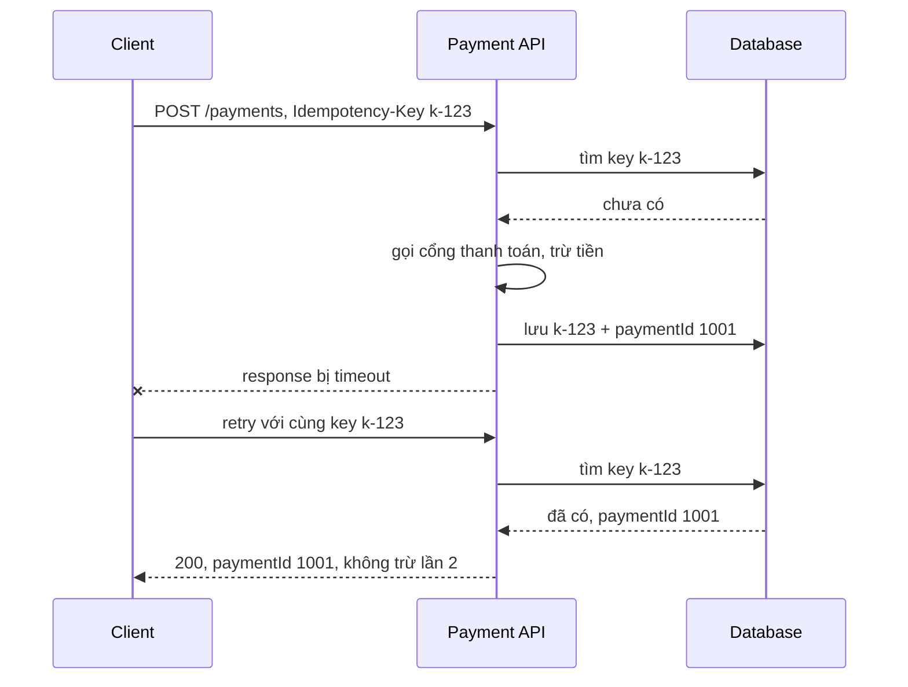

# REST API Design

> **Tuần 7 · Ngày 43** · Thuộc [[03 - Concurrency, SQL, REST & Security]] · Bài trước: [[03.07 - SQL Queries & Pagination]] · Bài sau: [[03.09 - Spring Security & JWT]]
> Câu hỏi REST thường mở đầu buổi phỏng vấn backend: nghe thì dễ, nhưng interviewer đào rất nhanh vào idempotency, 401 vs 403, retry thanh toán và backward compatibility.
> Output trong bài lấy từ một project Spring Boot 3.5.16 chạy trên JDK 21 (MockMvc gọi controller thật, H2 cho bảng idempotency).

**Mục lục**
1. [[#1. Resource và URL|Resource và URL]]
2. [[#2. HTTP method: safe và idempotent|HTTP method: safe và idempotent]]
3. [[#3. Status code cần nói đúng|Status code cần nói đúng]]
4. [[#4. Idempotency-Key cho POST thanh toán|Idempotency-Key cho POST thanh toán]]
5. [[#5. Pagination, filter, sort|Pagination, filter, sort]]
6. [[#6. Versioning và backward compatibility|Versioning và backward compatibility]]
7. [[#7. Format lỗi thống nhất với ProblemDetail|Format lỗi thống nhất với ProblemDetail]]
8. [[#8. DTO, không trả entity|DTO, không trả entity]]
9. [[#9. Kịch bản Feynman hôm nay|Kịch bản Feynman hôm nay]]

---

## 1. Resource và URL

### Hiểu bản chất
REST nhìn hệ thống như một tập **resource** (đơn hàng, khách hàng, sản phẩm). URL là **địa chỉ của resource**, còn **HTTP method** nói bạn muốn làm gì với nó. Vì vậy URL dùng **danh từ**, không dùng động từ: động từ đã nằm ở method rồi.

| Muốn làm | Nên | Không nên |
|---|---|---|
| Lấy 1 đơn hàng | `GET /api/v1/orders/42` | `GET /getOrder?id=42` |
| Tạo đơn hàng | `POST /api/v1/orders` | `POST /createOrder` |
| Đơn hàng của 1 khách | `GET /api/v1/customers/7/orders` | `GET /orders/byCustomer/7` |
| Huỷ đơn (hành động nghiệp vụ) | `POST /api/v1/orders/42/cancel` | `GET /cancelOrder/42` |

Quy ước hay dùng: danh từ **số nhiều**, chữ thường, nối bằng gạch ngang (`/order-items`), lồng tối đa 1–2 cấp. Hành động không map gọn vào CRUD (huỷ, duyệt, hoàn tiền) thì chấp nhận một **sub-resource dạng động từ** với `POST`, miễn là nhất quán trong cả hệ thống.

### Bẫy hay gặp
- Dùng `GET` cho thao tác thay đổi dữ liệu (`GET /orders/42/delete`). Crawler, prefetch của browser hay retry của proxy có thể gọi GET bất kỳ lúc nào, vì GET được coi là an toàn.
- URL chứa dữ liệu nhạy cảm (`?token=...`, số thẻ): URL bị ghi vào access log, lịch sử browser, header `Referer`.

---

## 2. HTTP method: safe và idempotent

### Hiểu bản chất
- **Safe**: request **không thay đổi** trạng thái server (chỉ đọc).
- **Idempotent**: gọi **1 lần hay N lần**, trạng thái cuối cùng trên server **như nhau**. Response có thể khác (lần 2 `DELETE` có thể trả 404), nhưng dữ liệu không bị đổi thêm.

Idempotent quan trọng vì **mạng không đáng tin**: client gửi request, bị timeout, và **không biết** server đã xử lý hay chưa. Nếu method idempotent thì cứ retry, không sợ hậu quả.

| Method | Mục đích | Safe | Idempotent | Ví dụ |
|---|---|---|---|---|
| GET | Đọc | Có | Có | `GET /orders/42` |
| HEAD, OPTIONS | Metadata, preflight | Có | Có | CORS preflight dùng OPTIONS |
| POST | Tạo mới, hành động | Không | **Không** | `POST /orders` gọi 2 lần tạo 2 đơn |
| PUT | Thay **toàn bộ** resource | Không | Có | `PUT /orders/42` với cùng body |
| PATCH | Sửa **một phần** | Không | Không đảm bảo | Tuỳ cách viết |
| DELETE | Xoá | Không | Có | Xoá rồi thì xoá lần nữa vẫn là "đã xoá" |

### PUT vs PATCH

```http
PUT /api/v1/products/42
Content-Type: application/json

{"name": "Keyboard", "price": 90, "stock": 10}
```

PUT nghĩa là "**trạng thái mới của resource là đúng body này**". Field không gửi lên thì hiểu là bị bỏ (về null hoặc mặc định). Gửi lại 10 lần vẫn ra cùng một kết quả, nên idempotent.

```http
PATCH /api/v1/products/42
Content-Type: application/merge-patch+json

{"price": 90}
```

PATCH chỉ đổi field được gửi. Có idempotent hay không phụ thuộc **nội dung patch**:
- `{"price": 90}`: gán giá trị tuyệt đối, gọi lại vẫn 90, nên trên thực tế idempotent.
- `{"op": "increment", "path": "/stock", "value": 1}`: mỗi lần gọi cộng thêm 1, **không** idempotent.

### Bẫy hay gặp
- "PUT dùng để update, PATCH cũng để update, giống nhau." Sai: khác ở **ngữ nghĩa thay toàn bộ hay một phần**, và hệ quả với field bị thiếu.
- Viết PUT nhưng code lại xử lý như PATCH (bỏ qua field null). Client gửi `{"note": null}` để xoá note thì không xoá được. Hãy chọn một ngữ nghĩa và ghi rõ trong tài liệu API.
- Nghĩ rằng idempotent nghĩa là "response giống nhau". Không: idempotent nói về **trạng thái server**.

> **Trả lời mẫu:** "Safe là không thay đổi dữ liệu, idempotent là gọi một hay nhiều lần thì trạng thái server như nhau. GET, PUT, DELETE là idempotent; POST thì không, PATCH thì không đảm bảo vì tuỳ nội dung patch. PUT thay toàn bộ resource nên field thiếu bị coi là bỏ; PATCH chỉ sửa field được gửi. Điều này quan trọng khi client retry do timeout: method idempotent thì retry an toàn, còn POST như tạo thanh toán thì em phải làm cho nó idempotent bằng Idempotency-Key."

### Câu hỏi xoáy

**Q1.** `DELETE /orders/42` lần đầu trả 204, lần hai trả 404. Vậy DELETE có còn idempotent không?
> [!success]- Gợi ý trả lời
> Vẫn idempotent. Idempotent nói về **trạng thái server**: sau lần 1 và sau lần 2, đơn 42 đều không tồn tại. Response khác nhau là chấp nhận được. Một số team chọn trả 204 cho cả hai lần để client dễ xử lý retry; cả hai cách đều hợp lệ, quan trọng là nhất quán.

**Q2.** Làm sao để PATCH trừ kho (`stock - 1`) an toàn khi client retry?
> [!success]- Gợi ý trả lời
> Biến thao tác tương đối thành tuyệt đối hoặc có điều kiện: gửi kèm version (`If-Match: "7"` hoặc field `version` để dùng optimistic lock, sai version thì trả 409/412), hoặc dùng Idempotency-Key giống POST. Đừng để server cứ nhận là cộng trừ.

---

## 3. Status code cần nói đúng

### Hiểu bản chất
Status code là **hợp đồng** với client: client (và cả gateway, retry policy, monitoring) quyết định hành vi dựa vào nó. Trả `200` kèm `{"success": false}` làm hỏng mọi thứ phía sau: retry không chạy, dashboard lỗi không đếm được.

| Code | Ý nghĩa | Ví dụ dùng |
|---|---|---|
| 200 OK | Thành công, có body | GET, PUT trả resource |
| 201 Created | Tạo mới thành công, kèm header `Location` | POST /orders |
| 204 No Content | Thành công, không có body | DELETE |
| 400 Bad Request | Request sai định dạng, validate fail | JSON hỏng, `quantity = 0` |
| **401 Unauthorized** | **Chưa xác thực**: thiếu token, token sai, hết hạn | Không gửi Bearer token |
| **403 Forbidden** | **Đã biết bạn là ai** nhưng **không đủ quyền** | USER gọi API của ADMIN |
| 404 Not Found | Không có resource | Đơn 999 không tồn tại |
| **409 Conflict** | Xung đột với trạng thái hiện tại | Trùng email, sai `@Version` |
| **422 Unprocessable Entity** | Đúng cú pháp nhưng vi phạm nghiệp vụ | Huỷ đơn đã giao |
| **429 Too Many Requests** | Vượt rate limit, kèm `Retry-After` | Gọi OTP quá nhiều |
| 500 | Lỗi không lường trước ở server | NPE, bug |
| 502 / 503 / 504 | Gateway nhận lỗi / service quá tải / upstream timeout | Downstream chết |

### Code minh hoạ: 401 vs 403 quan sát thực tế
Gọi các endpoint qua Spring Security resource server (chi tiết cấu hình ở [[03.09 - Spring Security & JWT]]):

| Request | Status | Header `WWW-Authenticate` |
|---|---|---|
| `GET /api/me` không có token | **401** | `Bearer` |
| Token hết hạn | **401** | `error="invalid_token"`, "Jwt expired at ..." |
| Token bị sửa chữ ký | **401** | `error="invalid_token"`, "Invalid signature" |
| Token USER gọi `/api/admin/stats` | **403** | `error="insufficient_scope"` |
| Token ADMIN gọi `/api/admin/stats` | 200 | không có |

Mẹo nhớ: 401 là "**anh là ai?**", 403 là "**biết anh là ai rồi, nhưng không được vào**". Tên "Unauthorized" của 401 là cách đặt tên lịch sử hơi gây nhầm; về nghĩa nó là **unauthenticated**.

### 409 vs 422 vs 400
- **400**: request **không đọc được** hoặc sai ràng buộc định dạng (JSON hỏng, thiếu field bắt buộc, `quantity` âm).
- **422**: request **hợp lệ về hình thức** nhưng **nghiệp vụ không cho phép** (huỷ đơn đã giao, rút tiền quá số dư).
- **409**: xung đột với **trạng thái hiện tại** của resource (email đã tồn tại, version cũ do người khác vừa sửa).

Nhiều team chỉ dùng 400 cho mọi lỗi phía client. Không sai về nguyên tắc, nhưng khi phỏng vấn bạn nên nói được sự khác nhau và **nhất quán** trong dự án.

### Bẫy hay gặp
- Trả 403 khi token hết hạn. Client tưởng là thiếu quyền nên không gọi refresh token, user bị "kẹt".
- Trả 404 thay vì 403 để **giấu sự tồn tại** của resource (ví dụ đơn của người khác): đây là lựa chọn bảo mật **có chủ đích**, được chấp nhận. Hãy nói rõ là cố ý.
- 429 mà không có `Retry-After`: client không biết chờ bao lâu, retry dồn dập càng làm quá tải.

### Câu hỏi xoáy

**Q1.** Client nên retry những status code nào?
> [!success]- Gợi ý trả lời
> Thường retry **503, 504, 429** (theo `Retry-After`) và lỗi mạng/timeout, có **exponential backoff + jitter** và giới hạn số lần. Không retry 4xx còn lại (400, 401, 403, 404, 409, 422) vì gửi lại y nguyên vẫn lỗi. 500 thì tuỳ: chỉ retry khi request idempotent hoặc có Idempotency-Key.

**Q2.** Cập nhật sản phẩm bị `OptimisticLockException` thì trả status nào?
> [!success]- Gợi ý trả lời
> **409 Conflict** (hoặc 412 Precondition Failed nếu dùng header `If-Match`/ETag). Client cần tải lại bản mới nhất rồi quyết định sửa tiếp. Xem `@Version` ở [[05 - Transaction & JPA]].

---

## 4. Idempotency-Key cho POST thanh toán

### Hiểu bản chất
Kịch bản kinh điển: app gọi `POST /payments`, server đã trừ tiền nhưng response bị **timeout** trên đường về. App retry, và nếu không có cơ chế gì thì **trừ tiền 2 lần**.

Giải pháp: client sinh một **Idempotency-Key** (UUID) cho **mỗi ý định thanh toán**, gửi trong header, và **dùng lại đúng key đó khi retry**. Server lưu key cùng kết quả; gặp lại key thì **trả lại kết quả cũ** thay vì xử lý lần nữa.



### Code minh hoạ

```java
@Entity
public class IdempotencyRecord {
    @Id String idemKey;        // PRIMARY KEY: 2 request cùng key không thể cùng insert
    String requestHash;        // để phát hiện dùng lại key cho body khác
    Long paymentId;
}

@PostMapping("/api/payments")
@Transactional
public ResponseEntity<?> pay(@RequestHeader("Idempotency-Key") String key,
                             @RequestBody PayRequest req) {
    String hash = req.orderId() + ":" + req.amount();
    var existing = repo.findById(key);
    if (existing.isPresent()) {
        if (!existing.get().requestHash.equals(hash)) {
            return ResponseEntity.unprocessableEntity().body(
                    ProblemDetail.forStatusAndDetail(HttpStatus.UNPROCESSABLE_ENTITY,
                            "Idempotency-Key reused with different body"));
        }
        return ResponseEntity.ok(
                Map.of("paymentId", existing.get().paymentId, "replayed", true));
    }
    charges.incrementAndGet();                 // chỗ gọi cổng thanh toán thật
    long id = ids.incrementAndGet();
    repo.save(new IdempotencyRecord(key, hash, id));
    return ResponseEntity.status(HttpStatus.CREATED)
            .body(Map.of("paymentId", id, "replayed", false));
}
```

Output thực tế (MockMvc gọi 4 lần):

| Lần gọi | Status | Body |
|---|---|---|
| Lần 1, key `k-123` | 201 | `paymentId 1001, replayed false` |
| Retry, cùng key, cùng body | **200** | `paymentId 1001, replayed true` |
| Cùng key, body khác (amount 1) | **422** | ProblemDetail "Idempotency-Key reused with different body" |
| Key mới `k-456` | 201 | `paymentId 1002` |

Bộ đếm `charges` sau 4 lần gọi bằng **2**: chỉ 2 ý định thanh toán thật sự được xử lý.

### Bẫy hay gặp
- **Hai request cùng key đến đồng thời**: cả hai `findById` đều thấy "chưa có". Vì vậy key phải là **PRIMARY KEY hoặc UNIQUE**: request thứ hai sẽ lỗi duplicate khi insert, bắt lỗi đó và trả 409 ("đang xử lý, thử lại sau") hoặc chờ rồi trả kết quả. Code mẫu ở trên đủ cho retry tuần tự; với concurrent thật, hãy **insert key trạng thái `PROCESSING` trước** rồi mới gọi cổng thanh toán.
- Gọi cổng thanh toán **bên trong** transaction DB: nếu commit fail sau khi đã trừ tiền thì lệch dữ liệu. Thực tế thường lưu key + trạng thái trước, gọi ra ngoài, rồi cập nhật kết quả.
- Không đặt TTL cho bảng key: bảng phình mãi. Thường giữ 24h–7 ngày.
- Server tự sinh key: vô nghĩa, vì retry của client sẽ ra key mới. Key phải do **client** sinh và giữ lại khi retry.

> **Trả lời mẫu:** "POST không idempotent nên retry sau timeout có thể trừ tiền hai lần. Em yêu cầu client gửi header Idempotency-Key, sinh một UUID cho mỗi lần bấm thanh toán và dùng lại khi retry. Server lưu key có unique constraint cùng hash của body và kết quả. Gặp lại key với cùng body thì trả lại kết quả cũ, body khác thì báo lỗi 422. Hai request trùng key đồng thời thì unique constraint chặn, request sau nhận 409. Em đã thử: 4 lần gọi gồm 1 lần retry thì cổng thanh toán chỉ bị gọi 2 lần."

### Câu hỏi xoáy

**Q1.** Lưu Idempotency-Key ở Redis hay DB?
> [!success]- Gợi ý trả lời
> Redis (`SET key value NX EX 86400`) nhanh và có TTL sẵn, hợp khi chỉ cần chống trùng ngắn hạn. DB thì lưu được **cùng transaction** với bản ghi payment, nên chắc chắn hơn cho tiền bạc. Với thanh toán em ưu tiên DB với unique constraint; Redis có thể đặt phía trước làm lớp lọc nhanh.

**Q2.** Idempotency-Key khác gì với unique constraint trên `orderId`?
> [!success]- Gợi ý trả lời
> Unique `orderId` chỉ đúng khi mỗi đơn chỉ được trả **một lần**. Nhưng một đơn có thể thanh toán lại sau khi lần trước **thất bại thật**, hoặc trả góp nhiều lần. Idempotency-Key đại diện cho **một ý định cụ thể của client**, nên linh hoạt hơn. Hai cách có thể dùng cùng nhau.

---

## 5. Pagination, filter, sort

### Hiểu bản chất
Không bao giờ trả "toàn bộ" một collection: hôm nay 100 dòng, năm sau 2 triệu dòng. Filter, sort, paging đều đi qua **query param**:

```http
GET /api/v1/orders?status=PAID&createdFrom=2026-11-01&sort=createdAt,desc&page=0&size=20
```

Với Spring Data, `Pageable` tự đọc `page`, `size`, `sort`:

```java
@GetMapping("/api/v1/orders")
public Page<OrderDto> search(@RequestParam(required = false) OrderStatus status,
                             Pageable pageable) {
    return orderService.search(status, pageable);      // nhớ giới hạn size tối đa
}
```

| Kiểu | Cách | Ưu | Nhược |
|---|---|---|---|
| Offset | `page=500&size=20` | Nhảy trang tuỳ ý, dễ làm | Trang sâu chậm, dữ liệu chèn thêm làm trùng hoặc sót |
| Keyset (cursor) | `after=<id cuối>&size=20` | Nhanh đều ở mọi trang, ổn định | Không nhảy trang tuỳ ý |

Chi tiết hiệu năng offset vs keyset đã học ở [[03.07 - SQL Queries & Pagination]].

### Bẫy hay gặp
- Cho `size` không giới hạn: client gửi `size=1000000` là kéo sập DB. Đặt `spring.data.web.pageable.max-page-size`.
- `sort` lấy thẳng tên field từ client đưa vào SQL nối chuỗi: lỗ hổng injection. Chỉ cho phép danh sách field cố định.
- Trả `Page<T>` của Spring trực tiếp: JSON chứa nhiều field nội bộ và cấu trúc có thể đổi theo version Spring. Nên bọc thành DTO riêng (`content`, `page`, `size`, `totalElements`).
- Sort không có cột phụ duy nhất (`sort=createdAt` mà nhiều dòng cùng giây): thứ tự giữa các trang không ổn định. Thêm `id` làm tie-breaker.

---

## 6. Versioning và backward compatibility

### Hiểu bản chất
Khi API đã có client (mobile app không ép update được, service khác), mọi thay đổi phải nghĩ: **client cũ có vỡ không?**

| Cách versioning | Ví dụ | Nhận xét |
|---|---|---|
| URL path | `/api/v1/orders` | Phổ biến nhất, dễ thấy, dễ route ở gateway |
| Header | `X-API-Version: 2` | URL sạch, nhưng khó test bằng browser |
| Media type | `Accept: application/vnd.shop.v2+json` | Đúng chuẩn REST nhất, ít team dùng |

| Thay đổi | Tương thích ngược? |
|---|---|
| Thêm field mới vào response | **Có** (client phải bỏ qua field lạ) |
| Thêm endpoint mới | Có |
| Thêm query param tuỳ chọn | Có |
| Thêm field **bắt buộc** vào request | **Không** |
| Xoá hoặc đổi tên field | **Không** |
| Đổi kiểu (`id` từ số sang chuỗi), đổi nghĩa field | **Không** |
| Thêm giá trị enum mới | Nguy hiểm: client cũ có thể không parse được |

Quy trình an toàn khi phải đổi: thêm field mới, giữ field cũ (đánh dấu deprecated, báo qua header `Deprecation`/`Sunset` hoặc changelog), chờ client chuyển, rồi mới xoá. Breaking change thật sự thì ra `v2` và chạy song song.

### Bẫy hay gặp
- Phía client (kể cả service Java của mình) bật `FAIL_ON_UNKNOWN_PROPERTIES`: server thêm một field là client vỡ. Spring Boot mặc định **tắt** cờ này, đừng bật lại.
- Lên v2 cho mọi thay đổi nhỏ: phải bảo trì nhiều version. Chỉ tăng version khi **breaking**.

> **Trả lời mẫu:** "Em versioning bằng URL `/api/v1` vì dễ thấy và dễ route. Nguyên tắc backward compatibility là chỉ thêm, không xoá hay đổi nghĩa: thêm field response, thêm endpoint, thêm param tuỳ chọn thì an toàn; xoá, đổi tên, đổi kiểu hay thêm field bắt buộc thì phá client cũ. Khi cần đổi, em thêm field mới song song, đánh dấu deprecated, chờ client chuyển rồi mới xoá. Với enum, em dặn client có nhánh mặc định cho giá trị lạ."

### Câu hỏi xoáy

**Q1.** Mobile app bản cũ vẫn còn 20% người dùng. Bạn cần đổi `price` từ số nguyên sang object `{amount, currency}`. Làm thế nào?
> [!success]- Gợi ý trả lời
> Không sửa field `price` cũ. Thêm field mới `priceDetail: {amount, currency}`, giữ `price` như cũ. App mới đọc `priceDetail`. Theo dõi tỷ lệ app cũ, khi đủ thấp (hoặc ép update) thì mới bỏ `price`. Nếu thay đổi lan rộng nhiều endpoint thì cân nhắc `v2`.

---

## 7. Format lỗi thống nhất với ProblemDetail

### Hiểu bản chất
Mỗi API tự chế một format lỗi khiến client khổ. **RFC 9457 (trước là 7807)** định nghĩa format `application/problem+json` với các field `type`, `title`, `status`, `detail`, `instance`. Spring 6 / Boot 3 hỗ trợ sẵn qua class `ProblemDetail`.

### Code minh hoạ

```java
@RestControllerAdvice
public class ApiExceptionHandler extends ResponseEntityExceptionHandler {
    @ExceptionHandler(NotFoundException.class)
    ProblemDetail notFound(NotFoundException e) {
        var pd = ProblemDetail.forStatusAndDetail(HttpStatus.NOT_FOUND, e.getMessage());
        pd.setTitle("Resource not found");
        return pd;
    }
}
```

Kế thừa `ResponseEntityExceptionHandler` để các lỗi chuẩn của Spring MVC (validate, JSON hỏng, sai method) cũng ra ProblemDetail. Output thực tế:

```text
404 application/problem+json
{"type":"about:blank","title":"Resource not found","status":404,
 "detail":"Order 1 not found","instance":"/api/orders/1"}
```

```text
400 application/problem+json   (POST body: customer rỗng, quantity 0)
{"type":"about:blank","title":"Bad Request","status":400,
 "detail":"Invalid request content.","instance":"/api/orders"}
```

Request hợp lệ thì trả `201` với header `Location: /api/orders/100`, đúng như bảng status ở mục 3.

### Bẫy hay gặp
- Lỗi validate mặc định chỉ có `"Invalid request content."`, **không liệt kê field nào sai** (đã quan sát ở trên). Muốn client hiển thị lỗi theo field, override `handleMethodArgumentNotValid` và thêm property `errors` (`pd.setProperty("errors", ...)`).
- Trả `e.getMessage()` của mọi exception ra ngoài: lộ tên bảng, câu SQL, stack trace. Với 500, chỉ trả message chung kèm **traceId** để tra log.
- Mỗi controller tự `try/catch` và tự build lỗi: format lệch nhau. Gom về một `@RestControllerAdvice`.

---

## 8. DTO, không trả entity

### Hiểu bản chất
Trả thẳng JPA entity ra JSON gây ra hàng loạt vấn đề:

| Vấn đề | Chuyện gì xảy ra |
|---|---|
| Lộ dữ liệu | `passwordHash`, `internalNote` tự động ra JSON |
| Lazy loading | Jackson gọi getter của quan hệ LAZY ngoài transaction: `LazyInitializationException`, hoặc N+1 nếu bật open-in-view |
| Vòng lặp | `Order.customer.orders.customer...` → StackOverflow / JSON vô hạn |
| Gắn chặt schema | Đổi tên cột DB là đổi luôn API, phá backward compatibility |
| Mass assignment | Nhận entity ở request: client gửi thêm `"role": "ADMIN"` là được set |

Dùng **record** làm DTO cho cả request và response:

```java
public record ProductDto(Long id, String name, BigDecimal price) {
    static ProductDto from(Product p) {
        return new ProductDto(p.getId(), p.getName(), p.getPrice());
    }
}
public record CreateOrder(@NotBlank String customer, @Positive int quantity) {}
```

DTO cũng là thứ nên **cache** (xem [[03.10 - Redis Cache]]): cache entity có quan hệ lazy sẽ gặp đúng các lỗi trên khi serialize.

> **Trả lời mẫu:** "Em không trả entity ra controller. Entity gắn với schema DB, có quan hệ lazy và field nhạy cảm, nên trả thẳng dễ lộ dữ liệu, dính LazyInitializationException hoặc N+1, và đổi DB là vỡ API. Em dùng record làm DTO: request DTO có validation annotation, response DTO chỉ chứa field client cần, map ở tầng service. Như vậy API là hợp đồng độc lập với DB."

### Câu hỏi xoáy

**Q1.** Dùng `@JsonIgnore` trên entity thay cho DTO được không?
> [!success]- Gợi ý trả lời
> Chạy được cho trường hợp nhỏ, nhưng entity vẫn gánh 2 trách nhiệm (persistence và API). Mỗi API cần một "góc nhìn" khác (list ít field, detail nhiều field), `@JsonIgnore` không đáp ứng được, và vẫn còn rủi ro lazy loading, mass assignment. DTO rõ ràng hơn.

**Q2.** Vì sao nên tắt `spring.jpa.open-in-view`?
> [!success]- Gợi ý trả lời
> Open-in-view giữ EntityManager (và connection) mở tới khi render xong response, nên Jackson serialize entity vẫn lazy load được, che giấu N+1 và giữ connection lâu hơn cần thiết. Tắt đi buộc mình load đủ dữ liệu trong service và map sang DTO. Spring Boot mặc định bật và log cảnh báo khi khởi động.

---

## 9. Kịch bản Feynman hôm nay

1. Giải thích cho một bạn frontend vì sao bấm "Thanh toán" 2 lần (hoặc mạng chập chờn) không bị trừ tiền 2 lần, vẽ lại sequence diagram ở mục 4.
2. Nói trong 60 giây: 400, 401, 403, 409, 422, 429 khác nhau thế nào, mỗi cái một ví dụ từ dự án.
3. Kể một lần API của em phải thay đổi mà không được làm vỡ app cũ: em đã làm gì?
4. Giải thích vì sao trả entity ra JSON là ý tưởng tồi, nêu ít nhất 3 lý do.

Ghi vào [[08 - Nhật ký học tập]].

## Tự kiểm tra nhanh (không mở tài liệu)

- [ ] Method nào safe, method nào idempotent? PATCH thì sao?
- [ ] PUT thiếu một field thì field đó bị gì?
- [ ] 401 khác 403 thế nào? Token hết hạn trả mã nào?
- [ ] 409 khác 422 khác 400 thế nào?
- [ ] Idempotency-Key: ai sinh, lưu ở đâu, xử lý request trùng đồng thời ra sao?
- [ ] Offset vs keyset pagination: khi nào dùng cái nào?
- [ ] 3 thay đổi tương thích ngược và 3 thay đổi phá client cũ
- [ ] ProblemDetail có những field nào? Vì sao không trả entity?
