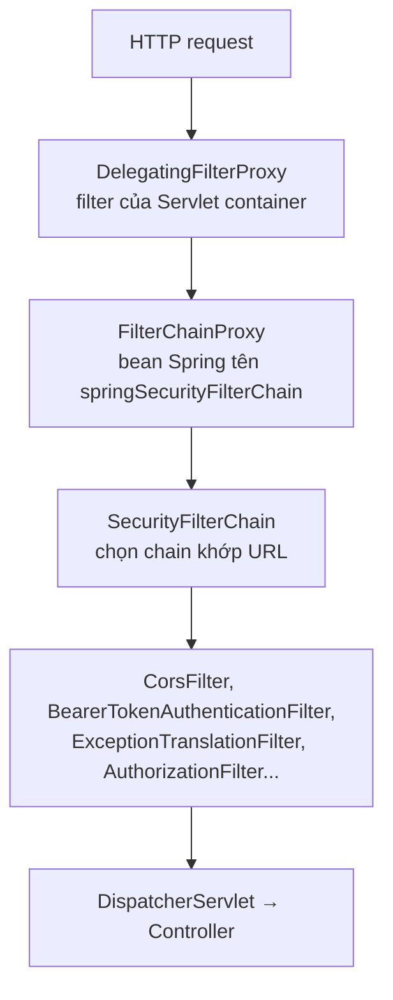
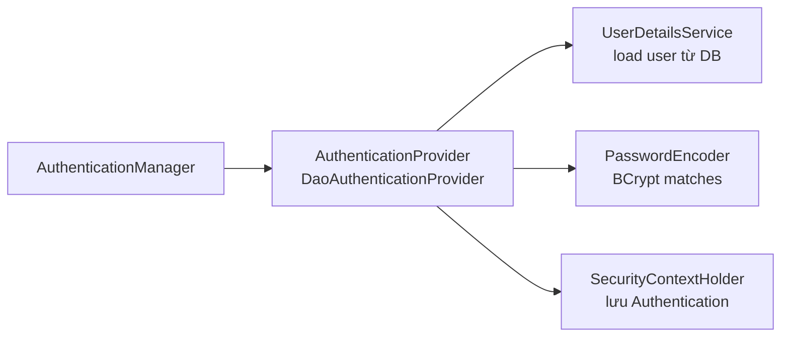
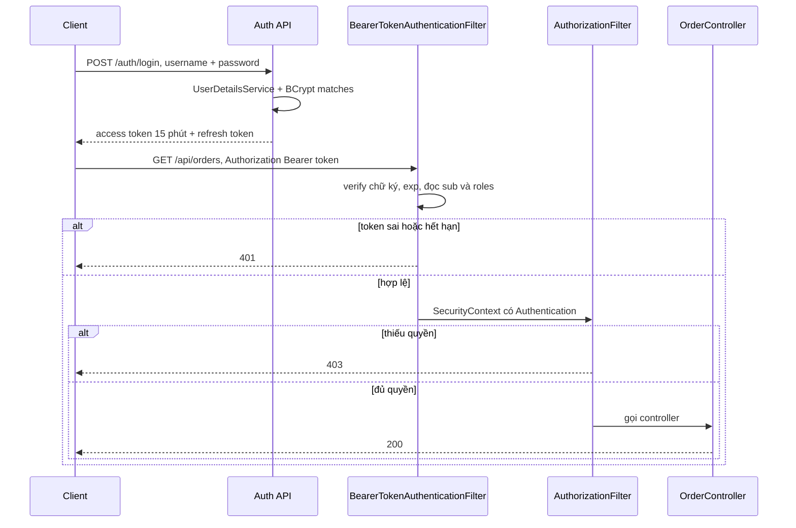

# Spring Security & JWT

> **Tuần 7 · Ngày 44** · Thuộc [[03 - Concurrency, SQL, REST & Security]] · Bài trước: [[03.08 - REST API Design]] · Bài sau: [[03.10 - Redis Cache]]
> Gần như dự án Spring Boot nào cũng có login + JWT, nên interviewer kỳ vọng bạn vẽ được filter chain, giải thích 401 vs 403, và biết JWT **không** được mã hoá.
> Output trong bài lấy từ project Spring Boot 3.5.16 (Spring Security 6, `oauth2-resource-server`, token HS256 ký trong test) chạy trên JDK 21. Phần RS256 chỉ mô tả, không chạy.

**Mục lục**
1. [[#1. Filter chain: request đi qua những đâu|Filter chain: request đi qua những đâu]]
2. [[#2. Authentication vs Authorization|Authentication vs Authorization]]
3. [[#3. Cấu hình bằng SecurityFilterChain bean|Cấu hình bằng SecurityFilterChain bean]]
4. [[#4. JWT: cấu trúc và luồng|JWT: cấu trúc và luồng]]
5. [[#5. HS256 vs RS256, access và refresh token|HS256 vs RS256, access và refresh token]]
6. [[#6. Lưu mật khẩu: BCrypt|Lưu mật khẩu: BCrypt]]
7. [[#7. CORS vs CSRF|CORS vs CSRF]]
8. [[#8. Phân quyền theo method: @PreAuthorize|Phân quyền theo method: @PreAuthorize]]
9. [[#9. OWASP cơ bản: SQL injection và bạn bè|OWASP cơ bản: SQL injection và bạn bè]]
10. [[#10. Kịch bản Feynman hôm nay|Kịch bản Feynman hôm nay]]

---

## 1. Filter chain: request đi qua những đâu

### Hiểu bản chất
Spring Security **không nằm trong controller**. Nó là một chuỗi **Servlet Filter** đứng **trước** `DispatcherServlet`: request bị chặn hoặc được gắn danh tính trước khi chạm tới code của bạn.

Có 3 lớp, mỗi lớp có lý do tồn tại:



- **DelegatingFilterProxy**: Tomcat chỉ biết Servlet Filter, không biết Spring bean. Đây là "cái cầu": một filter đăng ký với Tomcat, bên trong **uỷ quyền** cho một bean trong Spring context.
- **FilterChainProxy**: bean thật sự, giữ **danh sách các `SecurityFilterChain`**. Với mỗi request, nó chọn **chain đầu tiên khớp** (ví dụ chain cho `/api/**`, chain khác cho `/admin-ui/**`).
- **SecurityFilterChain**: danh sách filter cụ thể theo thứ tự.

### Code minh hoạ: in danh sách filter thật
In ra từ `FilterChainProxy` của project demo (CSRF đã tắt, dùng JWT resource server):

| # | Filter | Vai trò |
|---|---|---|
| 1–4 | `DisableEncodeUrlFilter`, `WebAsyncManagerIntegrationFilter`, `SecurityContextHolderFilter`, `HeaderWriterFilter` | Hạ tầng: nạp/dọn SecurityContext, thêm security header |
| 5 | `CorsFilter` | Xử lý CORS, kể cả preflight OPTIONS |
| 6 | `LogoutFilter` | |
| 7 | **`BearerTokenAuthenticationFilter`** | Đọc `Authorization: Bearer`, verify JWT, set Authentication |
| 8–11 | `AuthenticationFilter`, `RequestCacheAwareFilter`, `SecurityContextHolderAwareRequestFilter`, `AnonymousAuthenticationFilter` | Không có token thì gắn "anonymous" |
| 12 | `SessionManagementFilter` | |
| 13 | **`ExceptionTranslationFilter`** | Bắt lỗi bảo mật, biến thành **401** hoặc **403** |
| 14 | **`AuthorizationFilter`** | Kiểm tra quyền theo URL (`authorizeHttpRequests`) |

Tổng cộng 14 filter. Không thấy `CsrfFilter` vì đã `csrf.disable()`.

### Bẫy hay gặp
- Tưởng `ExceptionTranslationFilter` đứng sau `AuthorizationFilter` nên "bắt lỗi sau". Thực tế nó đứng **trước**, bọc lời gọi các filter phía sau trong `try/catch`: `AuthorizationFilter` ném `AccessDeniedException`, nó bắt và quyết định trả 401 (nếu đang anonymous) hay 403 (nếu đã đăng nhập).
- Exception ném trong **filter** không đi qua `@RestControllerAdvice`, vì advice chỉ hoạt động trong `DispatcherServlet`. Muốn body 401/403 theo ProblemDetail thì cấu hình `AuthenticationEntryPoint` và `AccessDeniedHandler`.
- `SecurityContextHolder` mặc định lưu trong **ThreadLocal**: code chạy trong `@Async` hay `CompletableFuture` không tự có user hiện tại.

> **Trả lời mẫu:** "Spring Security là chuỗi Servlet Filter đứng trước DispatcherServlet. Tomcat gọi DelegatingFilterProxy, filter này uỷ quyền cho bean FilterChainProxy; FilterChainProxy chọn SecurityFilterChain khớp với URL và chạy lần lượt các filter. Với API JWT, BearerTokenAuthenticationFilter verify token rồi đặt Authentication vào SecurityContextHolder, AuthorizationFilter kiểm tra quyền, còn ExceptionTranslationFilter đổi lỗi thành 401 hoặc 403. Vì lỗi xảy ra ở filter nên muốn format lỗi thống nhất em phải cấu hình entry point và access denied handler, không dùng được ControllerAdvice."

### Câu hỏi xoáy

**Q1.** Vì sao cần DelegatingFilterProxy, sao không đăng ký thẳng filter của Spring với Tomcat?
> [!success]- Gợi ý trả lời
> Servlet container khởi tạo filter **trước hoặc độc lập** với Spring context, nên filter đăng ký trực tiếp không được inject bean. DelegatingFilterProxy là filter "rỗng", lazy tìm bean `springSecurityFilterChain` trong context và chuyển việc cho nó, nhờ vậy toàn bộ logic security là Spring bean, dùng được DI, AOP, cấu hình.

**Q2.** Một app có thể có nhiều SecurityFilterChain không?
> [!success]- Gợi ý trả lời
> Có. Ví dụ chain 1 cho `/api/**` (stateless, JWT), chain 2 cho trang admin web (form login, session, CSRF bật). Dùng `securityMatcher(...)` và `@Order` để FilterChainProxy chọn đúng; chain đầu tiên khớp sẽ được dùng.

---

## 2. Authentication vs Authorization

### Hiểu bản chất
- **Authentication** (xác thực): **bạn là ai?** Kiểm tra username/password, verify chữ ký token.
- **Authorization** (phân quyền): **bạn được làm gì?** Kiểm tra role, permission.

Luồng login bằng username/password:



Với JWT resource server, phần "provider" là `JwtAuthenticationProvider`: verify chữ ký + `exp` qua `JwtDecoder`, rồi đổi claims thành `Authentication` có danh sách authority.

Hai lỗi tương ứng: thất bại authentication cho **401**, thất bại authorization cho **403**. Quan sát thực tế:

| Request | Status |
|---|---|
| Không token | **401**, `WWW-Authenticate: Bearer` |
| Token hết hạn | **401**, `error="invalid_token"`, "Jwt expired at 2026-11-13T12:06:23Z" |
| Token USER gọi `/api/admin/stats` | **403**, `error="insufficient_scope"` |
| Token ADMIN gọi `/api/admin/stats` | 200 `{"orders":42}` |

### Bẫy hay gặp
- **`hasRole("ADMIN")` thực chất kiểm tra authority `ROLE_ADMIN`.** Mặc định resource server đọc claim `scope`/`scp` và gắn tiền tố `SCOPE_`, nên token có `"roles": ["ADMIN"]` mà không cấu hình converter thì `hasRole("ADMIN")` luôn trả 403. Project demo phải cấu hình `JwtGrantedAuthoritiesConverter` đọc claim `roles`, prefix `ROLE_` (xem mục 3).
- `hasRole` vs `hasAuthority`: `hasRole("ADMIN")` tự thêm `ROLE_`; `hasAuthority("ROLE_ADMIN")` phải ghi đủ.

---

## 3. Cấu hình bằng SecurityFilterChain bean

### Hiểu bản chất
Spring Security 6 (Boot 3) **đã xoá `WebSecurityConfigurerAdapter`**. Cách mới: khai báo **bean `SecurityFilterChain`** với lambda DSL. Ưu điểm: đúng phong cách component của Spring, có thể có nhiều chain, dễ test.

### Code minh hoạ (đã chạy)

```java
@Configuration
@EnableMethodSecurity
public class SecurityConfig {
    @Bean
    SecurityFilterChain api(HttpSecurity http) throws Exception {
        return http
            .csrf(csrf -> csrf.disable())                 // API stateless dùng Bearer token
            .cors(Customizer.withDefaults())              // dùng bean CorsConfigurationSource
            .sessionManagement(s -> s.sessionCreationPolicy(SessionCreationPolicy.STATELESS))
            .authorizeHttpRequests(a -> a
                .requestMatchers("/api/public/**", "/api/auth/**").permitAll()
                .requestMatchers("/api/admin/**").hasRole("ADMIN")
                .anyRequest().authenticated())
            .oauth2ResourceServer(o -> o.jwt(j -> j.jwtAuthenticationConverter(converter())))
            .build();
    }

    JwtAuthenticationConverter converter() {
        var roles = new JwtGrantedAuthoritiesConverter();
        roles.setAuthoritiesClaimName("roles");          // đọc claim "roles"
        roles.setAuthorityPrefix("ROLE_");               // ADMIN → ROLE_ADMIN
        var c = new JwtAuthenticationConverter();
        c.setJwtGrantedAuthoritiesConverter(roles);
        return c;
    }

    @Bean JwtDecoder jwtDecoder() {
        return NimbusJwtDecoder.withSecretKey(key()).macAlgorithm(MacAlgorithm.HS256).build();
    }
    @Bean PasswordEncoder passwordEncoder() { return new BCryptPasswordEncoder(); }
}
```

Dùng thư viện `spring-boot-starter-oauth2-resource-server` thay vì tự viết `JwtFilter extends OncePerRequestFilter`: verify chữ ký, `exp`, `nbf`, header `WWW-Authenticate` đúng chuẩn RFC 6750 đều có sẵn.

### Bẫy hay gặp
- **Thứ tự `requestMatchers` có ý nghĩa**: rule đầu tiên khớp sẽ thắng. Đặt `anyRequest().authenticated()` lên trước thì các rule sau vô tác dụng (Spring 6 báo lỗi khi khởi động nếu `anyRequest` không ở cuối).
- Quên `STATELESS`: Spring có thể tạo `HttpSession`, tốn bộ nhớ và gây nhầm lẫn khi scale nhiều instance.
- Với `@WebMvcTest`, class `@Configuration` chứa SecurityFilterChain **không** được nạp tự động (đã quan sát: bean `SecurityConfig` = false, request không user ra 401 và POST không có CSRF token ra 403 do cấu hình mặc định). Muốn test đúng rule của mình thì `@Import(SecurityConfig.class)`. Xem [[03.12 - Testing Spring Boot]].

---

## 4. JWT: cấu trúc và luồng

### Hiểu bản chất
JWT = `header.payload.signature`, mỗi phần **base64url encode**. Chữ ký được tính trên `header.payload` bằng secret hoặc private key.

**Encode không phải encrypt.** Ai có token đều đọc được payload. Chữ ký chỉ đảm bảo **không ai sửa được** payload mà không bị phát hiện.

### Code minh hoạ: giải mã payload không cần key

```java
String[] parts = token.split("\\.");
System.out.println(new String(Base64.getUrlDecoder().decode(parts[0]), UTF_8));
System.out.println(new String(Base64.getUrlDecoder().decode(parts[1]), UTF_8));
```

Output thực tế (token 153 ký tự, 3 phần):

```text
header={"alg":"HS256"}
payload={"sub":"alice","exp":1794572543,"iat":1794571043,"roles":["USER"]}
```

Thử **giả mạo**: decode payload, đổi `USER` thành `ADMIN`, encode lại, giữ chữ ký cũ, gọi `/api/admin/stats`:

```text
401  error="invalid_token"
     error_description="... Signed JWT rejected: Invalid signature"
```

Đọc được nhưng không sửa được: đó chính là ý nghĩa của chữ ký.

### Luồng đầy đủ



Điểm mấu chốt: server **không lưu session**. Mỗi request tự mang đủ thông tin, server chỉ cần key để verify. Đó là lý do JWT hợp với scale ngang và microservices.

### Bẫy hay gặp
- Đặt email, số điện thoại, quyền chi tiết nhạy cảm vào payload: ai cũng đọc được (đã chứng minh ở trên).
- Token quá to (nhét cả danh sách permission): gửi kèm **mọi** request, tốn băng thông, có thể vượt giới hạn header.
- Chấp nhận `alg` do token tự khai (lỗi kinh điển `alg: none`). Decoder của Spring cố định thuật toán (`macAlgorithm(HS256)`), nên token khai thuật toán khác bị từ chối.
- Secret HS256 ngắn hoặc dễ đoán: brute-force offline được, vì kẻ tấn công có sẵn `header.payload` và chữ ký. Dùng tối thiểu 256 bit ngẫu nhiên, đọc từ secret manager.

> **Trả lời mẫu:** "JWT gồm header, payload, signature, mỗi phần base64url encode, nên payload không được mã hoá; em đã thử decode payload mà không cần key. Chữ ký đảm bảo không sửa được: em đổi role USER thành ADMIN thì server trả 401 invalid signature. Luồng là client login, server kiểm tra BCrypt rồi ký access token ngắn hạn và refresh token. Mỗi request gửi Bearer token, BearerTokenAuthenticationFilter verify chữ ký và exp, đặt Authentication vào SecurityContext, rồi AuthorizationFilter kiểm tra role. Server không cần session nên scale ngang dễ."

### Câu hỏi xoáy

**Q1.** Muốn ẩn nội dung payload thì sao?
> [!success]- Gợi ý trả lời
> Dùng **JWE** (JSON Web Encryption) thay cho JWS. Nhưng thường câu trả lời đúng hơn là **đừng đặt dữ liệu nhạy cảm vào token**: chỉ để `sub` (id), role cơ bản, `exp`, `jti`; thông tin khác tra ở server. Và luôn dùng HTTPS.

**Q2.** Server đổi role của user từ ADMIN xuống USER, token cũ vẫn còn hạn 15 phút. Chuyện gì xảy ra?
> [!success]- Gợi ý trả lời
> Token cũ vẫn mang `roles: ["ADMIN"]` và vẫn hợp lệ tới khi hết hạn, vì server không tra DB. Đây là cái giá của stateless. Cách giảm: access token ngắn, khi đổi quyền thì **thu hồi** (blacklist `jti`, hoặc tăng "token version" của user và kiểm tra), với API nhạy cảm thì tra quyền từ DB.

---

## 5. HS256 vs RS256, access và refresh token

### Hiểu bản chất

| | HS256 | RS256 / ES256 |
|---|---|---|
| Loại | Đối xứng (HMAC) | Bất đối xứng |
| Ký | Secret dùng chung | **Private key** (chỉ auth server có) |
| Verify | Cùng secret đó | **Public key** (công khai qua JWKS endpoint) |
| Rủi ro | Service nào verify được cũng **ký được** token giả | Service chỉ verify, không ký được |
| Hợp với | Monolith, 1 service tự ký tự verify | Microservices, SSO, Keycloak, Auth0 |

Với RS256, service chỉ cần cấu hình `spring.security.oauth2.resourceserver.jwt.jwk-set-uri`, Spring tự tải public key và cache lại; auth server xoay vòng key (`kid` trong header) mà service không phải deploy lại.

### Access token vs refresh token

| | Access token | Refresh token |
|---|---|---|
| Thời hạn | Ngắn: 5–15 phút | Dài: vài ngày đến vài tuần |
| Gửi kèm | Mọi request API | Chỉ khi gọi `/auth/refresh` |
| Lưu ở server | Không (stateless) | **Có** (DB/Redis) để thu hồi được |
| Bị lộ | Thiệt hại giới hạn trong vài phút | Nghiêm trọng hơn: cần rotation |

**Refresh token rotation**: mỗi lần refresh, cấp refresh token **mới** và vô hiệu cái cũ. Nếu một refresh token **đã dùng rồi** lại được gửi tới, nghĩa là có người đánh cắp: thu hồi cả "họ" token của phiên đó.

**Thu hồi access token trước hạn** (logout, khoá tài khoản): lưu `jti` vào Redis blacklist với TTL = thời gian còn lại của token, filter kiểm tra thêm bước này. Chấp nhận mất một phần "stateless" để đổi lấy khả năng thu hồi.

### Lưu token ở client đâu?

| Chỗ lưu | XSS đọc được token? | Cần chống CSRF? |
|---|---|---|
| `localStorage` | **Có**: script độc chạy được là lấy được token | Không (browser không tự gửi) |
| Cookie `HttpOnly; Secure; SameSite` | **Không**: JS không đọc được | **Có**: browser tự gửi cookie |
| Memory (biến JS) + refresh token trong cookie HttpOnly | Không lưu lâu | Chỉ endpoint refresh cần chú ý |

Không có lựa chọn hoàn hảo; phương án thứ ba là phổ biến cho SPA.

### Câu hỏi xoáy

**Q1.** Đã có refresh token thì sao không cho access token sống 1 ngày cho tiện?
> [!success]- Gợi ý trả lời
> Access token gửi kèm mọi request nên **dễ lộ hơn** (log, proxy, extension). Không thu hồi được nếu không có blacklist. Hạn ngắn giới hạn thiệt hại khi lộ. Refresh token ít khi gửi, được lưu ở server nên kiểm soát được.

**Q2.** Logout với JWT làm thế nào?
> [!success]- Gợi ý trả lời
> Client xoá token; server **thu hồi refresh token** (xoá khỏi DB/Redis). Access token còn sống tới khi hết hạn; nếu cần cắt ngay thì đưa `jti` vào blacklist Redis với TTL bằng thời gian còn lại.

---

## 6. Lưu mật khẩu: BCrypt

### Hiểu bản chất
Mật khẩu phải được **hash một chiều**, không mã hoá hai chiều (mã hoá thì có key giải mã, lộ key là lộ hết). Nhưng hash nhanh như SHA-256 cũng không ổn: kẻ tấn công lấy được DB sẽ thử **hàng tỷ** mật khẩu mỗi giây bằng GPU.

BCrypt giải quyết bằng 2 thứ:
- **Salt** ngẫu nhiên cho mỗi mật khẩu: cùng mật khẩu ra hash khác nhau, rainbow table vô dụng.
- **Cost factor** (strength): **chậm có chủ đích**, mỗi lần tăng 1 thì chậm gấp đôi.

### Code minh hoạ (đã đo)

```java
var enc = new BCryptPasswordEncoder(strength);
String h = enc.encode("P@ssw0rd");
enc.matches("P@ssw0rd", h);   // true
```

| Strength | Thời gian trung bình / hash | Ví dụ hash (60 ký tự) |
|---|---|---|
| 10 (mặc định) | 113.6 ms | `$2a$10$C38mwtoaKAO72ovSTPijP.x8TNjXNu6...` |
| 12 | 590.4 ms | `$2a$12$D8unsobwi32srG4Ah6LVnO287tECJnV...` |
| 14 | 4410.0 ms | `$2a$14$dCwjzEeLXqSdAyKz3W/BuOwv7l7tol/...` |

> Đo lại với spring-security-crypto 6.5, có warm-up và nhiều mẫu: strength 10 khoảng 88 ms, 11 là 180 ms, 12 là 386 ms, 13 là 766 ms, 14 là 1521 ms. Đây mới đúng quy luật mỗi bậc chậm gấp đôi; số 590 và 4410 ở bảng trên là một lần đo bị nhiễu.

So sánh trên cùng máy: **100.000** hash SHA-256 chỉ mất **165.7 ms**, tức nhanh hơn BCrypt strength 10 khoảng 70.000 lần cho mỗi lần thử.

Cấu trúc chuỗi `$2a$10$C38mwtoaKAO72ovSTPijP.x8TNjXNu6OcsezPoEcqbtDes4LeECWO`:

| Phần | Ý nghĩa |
|---|---|
| `$2a$` | Phiên bản thuật toán |
| `10$` | Cost: 2^10 vòng |
| 22 ký tự tiếp | **Salt** |
| 31 ký tự cuối | Hash |

Salt **nằm ngay trong chuỗi**, nên không cần cột salt riêng; `matches` đọc salt và cost từ chính chuỗi hash. Hash cùng mật khẩu 2 lần: `equals` = **false**, nhưng `matches` cả hai đều **true**. SHA-256 cùng input 2 lần thì ra y hệt (`b03ddf3ca2e714a6...`).

### Bẫy hay gặp
- So sánh bằng `encode(raw).equals(storedHash)`: luôn false vì salt mới. Phải dùng `matches`.
- Strength quá cao: login chậm và **dễ bị DoS** (gửi nhiều request login là đốt CPU). Mục tiêu thường khoảng 100–500 ms trên server thật; đo rồi chọn.
- BCrypt chỉ dùng **72 byte** đầu của mật khẩu. Đã thử trên Spring Security 6.5.11: `encode` mật khẩu 73 byte ném `IllegalArgumentException: password cannot be more than 72 bytes`, nhưng `matches(72 ký tự + "x", hash của 72 ký tự)` vẫn trả **true**. Nên giới hạn độ dài mật khẩu ở tầng validate (ví dụ tối đa 64 ký tự).
- Muốn đổi thuật toán sau này: dùng `DelegatingPasswordEncoder` (`PasswordEncoderFactories.createDelegatingPasswordEncoder()`), hash có tiền tố `{bcrypt}`, `{argon2}` nên chuyển dần được.

> **Trả lời mẫu:** "Em hash mật khẩu bằng BCrypt, không dùng MD5 hay SHA trần và không mã hoá hai chiều. BCrypt có salt ngẫu nhiên nằm ngay trong chuỗi hash nên cùng mật khẩu ra hash khác nhau, và có cost factor để chậm có chủ đích. Em đo trên máy: strength 10 mất khoảng 110 ms mỗi hash, trong khi 100 nghìn hash SHA-256 chỉ mất 165 ms, nên brute-force BCrypt đắt hơn rất nhiều. Khi kiểm tra phải dùng `matches` chứ không encode rồi so chuỗi."

---

## 7. CORS vs CSRF

### Hiểu bản chất
Hai thứ hay bị nhầm, nhưng **bảo vệ hai chuyện khác nhau**:

| | CORS | CSRF |
|---|---|---|
| Là gì | Cơ chế browser **cho phép** JS ở origin A đọc response từ origin B | **Tấn công** lợi dụng browser tự gửi cookie |
| Ai thực thi | **Browser** (dựa vào header server trả) | Server phải tự chống (CSRF token, SameSite) |
| Khi nào gặp | Frontend `shop.example.com` gọi API `api.example.com` | Trang độc gửi form tới ngân hàng khi bạn đang đăng nhập |
| Có liên quan Bearer token? | Có, header `Authorization` cần được cho phép | **Không**: browser không tự gửi Bearer token |

### Code minh hoạ: preflight quan sát thực tế

```java
@Bean
CorsConfigurationSource corsConfigurationSource() {
    var cfg = new CorsConfiguration();
    cfg.setAllowedOrigins(List.of("https://shop.example.com"));
    cfg.setAllowedMethods(List.of("GET", "POST", "PUT", "DELETE"));
    cfg.setAllowedHeaders(List.of("Authorization", "Content-Type"));
    cfg.setMaxAge(3600L);
    var src = new UrlBasedCorsConfigurationSource();
    src.registerCorsConfiguration("/api/**", cfg);
    return src;
}
```

Request có header `Authorization` là "non-simple", nên browser gửi trước một **preflight** `OPTIONS`:

| Request | Status | Header trả về |
|---|---|---|
| `OPTIONS /api/me`, Origin `shop.example.com` | **200** | `Access-Control-Allow-Origin: https://shop.example.com`, `Allow-Methods: GET,POST,PUT,DELETE` |
| `OPTIONS /api/me`, Origin `evil.example` | **403** | body `Invalid CORS request` |
| `GET /api/public/ping`, Origin `evil.example` | **403** | `Invalid CORS request` |
| `GET /api/public/ping`, Origin `shop.example.com` | 200 | `Access-Control-Allow-Origin` khớp |

Hai điểm rút ra từ kết quả:
- Preflight hợp lệ trả **200 dù không có token**: `CorsFilter` đứng **trước** filter xác thực và trả lời preflight luôn. Nếu không bật `.cors(...)` trong Security, preflight sẽ bị chặn 401 vì OPTIONS không mang token.
- Spring còn **chủ động trả 403** cho request có header `Origin` không được phép. Nhưng request **không có** `Origin` (curl, Postman, server-to-server) thì CORS không áp dụng. **CORS không phải là cơ chế bảo mật cho API**, nó chỉ bảo vệ người dùng trong browser.

### Bẫy hay gặp
- `allowedOrigins("*")` cùng `allowCredentials(true)`: spec cấm, Spring ném lỗi khi gặp request. Liệt kê origin cụ thể (hoặc `allowedOriginPatterns`).
- Tắt CSRF chỉ vì "API dùng JWT" nhưng token lại nằm trong **cookie**: browser tự gửi cookie, nên CSRF quay lại. Dùng cookie thì bật CSRF hoặc ít nhất `SameSite=Strict/Lax`.
- Cấu hình `@CrossOrigin` ở controller nhưng quên `.cors()` trong Security: preflight chết ở filter, controller không bao giờ được gọi.

> **Trả lời mẫu:** "CORS là cơ chế của browser: JS ở origin khác muốn đọc response thì server phải trả header cho phép, với request có Authorization browser gửi preflight OPTIONS trước. Em khai báo origin cụ thể trong CorsConfigurationSource và bật `.cors()` trong SecurityFilterChain để preflight được trả lời trước bước xác thực. CSRF là tấn công lợi dụng cookie tự gửi kèm. API stateless dùng Bearer token trong header thì em tắt CSRF, vì browser không tự gửi header đó; nếu token lưu trong cookie thì phải bật lại."

### Câu hỏi xoáy

**Q1.** Gọi API từ Postman không bị lỗi CORS, từ React thì bị. Vì sao?
> [!success]- Gợi ý trả lời
> CORS do **browser** thực thi. Postman không phải browser, không gửi preflight và không kiểm tra header `Access-Control-Allow-Origin`. Server vẫn trả response bình thường; chỉ có browser từ chối đưa response cho JS.

**Q2.** Vì sao API dùng Bearer token thì không cần CSRF token?
> [!success]- Gợi ý trả lời
> CSRF dựa vào việc browser **tự động** đính kèm credential (cookie) khi trang khác gửi request tới site của bạn. Header `Authorization: Bearer` phải do JS của chính app bạn gắn vào; trang độc ở origin khác không đọc được token của bạn nên không gắn được.

---

## 8. Phân quyền theo method: @PreAuthorize

### Hiểu bản chất
Rule theo URL (`requestMatchers`) thô: chỉ biết đường dẫn. `@PreAuthorize` cho phép kiểm tra **ngay tại method service hoặc controller**, kể cả điều kiện theo dữ liệu (`#ownerId == authentication.name`). Cần bật `@EnableMethodSecurity` (thay cho `@EnableGlobalMethodSecurity` cũ).

```java
@PreAuthorize("hasRole('ADMIN')")
@DeleteMapping("/api/orders/{id}")
public void delete(@PathVariable Long id) {}
```

Output thực tế: token USER gọi `DELETE /api/orders/1` ra **403** (`insufficient_scope`), token ADMIN ra **200**.

### Bẫy hay gặp
- `@PreAuthorize` chạy bằng **AOP proxy**, nên dính **self-invocation**: method A gọi `this.b()` có `@PreAuthorize` thì kiểm tra quyền bị **bỏ qua**. Cùng cơ chế với `@Transactional` ([[06 - Sơ đồ cơ chế cốt lõi]] mục 2) và `@Cacheable` ([[03.10 - Redis Cache]]).
- Quên `@EnableMethodSecurity`: annotation nằm đó nhưng **không có tác dụng**, không có cảnh báo nào.
- Chỉ dựa vào ẩn nút trên UI: API vẫn phải tự kiểm tra quyền.

### Câu hỏi xoáy

**Q1.** User chỉ được xem đơn của chính mình. Viết thế nào?
> [!success]- Gợi ý trả lời
> Cách đơn giản và chắc nhất: query theo cả `id` và `ownerId` lấy từ `authentication`, không có thì 404. Hoặc `@PostAuthorize("returnObject.ownerId == authentication.name")`. Lỗi này (IDOR: đổi id trên URL là xem được đơn người khác) đứng đầu OWASP Top 10 dưới tên Broken Access Control.

---

## 9. OWASP cơ bản: SQL injection và bạn bè

### Hiểu bản chất
**SQL injection**: dữ liệu người dùng được **nối thẳng** vào câu SQL nên trở thành **lệnh**.

```java
// SAI: name = "x' OR '1'='1" → trả về toàn bộ bảng
String sql = "select * from users where name = '" + name + "'";

// ĐÚNG: tham số bind, DB coi giá trị là dữ liệu, không bao giờ là lệnh
@Query("select u from User u where u.name = :name")
List<User> findByName(@Param("name") String name);
```

JPA/JPQL với `:param`, Spring Data derived query, `JdbcTemplate` với `?` đều an toàn. **Không** an toàn: nối chuỗi trong `@Query(nativeQuery = true)`, `createQuery("..." + x)`, hoặc đưa tên cột `sort` từ client vào SQL mà không whitelist.

Những mục OWASP Top 10 hay được hỏi ở level 2 năm:

| Mục | Ví dụ | Cách chống |
|---|---|---|
| Broken Access Control | Đổi `/orders/42` thành `/orders/43` xem được đơn người khác | Kiểm tra quyền sở hữu ở server |
| Cryptographic Failures | Lưu mật khẩu MD5, không HTTPS | BCrypt/Argon2, TLS |
| Injection | SQL nối chuỗi | Prepared statement |
| Security Misconfiguration | Bật actuator `/env` public, trả stack trace | Chỉ expose `health`, ProblemDetail gọn |
| Vulnerable Components | Thư viện có CVE (Log4Shell) | Cập nhật dependency, quét bằng công cụ |
| Logging Failures | Log password, token, số thẻ | Mask dữ liệu nhạy cảm |

> **Trả lời mẫu:** "Chống SQL injection em luôn dùng tham số bind: JPQL với `:param`, derived query, hoặc JdbcTemplate với dấu hỏi; không nối chuỗi kể cả trong native query, và với sort động thì whitelist tên cột. Ngoài ra em để ý Broken Access Control: kiểm tra resource có thuộc user hiện tại không chứ không chỉ kiểm tra đã đăng nhập, không log token hay mật khẩu, và không để lộ actuator hay stack trace ra ngoài."

---

## 10. Kịch bản Feynman hôm nay

1. Vẽ lại filter chain (DelegatingFilterProxy → FilterChainProxy → SecurityFilterChain → các filter chính) và chỉ ra chỗ sinh 401, chỗ sinh 403.
2. Giải thích cho người không biết code: vì sao "ai cũng đọc được JWT nhưng không ai sửa được".
3. So sánh HS256 và RS256 trong 45 giây, kèm lý do chọn cho microservices.
4. Giải thích vì sao BCrypt cố tình chậm, dùng con số 113 ms so với 165 ms cho 100 nghìn SHA-256.

Ghi vào [[08 - Nhật ký học tập]].

## Tự kiểm tra nhanh (không mở tài liệu)

- [ ] Vai trò của DelegatingFilterProxy, FilterChainProxy, SecurityFilterChain
- [ ] Filter nào verify JWT? Filter nào đổi exception thành 401/403?
- [ ] Vì sao `hasRole("ADMIN")` trả 403 dù token có `roles: ["ADMIN"]`?
- [ ] JWT gồm mấy phần? Payload có bị mã hoá không?
- [ ] HS256 vs RS256: ai giữ key nào?
- [ ] Access vs refresh token, rotation, cách thu hồi trước hạn
- [ ] Chuỗi BCrypt chứa những gì? Vì sao không so sánh bằng `equals`?
- [ ] CORS vs CSRF; khi nào được tắt CSRF?
