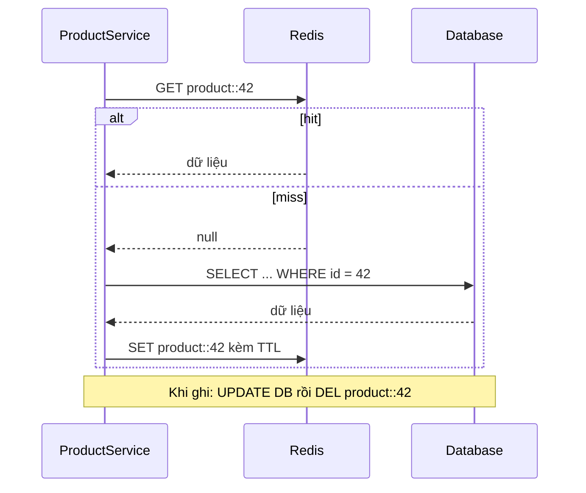
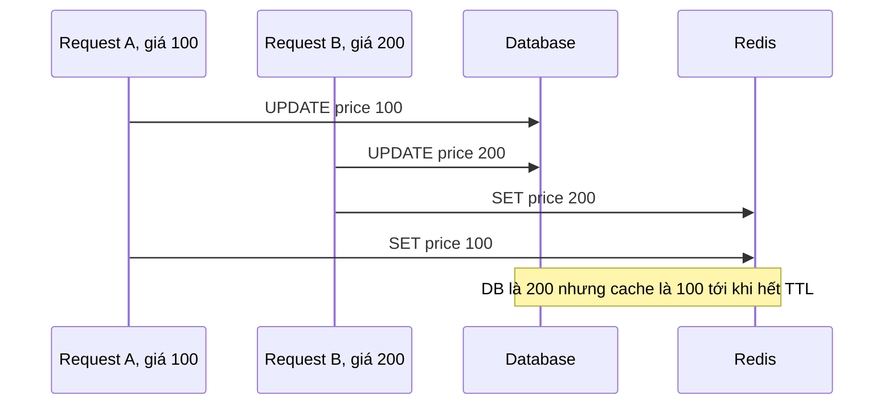

# Redis Cache

> **Tuần 7 · Ngày 45** · Thuộc [[03 - Concurrency, SQL, REST & Security]] · Bài trước: [[03.09 - Spring Security & JWT]] · Bài sau: [[03.11 - Kafka Basics]]
> Cache là câu "cộng điểm" ở level 2 năm, nhưng hỏi sâu thì rất dễ lộ: TTL, invalidation, self-invocation, ba sự cố penetration/stampede/avalanche.
> Output trong bài lấy từ project Spring Boot 3.5.16 (Spring Data Redis 3.5.13) chạy trên JDK 21, Redis 7 thật trong Docker qua Testcontainers. Phần Caffeine chỉ mô tả, không đo.

**Mục lục**
1. [[#1. Vì sao cần cache và cache-aside|Vì sao cần cache và cache-aside]]
2. [[#2. @Cacheable, @CacheEvict, @CachePut|@Cacheable, @CacheEvict, @CachePut]]
3. [[#3. TTL, key design, serialization|TTL, key design, serialization]]
4. [[#4. Self-invocation: cache bị bỏ qua|Self-invocation: cache bị bỏ qua]]
5. [[#5. Invalidation và consistency với DB|Invalidation và consistency với DB]]
6. [[#6. Penetration, stampede, avalanche|Penetration, stampede, avalanche]]
7. [[#7. Local cache (Caffeine) vs distributed (Redis)|Local cache (Caffeine) vs distributed (Redis)]]
8. [[#8. Kịch bản Feynman hôm nay|Kịch bản Feynman hôm nay]]

---

## 1. Vì sao cần cache và cache-aside

### Hiểu bản chất
Một query DB mất vài ms đến vài chục ms, đọc Redis thường dưới 1 ms qua mạng nội bộ. Nếu một dữ liệu được **đọc nhiều, ghi ít** (chi tiết sản phẩm, cấu hình, danh mục), cache giúp:
- Giảm tải DB (DB là thứ khó scale nhất).
- Giảm latency cho người dùng.

Cái giá phải trả: dữ liệu trong cache **có thể cũ** (stale). Mọi quyết định về cache đều là cân bằng giữa **tốc độ** và **độ tươi** của dữ liệu.

**Cache-aside** (lazy loading) là pattern phổ biến nhất, cũng là cái `@Cacheable` làm:



| Pattern | Cách làm | Khi nào |
|---|---|---|
| **Cache-aside** | App đọc cache, miss thì đọc DB rồi ghi cache; ghi DB thì xoá cache | Mặc định cho hầu hết trường hợp |
| Read-through | Cache tự load từ DB khi miss (app chỉ nói chuyện với cache) | Thư viện cache hỗ trợ loader |
| Write-through | Ghi vào cache, cache ghi đồng bộ xuống DB | Ít gặp trong Spring app thường |
| Write-behind | Ghi cache trước, ghi DB **bất đồng bộ** sau | Throughput ghi cao, chấp nhận rủi ro mất dữ liệu |

### Bẫy hay gặp
- Cache mọi thứ: dữ liệu thay đổi liên tục (tồn kho realtime, số dư) cache vào chỉ thêm bug stale.
- Không đo trước: cache một API chỉ gọi 10 lần/phút là thêm độ phức tạp mà không được gì.

---

## 2. @Cacheable, @CacheEvict, @CachePut

### Hiểu bản chất
Spring Cache là **abstraction** giống `@Transactional`: bạn gắn annotation, Spring tạo **proxy** bọc bean; proxy kiểm tra cache trước khi gọi method thật. Đổi Redis sang Caffeine chỉ là đổi `CacheManager`, code không đổi.

| Annotation | Làm gì |
|---|---|
| `@EnableCaching` | Bật cơ chế (đặt ở class cấu hình) |
| `@Cacheable` | Có trong cache thì trả luôn, **không gọi method**; chưa có thì gọi rồi lưu |
| `@CacheEvict` | Xoá entry (hoặc `allEntries = true` xoá cả cache) |
| `@CachePut` | **Luôn** gọi method và ghi kết quả vào cache |

### Code minh hoạ (đã chạy với Redis thật)

```java
@Service
public class ProductService {
    @Cacheable(cacheNames = "product", key = "#id")
    public ProductDto getProduct(Long id) {
        dbLoads.incrementAndGet();                        // đếm số lần thật sự đọc DB
        return repo.findById(id).map(ProductDto::from)
                .orElseThrow(() -> new NotFoundException("Product " + id + " not found"));
    }

    @Transactional
    @CacheEvict(cacheNames = "product", key = "#id")
    public void updatePrice(Long id, BigDecimal price) {
        repo.findById(id).orElseThrow().setPrice(price);
    }
}
```

| Bước | Số lần đọc DB (cộng dồn) | Trong Redis |
|---|---|---|
| `getProduct(1)` lần 1 | 1 (miss) | `product::1` |
| `getProduct(1)` lần 2, lần 3 | **vẫn 1** (hit) | `product::1` |
| `updatePrice(1, 90)` | 1 | **rỗng** (đã evict) |
| `getProduct(1)` | 2 (miss, giá mới `90.00`) | `product::1` |

`CacheManager` được Boot tự cấu hình là `RedisCacheManager` khi có `spring-boot-starter-data-redis`.

### Bẫy hay gặp
- **Quên `@EnableCaching`**: annotation không có tác dụng, không báo lỗi.
- **`@CachePut` và `@Cacheable` trên cùng method**: mâu thuẫn, `@CachePut` luôn gọi method nên cache vô nghĩa.
- **Đọc field public của bean có proxy**: khi thử in `service.dbLoads` (field public) từ test, kết quả là **`NullPointerException`** vì `service` là proxy CGLIB, field của proxy không được khởi tạo. Phải truy cập qua method. Đây là lý do khác để luôn dùng getter thay vì field public trên Spring bean.

---

## 3. TTL, key design, serialization

### TTL
**Luôn đặt TTL.** TTL là lưới an toàn cuối cùng: nếu quên evict ở chỗ nào đó, dữ liệu sai chỉ sống tối đa bằng TTL.

```java
@Bean
RedisCacheConfiguration redisCacheConfiguration() {
    return RedisCacheConfiguration.defaultCacheConfig()
            .entryTtl(Duration.ofMinutes(30))                     // mặc định cho mọi cache
            .disableCachingNullValues()
            .serializeValuesWith(SerializationPair.fromSerializer(
                    new GenericJackson2JsonRedisSerializer()));
}

@Bean
RedisCacheManagerBuilderCustomizer perCacheTtl(RedisCacheConfiguration base) {
    return b -> b.withCacheConfiguration("product", base.entryTtl(Duration.ofMinutes(10)));
}
```

Kiểm tra trong Redis: `TTL product::1` trả **600** giây, đúng cấu hình riêng 10 phút của cache `product`.

So sánh: tạo `RedisCacheManager.create(connectionFactory)` với cấu hình mặc định rồi `put` một chuỗi, `TTL raw::2` trả **-1**, tức **không bao giờ hết hạn**. Mặc định của Spring Data Redis là không có TTL. Với Boot, có thể đặt nhanh `spring.cache.redis.time-to-live=10m`; nhưng nếu bạn tự khai báo bean `RedisCacheConfiguration` như trên thì các property `spring.cache.redis.*` **bị bỏ qua**, mọi thứ phải cấu hình trong bean.

### Key design
- Spring tạo key dạng `<cacheName>::<key>`: quan sát được `product::1`.
- Key phải **đủ để phân biệt** kết quả: method có 2 tham số `(id, locale)` mà chỉ dùng `key = "#id"` thì user tiếng Việt nhận cache tiếng Anh.
- Dữ liệu theo user/tenant thì key phải có `userId`/`tenantId`, nếu không là **lộ dữ liệu người khác**.
- Có thể thêm tiền tố version (`product:v2::1`) khi đổi cấu trúc DTO để không đọc nhầm dữ liệu cũ.

### Serialization
Mặc định `RedisCacheManager` dùng **JDK serialization**. Đã thử `put` một `record ProductDto` (không implement `Serializable`):

```text
SerializationException: Cannot serialize
```

Với `GenericJackson2JsonRedisSerializer`, giá trị trong Redis đọc được bằng mắt:

```text
{"@class":"demo.ProductDto","id":1,"name":"Keyboard",
 "price":["java.math.BigDecimal",100.00]}
```

Field `@class` giúp deserialize đúng kiểu, nhưng cũng có nghĩa: **đổi tên package hoặc class là cache cũ không đọc được**. Khi deploy thay đổi DTO, đổi tên cache hoặc tiền tố version.

### Bẫy hay gặp
- Cache **entity JPA** thay vì DTO: entity có proxy Hibernate, quan hệ lazy, khi serialize sẽ lỗi hoặc kéo theo cả đồ thị object. Cache DTO.
- Cache `null`: `disableCachingNullValues()` thì không cache null; nhưng muốn chống penetration (mục 6) thì lại cần cache "không tồn tại". Phải quyết định có chủ đích.

---

## 4. Self-invocation: cache bị bỏ qua

### Hiểu bản chất
Giống hệt `@Transactional` ([[06 - Sơ đồ cơ chế cốt lõi]] mục 2): annotation chỉ có tác dụng khi lời gọi **đi qua proxy**. Gọi `this.getProduct()` từ chính class đó là gọi thẳng object thật.

```java
public ProductDto getViaThis(Long id) { return this.getProduct(id); }   // không qua proxy
```

Đo thực tế (sau khi `product::1` đã có trong Redis): gọi `getViaThis(1)` **2 lần** làm số lần đọc DB tăng thêm **2**. Cache bị bỏ qua hoàn toàn, dù key đang nằm sẵn trong Redis.

### Cách sửa
- Tách method có `@Cacheable` sang **bean khác** (cách sạch nhất).
- Hoặc inject chính mình qua `@Lazy` / `ObjectProvider` (chạy được nhưng khó đọc).

> **Trả lời mẫu:** "Em dùng Spring Cache với Redis theo pattern cache-aside: `@Cacheable` đọc cache trước, miss thì gọi DB rồi lưu; khi update thì `@CacheEvict` xoá key. Em luôn đặt TTL trong RedisCacheConfiguration, dùng JSON serializer và cache DTO chứ không cache entity. Vì Spring Cache chạy bằng proxy nên dính self-invocation như `@Transactional`: em đã thử gọi `this.getProduct` hai lần thì DB bị đọc hai lần dù key có trong Redis. Cách sửa là tách method ra bean khác."

### Câu hỏi xoáy

**Q1.** `@Cacheable` đặt trên method `private` có chạy không?
> [!success]- Gợi ý trả lời
> Không. Proxy chỉ chặn được method **public** gọi từ bên ngoài. Method private không bị override bởi proxy CGLIB nên annotation bị bỏ qua, không báo lỗi.

**Q2.** Method `@Cacheable` ném exception thì có cache gì không?
> [!success]- Gợi ý trả lời
> Không. Exception đi thẳng ra ngoài, không có gì được lưu. Đã quan sát: gọi `getProduct(999)` (không tồn tại) 2 lần thì DB bị đọc **cả 2 lần** và Redis không có key `product::999`. Đây cũng chính là kịch bản cache penetration ở mục 6.

---

## 5. Invalidation và consistency với DB

### Hiểu bản chất
Cache và DB là **hai hệ thống**, không có transaction chung. Không có cách đơn giản nào đảm bảo chúng luôn khớp tuyệt đối; mục tiêu là **giảm cửa sổ sai lệch** và có **TTL làm lưới an toàn**.

**Vì sao xoá cache thay vì update cache khi ghi?** Hai request ghi đồng thời:



Nếu **xoá** thay vì set, cả A và B đều xoá, lần đọc sau tự load giá trị mới nhất từ DB. Xoá là thao tác idempotent, thứ tự không quan trọng.

### Thứ tự: ghi DB trước, rồi xoá cache
- **Xoá cache trước, ghi DB sau**: giữa hai bước, một request đọc miss, load giá **cũ** từ DB và ghi lại vào cache. Cache sai tới hết TTL.
- **Ghi DB trước, xoá cache sau** (cái `@CacheEvict` mặc định làm, sau khi method chạy xong): cửa sổ sai nhỏ hơn nhiều.

### Bẫy hay gặp
- `@CacheEvict` chạy **sau khi method trả về**, nhưng nếu method nằm trong transaction lớn hơn ở bên ngoài thì **evict xảy ra trước commit**. Request khác đọc miss trong khoảng đó sẽ load dữ liệu cũ từ DB rồi cache lại. Cách chắc hơn: evict trong `@TransactionalEventListener(phase = AFTER_COMMIT)` (xem [[05.05 - TransactionTemplate & Transaction Events]]), hoặc bật `transactionAware()` trên `RedisCacheManager` để thao tác cache chờ tới khi commit.
- Xoá cache thất bại (Redis tạm lỗi): dữ liệu cũ sống tới hết TTL. Với dữ liệu quan trọng, thêm retry hoặc phát event để xoá lại; một số hệ thống đọc binlog (CDC) để xoá cache.
- Nhiều instance có **local cache**: evict ở instance A không xoá được cache ở instance B (xem mục 7).

### Câu hỏi xoáy

**Q1.** "Delayed double delete" là gì?
> [!success]- Gợi ý trả lời
> Xoá cache, ghi DB, rồi **chờ một chút** (vài trăm ms) và **xoá lần nữa**, để dọn giá trị cũ mà một request đọc chen vào có thể đã ghi lại. Giảm được cửa sổ sai, nhưng vẫn là heuristic, không đảm bảo tuyệt đối. Nói được ý này là cộng điểm, nhưng nên nhấn mạnh TTL vẫn là lưới an toàn.

**Q2.** Khi nào không nên dùng cache cho một dữ liệu?
> [!success]- Gợi ý trả lời
> Khi yêu cầu **đúng tuyệt đối tại mọi thời điểm** (số dư, tồn kho lúc đặt hàng, trạng thái thanh toán), hoặc khi tỷ lệ ghi cao so với đọc (hit rate thấp). Khi đó tối ưu query/index trước.

---

## 6. Penetration, stampede, avalanche

### Hiểu bản chất

| Sự cố | Chuyện gì xảy ra | Cách xử lý |
|---|---|---|
| **Penetration** (xuyên thủng) | Query liên tục key **không tồn tại** (id âm, id random do bot). Cache không bao giờ có, mọi request đâm thẳng DB | Cache giá trị rỗng với TTL ngắn; Bloom filter chặn id chắc chắn không tồn tại; validate input |
| **Breakdown / stampede** | Một key **rất nóng** hết hạn, hàng nghìn request cùng miss và cùng load DB | Single-flight/lock: chỉ một request load; refresh trước khi hết hạn; key nóng không đặt TTL cứng |
| **Avalanche** (tuyết lở) | **Nhiều key** hết hạn cùng lúc (cùng được nạp lúc deploy, cùng TTL), hoặc Redis sập | TTL + **jitter** ngẫu nhiên; Redis cluster/replica; circuit breaker và rate limit bảo vệ DB |

### Code minh hoạ: penetration
Gọi `getProduct(999)` 2 lần với id không tồn tại: **2 lần đọc DB**, Redis không có key `product::999`. Một bot gọi 10.000 id ngẫu nhiên là 10.000 query DB.

### Code minh hoạ: stampede và `sync = true`
Thử 50 thread cùng gọi một key **chưa có trong cache**, loader giả lập DB chậm 200 ms:

```java
@Cacheable(cacheNames = "hotSync", key = "#id", sync = true)
public ProductDto getHotSync(Long id) { slowLoad(); return getUncached(id); }
```

| Cấu hình | Số lần load DB cho 50 request đồng thời |
|---|---|
| `@Cacheable` thường | **50** |
| `@Cacheable(sync = true)` với `RedisCacheManager` mặc định của Boot | **50** |
| Gọi thẳng `cache.get(key, loader)`, writer non-locking | **50** (tổng 1040 ms) |
| Gọi thẳng `cache.get(key, loader)`, writer `RedisCacheWriter.lockingRedisCacheWriter` | **1** (nhưng tổng 3090 ms) |

Kết quả đo này **trái với câu trả lời phổ biến** "cứ thêm `sync = true` là hết stampede". Đọc source Spring Data Redis 3.5.13: `sync = true` gọi `RedisCache.get(key, valueLoader)`, nhưng việc khoá chỉ xảy ra khi cache writer là loại **locking**; Boot mặc định dùng **non-locking** writer. Writer locking thì khoá theo **tên cache** (key Redis `<cacheName>~lock`) chứ không theo từng key, và chờ lock bằng cách **ngủ rồi thử lại** (mặc định 50 ms), nên chậm hơn hẳn và chặn cả những key khác trong cùng cache.

Kết luận thực tế:
- Với **Caffeine** (local), `sync = true` cho single-flight **theo từng key trong một JVM**: là cách rẻ nhất.
- Với **Redis**, muốn single-flight giữa nhiều instance thì tự làm lock theo key (`SET lock:product:42 <token> NX PX 3000`, hoặc Redisson), request khác chờ ngắn rồi đọc lại cache; hoặc refresh key nóng **trước khi** hết hạn bằng job nền.

### Code minh hoạ: TTL có jitter

```java
Duration ttl = Duration.ofMinutes(10).plusSeconds(ThreadLocalRandom.current().nextInt(0, 120));
redisTemplate.opsForValue().set("product::" + id, json, ttl);
```

Với `RedisCacheConfiguration` có thể truyền `TtlFunction` (`entryTtl((key, value) -> ...)`) để tính TTL riêng cho từng entry.

> **Trả lời mẫu:** "Có ba sự cố em cần lưu ý. Penetration là query key không tồn tại nên luôn đâm vào DB; em đã thấy gọi id không tồn tại hai lần là hai lần query, xử lý bằng cache giá trị rỗng với TTL ngắn hoặc Bloom filter. Stampede là key nóng hết hạn và nhiều request cùng load DB; em đo thấy với Redis, `sync = true` mặc định của Boot vẫn để 50 request load cả 50 lần, nên em dùng lock theo key trong Redis hoặc refresh trước khi hết hạn; với Caffeine thì `sync = true` là đủ trong một JVM. Avalanche là nhiều key hết hạn cùng lúc, xử lý bằng TTL cộng jitter và bảo vệ DB bằng rate limit."

### Câu hỏi xoáy

**Q1.** Cache giá trị rỗng để chống penetration có hại gì?
> [!success]- Gợi ý trả lời
> Nếu sau đó bản ghi **được tạo** thì cache rỗng còn sống làm user thấy "không tồn tại". Vì vậy TTL của giá trị rỗng phải ngắn (vài chục giây đến vài phút) và evict khi tạo mới. Bot gửi id ngẫu nhiên vô hạn cũng làm Redis đầy key rác: kết hợp Bloom filter hoặc rate limit.

**Q2.** Redis sập thì app có sập theo không?
> [!success]- Gợi ý trả lời
> Mặc định, lỗi kết nối Redis trong `@Cacheable` ném exception lên tới request. Có thể cấu hình `CacheErrorHandler` để log và **bỏ qua cache** (đọc DB thẳng), nhưng khi đó toàn bộ tải dồn vào DB: cần rate limit hoặc circuit breaker để DB không sập theo.

---

## 7. Local cache (Caffeine) vs distributed (Redis)

### Hiểu bản chất

| | Caffeine (local, trong heap) | Redis (distributed) |
|---|---|---|
| Tốc độ | Nhanh nhất: không có mạng, không serialize | Nhanh nhưng có network round-trip + serialize |
| Chia sẻ giữa instance | **Không**: mỗi instance một bản | **Có** |
| Invalidation | Evict ở A không ảnh hưởng B | Evict một lần là xong |
| Bộ nhớ | Ăn heap JVM, ảnh hưởng GC | Server riêng, scale riêng |
| Khi restart | Mất sạch | Còn (nếu Redis còn) |
| Hợp với | Dữ liệu gần như bất biến, cấu hình, danh mục nhỏ | Dữ liệu dùng chung, session, rate limit, lock |

Mô hình **2 tầng** (L1 Caffeine TTL ngắn, L2 Redis) hay gặp ở hệ thống tải lớn: đọc L1, miss thì L2, miss nữa thì DB. Cái giá là invalidation phức tạp hơn (thường dùng Redis pub/sub để báo các instance xoá L1).

### Bẫy hay gặp
- Dùng local cache cho dữ liệu hay đổi khi chạy nhiều instance: user refresh trang có lúc thấy giá cũ, lúc thấy giá mới tuỳ load balancer đẩy vào instance nào.
- Caffeine không giới hạn `maximumSize`: heap đầy, GC liên tục.

---

## 8. Kịch bản Feynman hôm nay

1. Vẽ lại sơ đồ cache-aside (đọc và ghi) không nhìn tài liệu, rồi giải thích vì sao xoá cache an toàn hơn update cache.
2. Giải thích ba sự cố penetration, stampede, avalanche, mỗi cái một câu "chuyện gì xảy ra" và một cách sửa.
3. Kể lại kết quả đo `sync = true` với Redis (50 lần load) và giải thích vì sao.
4. Giải thích cho đồng nghiệp vì sao `this.getProduct()` không dùng cache.

Ghi vào [[08 - Nhật ký học tập]].

## Tự kiểm tra nhanh (không mở tài liệu)

- [ ] Cache-aside đọc và ghi thế nào?
- [ ] `@Cacheable`, `@CacheEvict`, `@CachePut` khác nhau ra sao?
- [ ] Không cấu hình gì thì Redis cache có TTL không? Serializer mặc định là gì?
- [ ] Vì sao cache DTO chứ không cache entity?
- [ ] Ghi DB trước hay xoá cache trước? Vì sao?
- [ ] Penetration, stampede, avalanche: định nghĩa và cách sửa
- [ ] `sync = true` với Redis có chặn được stampede không?
- [ ] Caffeine vs Redis: khi nào dùng cái nào?
