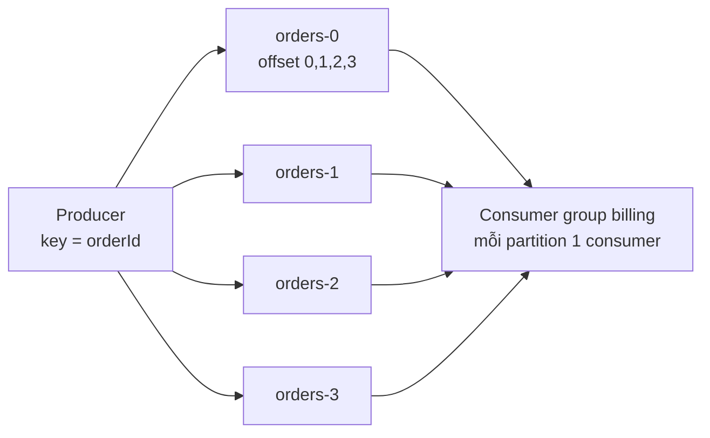
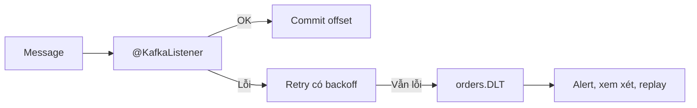

# Kafka Basics

> **Tuần 7 · Ngày 46** · Thuộc [[03 - Concurrency, SQL, REST & Security]] · Bài trước: [[03.10 - Redis Cache]] · Bài sau: [[03.12 - Testing Spring Boot]]
> Ở level 2 năm, Kafka thường là câu "cộng điểm": không cần biết vận hành cluster, nhưng phải nói đúng partition, ordering, consumer group, offset và vì sao consumer phải idempotent.
> Output trong bài lấy từ Kafka 3.9.1 thật trong Docker (Testcontainers), client `kafka-clients` 3.9.2 và Spring Kafka 3.3.16 trên JDK 21. Phần retry/DLT và RabbitMQ chỉ mô tả, không chạy.

**Mục lục**
1. [[#1. Topic, partition, offset|Topic, partition, offset]]
2. [[#2. Ordering: chỉ trong một partition|Ordering: chỉ trong một partition]]
3. [[#3. Consumer group và partition assignment|Consumer group và partition assignment]]
4. [[#4. Delivery semantics và commit offset|Delivery semantics và commit offset]]
5. [[#5. Producer an toàn: acks và idempotence|Producer an toàn: acks và idempotence]]
6. [[#6. Idempotent consumer|Idempotent consumer]]
7. [[#7. Retry và Dead Letter Topic|Retry và Dead Letter Topic]]
8. [[#8. Kafka vs RabbitMQ và transactional outbox|Kafka vs RabbitMQ và transactional outbox]]
9. [[#9. Kịch bản Feynman hôm nay|Kịch bản Feynman hôm nay]]

---

## 1. Topic, partition, offset

### Hiểu bản chất
Hãy hình dung Kafka như một **cuốn sổ ghi chép chỉ được viết thêm vào cuối** (append-only log), không phải một hàng đợi xoá message sau khi đọc.

- **Topic**: tên một luồng sự kiện, ví dụ `orders`.
- **Partition**: topic được chia thành nhiều "cuốn sổ con". Mỗi partition là một log **có thứ tự**, nằm trên một broker (có bản sao ở broker khác). Partition là **đơn vị song song**: nhiều partition thì nhiều consumer đọc cùng lúc được.
- **Offset**: số thứ tự của message trong **một partition** (0, 1, 2...). Offset của partition 0 và partition 1 độc lập nhau.
- **Retention**: message được giữ theo thời gian (mặc định 7 ngày) hoặc dung lượng, **dù đã có ai đọc hay chưa**. Nhờ vậy nhiều nhóm consumer đọc độc lập, và đọc lại (replay) được.



Consumer không bị "đẩy" message tới; nó **chủ động poll** và tự nhớ đã đọc tới đâu bằng **committed offset** (lưu trong topic nội bộ `__consumer_offsets`).

---

## 2. Ordering: chỉ trong một partition

### Hiểu bản chất
Kafka chỉ đảm bảo thứ tự **trong một partition**. Producer chọn partition dựa vào **key**: mặc định là `hash(key) % số partition`, nên **cùng key luôn vào cùng partition**. Muốn các event của một đơn hàng (`CREATED → PAID → SHIPPED`) luôn đúng thứ tự, dùng `orderId` làm key.

### Code minh hoạ (đã chạy)
Topic `orders` có 4 partition. Gửi 5 key, mỗi key 4 event, **xen kẽ**: `A#1, B#1, C#1, D#1, E#1, A#2, B#2...`

```java
for (int seq = 1; seq <= 4; seq++) {
    for (String k : keys) {                     // order-A ... order-E
        var md = template.send("orders", k, k + "#" + seq).get().getRecordMetadata();
        keyToPartition.computeIfAbsent(k, x -> new TreeSet<>()).add(md.partition());
    }
}
```

Key nào vào partition nào (mỗi key **chỉ đúng một** partition):

| Key | Partition |
|---|---|
| order-A | 1 |
| order-B | 3 |
| order-C | 3 |
| order-D | 0 |
| order-E | 2 |

Một consumer đọc cả 4 partition, thứ tự nhận được:

```text
D#1 D#2 D#3 D#4  A#1 A#2 A#3 A#4  E#1 E#2 E#3 E#4
B#1 C#1 B#2 C#2  B#3 C#3 B#4 C#4
```

Rút ra từ output:
- **Thứ tự toàn cục bị mất**: gửi `A#1` đầu tiên nhưng nhận `D#1` đầu tiên.
- **Thứ tự theo từng key được giữ**: `A#1 → A#4` luôn đúng thứ tự.
- B và C **dùng chung partition 3** (offset 0 đến 7) nên xen kẽ nhau nhưng mỗi key vẫn đúng thứ tự. Nhiều key chung một partition là bình thường.

### Bẫy hay gặp
- **Gửi không có key**: message được rải qua các partition, các event của cùng một đơn có thể bị xử lý **sai thứ tự** (`PAID` trước `CREATED`).
- **Tăng số partition** của topic đang chạy: công thức `hash % N` đổi, key cũ có thể sang partition khác, thứ tự giữa message cũ và mới của cùng key không còn được đảm bảo. Hãy chọn số partition dư từ đầu.
- **Key nóng** (một khách hàng lớn chiếm 50% event): một partition quá tải trong khi partition khác rảnh.
- Producer retry khi **không bật idempotence** có thể làm đảo thứ tự trong partition (xem mục 5).

> **Trả lời mẫu:** "Kafka chỉ đảm bảo thứ tự trong một partition. Producer chọn partition bằng hash của key, nên em dùng orderId làm key để mọi event của một đơn vào cùng partition và được xử lý đúng thứ tự. Em đã thử gửi xen kẽ 5 key vào topic 4 partition: thứ tự toàn cục bị đảo, nhưng từng key thì đúng thứ tự. Cần lưu ý không tăng số partition tuỳ tiện vì mapping key sang partition sẽ đổi."

---

## 3. Consumer group và partition assignment

### Hiểu bản chất
- Các consumer cùng `group.id` tạo thành một **consumer group** và **chia nhau** partition: **mỗi partition chỉ giao cho đúng 1 consumer** trong group. Nhờ vậy thứ tự trong partition được giữ.
- Các **group khác nhau** đọc **độc lập** cùng một topic, mỗi group có offset riêng. Ví dụ group `billing` và group `notification` đều nhận đủ mọi event `orders`.
- Consumer vào hoặc ra khỏi group thì Kafka **rebalance**: chia lại partition.

### Code minh hoạ: 4 partition, 6 consumer (đã chạy)
6 thread, mỗi thread một `KafkaConsumer` cùng group `six`, poll liên tục, sau 20 giây in `assignment()`:

| Consumer | Partition được giao |
|---|---|
| consumer-0 | [1] |
| consumer-1 | [0] |
| consumer-2 | [2] |
| consumer-3 | [3] |
| consumer-4 | **[]** |
| consumer-5 | **[]** |

**2 consumer ngồi chơi.** Số consumer có ích tối đa bằng số partition. Muốn xử lý song song hơn thì phải **tăng partition** (cân nhắc bẫy ở mục 2), không phải thêm consumer.

### Bẫy hay gặp
- Scale service lên 10 pod để "xử lý nhanh hơn" trong khi topic chỉ có 3 partition: 7 pod không nhận gì.
- **Xử lý một batch quá lâu** (lâu hơn `max.poll.interval.ms`, mặc định 5 phút): Kafka coi consumer đã chết, rebalance, partition giao cho consumer khác, và message **bị xử lý lại**. Giảm `max.poll.records` hoặc đẩy việc nặng ra chỗ khác.
- Trong Spring Kafka, `concurrency = 3` trên `@KafkaListener` nghĩa là 3 consumer (3 thread) trong cùng group. Đặt lớn hơn số partition cũng chỉ thêm consumer ngồi chơi.

### Câu hỏi xoáy

**Q1.** Topic 4 partition, group có 2 consumer. Chia thế nào? Một consumer chết thì sao?
> [!success]- Gợi ý trả lời
> Mỗi consumer nhận 2 partition. Một consumer chết (hoặc không poll kịp) thì sau timeout, group rebalance và consumer còn lại nhận cả 4 partition, đọc tiếp từ **committed offset** cuối cùng của từng partition. Message đã xử lý nhưng chưa commit sẽ bị xử lý lại.

**Q2.** Muốn một event được gửi tới cả service billing và service email thì làm sao?
> [!success]- Gợi ý trả lời
> Cho hai service **khác `group.id`**. Mỗi group có offset riêng nên đều nhận đủ mọi message. Đây là điểm khác lớn với queue truyền thống, nơi message bị lấy đi là mất.

---

## 4. Delivery semantics và commit offset

### Hiểu bản chất
"Đã xử lý" và "đã commit offset" là **hai bước riêng**. Thứ tự hai bước quyết định ngữ nghĩa:

| Ngữ nghĩa | Cách làm | Khi consumer chết giữa chừng |
|---|---|---|
| At-most-once | Commit **trước**, xử lý **sau** | Message đã commit nhưng chưa xử lý: **mất** |
| **At-least-once** | Xử lý **trước**, commit **sau** | Đã xử lý nhưng chưa commit: **xử lý lại** (trùng) |
| Exactly-once | Kafka transactions (đọc-xử lý-ghi đều trong Kafka) hoặc at-least-once + idempotent consumer | Không mất, không trùng về mặt kết quả |

Thực tế phổ biến nhất: **at-least-once + consumer idempotent**. "Exactly-once" của Kafka chỉ đúng trọn vẹn khi kết quả cũng ghi vào Kafka; khi xử lý là ghi DB hay gọi API ngoài thì vẫn cần idempotent.

### Code minh hoạ: nhận lại message vì chưa commit (đã chạy)
Consumer group `billing`, `enable.auto.commit=false`. Vòng 1 xử lý 20 message nhưng **không commit** rồi đóng consumer (giả lập crash). Vòng 2 một consumer mới cùng group:

| Vòng | Nhận | Xử lý mới | Bỏ qua vì trùng |
|---|---|---|---|
| 1 (không commit) | 20 | 20 | 0 |
| 2 (cùng group) | **20 lại từ đầu** | 0 | **20** |

Bảng `processed_event` cuối cùng có đúng **20** dòng. Kafka giao lại **toàn bộ** 20 message vì offset chưa được commit; nhờ consumer idempotent (mục 6) nên không xử lý trùng.

### Spring Kafka commit khi nào?
Spring Kafka **tắt** auto commit của client và tự commit theo `AckMode` (mặc định `BATCH`: commit sau khi listener xử lý xong các record của một lần poll). Listener ném exception thì record đó không được coi là xong, error handler quyết định retry (mục 7). Nếu cần kiểm soát từng message, dùng `AckMode.MANUAL` và gọi `ack.acknowledge()`.

### Bẫy hay gặp
- Bật `enable.auto.commit=true` của client thuần: offset của lô trả về ở lần `poll()` trước được commit **ngay trong lần `poll()` kế tiếp**. Xử lý đồng bộ xong mới poll tiếp thì vẫn là at-least-once (crash giữa chừng thì chưa có poll kế tiếp, lô đó được giao lại). **Mất message** khi đẩy việc sang thread khác rồi poll tiếp: offset đã commit trong khi việc chưa xong.
- Xử lý bất đồng bộ (đẩy sang thread pool) rồi để listener trả về ngay: offset được commit trong khi việc thật chưa xong.

---

## 5. Producer an toàn: acks và idempotence

### Hiểu bản chất

| `acks` | Producer chờ gì | Rủi ro |
|---|---|---|
| `0` | Không chờ gì | Mất message mà không biết |
| `1` | Leader ghi xong | Leader chết trước khi follower kịp sao chép: mất |
| `all` (`-1`) | Leader + các replica **in-sync** đều ghi | An toàn nhất (kết hợp `min.insync.replicas=2`) |

**Idempotent producer** (`enable.idempotence=true`): mỗi producer có id, mỗi message có số thứ tự; broker loại bỏ bản ghi trùng khi producer **retry** do mất ack, và giữ đúng thứ tự trong partition khi retry.

Đọc giá trị mặc định thật của `ProducerConfig` trong `kafka-clients` 3.9.2 (không cấu hình gì):

```text
acks=-1  enable.idempotence=true
```

Tức là từ Kafka client 3.0, mặc định **đã là `acks=all` + idempotence**. Nhiều bài viết cũ vẫn ghi mặc định `acks=1`; đó là hành vi của client trước 3.0. Khi phỏng vấn nói rõ: "client mới mặc định đã an toàn, nhưng em vẫn ghi tường minh trong cấu hình để không phụ thuộc version".

```yaml
spring:
  kafka:
    producer:
      acks: all
      properties:
        enable.idempotence: true
```

`min.insync.replicas=2` là cấu hình của **topic/broker**, không phải của producer: `acks=all` chỉ thật sự an toàn khi topic có replication factor 3 và `min.insync.replicas=2`.

### Bẫy hay gặp
- Idempotent producer chỉ chống trùng do **retry nội bộ của producer** trong một phiên. Nếu **ứng dụng** gửi lại cùng event (ví dụ job chạy lại), Kafka vẫn nhận 2 message. Consumer vẫn phải idempotent.
- `acks=all` nhưng topic chỉ có 1 replica (như trong test này): "all" cũng chỉ là 1 broker.

---

## 6. Idempotent consumer

### Hiểu bản chất
Vì at-least-once **chắc chắn** sẽ có lúc giao trùng (rebalance, crash, timeout), consumer phải xử lý sao cho **nhận 2 lần cũng như 1 lần**.

Các cách hay dùng:
1. **Bảng processed event** với `eventId` là primary key: insert thành công thì xử lý, trùng key thì bỏ qua. Làm **trong cùng transaction** với thay đổi nghiệp vụ.
2. **Upsert / điều kiện trạng thái**: `UPDATE orders SET status='PAID' WHERE id=? AND status='CREATED'`. Lần 2 không ảnh hưởng dòng nào.
3. Thao tác tự nhiên idempotent: set giá trị tuyệt đối thay vì cộng dồn.

### Code minh hoạ (đã chạy ở mục 4)

```java
for (var r : records) {
    try {
        jdbc.update("insert into processed_event(event_id) values (?)", r.value());
        processed++;                      // lần đầu thấy event: xử lý nghiệp vụ ở đây
    } catch (DuplicateKeyException dup) {
        skipped++;                        // đã xử lý rồi: bỏ qua
    }
}
```

Kết quả: vòng 2 nhận lại 20 message, **20 bị bỏ qua**, không có xử lý trùng.

### Bẫy hay gặp
- Kiểm tra bằng `SELECT` rồi mới `INSERT`: hai consumer (sau rebalance) có thể cùng thấy "chưa có". Dựa vào **unique constraint**, không dựa vào select.
- Ghi `processed_event` và cập nhật nghiệp vụ ở **hai transaction khác nhau**: crash ở giữa là lệch. Phải chung một transaction.
- Dùng offset làm id event: offset đổi nếu event được gửi lại thành message mới. Dùng `eventId` do producer sinh (UUID) nằm trong payload hoặc header.

> **Trả lời mẫu:** "Em dùng at-least-once: xử lý xong mới commit offset, nên khi consumer chết hoặc rebalance thì message có thể bị giao lại. Em đã thử xử lý 20 message mà không commit, consumer mới cùng group nhận lại đủ 20. Vì vậy consumer phải idempotent: em lưu eventId vào bảng processed_event có primary key trong cùng transaction với nghiệp vụ, trùng key thì bỏ qua. Producer em để acks=all và enable.idempotence=true, đó cũng là mặc định của client từ 3.0."

### Câu hỏi xoáy

**Q1.** Đã bật idempotent producer rồi, sao consumer vẫn phải idempotent?
> [!success]- Gợi ý trả lời
> Idempotent producer chỉ chống trùng **khi ghi vào Kafka** do producer retry. Trùng phía consumer đến từ chỗ khác: xử lý xong nhưng chưa commit offset thì crash hoặc rebalance, Kafka giao lại. Hai lớp trùng khác nhau, cần hai biện pháp khác nhau.

**Q2.** Bảng processed_event lớn mãi thì sao?
> [!success]- Gợi ý trả lời
> Xoá định kỳ các dòng cũ hơn retention của topic cộng biên an toàn (ví dụ topic giữ 7 ngày thì giữ bảng 14 ngày), vì message cũ hơn thế không thể được giao lại. Hoặc dùng Redis `SET eventId NX EX` nếu chấp nhận rủi ro thấp hơn DB.

---

## 7. Retry và Dead Letter Topic

### Hiểu bản chất
Listener ném exception thì làm gì? Retry mãi một message lỗi vĩnh viễn (JSON hỏng, dữ liệu sai) sẽ **chặn cả partition** phía sau nó, vì thứ tự phải được giữ. Cách chuẩn: retry vài lần, vẫn lỗi thì đẩy sang **Dead Letter Topic (DLT)** để xem xét sau, rồi đi tiếp.



Trong Spring Kafka (mô tả, không chạy trong bài):

```java
@Bean
DefaultErrorHandler errorHandler(KafkaTemplate<Object, Object> template) {
    var recoverer = new DeadLetterPublishingRecoverer(template);   // gửi sang <topic>.DLT
    var handler = new DefaultErrorHandler(recoverer, new FixedBackOff(1000L, 3));
    handler.addNotRetryableExceptions(IllegalArgumentException.class);  // lỗi dữ liệu
    return handler;
}
```

- **Blocking retry** (`DefaultErrorHandler`): retry ngay trên partition, giữ thứ tự nhưng chặn partition trong lúc retry.
- **Non-blocking retry** (`@RetryableTopic`): đẩy sang các topic retry có delay, partition chính chạy tiếp, nhưng **mất thứ tự**.

### Bẫy hay gặp
- Retry vô hạn (tự cấu hình `FixedBackOff.UNLIMITED_ATTEMPTS`) với lỗi không bao giờ tự hết: consumer kẹt, lag tăng mãi. Ngược lại, `DefaultErrorHandler` mặc định (không recoverer) thử tổng cộng 10 lần rồi chỉ **log và bỏ qua** message: không chặn, nhưng mất message nếu không cấu hình DLT.
- Không có ai theo dõi DLT: message chết lặng lẽ. Cần alert và quy trình replay.
- Retry lỗi **không tạm thời** (validate fail): lãng phí. Phân loại exception retryable và non-retryable.

---

## 8. Kafka vs RabbitMQ và transactional outbox

### Kafka vs RabbitMQ

| | Kafka | RabbitMQ |
|---|---|---|
| Mô hình | Log phân tán, consumer tự kéo theo offset | Message broker, đẩy message tới consumer |
| Sau khi đọc | Message **vẫn còn** tới hết retention | Message **bị xoá** sau ack |
| Replay | Có (reset offset) | Không (trừ cấu hình đặc biệt) |
| Thứ tự | Theo partition | Theo queue, dễ mất khi nhiều consumer |
| Throughput | Rất cao | Thấp hơn nhưng latency từng message tốt |
| Routing | Đơn giản (topic, key) | Linh hoạt: exchange direct/topic/fanout, header |
| Hợp với | Event streaming, nhiều service cùng nghe một sự kiện, log, CDC | Task queue, RPC, routing phức tạp, ưu tiên message |

### Transactional outbox
Vấn đề kinh điển: trong `@Transactional`, lưu đơn hàng vào DB **và** gửi `OrderCreated` lên Kafka. Hai hệ thống, không có transaction chung:
- Gửi Kafka **trong** transaction rồi DB rollback: event "ma" cho một đơn không tồn tại.
- Commit DB xong rồi gửi Kafka thì app crash: đơn có nhưng event **mất**.

**Outbox**: trong **cùng transaction** DB, insert đơn hàng **và** một dòng vào bảng `outbox`. Một tiến trình riêng (poller hoặc CDC như Debezium) đọc `outbox` và publish lên Kafka, thành công thì đánh dấu đã gửi. Kết quả: event được gửi **ít nhất một lần** khi và chỉ khi DB đã commit. Lại là at-least-once, nên consumer phải idempotent (mục 6).

Phiên bản nhẹ hơn trong một service là gửi event bằng `@TransactionalEventListener(phase = AFTER_COMMIT)`: không có event ma, nhưng vẫn có thể mất event nếu crash ngay sau commit. Xem [[05.05 - TransactionTemplate & Transaction Events]].

> **Trả lời mẫu:** "Kafka là log append-only chia thành partition, thứ tự chỉ đảm bảo trong một partition nên em dùng orderId làm key. Consumer cùng group chia partition, mỗi partition một consumer; em đã thử 6 consumer với 4 partition thì 2 consumer không nhận gì. Em dùng at-least-once nên consumer phải idempotent, kèm retry có giới hạn và DLT cho message lỗi. Để không mất event khi vừa ghi DB vừa gửi Kafka, em dùng transactional outbox. So với RabbitMQ, Kafka giữ message sau khi đọc nên replay được và nhiều service nghe cùng sự kiện; RabbitMQ hợp task queue và routing linh hoạt."

### Câu hỏi xoáy

**Q1.** Vì sao không gửi Kafka ngay trong method `@Transactional` cho gọn?
> [!success]- Gợi ý trả lời
> Gửi Kafka không tham gia transaction DB. Nếu sau khi gửi mà DB rollback (lỗi constraint ở cuối, lỗi commit) thì consumer đã nhận event cho dữ liệu không tồn tại. Ngược lại gửi sau commit thì có thể mất event khi crash. Outbox giải quyết cả hai bằng cách biến "gửi event" thành "ghi một dòng DB" trong cùng transaction.

**Q2.** Consumer lag là gì, tăng mãi thì xử lý sao?
> [!success]- Gợi ý trả lời
> Lag là khoảng cách giữa offset mới nhất của partition và offset consumer đã commit, tức số message còn tồn. Lag tăng mãi nghĩa là xử lý chậm hơn tốc độ ghi: tối ưu xử lý (batch, bỏ gọi đồng bộ chậm), tăng consumer nhưng **không vượt số partition**, hoặc tăng partition; kiểm tra có message lỗi đang retry chặn partition không.

---

## 9. Kịch bản Feynman hôm nay

1. Vẽ topic 4 partition, 2 consumer group, giải thích vì sao 6 consumer trong một group thì 2 consumer không làm gì.
2. Giải thích bằng output thực tế: vì sao `A#1` gửi trước mà `D#1` lại đến trước, nhưng `A#1 → A#4` vẫn đúng thứ tự.
3. Kể lại thí nghiệm "không commit thì nhận lại 20 message" và cách bảng `processed_event` cứu mình.
4. Giải thích transactional outbox cho người chưa biết Kafka: vấn đề gì, giải quyết thế nào.

Ghi vào [[08 - Nhật ký học tập]].

## Tự kiểm tra nhanh (không mở tài liệu)

- [ ] Topic, partition, offset, consumer group: mỗi khái niệm một câu
- [ ] Kafka đảm bảo thứ tự ở phạm vi nào? Làm sao giữ thứ tự event của một đơn?
- [ ] 4 partition, 6 consumer cùng group: bao nhiêu consumer rảnh?
- [ ] At-most-once vs at-least-once: khác ở thứ tự commit và xử lý
- [ ] `acks=all` và `enable.idempotence` làm gì? Mặc định của client 3.x là gì?
- [ ] 3 cách làm consumer idempotent
- [ ] Retry + DLT; blocking vs non-blocking retry
- [ ] Kafka vs RabbitMQ; transactional outbox giải quyết vấn đề gì?
