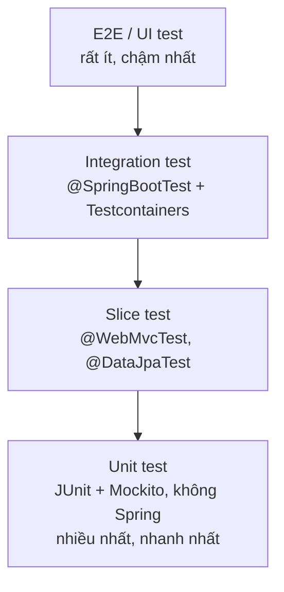

# Testing Spring Boot

> **Tuần 7 · Ngày 47** · Thuộc [[03 - Concurrency, SQL, REST & Security]] · Bài trước: [[03.11 - Kafka Basics]] · Bài sau: [[10.01 - System Design Concepts]]
> Câu "bạn viết test thế nào?" gần như luôn xuất hiện. Interviewer muốn nghe bạn phân biệt được các loại test, biết slice nào load gì, và đã từng gặp bẫy H2 hay test flaky.
> Output trong bài lấy từ project Spring Boot 3.5.16 (JUnit 5, Mockito, Testcontainers 1.21) chạy trên JDK 21, PostgreSQL 16, Redis 7 và Kafka 3.9.1 thật trong Docker.

**Mục lục**
1. [[#1. Test pyramid: test gì ở tầng nào|Test pyramid: test gì ở tầng nào]]
2. [[#2. Unit test với JUnit 5 và Mockito|Unit test với JUnit 5 và Mockito]]
3. [[#3. @WebMvcTest và MockMvc|@WebMvcTest và MockMvc]]
4. [[#4. @MockitoBean thay cho @MockBean|@MockitoBean thay cho @MockBean]]
5. [[#5. @DataJpaTest và bẫy H2|@DataJpaTest và bẫy H2]]
6. [[#6. @SpringBootTest và Testcontainers với @ServiceConnection|@SpringBootTest và Testcontainers với @ServiceConnection]]
7. [[#7. Test flaky|Test flaky]]
8. [[#8. Kịch bản Feynman hôm nay|Kịch bản Feynman hôm nay]]

---

## 1. Test pyramid: test gì ở tầng nào

### Hiểu bản chất
Test càng "thật" thì càng **chậm, khó viết, dễ flaky**, nhưng càng **đáng tin**. Test pyramid là cách phân bổ: **nhiều** test nhanh ở đáy, **ít** test nặng ở đỉnh.



| Loại | Annotation | Load gì | Test cái gì |
|---|---|---|---|
| Unit | `@ExtendWith(MockitoExtension.class)` | Không có Spring | Logic nghiệp vụ trong service, tính toán, nhánh if/else |
| Web slice | `@WebMvcTest(OrderController.class)` | Controller, advice, converter, filter, Security | URL mapping, validate, JSON, status code, format lỗi |
| JPA slice | `@DataJpaTest` | Entity, repository, DataSource, tự rollback | Query tự viết, mapping entity, constraint |
| Integration | `@SpringBootTest` | **Toàn bộ** context | Luồng xuyên tầng, cấu hình thật, transaction, cache, Kafka |

Thời gian chạy từng class test trên máy chạy thử (gồm cả khởi động Spring context và container):

| Class | Loại | Thời gian |
|---|---|---|
| `OrderLogicUnitTest` (4 test) | Unit, Mockito | khoảng 1 s |
| `OrderControllerTest` (4 test) | `@WebMvcTest` | khoảng 0.8 s |
| `ProductRepositoryH2Test` (3 test) | `@DataJpaTest` + H2 | khoảng 2.1 s |
| `ProductRepositoryPostgresTest` (1 test) | `@DataJpaTest` + PostgreSQL container | khoảng 19 s |
| `RedisCacheTest` (2 test) | `@SpringBootTest` + Redis container | khoảng 23 s |
| `KafkaBehaviourTest` (1 test) | `@SpringBootTest` + Kafka container | khoảng 72 s (có 20 s chờ cố ý) |

Con số tuyệt đối tuỳ máy, nhưng chênh lệch **hàng chục lần** giữa đáy và đỉnh pyramid là lý do pyramid tồn tại.

### Bẫy hay gặp
- Viết toàn `@SpringBootTest` cho mọi thứ: suite chạy 20 phút, dev không muốn chạy, rồi bỏ test.
- Chỉ có unit test mock hết mọi thứ: test xanh nhưng query sai, cấu hình sai, mapping JSON sai vẫn lọt.
- Test **implementation** thay vì **behavior**: `verify` từng lời gọi nội bộ, refactor một chút là đỏ hàng loạt dù hành vi không đổi.

---

## 2. Unit test với JUnit 5 và Mockito

### Hiểu bản chất
Unit test kiểm tra **một class** và thay các phụ thuộc bằng **mock**, để test nhanh và chỉ hỏng khi chính class đó sai.

- `@Mock`: object giả **hoàn toàn**. Method chưa stub trả giá trị "rỗng" mặc định.
- `@Spy`: bọc **object thật**. Method chưa stub chạy **code thật**.
- `@InjectMocks`: tạo class cần test và tiêm các mock vào.
- `verify(...)`: kiểm tra có gọi phụ thuộc hay không, bao nhiêu lần.
- `ArgumentCaptor`: bắt lại tham số đã truyền vào mock để kiểm tra chi tiết.

### Code minh hoạ (đã chạy)

```java
@ExtendWith(MockitoExtension.class)
class OrderLogicUnitTest {
    @Mock ProductRepository repo;
    @InjectMocks ProductService service;
    @Captor ArgumentCaptor<Long> idCaptor;

    @Test
    void stubAndVerify() {
        var p = new Product("SKU-9", "Mouse", new BigDecimal("50"));
        when(repo.findById(9L)).thenReturn(Optional.of(p));
        var dto = service.getProduct(9L);
        verify(repo, times(1)).findById(idCaptor.capture());
        assertThat(idCaptor.getValue()).isEqualTo(9L);
        verifyNoMoreInteractions(repo);
    }
}
```

Output: `dto=ProductDto[id=null, name=Mouse, price=50]`, `captured id=9`.

Giá trị mặc định của mock chưa stub (đã in ra):

| Gọi trên mock | Trả về |
|---|---|
| `repo.findById(1L)` | `Optional.empty` |
| `repo.count()` | `0` |
| `repo.findAll()` | `[]` |

Mock vs spy trên `ArrayList` (đã chạy):

| Thao tác | Mock | Spy |
|---|---|---|
| `add("a")` rồi `size()` | **0** (add bị nuốt) | **1** (chạy code thật) |
| `doReturn(99).when(spy).size()` rồi `size()` | | 99 |
| `get(0)` sau khi stub `size` | | `a` (vẫn là code thật) |
| `when(spy.get(5)).thenReturn("x")` | | **`IndexOutOfBoundsException`** |

Dòng cuối là bẫy kinh điển: `when(spy.get(5))` **gọi method thật** trước khi kịp stub. Với spy, luôn dùng `doReturn(...).when(spy).method(...)`.

**Strict stubs**: `MockitoExtension` mặc định **báo lỗi** nếu bạn stub mà không dùng. Test có `when(repo.count()).thenReturn(5L)` nhưng code không gọi `count()` thì fail với `UnnecessaryStubbingException`. Đây là tính năng, không phải bug: stub thừa thường nghĩa là test đang kiểm tra sai thứ.

### Bẫy hay gặp
- Mock **chính class đang test**, hoặc mock DTO/record: không cần, tạo object thật.
- Mock tràn lan đến mức test chỉ là "copy lại code": thay đổi nhỏ là phải sửa test. Mock ở **ranh giới** (repository, client gọi API ngoài, clock), giữ logic thật.
- `any()` khắp nơi trong `verify`: test pass dù truyền sai tham số. Dùng giá trị cụ thể hoặc `ArgumentCaptor`.
- Logic phụ thuộc thời gian dùng `LocalDateTime.now()` trực tiếp: không test được. Inject `Clock`.

> **Trả lời mẫu:** "Unit test em dùng JUnit 5 với MockitoExtension, không load Spring nên chạy khoảng một giây. Phụ thuộc như repository hay client ngoài em mock bằng `@Mock`, class cần test dùng `@InjectMocks`. Mock là object giả hoàn toàn, method chưa stub trả rỗng; spy bọc object thật và chạy code thật, nên stub spy phải dùng `doReturn` vì `when(spy.get(5))` sẽ gọi method thật và ném exception. Em dùng `verify` và `ArgumentCaptor` để kiểm tra tương tác quan trọng, như đã lưu đúng entity, nhưng không verify mọi lời gọi nội bộ để test không vỡ khi refactor."

### Câu hỏi xoáy

**Q1.** Khi nào dùng spy thay vì mock?
> [!success]- Gợi ý trả lời
> Hiếm. Khi cần giữ phần lớn hành vi thật và chỉ thay một method (thường là code legacy khó tách). Nếu thấy cần spy nhiều, đó là dấu hiệu class làm quá nhiều việc. Ưu tiên tách phụ thuộc rồi mock ở ranh giới.

**Q2.** Có nên unit test repository interface của Spring Data không?
> [!success]- Gợi ý trả lời
> Không unit test (mock repository thì chẳng kiểm tra được gì). Query tự viết (`@Query`, derived query phức tạp, Specification) thì test bằng `@DataJpaTest` với DB thật hoặc Testcontainers. `findById`, `save` của framework thì không cần test.

---

## 3. @WebMvcTest và MockMvc

### Hiểu bản chất
`@WebMvcTest(OrderController.class)` dựng một context **chỉ có tầng web**: controller được chỉ định, `@ControllerAdvice`, converter Jackson, validation, filter, Spring Security. **Không** có service, repository, DataSource. `MockMvc` gửi request giả qua `DispatcherServlet` thật, không cần mở port.

### Code minh hoạ (đã chạy)

```java
@WebMvcTest(OrderController.class)
class OrderControllerTest {
    @Autowired MockMvc mvc;
    @MockitoBean OrderService orderService;

    @Test
    @WithMockUser
    void notFoundIsProblemDetail() throws Exception {
        when(orderService.get(1L)).thenThrow(new NotFoundException("Order 1 not found"));
        mvc.perform(get("/api/orders/1"))
           .andExpect(status().isNotFound())
           .andExpect(jsonPath("$.detail").value("Order 1 not found"));
        verify(orderService).get(1L);
    }
}
```

Kiểm tra context của slice này:

| Bean | Có trong context? |
|---|---|
| `OrderController` | **Có** |
| `ApiExceptionHandler` (`@RestControllerAdvice`) | **Có** |
| `ProductService`, `ProductRepository` | Không |
| `SecurityConfig` (class `@Configuration` chứa `SecurityFilterChain`) | **Không** |

Kết quả các request:

| Request | Status | Ghi chú |
|---|---|---|
| `GET /api/orders/1` không có user | **401** | Security mặc định của Boot vẫn bật |
| `GET /api/orders/1` với `@WithMockUser`, service ném NotFound | 404 | `application/problem+json`, detail "Order 1 not found" |
| `POST /api/orders` body sai, **không** gửi CSRF token | **403** | CSRF bật trong cấu hình mặc định |
| `POST` body sai, có `.with(csrf())` | 400 | ProblemDetail "Invalid request content.", service **không** được gọi |
| `POST` body đúng, có `.with(csrf())` | 201 | `Location: /api/orders/100` |

### Bẫy hay gặp
- **Cấu hình security của mình không được nạp trong `@WebMvcTest`** (bảng trên: `SecurityConfig` vắng mặt). Slice dùng cấu hình security mặc định của Boot: mọi request cần đăng nhập, CSRF bật. Kết quả là 401/403 khó hiểu, hoặc tệ hơn: test pass nhưng không kiểm tra rule thật của bạn. Muốn test rule thật: `@Import(SecurityConfig.class)` và gửi JWT bằng `.with(jwt().authorities(...))` của `spring-security-test`.
- Quên mock một phụ thuộc của controller: context không khởi động được (`NoSuchBeanDefinitionException`).
- Assert mỗi status mà không assert body/format lỗi: client vẫn vỡ nếu JSON đổi.

---

## 4. @MockitoBean thay cho @MockBean

### Hiểu bản chất
Cả hai đều **thay một bean trong Spring context bằng mock** (khác `@Mock` của Mockito, vốn không liên quan Spring). Từ Spring Framework 6.2 / Boot 3.4, Spring Framework có annotation riêng là `@MockitoBean` (và `@MockitoSpyBean`); `@MockBean` của Spring Boot bị deprecated.

Biên dịch một test còn dùng `@MockBean` trên Boot 3.5.16 với `showDeprecation`:

```text
[WARNING] ...LegacyMockBeanTest.java:[9,6] org.springframework.boot.test.mock.mockito.MockBean
in org.springframework.boot.test.mock.mockito has been deprecated and marked for removal
```

Test vẫn chạy (`legacy @MockBean still works: true`), nhưng "marked for removal" nghĩa là sẽ bị xoá ở bản lớn sau. Đổi import là xong:

```java
import org.springframework.test.context.bean.override.mockito.MockitoBean;   // mới
// import org.springframework.boot.test.mock.mockito.MockBean;                // cũ
```

| | `@Mock` | `@MockitoBean` |
|---|---|---|
| Thuộc về | Mockito | Spring Test |
| Cần Spring context? | Không | Có |
| Dùng trong | Unit test | `@WebMvcTest`, `@SpringBootTest` |

### Bẫy hay gặp
- Mỗi tổ hợp `@MockitoBean` khác nhau tạo ra **một context khác** trong cache của Spring Test, nên mỗi class test khai báo mock khác nhau là khởi động context mới, suite chậm dần. Gom mock chung vào một base class hoặc giữ cấu hình test đồng nhất.
- Dùng `@Mock` trong `@WebMvcTest`: mock không được đưa vào context, controller vẫn đòi bean thật.

---

## 5. @DataJpaTest và bẫy H2

### Hiểu bản chất
`@DataJpaTest` chỉ load JPA: entity, repository, `DataSource`, `TestEntityManager`. Mặc định:
- **Thay DataSource bằng DB nhúng** (H2) dù `application.properties` cấu hình PostgreSQL.
- Mỗi test chạy trong **transaction và rollback** khi xong.

### Code minh hoạ (đã chạy)

```java
@DataJpaTest
class ProductRepositoryH2Test {
    @Autowired ProductRepository repo;
    @Autowired TestEntityManager em;

    @Test @Order(1)
    void savesAndQueries() {
        repo.save(new Product("SKU-1", "Gaming Mouse", BigDecimal.TEN));
        em.flush(); em.clear();                     // ép SQL chạy thật, xoá cache cấp 1
        assertThat(repo.findByNameContainingIgnoreCase("mouse")).hasSize(1);
    }

    @Test @Order(2)
    void rolledBack() { assertThat(repo.count()).isZero(); }
}
```

| Quan sát | Kết quả |
|---|---|
| DB thật sự dùng | `H2`, URL `jdbc:h2:mem:1c616d52-...` |
| Đang trong transaction? | `true` |
| Số dòng ở test kế tiếp | **0** (đã rollback) |

`em.flush(); em.clear();` quan trọng: không có hai dòng này, `findBy...` có thể trả object từ **persistence context** mà không kiểm tra được mapping thật với DB.

### Bẫy H2: SQL chạy trên H2 khác PostgreSQL
Repository có native query dùng cú pháp PostgreSQL:

```java
@Modifying
@Query(value = "insert into product(sku, name, price) values (:sku, :name, 1) "
        + "on conflict (sku) do nothing", nativeQuery = true)
int insertIgnore(String sku, String name);
```

| DB | Kết quả |
|---|---|
| H2 (mặc định của `@DataJpaTest`) | **`InvalidDataAccessResourceUsageException`**: `Syntax error in SQL statement "... [*]on conflict (sku) do nothing"` |
| PostgreSQL 16.14 (Testcontainers) | Lần 1 trả **1**, lần 2 trả **0** (bỏ qua vì trùng): đúng ý |

Các khác biệt H2 hay gây "test xanh, production đỏ" (hoặc ngược lại): native query và hàm riêng của DB (`ON CONFLICT`, `jsonb`, toán tử và hàm riêng của PostgreSQL), kiểu dữ liệu, collation và so sánh chữ hoa thường, hành vi lock (`SELECT ... FOR UPDATE SKIP LOCKED`), migration Flyway viết cho PostgreSQL.

### Bẫy hay gặp
- Quên `flush()`: lỗi constraint chỉ nổ lúc commit, mà test lại rollback, nên **không bao giờ thấy lỗi**.
- Test ghi dữ liệu ở thread khác (`@Async`, `CompletableFuture`): thread đó không thấy transaction của test, và dữ liệu nó ghi **không bị rollback**.
- Chuyển `@DataJpaTest` sang PostgreSQL container mà quên `ddl-auto`: đã gặp lỗi `relation "product" does not exist`, vì Boot chỉ tự `create-drop` schema cho DB **nhúng**; với DB thật mặc định là không tạo. Trong dự án thật, để Flyway/Liquibase tạo schema.

> **Trả lời mẫu:** "`@DataJpaTest` chỉ load tầng JPA, mặc định thay DataSource bằng H2 và rollback sau mỗi test. Em dùng nó để test query tự viết, và luôn `flush` rồi `clear` để SQL chạy thật. Nhưng H2 khác PostgreSQL: em đã gặp native query `ON CONFLICT DO NOTHING` chạy tốt trên PostgreSQL mà H2 báo syntax error. Nên với query phụ thuộc DB, em dùng `@AutoConfigureTestDatabase(replace = NONE)` cùng Testcontainers PostgreSQL và `@ServiceConnection`, để test chạy đúng DB production."

### Câu hỏi xoáy

**Q1.** Test pass trên H2 nhưng production lỗi. Kể một ví dụ và cách phòng.
> [!success]- Gợi ý trả lời
> Ví dụ native query dùng `ON CONFLICT`, `jsonb`, hoặc migration Flyway viết cho PostgreSQL. Ngoài ra còn khác biệt về kiểu dữ liệu, collation và hành vi lock. Cách phòng: test repository và migration trên Testcontainers cùng version với production; H2 chỉ còn cho test rất nhanh không phụ thuộc dialect.

---

## 6. @SpringBootTest và Testcontainers với @ServiceConnection

### Hiểu bản chất
`@SpringBootTest` load **toàn bộ** ứng dụng. Kết hợp **Testcontainers**: chạy PostgreSQL, Redis, Kafka **thật** trong Docker trong lúc test, tự dọn khi xong.

Trước Boot 3.1 phải dùng `@DynamicPropertySource` để chép host/port của container vào `spring.datasource.url`... Từ Boot 3.1, `@ServiceConnection` làm việc đó tự động: Boot nhận ra loại container và tạo `ConnectionDetails` tương ứng.

### Code minh hoạ (đã chạy, cả ba loại container)

```java
@SpringBootTest
@Testcontainers
class RedisCacheTest {
    @Container @ServiceConnection(name = "redis")      // GenericContainer cần chỉ rõ name
    static GenericContainer<?> redis =
            new GenericContainer<>("redis:7-alpine").withExposedPorts(6379);
    // ...
}

@DataJpaTest(properties = "spring.jpa.hibernate.ddl-auto=create-drop")
@AutoConfigureTestDatabase(replace = AutoConfigureTestDatabase.Replace.NONE)
@Testcontainers
class ProductRepositoryPostgresTest {
    @Container @ServiceConnection
    static PostgreSQLContainer<?> pg = new PostgreSQLContainer<>("postgres:16-alpine");
}

@SpringBootTest
@Testcontainers
class KafkaBehaviourTest {
    @Container @ServiceConnection
    static KafkaContainer kafka = new KafkaContainer("apache/kafka:3.9.1");
}
```

Không có dòng cấu hình URL nào. Quan sát được: `RedisCacheManager` thật kết nối Redis trong container (key `product::1`, TTL 600), `DataSource` trả `PostgreSQL 16.14`, `KafkaTemplate` gửi được vào broker trong container. Các kết quả này là nguồn số liệu của [[03.10 - Redis Cache]] và [[03.11 - Kafka Basics]].

### Context caching
Spring Test **cache context** giữa các class có cùng cấu hình. Trong lần chạy cả suite, `PaymentIdempotencyTest` (khởi động context) mất khoảng 4.3 s, còn `SecurityJwtTest` ngay sau đó với cùng cấu hình (`@SpringBootTest(properties = "spring.cache.type=simple")` + `@AutoConfigureMockMvc`) chỉ mất khoảng 0.3 s cho 4 test, phù hợp với việc dùng lại context đã có. Mỗi khác biệt nhỏ (property khác, `@MockitoBean` khác, `@DirtiesContext`) đều tạo context mới.

### Bẫy hay gặp
- Container khai báo **không `static`**: mỗi test method khởi động container mới, chậm khủng khiếp.
- Dùng image `latest`: hôm nay pass, mai image đổi version thì fail. Ghim version giống production.
- `@SpringBootTest(webEnvironment = RANDOM_PORT)` + gọi HTTP thật: test **không chạy trong transaction của test**, dữ liệu không tự rollback. Phải dọn dữ liệu chủ động.
- `@DirtiesContext` rải khắp nơi: phá context cache, suite chậm gấp nhiều lần.

> **Trả lời mẫu:** "Integration test em dùng `@SpringBootTest` với Testcontainers: PostgreSQL, Redis, Kafka thật trong Docker, cùng version với production. Từ Boot 3.1 em dùng `@ServiceConnection` nên không cần tự set URL. Container khai báo static để dùng chung cho cả class, và em giữ cấu hình test đồng nhất để Spring cache context. Em chỉ viết vài test kiểu này cho luồng quan trọng, vì một class Kafka test mất cả phút trong khi unit test chỉ khoảng một giây."

### Câu hỏi xoáy

**Q1.** `@SpringBootTest` có tự rollback như `@DataJpaTest` không?
> [!success]- Gợi ý trả lời
> Không tự động. Chỉ rollback nếu bạn thêm `@Transactional` lên test, và chỉ với code chạy **cùng thread** (MockMvc chạy cùng thread nên được). Với `RANDOM_PORT` gọi HTTP thật, request chạy trên thread của Tomcat, transaction của test không bao phủ, phải tự dọn dữ liệu.

---

## 7. Test flaky

### Hiểu bản chất
Test **flaky** là test lúc pass lúc fail mà code không đổi. Nguy hiểm hơn test fail hẳn: team quen "chạy lại cho xanh" và bỏ qua lỗi thật.

| Nguyên nhân | Ví dụ | Cách sửa |
|---|---|---|
| Thời gian | `LocalDate.now()`, test chạy lúc nửa đêm | Inject `Clock` cố định |
| Bất đồng bộ | `Thread.sleep(1000)` rồi assert kết quả Kafka/@Async | Awaitility: `await().atMost(10, SECONDS).until(...)` |
| Thứ tự | Test phụ thuộc dữ liệu test khác để lại, hoặc thứ tự HashMap/Set | Mỗi test tự chuẩn bị và dọn dữ liệu; không assert thứ tự khi không đảm bảo |
| Dữ liệu chung | Hai test cùng dùng email `a@b.com` | Sinh dữ liệu duy nhất mỗi test |
| Môi trường | Port cố định, timezone máy CI khác | Port ngẫu nhiên, đặt timezone tường minh |

Ví dụ ngay trong bài: `KafkaBehaviourTest` dùng `Thread.sleep(20_000)` để chờ rebalance. Chạy trên máy nhanh thì ổn, trên CI chậm có thể chưa rebalance xong. Bản tốt hơn là chờ có điều kiện ("tổng số partition được giao bằng 4") với Awaitility và timeout.

> **Trả lời mẫu:** "Test flaky thường do thời gian, bất đồng bộ, thứ tự hoặc dữ liệu dùng chung. Em inject Clock thay vì gọi now, dùng Awaitility chờ có điều kiện thay cho Thread.sleep, để mỗi test tự tạo dữ liệu riêng, và không assert thứ tự của tập hợp không có thứ tự. Khi gặp test flaky em không bấm chạy lại mà tìm nguyên nhân, vì nhiều khi nó đang chỉ ra race condition thật trong code."

---

## 8. Kịch bản Feynman hôm nay

1. Vẽ test pyramid và nói cho mỗi tầng: annotation, load gì, test cái gì, chạy mất bao lâu (dùng bảng đo ở mục 1).
2. Giải thích vì sao `@WebMvcTest` trả 401 và 403 dù controller không có gì liên quan security, và cách sửa.
3. Kể câu chuyện `ON CONFLICT` chạy trên PostgreSQL nhưng lỗi trên H2 để thuyết phục team dùng Testcontainers.
4. Giải thích mock vs spy bằng ví dụ `ArrayList`, kèm bẫy `when(spy.get(5))`.

Ghi vào [[08 - Nhật ký học tập]].

## Tự kiểm tra nhanh (không mở tài liệu)

- [ ] 4 loại test trong Spring Boot: annotation, load gì, dùng khi nào
- [ ] `@Mock` vs `@Spy` vs `@InjectMocks`; vì sao stub spy bằng `doReturn`?
- [ ] `ArgumentCaptor` dùng khi nào? Strict stubs báo lỗi gì?
- [ ] `@WebMvcTest` có nạp `SecurityFilterChain` của mình không?
- [ ] `@MockitoBean` vs `@MockBean` vs `@Mock`
- [ ] `@DataJpaTest` mặc định dùng DB nào, có rollback không? Vì sao cần `flush`?
- [ ] 3 khác biệt H2 vs PostgreSQL có thể làm test sai
- [ ] `@ServiceConnection` thay thế cái gì? Vì sao container phải `static`?
