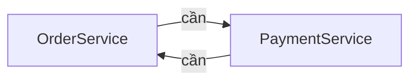
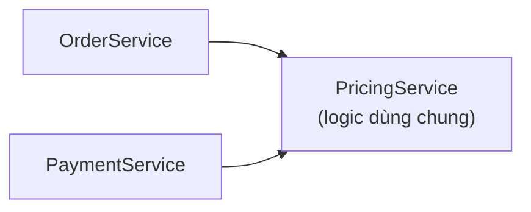

# IoC & Dependency Injection

> **Tuần 4 · Ngày 22** · Thuộc [[04 - Spring Core, Boot & MVC]] · Bài trước: [[03.05 - Deadlock, ThreadLocal & Virtual Threads]] · Bài sau: [[04.02 - Bean Scope & Lifecycle]]
> Đây là câu mở màn của gần như mọi buổi phỏng vấn Spring. Trả lời trơn tru phần này giúp bạn tạo ấn tượng "hiểu framework chứ không chỉ dùng annotation".
> Mọi hành vi Spring và mọi exception message trong bài đã được **chạy thử trên Spring Boot 3.5.16 (Spring Framework 6.2), JDK 21**.

**Mục lục**
1. [[#1. IoC và DI|IoC và DI]]
2. [[#2. ApplicationContext: IoC container|ApplicationContext: IoC container]]
3. [[#3. Constructor vs setter vs field injection|Constructor vs setter vs field injection]]
4. [[#4. Circular dependency|Circular dependency]]
5. [[#5. Nhiều bean cùng kiểu|Nhiều bean cùng kiểu]]
6. [[#6. @Component vs @Bean và proxyBeanMethods|@Component vs @Bean và proxyBeanMethods]]
7. [[#7. Kịch bản Feynman hôm nay|Kịch bản Feynman hôm nay]]

---

## 1. IoC và DI

### Hiểu bản chất

Không có Spring, code của bạn tự `new` mọi thứ:

```java
public class OrderService {
    private final OrderRepository repo = new JdbcOrderRepository();   // tự chọn implementation
    private final PaymentClient client = new VnPayClient("https://...", 3000);
}
```

Vấn đề: `OrderService` **biết quá nhiều**. Nó quyết định dùng implementation nào, cấu hình ra sao, và không thể thay bằng mock khi test.

- **IoC (Inversion of Control)** là **nguyên lý**: "quyền điều khiển" việc tạo object và nối các phụ thuộc được **đảo ngược**, chuyển từ code của bạn sang framework. Bạn chỉ khai báo "tôi cần gì", framework lo "lấy ở đâu, tạo khi nào".
- **DI (Dependency Injection)** là **một cách hiện thực** IoC: phụ thuộc được **tiêm từ bên ngoài vào** qua constructor, setter hoặc field.

Ví von: IoC giống việc bạn đi ăn nhà hàng thay vì tự nấu. Bạn gọi món (khai báo phụ thuộc), bếp (container) lo nguyên liệu và nấu. DI là cách người phục vụ **mang món tới bàn** cho bạn.

IoC còn có các dạng khác ngoài DI: template method (framework gọi code của bạn), event listener, Service Locator. Nên câu "IoC và DI là một" là **sai**, DI chỉ là dạng phổ biến nhất.

### Code minh hoạ

```java
@Service
public class OrderService {
    private final OrderRepository repo;
    private final PaymentClient client;

    public OrderService(OrderRepository repo, PaymentClient client) {   // Spring tiêm vào
        this.repo = repo;
        this.client = client;
    }
}
```

`OrderService` giờ chỉ phụ thuộc vào **interface**. Đổi `VnPayClient` sang `MomoClient`, hay truyền mock trong unit test, đều không phải sửa class này. Đây chính là chữ **D** trong SOLID (Dependency Inversion), xem [[02.01 - OOP & SOLID]].

> **Trả lời mẫu:** "IoC là nguyên lý đảo quyền điều khiển: thay vì code tự tạo object và phụ thuộc, framework làm việc đó. DI là cách hiện thực IoC phổ biến nhất: phụ thuộc được tiêm từ ngoài vào qua constructor, setter hoặc field. Trong Spring, IoC container là `ApplicationContext`: nó đọc bean definition, tạo bean, inject phụ thuộc và quản lý vòng đời. Lợi ích thực tế em thấy là class lỏng lẻo hơn, dễ thay implementation và dễ unit test, ví dụ service chỉ phụ thuộc interface `PaymentClient`, test thì em truyền mock vào constructor."

---

## 2. ApplicationContext: IoC container

### Hiểu bản chất

| | `BeanFactory` | `ApplicationContext` |
|---|---|---|
| Vai trò | Container cơ bản: tạo bean, inject | Mở rộng `BeanFactory` |
| Tạo singleton | Lazy (khi `getBean`) | **Eager** lúc khởi động, nên lỗi cấu hình lộ ra sớm |
| Thêm | | Event (`ApplicationEventPublisher`), i18n (`MessageSource`), `Environment`/profiles, tự đăng ký `BeanPostProcessor` |
| Dùng thực tế | Gần như không dùng trực tiếp | Spring Boot luôn tạo một `ApplicationContext` |

Container làm việc theo 2 pha:
1. **Đọc bean definition** (công thức tạo bean): từ component scan, `@Bean`, auto-configuration.
2. **Tạo bean** theo thứ tự phụ thuộc, inject, chạy callback vòng đời ([[04.02 - Bean Scope & Lifecycle]]).

Vì `ApplicationContext` tạo singleton **ngay lúc khởi động**, nên thiếu bean, trùng bean hay vòng phụ thuộc đều làm **app fail khi start**, không đợi tới request đầu tiên. Đây là điều tốt: lỗi lộ ra trên máy dev, không phải trên production lúc 2 giờ sáng.

Đo thực tế: Boot web app tạo `AnnotationConfigServletWebServerApplicationContext`; app không có web (`web-application-type=none`) tạo `AnnotationConfigApplicationContext`.

---

## 3. Constructor vs setter vs field injection

### Hiểu bản chất

```java
// 1. Constructor injection (khuyên dùng)
@Service
@RequiredArgsConstructor                 // Lombok sinh constructor cho các field final
public class OrderService {
    private final OrderRepository orderRepository;
    private final PaymentClient paymentClient;
}

// 2. Setter injection: cho phụ thuộc tuỳ chọn
@Service
public class ReportService {
    private MetricsClient metrics;
    @Autowired(required = false)
    public void setMetrics(MetricsClient metrics) { this.metrics = metrics; }
}

// 3. Field injection: không nên
@Service
public class LegacyService {
    @Autowired private OrderRepository orderRepository;
}
```

| Tiêu chí | Constructor | Setter | Field |
|---|---|---|---|
| Field `final`, immutable | Có | Không | Không |
| Object luôn đầy đủ phụ thuộc sau khi tạo | Có | Không chắc | Không chắc |
| Unit test không cần Spring | `new OrderService(mock, mock)` | Gọi setter | Phải dùng reflection hoặc Spring |
| Thấy rõ phụ thuộc | Ngay trên chữ ký constructor | Rải rác | Ẩn trong field |
| Dùng khi | **Mặc định** | Phụ thuộc tuỳ chọn, có thể thay đổi | Code test, code cũ |

### Vì sao chọn constructor injection

1. **Immutable và an toàn**: field `final`, không ai gán lại được, không có trạng thái "nửa vời" khi phụ thuộc còn `null`.
2. **Dễ test**: chỉ cần `new`, không cần khởi động Spring.
3. **Lộ "mùi" thiết kế**: constructor có 8 tham số là tín hiệu class đang làm quá nhiều việc (vi phạm SRP). Field injection che giấu điều đó vì thêm một dòng `@Autowired` chẳng ai để ý.
4. Từ **Spring 4.3**, class chỉ có **1 constructor** thì không cần `@Autowired`.

### Bẫy hay gặp

- "Constructor injection giúp phát hiện circular dependency, field injection thì không": **chỉ đúng một nửa ở Boot hiện đại**. Đo thực tế ở mục 4: từ Boot 2.6, **cả field injection** có vòng phụ thuộc cũng làm app fail khi start. Khác biệt thật sự là: nếu bật `allow-circular-references=true`, field injection sẽ chạy được còn constructor injection **vẫn fail**.
- `@RequiredArgsConstructor` chỉ sinh tham số cho field `final` (và `@NonNull`). Quên `final` thì field đó **không được inject**, để lại `null`.
- Có 2 constructor mà không đánh `@Autowired` lên cái nào thì Spring dùng constructor không tham số (nếu có), các phụ thuộc sẽ `null`.

> **Trả lời mẫu:** "Em dùng constructor injection làm mặc định. Field được khai báo `final` nên object immutable và luôn đầy đủ phụ thuộc ngay khi tạo. Unit test chỉ cần `new` với mock, không phải dựng Spring context. Constructor dài cũng là tín hiệu class vi phạm Single Responsibility. Setter injection em chỉ dùng cho phụ thuộc tuỳ chọn. Field injection thì tránh vì che giấu phụ thuộc và khó test. Ở dự án em dùng Lombok `@RequiredArgsConstructor` để code gọn."

### Câu hỏi xoáy

**Q1.** Class có 1 constructor, không đánh `@Autowired`, Spring có inject không?
> [!success]- Gợi ý trả lời
> Có, từ Spring 4.3. Khi class chỉ có một constructor, Spring dùng nó để inject. Chỉ khi có **nhiều** constructor mới cần đánh `@Autowired` lên constructor muốn dùng.

**Q2.** Field injection dùng reflection, vậy có chậm hơn không?
> [!success]- Gợi ý trả lời
> Khác biệt hiệu năng không đáng kể vì chỉ xảy ra một lần lúc khởi động. Lý do tránh field injection là **thiết kế và khả năng test**, không phải tốc độ.

---

## 4. Circular dependency

### Hiểu bản chất

`OrderService` cần `PaymentService`, `PaymentService` lại cần `OrderService`. Với constructor injection, Spring rơi vào thế "con gà quả trứng": muốn tạo A phải có B, muốn tạo B phải có A.



**Từ Spring Boot 2.6**, `spring.main.allow-circular-references` mặc định là `false`: **mọi** vòng phụ thuộc giữa các bean đều làm app fail khi khởi động.

### Code minh hoạ

```java
@Component class OrderService   { OrderService(PaymentService p) {} }
@Component class PaymentService { PaymentService(OrderService o) {} }
```

Output thật khi khởi động (FailureAnalyzer của Boot in ra):

```text
The dependencies of some of the beans in the application context form a cycle:
|  lab.core.CircularTest$OrderService
↑     ↓
|  lab.core.CircularTest$PaymentService
```

Kèm phần **Action**: "Relying upon circular references is discouraged and they are prohibited by default. Update your application to remove the dependency cycle between beans. As a last resort, it may be possible to break the cycle automatically by setting spring.main.allow-circular-references to true."

Exception gốc (root cause) đo được:

```text
BeanCurrentlyInCreationException: Error creating bean with name
'lab.core.CircularTest$OrderService': Requested bean is currently in creation:
Is there an unresolvable circular reference or an asynchronous initialization dependency?
```

Exception bọc ngoài cùng là `UnsatisfiedDependencyException`.

### Kết quả đo 4 trường hợp

| Kiểu inject | `allow-circular-references` | Kết quả |
|---|---|---|
| Field (`@Autowired`) | `false` (mặc định) | **Fail** khi start, cùng thông báo cycle |
| Field (`@Autowired`) | `true` | Start OK (Spring dùng early reference) |
| Constructor | `true` | **Vẫn fail**: "Despite circular references being allowed, the dependency cycle between beans could not be broken." |
| Constructor + `@Lazy` ở một phía | `false` | Start OK, phía `@Lazy` nhận một **CGLIB proxy** (`LazyPay$$SpringCGLIB$$0`) |

**Vì sao field injection "gỡ" được khi cho phép?** Spring tạo A bằng constructor rỗng, đặt một **tham chiếu sớm** (early reference) của A vào cache, rồi mới inject field. Khi tạo B cần A, nó lấy tham chiếu sớm đó. Đây là cơ chế "3 cấp cache" (`singletonObjects`, `earlySingletonObjects`, `singletonFactories`). Với constructor injection, A **chưa tồn tại** cho tới khi constructor chạy xong, nên không có gì để đưa ra sớm.

### Cách xử lý đúng

1. **Thiết kế lại** (ưu tiên): thường vòng phụ thuộc nghĩa là hai class đang chia nhau một trách nhiệm. Tách phần dùng chung ra bean thứ ba:



2. **Dùng event**: `OrderService` publish `OrderPaidEvent` qua `ApplicationEventPublisher`, bên kia `@EventListener`. Hai bên không còn biết nhau.
3. **`@Lazy` trên một tham số constructor**: giải pháp tạm, vì nó chỉ che vấn đề thiết kế.
4. `allow-circular-references=true`: **phương án cuối cùng**, và chỉ giúp được setter/field injection.

### Bẫy hay gặp

- Nói "Spring tự giải quyết circular dependency bằng 3-level cache" mà không nói thêm "nhưng từ Boot 2.6 bị cấm mặc định" là câu trả lời **lỗi thời**.
- Vòng có thể dài hơn 2 bean (A → B → C → A). Report của Boot vẽ cả vòng, đọc từ trên xuống.

> **Trả lời mẫu:** "Circular dependency là khi A cần B và B cần A. Từ Spring Boot 2.6 nó bị cấm mặc định, app fail ngay lúc start với `BeanCurrentlyInCreationException` và Boot in ra sơ đồ vòng phụ thuộc. Với field hoặc setter injection, nếu bật `allow-circular-references` thì Spring gỡ được nhờ early reference trong cache 3 cấp; còn constructor injection thì không bao giờ gỡ được vì object chưa tồn tại. Cách xử lý của em là thiết kế lại: tách logic chung ra bean thứ ba, hoặc dùng event. `@Lazy` chỉ là giải pháp tạm."

### Câu hỏi xoáy

**Q1.** `@Lazy` gỡ vòng phụ thuộc bằng cách nào?
> [!success]- Gợi ý trả lời
> Thay vì inject bean thật, Spring inject một **proxy** (đo được: class `...$$SpringCGLIB$$0`). Proxy chỉ đi lấy bean thật ở **lần gọi method đầu tiên**, lúc đó cả hai bean đã tạo xong. Nhược điểm: lỗi bị đẩy từ lúc start sang lúc runtime, và vấn đề thiết kế vẫn còn đó.

**Q2.** Nâng cấp từ Boot 2.5 lên 2.7, app bỗng không start được. Nguyên nhân có thể là gì?
> [!success]- Gợi ý trả lời
> Một nguyên nhân rất hay gặp: code cũ có circular dependency qua field injection, trước 2.6 Spring tự gỡ được nên không ai biết. Từ 2.6 nó bị cấm mặc định. Đọc phần "form a cycle" trong log để tìm vòng, rồi refactor.

---

## 5. Nhiều bean cùng kiểu

### Hiểu bản chất

Có 2 bean implement `PaymentGateway` (`momo`, `vnpay`) mà inject một `PaymentGateway`, Spring không biết chọn bean nào. Output thật:

```text
NoUniqueBeanDefinitionException: No qualifying bean of type
'lab.core.MultiBeanTest$PaymentGateway' available:
expected single matching bean but found 2: momo,vnpay
```

| Cách | Đặt ở | Ý nghĩa |
|---|---|---|
| `@Primary` | Bean | "Nếu không ai nói gì thì chọn tôi" |
| `@Qualifier("vnpay")` | Điểm inject | "Tôi muốn đúng bean này", **thắng `@Primary`** |
| `List<PaymentGateway>` | Điểm inject | Lấy **tất cả**, thứ tự theo `@Order` |
| `Map<String, PaymentGateway>` | Điểm inject | Lấy tất cả, **key là tên bean** |

### Code minh hoạ

```java
@Component("momo")    @Order(2) class Momo   implements PaymentGateway { }
@Component("vnpay")   @Order(1) class VnPay  implements PaymentGateway { }
@Component("zalopay") @Primary  class Zalo   implements PaymentGateway { }

@Component
class Checkout {
    Checkout(PaymentGateway def,                          // không chỉ định
             @Qualifier("vnpay") PaymentGateway chosen,   // chỉ định rõ
             List<PaymentGateway> all,
             Map<String, PaymentGateway> byName) { }
}
```

Kết quả đo:

| Tham số | Nhận được |
|---|---|
| `def` | `zalopay` (bean `@Primary`) |
| `chosen` | `vnpay` (`@Qualifier` thắng `@Primary`) |
| `all` | `[vnpay, momo, zalopay]` (theo `@Order`; bean không có `@Order` xếp cuối) |
| `byName.keySet()` | `[momo, vnpay, zalopay]` |

### Strategy pattern bằng Map injection

Đây là cách viết mà người phỏng vấn rất thích nghe, vì nó thay chuỗi `if/else` hay `switch` theo kênh thanh toán:

```java
@Service
@RequiredArgsConstructor
public class PaymentService {
    private final Map<String, PaymentGateway> gateways;   // key = tên bean

    public PaymentResult pay(String channel, PaymentRequest req) {
        PaymentGateway gw = gateways.get(channel);
        if (gw == null) throw new UnsupportedChannelException(channel);
        return gw.pay(req);
    }
}
```

Thêm kênh `shopeepay` chỉ cần thêm một class `@Component("shopeepay")`, **không sửa** `PaymentService` (Open/Closed Principle).

### Bẫy hay gặp

- Key của `Map` là **tên bean**. `@Component` không đặt tên thì tên mặc định là tên class viết thường chữ đầu (`vnPayGateway`), dễ lệch với giá trị `channel` từ request. Nên đặt tên rõ ràng hoặc để interface có method `String channel()` rồi tự build map.
- `@Primary` đặt trên **hai** bean cùng kiểu thì lại `NoUniqueBeanDefinitionException`.
- Inject `List` khi không có bean nào: field `@Autowired List<T>` thì app fail, còn qua constructor duy nhất thì Spring tiêm List rỗng (đã chạy trên Spring 6.2). Dùng `ObjectProvider<T>` hoặc `List` kèm `@Autowired(required = false)` nếu thật sự tuỳ chọn.

> **Trả lời mẫu:** "Khi có nhiều bean cùng kiểu mà inject một bean, Spring ném `NoUniqueBeanDefinitionException`. Em dùng `@Primary` để đánh dấu bean mặc định, và `@Qualifier` ở điểm inject khi cần bean cụ thể; `@Qualifier` ưu tiên cao hơn `@Primary`. Còn khi cần chọn implementation theo dữ liệu lúc runtime, ví dụ kênh thanh toán, em inject `Map<String, PaymentGateway>` với key là tên bean. Đó là Strategy pattern, thêm kênh mới chỉ cần thêm class, không sửa service."

### Câu hỏi xoáy

**Q1.** Có 2 bean, một bean `@Primary`, điểm inject có `@Qualifier("vnpay")`. Bean nào được inject?
> [!success]- Gợi ý trả lời
> `vnpay`. Đã đo thực tế: `@Qualifier` ở điểm inject thắng `@Primary`.

**Q2.** Không có `@Primary` cũng không `@Qualifier`, nhưng tên tham số trùng tên bean (`PaymentGateway vnpay`). Có chạy không?
> [!success]- Gợi ý trả lời
> Có, Spring dùng **tên tham số** làm fallback để chọn bean (cần compile với `-parameters`, Spring Boot plugin bật sẵn). Nhưng đây là hành vi ngầm, đổi tên biến là hỏng. Nên dùng `@Qualifier` cho rõ ràng.

---

## 6. @Component vs @Bean và proxyBeanMethods

### Hiểu bản chất

| | `@Component` (+ `@Service`, `@Repository`, `@Controller`) | `@Bean` |
|---|---|---|
| Đặt ở | Class | Method trong class `@Configuration` |
| Cơ chế | Component scan tự phát hiện | Bạn tự viết code tạo object |
| Dùng khi | Class **của mình** | Class **thư viện** (không sửa được để gắn annotation), hoặc cần logic khởi tạo |

Ví dụ `@Bean` điển hình:

```java
@Configuration
public class HttpConfig {
    @Bean
    public RestClient paymentRestClient(PaymentProperties props) {
        return RestClient.builder().baseUrl(props.url()).build();   // class của thư viện
    }
}
```

Các annotation con của `@Component` khác nhau ở **ý nghĩa**, và có vài khác biệt hành vi:
- `@Repository`: bật **exception translation**, chuyển exception riêng của DB/JPA sang `DataAccessException` của Spring.
- `@Controller`: được Spring MVC nhận diện làm handler.
- `@Service`: hiện chỉ mang ý nghĩa tầng nghiệp vụ.

### proxyBeanMethods: đo thực tế

```java
@Configuration(proxyBeanMethods = true)          // mặc định
class FullCfg {
    @Bean Repo repo() { return new Repo(); }
    @Bean Svc svc()   { return new Svc(repo()); }    // gọi trực tiếp method @Bean
}
// LiteCfg giống hệt nhưng proxyBeanMethods = false
```

| Cấu hình | Class của bean config | `svc.repo == bean repo trong context`? |
|---|---|---|
| `proxyBeanMethods = true` | `FullCfg$$SpringCGLIB$$0` | **true** |
| `proxyBeanMethods = false` | `LiteCfg` (không proxy) | **false**: `repo()` bị gọi như method Java thường, tạo object mới |

**Giải thích:** với `true`, Spring tạo **CGLIB subclass** cho class config. Lời gọi `repo()` bị proxy chặn lại và trả về singleton đã có trong container. Với `false`, không có proxy, `repo()` chạy thẳng `new Repo()`, nên có **2 instance Repo**.

Mọi auto-configuration của Spring Boot đều dùng `proxyBeanMethods = false` để khởi động nhanh hơn. Khi dùng `false`, hãy lấy phụ thuộc qua **tham số method**: `@Bean Svc svc(Repo repo)`. Cách này đúng trong cả hai chế độ.

### Bẫy hay gặp

- `@Bean` đặt trong class chỉ có `@Component` (không phải `@Configuration`) hoạt động ở chế độ "lite", giống `proxyBeanMethods = false`.
- Method `@Bean` không được `private` hay `final` khi dùng chế độ proxy, vì CGLIB cần override.

> **Trả lời mẫu:** "`@Component` đặt trên class của mình và được component scan phát hiện. `@Bean` đặt trên method trong `@Configuration`, em dùng khi cần tạo bean từ class thư viện hoặc cần logic khởi tạo, ví dụ cấu hình `RestClient`. `@Configuration` mặc định `proxyBeanMethods = true`: Spring tạo CGLIB proxy cho class config nên gọi method `@Bean` này từ method `@Bean` khác vẫn trả về đúng singleton. Nếu đặt `false` thì gọi trực tiếp sẽ tạo object mới; Boot dùng `false` cho auto-config để start nhanh hơn, và an toàn nhất là nhận phụ thuộc qua tham số method."

### Câu hỏi xoáy

**Q1.** Vì sao không đặt `@Component` lên `ObjectMapper` hay `RestClient`?
> [!success]- Gợi ý trả lời
> Đó là class của thư viện, bạn không sửa được source để gắn annotation. Và thường cần cấu hình khi tạo (timeout, module, base URL), nên dùng `@Bean`.

**Q2.** `@Service` và `@Component` khác nhau gì về kỹ thuật?
> [!success]- Gợi ý trả lời
> Hiện tại `@Service` chỉ là `@Component` với tên mang nghĩa nghiệp vụ, không thêm hành vi. Khác biệt kỹ thuật thật nằm ở `@Repository` (exception translation) và `@Controller` (handler của MVC).

---

## 7. Kịch bản Feynman hôm nay

1. Giải thích IoC cho một bạn mới học Java, dùng ví dụ "tự nấu ăn vs đi nhà hàng", rồi chỉ ra DI là gì trong ví dụ đó.
2. Nói trong 60 giây: "Vì sao em chọn constructor injection?" (đủ 4 ý: final, test, SRP, không cần `@Autowired`).
3. Vẽ vòng phụ thuộc A ↔ B, rồi vẽ lại sau khi tách bean thứ ba. Giải thích vì sao constructor injection không bao giờ gỡ được vòng.
4. Viết lại `PaymentService` dùng `Map<String, PaymentGateway>` mà không nhìn bài.

Ghi vào [[08 - Nhật ký học tập]].

## Tự kiểm tra nhanh (không mở tài liệu)

- [ ] IoC khác DI thế nào? Kể một dạng IoC không phải DI
- [ ] `ApplicationContext` hơn `BeanFactory` ở những điểm nào?
- [ ] 4 lý do chọn constructor injection
- [ ] Boot 2.6+ gặp vòng phụ thuộc field injection thì sao? Bật `allow-circular-references` thì sao?
- [ ] Exception gốc khi có vòng phụ thuộc tên là gì?
- [ ] `@Primary` vs `@Qualifier`: cái nào thắng?
- [ ] Inject `Map<String, T>` thì key là gì? Dùng cho pattern nào?
- [ ] `proxyBeanMethods = false` thì gọi method `@Bean` trực tiếp ra kết quả gì?
