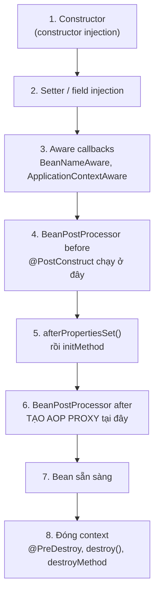

# Bean Scope & Lifecycle

> **Tuần 4 · Ngày 23** · Thuộc [[04 - Spring Core, Boot & MVC]] · Bài trước: [[04.01 - IoC & Dependency Injection]] · Bài sau: [[04.03 - Spring Boot Auto-configuration]]
> Hai câu bẫy kinh điển nằm ở bài này: "singleton có thread-safe không?" và "inject prototype vào singleton thì sao?". Phần vòng đời là nền để hiểu vì sao `@Transactional` không chạy trong `@PostConstruct` (Tuần 5).
> Mọi output trong bài đã được **chạy thử trên Spring Boot 3.5.16 (Spring Framework 6.2), JDK 21**.

**Mục lục**
1. [[#1. Các bean scope|Các bean scope]]
2. [[#2. Singleton có thread-safe không|Singleton có thread-safe không]]
3. [[#3. Prototype inject vào singleton|Prototype inject vào singleton]]
4. [[#4. Vòng đời bean: thứ tự đo thực tế|Vòng đời bean: thứ tự đo thực tế]]
5. [[#5. BeanPostProcessor vs BeanFactoryPostProcessor|BeanPostProcessor vs BeanFactoryPostProcessor]]
6. [[#6. @PostConstruct: dùng đúng và bẫy|@PostConstruct: dùng đúng và bẫy]]
7. [[#7. Kịch bản Feynman hôm nay|Kịch bản Feynman hôm nay]]

---

## 1. Các bean scope

### Hiểu bản chất

Scope trả lời câu hỏi: **"container giữ bao nhiêu instance của bean này, và mỗi instance sống bao lâu?"**

| Scope | Số instance | Spring gọi destroy callback? |
|---|---|---|
| **singleton** (mặc định) | 1 cho mỗi `ApplicationContext` | Có |
| **prototype** | Mỗi lần lấy bean (inject hoặc `getBean`) tạo mới | **Không** |
| request | 1 cho mỗi HTTP request | Có, khi request kết thúc |
| session | 1 cho mỗi HTTP session | Có |
| application | 1 cho mỗi `ServletContext` | Có |
| websocket | 1 cho mỗi WebSocket session | Có |

```java
@Component
@Scope("prototype")               // hoặc ConfigurableBeanFactory.SCOPE_PROTOTYPE
public class CsvExportJob { ... }

@Component
@RequestScope                     // = @Scope(value = "request", proxyMode = TARGET_CLASS)
public class RequestContext { ... }
```

**Lưu ý thuật ngữ:** singleton của Spring khác Singleton pattern của GoF. GoF đảm bảo 1 instance **trong cả JVM** (constructor private). Spring chỉ đảm bảo 1 instance **trong một container**; bạn vẫn `new` thêm được, và 2 context thì có 2 instance.

### Prototype: Spring không dọn dẹp

Đo thực tế: tạo 7 instance prototype `Cart` có `@PreDestroy`, rồi đóng context. **Không có dòng `@PreDestroy` nào được in ra.** Spring tạo xong prototype là "giao" cho bạn, không theo dõi nữa. Nếu prototype giữ tài nguyên (file, connection) thì **bạn tự đóng**.

---

## 2. Singleton có thread-safe không

### Hiểu bản chất

**Không tự động.** Singleton chỉ nói "một instance dùng chung". Tomcat có 200 worker thread, nên 200 request có thể chạy **đồng thời trong cùng một object**. Mọi field có thể thay đổi đều là **shared mutable state** (xem [[03.04 - synchronized, volatile, Atomic & ConcurrentHashMap]]).

### Code minh hoạ

```java
@Component
class Counter {                    // singleton có state: SAI
    int count = 0;
    void inc() { count++; }
}

// 8 thread gọi inc() tổng cộng 100_000 lần
```

Kết quả đo: `count = 99791`, không phải 100000. `count++` gồm 3 bước đọc, cộng, ghi; hai thread đọc cùng giá trị thì một lần cộng bị mất (lost update).

### Cách viết đúng

| Cách | Ví dụ |
|---|---|
| **Stateless** (tốt nhất) | Bean chỉ có field `final` trỏ tới bean khác; mọi dữ liệu theo request đi qua **tham số method** và biến cục bộ |
| Cấu trúc thread-safe | `AtomicLong`, `LongAdder`, `ConcurrentHashMap` |
| State theo request | `@RequestScope` bean, hoặc truyền DTO qua tham số |
| Cache thật | Caffeine/Redis thay vì `HashMap` tự chế |

### Bẫy hay gặp

```java
@Service
public class ReportService {
    private User currentUser;                      // BUG: request A ghi, request B đọc nhầm

    public Report build(Long userId) {
        currentUser = userRepo.findById(userId).orElseThrow();
        return render();                           // render() đọc currentUser
    }
}
```

Bug này **không lộ ra khi test bằng tay** (một request mỗi lần), chỉ lộ ra khi tải cao: user A thấy báo cáo của user B. Rất nguy hiểm về bảo mật.

> **Trả lời mẫu:** "Singleton bean không tự thread-safe. Singleton chỉ có nghĩa một instance dùng chung, và mọi request thread đều chạy vào cùng object đó. Nên em giữ bean stateless: chỉ có field `final` trỏ tới bean khác, dữ liệu theo request đi qua tham số và biến cục bộ. Nếu thật sự cần state dùng chung như bộ đếm thì dùng `AtomicLong` hoặc `ConcurrentHashMap`. Em từng thử cho 8 thread tăng một field `int` 100 nghìn lần, kết quả chỉ ra khoảng 99.8 nghìn vì lost update."

---

## 3. Prototype inject vào singleton

### Hiểu bản chất

Dependency injection chỉ xảy ra **một lần**, lúc tạo bean. Singleton được tạo một lần, nên prototype bên trong nó cũng chỉ được lấy **một lần** và dùng mãi. Scope prototype "mất tác dụng".

### Code minh hoạ

```java
@Component @Scope("prototype")
class Cart { final int id = SEQ.incrementAndGet(); }

@Component class Direct      { final Cart cart; Direct(Cart c) { cart = c; } }
@Component class ViaProvider { final ObjectProvider<Cart> carts; ... }
@Component abstract class ViaLookup { @Lookup abstract Cart cart(); }

@Component @Scope(value = "prototype", proxyMode = ScopedProxyMode.TARGET_CLASS)
class ProxiedCart { ... }
@Component class ViaProxy { final ProxiedCart cart; ... }
```

Kết quả đo (mỗi cột là id của Cart ở lần gọi 1 và lần gọi 2):

| Cách lấy | Lần 1 | Lần 2 | Ghi chú |
|---|---|---|---|
| Inject trực tiếp | 1 | **1** | Luôn cùng instance |
| `ObjectProvider<Cart>.getObject()` | 2 | 3 | Mới mỗi lần |
| `@Lookup` method | 4 | 5 | Spring tạo CGLIB subclass `ViaLookup$$SpringCGLIB$$0` override method |
| Scoped proxy (`TARGET_CLASS`) | 6 | 7 | Field giữ proxy `ProxiedCart$$SpringCGLIB$$0`; **mỗi lần gọi method** lại lấy một target mới |
| `ctx.getBean(Cart.class)` 2 lần | khác nhau | | `same? false` |

### So sánh các cách sửa

| Cách | Ưu | Nhược |
|---|---|---|
| `ObjectProvider<T>` | Rõ ràng, dễ test, có `getIfAvailable()` | Phải gọi `getObject()` |
| `@Lookup` | Code gọn | Class phải để Spring subclass; khó hiểu với người mới |
| Scoped proxy | Code dùng như bean thường | **Mỗi lần gọi method là một instance mới**: gọi `cart.add()` rồi `cart.total()` là trên 2 object khác nhau! |
| Inject `ApplicationContext` rồi `getBean` | Chạy được | Phụ thuộc vào container (Service Locator), khó test |

**Em chọn `ObjectProvider`** trong hầu hết trường hợp.

### Bẫy hay gặp

Bẫy của scoped proxy với prototype ở bảng trên là có thật: đo được id thay đổi giữa 2 lần gọi `x.cart.id()` trên **cùng một field**. Scoped proxy hợp với `request`/`session` scope (trong cùng request vẫn là một instance), không hợp với prototype có state.

> **Trả lời mẫu:** "Inject prototype vào singleton thì luôn nhận cùng một instance, vì injection chỉ xảy ra một lần lúc tạo singleton. Muốn mỗi lần dùng có instance mới, em inject `ObjectProvider<T>` và gọi `getObject()` khi cần. Ngoài ra có `@Lookup` hoặc scoped proxy. Với scoped proxy phải cẩn thận: mỗi lần gọi method qua proxy là một instance prototype mới, nên không giữ state giữa các lần gọi được."

### Câu hỏi xoáy

**Q1.** Ngược lại, inject singleton vào prototype thì sao?
> [!success]- Gợi ý trả lời
> Không có vấn đề gì. Mỗi prototype mới nhận cùng một singleton, đúng như mong muốn.

**Q2.** Request-scoped bean inject vào singleton controller thì sao? Có bị lỗi giống prototype không?
> [!success]- Gợi ý trả lời
> `@RequestScope` mặc định đã có `proxyMode = TARGET_CLASS`, nên singleton nhận một **proxy**. Mỗi lần gọi method, proxy tìm instance gắn với **request hiện tại** (lưu trong ThreadLocal của request). Nếu khai báo `@Scope("request")` không có proxy mà inject vào singleton, app sẽ fail lúc start vì không có request nào đang chạy. Đo thực tế, root cause là `IllegalStateException: No thread-bound request found: Are you referring to request attributes outside of an actual web request...`

---

## 4. Vòng đời bean: thứ tự đo thực tế

### Hiểu bản chất



### Code minh hoạ

Một bean implement đủ mọi callback, có thêm một method `@Async` để Spring phải tạo proxy, cùng một `BeanPostProcessor` và một `BeanFactoryPostProcessor` tự viết:

```java
class OrderCache implements BeanNameAware, ApplicationContextAware,
        InitializingBean, DisposableBean {
    OrderCache()                       { log("1 constructor"); }
    @Autowired void setDep(Dep d)      { log("2 setter injection"); }
    public void setBeanName(String n)  { log("3 BeanNameAware"); }
    @PostConstruct void pc()           { log("5 @PostConstruct, proxy? " + isAopProxy(this)); }
    public void afterPropertiesSet()   { log("6 afterPropertiesSet"); }
    void customInit()                  { log("7 @Bean(initMethod)"); }
    @Async public void warmUp()        { }
    @PreDestroy void pd()              { log("D1 @PreDestroy"); }
    public void destroy()              { log("D2 DisposableBean.destroy"); }
    void customDestroy()               { log("D3 @Bean(destroyMethod)"); }
}
```

Output thật, theo đúng thứ tự in ra:

| # | Bước | Ghi chú |
|---|---|---|
| 0 | `BeanFactoryPostProcessor` | Lúc này có 17 bean definition, `orderCache` **chưa** được tạo |
| 1 | constructor | |
| 2 | setter injection | |
| 3 | `BeanNameAware.setBeanName(orderCache)`, `ApplicationContextAware` | |
| 4 | `BPP.before`, class là `OrderCache` | Object gốc |
| 5 | `@PostConstruct`, `this` là proxy? **false** | |
| 6 | `InitializingBean.afterPropertiesSet` | |
| 7 | `@Bean(initMethod)` | |
| 8 | `BPP.after`, class là `OrderCache$$SpringCGLIB$$0` | Proxy đã được thay vào |
| 9 | Bean trong context là `OrderCache$$SpringCGLIB$$0`, proxy? **true** | |
| D1–D3 | `@PreDestroy` → `destroy()` → `destroyMethod` | Khi đóng context |

**Thứ tự init dễ nhớ:** annotation (`@PostConstruct`) → interface (`afterPropertiesSet`) → cấu hình (`initMethod`). Destroy theo đúng thứ tự tương tự: `@PreDestroy` → `destroy()` → `destroyMethod`.

### Chi tiết đáng chú ý từ phép đo

`@PostConstruct` không phải phép màu: nó được gọi **bên trong** `postProcessBeforeInitialization` của một BPP có sẵn (`CommonAnnotationBeanPostProcessor`). Trong phép đo, BPP tự viết in "before" **trước** `@PostConstruct`, vì Spring xếp các BPP nội bộ như `CommonAnnotationBeanPostProcessor` xuống cuối chuỗi. Khi phỏng vấn chỉ cần nói "`@PostConstruct` chạy ở pha before-initialization".

### Bẫy hay gặp

- **Bean trong context không phải object bạn `new`**. Bước 8 có thể **trả về object khác** (proxy). Đây là cách `@Transactional`, `@Async`, `@Cacheable` hoạt động.
- Trong `@PostConstruct`, `this` là **object gốc**, không phải proxy. Gọi method `@Transactional`/`@Async` của chính mình ở đây sẽ **không qua proxy** (mục 6).

> **Trả lời mẫu:** "Vòng đời bean: Spring gọi constructor, inject setter và field, gọi các Aware callback, rồi `BeanPostProcessor` before, trong đó có `@PostConstruct`; tiếp theo `afterPropertiesSet` và `initMethod`; rồi `BeanPostProcessor` after, đây là chỗ Spring bọc bean bằng AOP proxy cho `@Transactional`, `@Async`. Khi đóng context thì `@PreDestroy`, `destroy`, `destroyMethod`. Em đã in thử: trong `@PostConstruct` thì `this` chưa phải proxy, nhưng bean lấy ra từ context là class CGLIB. Prototype bean thì Spring không gọi destroy."

### Câu hỏi xoáy

**Q1.** AOP proxy được tạo ở bước nào? Vì sao không tạo sớm hơn?
> [!success]- Gợi ý trả lời
> Ở `postProcessAfterInitialization` (BPP after), sau `@PostConstruct` và `afterPropertiesSet`. Proxy bọc một object **đã khởi tạo xong hoàn toàn**; nếu bọc sớm thì các bước init chạy trên object chưa đầy đủ. Hệ quả: code trong `@PostConstruct` không được hưởng proxy.

**Q2.** Muốn chạy code khi app đã sẵn sàng hoàn toàn (đã có proxy, đã có transaction) thì đặt ở đâu?
> [!success]- Gợi ý trả lời
> `ApplicationRunner`/`CommandLineRunner`, hoặc `@EventListener(ApplicationReadyEvent.class)`. Lúc đó mọi bean đã là proxy hoàn chỉnh, gọi từ bean này sang bean khác sẽ qua proxy.

---

## 5. BeanPostProcessor vs BeanFactoryPostProcessor

### Hiểu bản chất

| | `BeanFactoryPostProcessor` | `BeanPostProcessor` |
|---|---|---|
| Can thiệp vào | **Bean definition** (công thức) | **Bean instance** (object thật) |
| Chạy khi nào | Sau khi đọc xong definition, **trước khi tạo bất kỳ bean thường nào** | Cho từng bean, quanh bước init |
| Ví dụ có sẵn | `PropertySourcesPlaceholderConfigurer` (thay `${...}`), `ConfigurationClassPostProcessor` (xử lý `@Configuration`, `@ComponentScan`, `@Import`) | `AutowiredAnnotationBeanPostProcessor` (`@Autowired`), `CommonAnnotationBeanPostProcessor` (`@PostConstruct`), `AnnotationAwareAspectJAutoProxyCreator` (tạo AOP proxy) |
| Có thể | Đổi class, scope, giá trị property của definition | Bọc, thay thế object (trả về proxy) |

Phép đo ở mục 4 xác nhận: BFPP chạy khi đã có 17 definition nhưng `orderCache` **chưa tồn tại**.

Ví von: BFPP sửa **bản vẽ** trước khi xây nhà; BPP **sơn sửa căn nhà** vừa xây xong (hoặc thay bằng căn nhà có bảo vệ đứng trước cửa, chính là proxy).

### Bẫy hay gặp

- Method `@Bean` trả về BFPP nên khai báo **`static`**. Nếu không, Spring phải tạo class `@Configuration` chứa nó từ rất sớm, khiến class đó không được các BPP xử lý đầy đủ (Spring log cảnh báo).
- Bean mà BPP phụ thuộc vào sẽ được tạo sớm và **có thể không được proxy**. Log có dòng "is not eligible for getting processed by all BeanPostProcessors".

### Câu hỏi xoáy

**Q1.** `${payment.url}` trong `@Value` được thay bằng giá trị thật ở đâu?
> [!success]- Gợi ý trả lời
> Placeholder được resolve nhờ `PropertySourcesPlaceholderConfigurer` (một BFPP) cùng embedded value resolver, dùng `Environment` của Spring. Giá trị được inject vào field ở pha populate, do `AutowiredAnnotationBeanPostProcessor` xử lý `@Value`.

---

## 6. @PostConstruct: dùng đúng và bẫy

### Dùng để làm gì

Khởi tạo **sau khi** mọi phụ thuộc đã inject xong, mà constructor không làm được (với field/setter injection) hoặc không nên làm:
- Validate cấu hình, fail sớm nếu thiếu.
- Load dữ liệu nhỏ vào bộ nhớ (danh sách mã tỉnh, config tĩnh).

### Bẫy hay gặp

| Bẫy | Vì sao | Cách sửa |
|---|---|---|
| Gọi method `@Transactional` của **chính bean** trong `@PostConstruct` | `this` là object gốc, không qua proxy, nên không có transaction | Chuyển sang `ApplicationRunner` hoặc `@EventListener(ApplicationReadyEvent.class)`, gọi qua bean khác |
| Gọi method `@Async` của chính bean | Chạy đồng bộ trên thread `main` | Như trên |
| Gọi API ngoài, query nặng | Làm **chậm khởi động**, một lỗi mạng làm app không start được | Chạy sau khi ready, có retry |
| Ném exception | Cả app fail khi start | Chỉ ném khi thật sự muốn fail sớm (cấu hình sai) |
| Đặt `@PostConstruct` trên prototype mong được dọn bằng `@PreDestroy` | Prototype không được gọi destroy | Tự quản lý |

```java
@Component
@RequiredArgsConstructor
class CacheWarmer {
    private final ProductService productService;    // bean khác, nhận qua proxy

    @EventListener(ApplicationReadyEvent.class)
    public void warmUp() {
        productService.loadHotProducts();   // @Transactional(readOnly = true) chạy đúng
    }
}
```

> **Trả lời mẫu:** "`@PostConstruct` chạy sau khi inject xong, em dùng để validate config hoặc nạp dữ liệu nhỏ. Bẫy lớn nhất là nó chạy trước bước tạo AOP proxy, và `this` là object gốc, nên gọi method `@Transactional` hay `@Async` của chính mình trong đó sẽ không có tác dụng. Logic cần transaction hay gọi service khác lúc khởi động em đặt trong `@EventListener(ApplicationReadyEvent.class)` hoặc `ApplicationRunner`."

---

## 7. Kịch bản Feynman hôm nay

1. Giải thích vì sao singleton không thread-safe, dùng ví dụ `currentUser` bị lẫn giữa 2 request.
2. Vẽ lại sơ đồ vòng đời 8 bước, đánh dấu chỗ `@PostConstruct` và chỗ tạo proxy, rồi đối chiếu với [[06 - Sơ đồ cơ chế cốt lõi]] mục 9.
3. Nói trong 60 giây: "Prototype inject vào singleton thì sao, sửa thế nào, vì sao em chọn `ObjectProvider`?"
4. Phân biệt BFPP và BPP bằng ví dụ "bản vẽ" và "căn nhà".

Ghi vào [[08 - Nhật ký học tập]].

## Tự kiểm tra nhanh (không mở tài liệu)

- [ ] Kể 6 scope. Scope nào Spring không gọi destroy?
- [ ] Singleton của Spring khác Singleton pattern GoF thế nào?
- [ ] Viết ví dụ bean singleton gây lỗi khi chạy đồng thời
- [ ] 3 cách lấy prototype mới mỗi lần từ singleton; bẫy của scoped proxy
- [ ] Thứ tự: `@PostConstruct`, `afterPropertiesSet`, `initMethod`, BPP after
- [ ] Trong `@PostConstruct`, `this` có phải proxy không?
- [ ] BFPP chạy trước hay sau khi tạo bean thường? Kể 1 BFPP có sẵn
- [ ] Logic cần transaction lúc khởi động đặt ở đâu?
