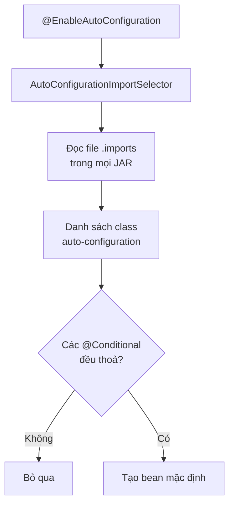

# Spring Boot Auto-configuration

> **Tuần 4 · Ngày 24** · Thuộc [[04 - Spring Core, Boot & MVC]] · Bài trước: [[04.02 - Bean Scope & Lifecycle]] · Bài sau: [[04.04 - Spring MVC Request Flow]]
> "Auto-configuration hoạt động thế nào?" là câu hỏi "internals" phân loại ứng viên: người chỉ dùng Boot sẽ nói "nó tự cấu hình", người hiểu sẽ nói được file `.imports`, `@Conditional` và cách override.
> Mọi output trong bài đã được **chạy thử trên Spring Boot 3.5.16, JDK 21**, gồm cả một starter tự viết để quan sát `@ConditionalOnMissingBean`.

**Mục lục**
1. [[#1. Spring Boot khác Spring Framework ở đâu|Spring Boot khác Spring Framework ở đâu]]
2. [[#2. @SpringBootApplication gồm những gì|@SpringBootApplication gồm những gì]]
3. [[#3. Auto-configuration hoạt động thế nào|Auto-configuration hoạt động thế nào]]
4. [[#4. SpringApplication.run() làm gì|SpringApplication.run() làm gì]]
5. [[#5. @Value vs @ConfigurationProperties|@Value vs @ConfigurationProperties]]
6. [[#6. Thứ tự ưu tiên property và profiles|Thứ tự ưu tiên property và profiles]]
7. [[#7. Actuator và ứng dụng không có web|Actuator và ứng dụng không có web]]
8. [[#8. Kịch bản Feynman hôm nay|Kịch bản Feynman hôm nay]]

---

## 1. Spring Boot khác Spring Framework ở đâu

### Hiểu bản chất

Spring Boot **không thay thế** Spring. Nó là lớp "opinionated" (có sẵn quan điểm mặc định) đặt **bên trên** Spring Framework. DI, AOP, MVC, transaction vẫn là của Spring Framework.

Ngày xưa, dựng một web app Spring phải: cấu hình `DispatcherServlet` trong `web.xml`, khai báo `DataSource`, `EntityManagerFactory`, `TransactionManager`, `ObjectMapper`, chọn version từng thư viện cho khớp nhau, rồi build WAR và deploy vào Tomcat. Boot làm sẵn tất cả:

| Tính năng | Giải quyết vấn đề gì |
|---|---|
| **Auto-configuration** | Tự tạo bean hợp lý dựa trên classpath và property |
| **Starter** | Một dependency kéo đủ bộ thư viện; version do BOM `spring-boot-dependencies` quản lý, không lệch nhau |
| **Embedded server** | Tomcat nằm trong app, chạy bằng `java -jar app.jar` (fat JAR) |
| **Externalized config** | `application.yml`, env var, profiles, command-line args |
| **Actuator** | Health, metrics, info cho production |

> **Trả lời mẫu:** "Spring Boot không thay Spring mà là lớp cấu hình mặc định bên trên. Nó có auto-configuration tự tạo bean dựa trên classpath, starter gom dependency với version đã được kiểm tra tương thích, embedded Tomcat để chạy bằng `java -jar`, cấu hình ngoài qua yml, env var, profile, và Actuator cho vận hành. DI, AOP, MVC, transaction vẫn là của Spring Framework."

---

## 2. @SpringBootApplication gồm những gì

```java
@SpringBootConfiguration      // một dạng @Configuration
@EnableAutoConfiguration      // bật auto-configuration
@ComponentScan                // quét package chứa class này và mọi package con
public @interface SpringBootApplication { }
```

**Hệ quả quan trọng:** class main phải đặt ở **package gốc** (ví dụ `com.shop.order`). Bean nằm ở `com.shop.common` (ngang hàng, không phải con) sẽ **không được scan**, và bạn nhận `NoSuchBeanDefinitionException` dù class có `@Service` hẳn hoi.

Các thuộc tính hay dùng:

```java
@SpringBootApplication(
    exclude = DataSourceAutoConfiguration.class,        // tắt một auto-config
    scanBasePackages = {"com.shop.order", "com.shop.common"})
```

Hoặc trong yml: `spring.autoconfigure.exclude=...`.

---

## 3. Auto-configuration hoạt động thế nào

### Hiểu bản chất



1. `@EnableAutoConfiguration` import `AutoConfigurationImportSelector`.
2. Selector đọc danh sách class từ file
   `META-INF/spring/org.springframework.boot.autoconfigure.AutoConfiguration.imports` trong **mọi JAR** trên classpath. (Trước Boot 2.7 là `META-INF/spring.factories`; **Boot 3 không còn đọc `spring.factories` cho auto-config**.)
3. Mỗi class auto-config được canh bởi các **điều kiện**:

| Điều kiện | Ý nghĩa | Ví dụ |
|---|---|---|
| `@ConditionalOnClass` | Class có trên classpath | Có `DataSource` thì mới cấu hình JDBC |
| `@ConditionalOnMissingBean` | **Bạn chưa tự khai báo** bean cùng kiểu | `ObjectMapper`, `RestTemplateBuilder` |
| `@ConditionalOnProperty` | Property có giá trị phù hợp | `spring.cache.type=redis` |
| `@ConditionalOnWebApplication` | App là web app | Cấu hình MVC |
| `@ConditionalOnBean` | Đã có bean nào đó | |

4. Auto-config được xử lý **sau** bean của bạn (component scan và `@Bean` của bạn đã đăng ký definition trước). Nhờ vậy `@ConditionalOnMissingBean` "thấy" bean của bạn và nhường.

### Code minh hoạ: tự viết một starter

```java
@AutoConfiguration
@ConditionalOnProperty(prefix = "greeting", name = "enabled",
        havingValue = "true", matchIfMissing = true)
public class GreetingAutoConfiguration {
    @Bean
    @ConditionalOnMissingBean
    public GreetingService greetingService() {
        return () -> "Hello from STARTER default";
    }
}
```

File `META-INF/spring/org.springframework.boot.autoconfigure.AutoConfiguration.imports` chỉ có một dòng: `lab.starter.GreetingAutoConfiguration`.

Kết quả đo ở 3 tình huống (đọc từ `ConditionEvaluationReport`):

| Tình huống | `greet()` trả về | Lý do Boot ghi trong report |
|---|---|---|
| App không khai báo gì | `Hello from STARTER default` | `@ConditionalOnMissingBean (types: lab.starter.GreetingService; ...) did not find any beans` |
| App tự khai báo `@Bean myGreeting()` | `Hello from MY bean` | `@ConditionalOnMissingBean ... found beans of type 'lab.starter.GreetingService' myGreeting` |
| Chạy với `--greeting.enabled=false` | Không có bean nào (0 bean) | `@ConditionalOnProperty (greeting.enabled=true) found different value in property 'enabled'` |

Cùng cơ chế với bean có sẵn của Boot. Khai báo `@Bean ObjectMapper myMapper()` thì đo được context chỉ còn **1** `ObjectMapper` tên `myMapper`, và report ghi:

```text
JacksonObjectMapperConfiguration#jacksonObjectMapper match=false :
@ConditionalOnMissingBean (types: com.fasterxml.jackson.databind.ObjectMapper; ...)
found beans of type 'com.fasterxml.jackson.databind.ObjectMapper' myMapper
```

### Condition Evaluation Report (`--debug`)

Chạy app với `--debug` (hoặc `debug=true` trong yml), Boot in ra `CONDITIONS EVALUATION REPORT` gồm 4 phần (đã kiểm tra có đủ): **Positive matches**, **Negative matches**, **Exclusions**, **Unconditional classes**. Ví dụ thật từ app không có JDBC:

```text
   DataSourceAutoConfiguration:
      Did not match:
         - @ConditionalOnClass did not find required class
           'org.springframework.jdbc.datasource.embedded.EmbeddedDatabaseType'
```

Đây là công cụ số 1 khi "bean của Boot không được tạo" hoặc "bean của Boot đè bean của tôi". Có Actuator thì xem online qua `/actuator/conditions` (phải expose).

### Bẫy hay gặp

- Khai báo `ObjectMapper` của riêng mình là **thay toàn bộ** `ObjectMapper` của Boot, kể cả các cấu hình `spring.jackson.*` trong yml sẽ không áp dụng nữa. Muốn chỉ chỉnh thêm thì khai báo `Jackson2ObjectMapperBuilderCustomizer`.
- `@ConditionalOnMissingBean` so theo **kiểu**. Bean của bạn khác kiểu (ví dụ subclass khác nhánh) có thể không làm auto-config nhường như bạn nghĩ. Kiểm tra bằng report.

> **Trả lời mẫu:** "`@SpringBootApplication` có `@EnableAutoConfiguration`, nó import `AutoConfigurationImportSelector`. Selector đọc danh sách class auto-config từ file `AutoConfiguration.imports` trong các JAR; Boot 3 không còn dùng `spring.factories` cho việc này. Mỗi class được canh bởi điều kiện như `@ConditionalOnClass`, `@ConditionalOnProperty`, và quan trọng nhất là `@ConditionalOnMissingBean`: chỉ tạo bean khi mình chưa tự khai báo. Auto-config được xử lý sau bean của mình nên bean của mình luôn thắng. Khi debug em chạy `--debug` để đọc Condition Evaluation Report; em từng tự viết một starter nhỏ và thấy report ghi rõ 'found beans of type ... myGreeting' khi em override."

### Câu hỏi xoáy

**Q1.** Tự khai báo bean `ObjectMapper`, vì sao bean mặc định của Boot không được tạo nữa?
> [!success]- Gợi ý trả lời
> Vì method tạo `ObjectMapper` trong `JacksonAutoConfiguration` có `@ConditionalOnMissingBean`. Auto-config xử lý sau bean của bạn, thấy đã có bean cùng kiểu nên bỏ qua. Đã đo: report ghi `found beans of type 'com.fasterxml.jackson.databind.ObjectMapper' myMapper`.

**Q2.** Làm sao viết một thư viện nội bộ mà team khác chỉ cần thêm dependency là có bean?
> [!success]- Gợi ý trả lời
> Viết class `@AutoConfiguration` với các `@Conditional` phù hợp (đặc biệt `@ConditionalOnMissingBean` để người dùng override được), rồi đăng ký tên class trong file `META-INF/spring/org.springframework.boot.autoconfigure.AutoConfiguration.imports`. Đừng dựa vào component scan, vì package của thư viện thường nằm ngoài package của app.

---

## 4. SpringApplication.run() làm gì

### Hiểu bản chất

1. Xác định **loại ứng dụng** dựa trên classpath: Servlet (có Spring MVC + Tomcat), Reactive (WebFlux), hoặc None.
2. Chuẩn bị **`Environment`**: đọc property từ file, env var, command-line, kích hoạt profile.
3. In banner, **tạo `ApplicationContext`** phù hợp với loại ứng dụng.
4. **Refresh context**: đọc bean definition (component scan + auto-config), chạy `BeanFactoryPostProcessor`, tạo singleton, chạy `BeanPostProcessor` (tạo proxy).
5. Khởi động **embedded web server** (Tomcat).
6. Gọi `ApplicationRunner` / `CommandLineRunner`.
7. Phát **`ApplicationReadyEvent`**: app sẵn sàng nhận traffic.

### Code minh hoạ: thứ tự event đo thực tế

Đăng ký một listener in tên mọi event Boot phát ra khi start một web app:

| # | Event | Ý nghĩa |
|---|---|---|
| 1 | `ApplicationStartingEvent` | Vừa bắt đầu, chưa có gì |
| 2 | `ApplicationEnvironmentPreparedEvent` | `Environment` đã sẵn sàng |
| 3 | `ApplicationContextInitializedEvent` | Context đã tạo, chưa nạp definition |
| 4 | `ApplicationPreparedEvent` | Đã nạp definition, chưa refresh |
| 5 | `ServletWebServerInitializedEvent` | Tomcat đã chạy (log "Tomcat initialized with port") |
| 6 | `ContextRefreshedEvent` | Refresh xong, mọi singleton đã tạo |
| 7 | `ApplicationStartedEvent` | |
| 8 | (`CommandLineRunner.run` được gọi) | |
| 9 | `ApplicationReadyEvent` | Sẵn sàng |

Context class đo được: `AnnotationConfigServletWebServerApplicationContext`.

Điểm đáng chú ý từ phép đo: web server khởi động **bên trong** pha refresh (trước `ContextRefreshedEvent`), còn runner chạy **trước** `ApplicationReadyEvent`.

### Câu hỏi xoáy

**Q1.** Muốn chạy một tác vụ sau khi app start xong, dùng gì?
> [!success]- Gợi ý trả lời
> `ApplicationRunner`/`CommandLineRunner` (chạy trước `ApplicationReadyEvent`, nếu ném exception thì app fail) hoặc `@EventListener(ApplicationReadyEvent.class)`. Tác vụ lâu thì nên chạy async để không chặn khởi động.

---

## 5. @Value vs @ConfigurationProperties

### Code minh hoạ

```java
@ConfigurationProperties(prefix = "payment")
@Validated
public record PaymentProperties(@NotBlank String url, Duration timeout, @Min(0) int retry) {}

// Bật bằng @EnableConfigurationProperties(PaymentProperties.class)
// hoặc @ConfigurationPropertiesScan trên class main
```

```yaml
payment:
  url: https://pay.local
  timeout: 3s          # tự convert sang Duration
  retry: 2
```

Đo thực tế: bind ra `PaymentProperties[url=https://pay.local, timeout=PT3S, retry=2]`. Còn `@Value("${payment.timeout}")` vào field `String` thì nhận nguyên chuỗi `3s`.

Cấu hình sai (`url` rỗng, `retry=-1`) thì app **fail ngay khi start**, FailureAnalyzer in ra rất rõ:

```text
Binding to target lab.boot.PropsTest$PaymentProperties failed:
    Property: payment.url
    Value: " "
    Reason: must not be blank
```

(kèm một khối tương tự cho `payment.retry`: `must be greater than or equal to 0`.)

| | `@Value("${x}")` | `@ConfigurationProperties` |
|---|---|---|
| Phù hợp | 1–2 giá trị lẻ | Nhóm config có cấu trúc |
| Type-safe, `Duration`, `List`, nested object | Hạn chế | Có |
| Validate (`@Validated`) | Không | Có, fail khi start |
| Relaxed binding (`PAYMENT_URL` → `payment.url`) | Có với env var (đo: `@Value("${payment.url}")` đọc được `PAYMENT_URL`), nhưng key trong `@Value` phải viết đúng dạng chuẩn | Có, mọi dạng |
| SpEL (`#{...}`) | Có | Không |
| Dễ test, dễ tìm usage | Rải rác khắp code | Một record duy nhất |

### Bẫy hay gặp

- Quên `@EnableConfigurationProperties` hoặc `@ConfigurationPropertiesScan`: record không trở thành bean.
- `@Value` sai tên key mà không có default (`${x:default}`) thì app fail khi start. Đo được: `PlaceholderResolutionException: Could not resolve placeholder 'payment.missing-key' in value "${payment.missing-key}"`.

> **Trả lời mẫu:** "Với nhóm cấu hình em dùng `@ConfigurationProperties` trên một record, kèm `@Validated`. Nó type-safe, tự convert `Duration`, hỗ trợ relaxed binding từ env var, và quan trọng là cấu hình sai thì app fail ngay khi start với thông báo rõ ràng từng property. `@Value` em chỉ dùng cho một vài giá trị lẻ hoặc khi cần SpEL."

---

## 6. Thứ tự ưu tiên property và profiles

### Thứ tự ưu tiên: đo thực tế

Đặt cùng key `payment.url` ở nhiều nguồn, xem giá trị nào thắng:

| Nguồn | Kết quả khi có mặt | Ưu tiên |
|---|---|---|
| Command-line `--payment.url=https://cli.local` | `cli.local` thắng tất cả | Cao nhất |
| Env var `PAYMENT_URL=https://env.local` | Thắng file, kể cả `application-dev` | |
| `application-dev.properties` (profile `dev` active) | Thắng `application.properties` | |
| `application.properties` | Thắng default properties | |
| `SpringApplication.setDefaultProperties` | Chỉ dùng khi không nguồn nào có | Thấp nhất |

Ngoài ra (theo tài liệu Boot): file **bên ngoài JAR** (ví dụ `./config/application.yml`) thắng file bên trong JAR cùng loại. Đây là cách ops đổi cấu hình mà không build lại.

### Profiles

```yaml
# application.yml: dùng chung
spring:
  profiles:
    active: dev           # mặc định cho máy dev; production ghi đè bằng env var
---
# application-prod.yml: chỉ khi profile prod active
payment:
  url: https://api.vnpay.vn
```

- Kích hoạt: `--spring.profiles.active=prod` hoặc env `SPRING_PROFILES_ACTIVE=prod`.
- `@Profile("dev")` trên bean hoặc `@Configuration`: bean chỉ tồn tại ở profile đó (ví dụ mock payment client cho dev).
- **Secret** (password DB, API key) **không** commit vào yml. Dùng env var, Vault, AWS Secrets Manager, Kubernetes Secret.

> **Trả lời mẫu:** "Thứ tự ưu tiên rút gọn là: command-line args, rồi biến môi trường, rồi file profile `application-{profile}.yml`, rồi `application.yml`; file ngoài JAR thắng file trong JAR. Em đã thử: env var `PAYMENT_URL` thắng cả file profile dev, và `--payment.url` thắng env var. Nên ở dự án, yml chứa giá trị mặc định cho dev, còn production thì override bằng env var trên Kubernetes, secret lấy từ Secret chứ không nằm trong Git."

### Câu hỏi xoáy

**Q1.** Production set env `PAYMENT_URL` nhưng app vẫn dùng URL cũ. Kiểm tra gì?
> [!success]- Gợi ý trả lời
> Có thể ai đó truyền `--payment.url` trên command-line (ưu tiên cao hơn env). Xem `/actuator/env` (trên management port nội bộ) để biết giá trị cuối cùng lấy từ property source nào. Cũng kiểm tra tên env var có đúng quy tắc relaxed binding (chữ hoa, `.` thành `_`, bỏ `-`).

---

## 7. Actuator và ứng dụng không có web

### Actuator: đo thực tế với cấu hình mặc định

| Request | Status |
|---|---|
| `GET /actuator` | 200 (chỉ liệt kê link `self`, `health`, `health-path`) |
| `GET /actuator/health` | 200 `{"status":"UP"}` |
| `GET /actuator/info` | **404** |
| `GET /actuator/env` | **404** |
| `GET /actuator/heapdump` | **404** |
| `GET /actuator/beans` | **404** |

Mặc định qua HTTP **chỉ expose `health`**. Mở thêm có chủ đích:

```yaml
management:
  endpoints:
    web:
      exposure:
        include: health,info,prometheus
  server:
    port: 8081            # management port riêng, chỉ mở trong mạng nội bộ
```

Endpoint thường dùng: `health` (kèm `/health/liveness`, `/health/readiness` cho Kubernetes probe), `info`, `metrics`, `prometheus` (cần Micrometer registry), `loggers` (đổi log level lúc runtime), `threaddump`.

**Bảo mật:** `env` và `configprops` lộ cấu hình (Boot che giá trị nhạy cảm nhưng không nên tin hoàn toàn); `heapdump` chứa **toàn bộ bộ nhớ**, có thể có password, token. Không bao giờ public ra internet. Đặt trên management port nội bộ hoặc bảo vệ bằng Spring Security.

### Ứng dụng không có web

Đo thực tế với cùng một app có `spring-boot-starter-web`:

| Cấu hình | Context class | Web server |
|---|---|---|
| `server.port=-1` | `AnnotationConfigServletWebServerApplicationContext` | **Vẫn tạo** `TomcatWebServer` (log "Tomcat started on port -1") |
| `spring.main.web-application-type=none` | `AnnotationConfigApplicationContext` | Không có |

Nên app batch hoặc Kafka consumer chạy console thì dùng `web-application-type=none`. `server.port=-1` chỉ tắt HTTP connector, web context vẫn tồn tại.

### Câu hỏi xoáy

**Q1.** Mặc định Actuator expose những endpoint nào qua HTTP? Kể 2 endpoint không nên public.
> [!success]- Gợi ý trả lời
> Chỉ `health` (đã đo: `info`, `env`, `heapdump`, `beans` đều 404). Không public `env`, `heapdump` (cùng `configprops`, `threaddump`).

**Q2.** Liveness và readiness probe khác gì?
> [!success]- Gợi ý trả lời
> Liveness fail thì Kubernetes **restart** pod (app treo, deadlock). Readiness fail thì Kubernetes **ngừng gửi traffic** nhưng không restart (app đang khởi động, hoặc DB tạm mất). Không nên đưa kiểm tra DB vào liveness, vì DB chậm sẽ làm mọi pod bị restart dây chuyền.

---

## 8. Kịch bản Feynman hôm nay

1. Vẽ sơ đồ auto-configuration từ `@SpringBootApplication` tới "tạo bean mặc định", không nhìn bài, rồi đối chiếu với [[06 - Sơ đồ cơ chế cốt lõi]] mục 10.
2. Nói trong 90 giây: "Auto-configuration hoạt động thế nào và làm sao override?" có nhắc file `.imports`, `@ConditionalOnMissingBean`, `--debug`.
3. Giải thích cho một bạn ops: production đổi URL thanh toán bằng cách nào mà không build lại, và vì sao không public `heapdump`.
4. Chạy lab tuần này với `--debug`, tìm trong report một auto-config bị loại và đọc lý do.

Ghi vào [[08 - Nhật ký học tập]].

## Tự kiểm tra nhanh (không mở tài liệu)

- [ ] 3 annotation trong `@SpringBootApplication`; vì sao class main phải ở package gốc?
- [ ] Tên file chứa danh sách auto-config ở Boot 3
- [ ] 4 annotation `@Conditional...` hay gặp; cái nào cho phép override?
- [ ] Vì sao bean của mình luôn thắng bean auto-config?
- [ ] 7 bước của `SpringApplication.run()`
- [ ] `@Value` vs `@ConfigurationProperties`: 3 khác biệt
- [ ] Thứ tự ưu tiên: command-line, env var, profile file, `application.yml`
- [ ] `server.port=-1` vs `web-application-type=none`
