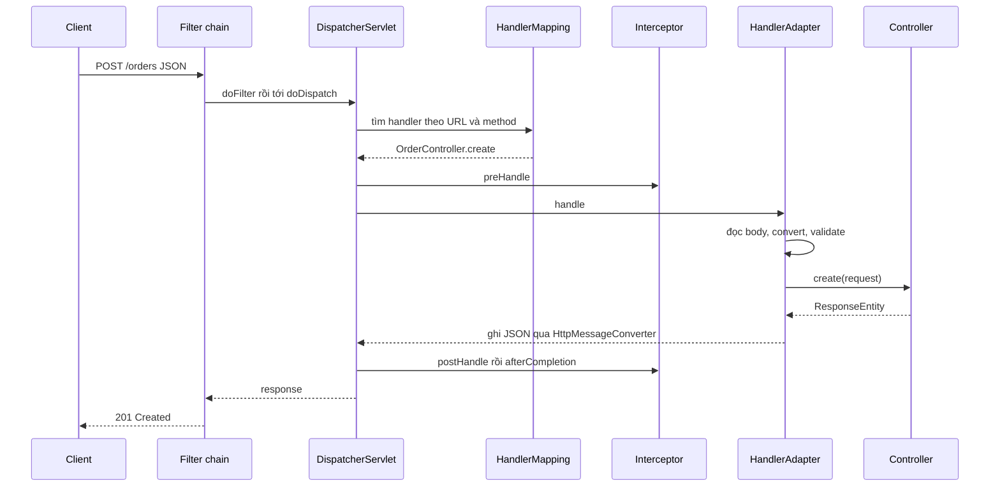
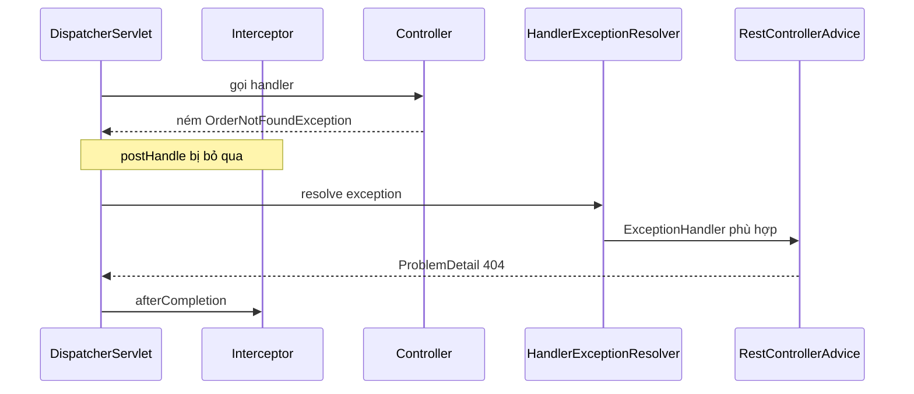
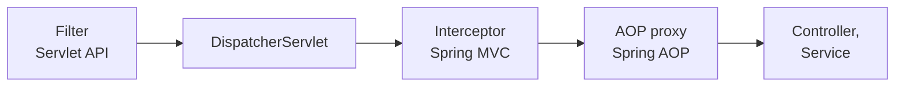

# Spring MVC Request Flow

> **Tuần 4 · Ngày 25** · Thuộc [[04 - Spring Core, Boot & MVC]] · Bài trước: [[04.03 - Spring Boot Auto-configuration]] · Bài sau: [[04.05 - Exception Handling, Validation & AOP]]
> "Một request đi qua Spring MVC như thế nào?" là câu hỏi cho phép bạn thể hiện hiểu biết từ Tomcat tới Jackson. Ai vẽ được luồng và giải thích được Filter khác Interceptor ở đâu sẽ ghi điểm rõ rệt.
> Thứ tự thực thi trong bài **được in ra từ một request thật** trên Spring Boot 3.5.16 (embedded Tomcat 10.1), JDK 21.

**Mục lục**
1. [[#1. Bức tranh tổng thể|Bức tranh tổng thể]]
2. [[#2. Các thành phần bên trong DispatcherServlet|Các thành phần bên trong DispatcherServlet]]
3. [[#3. Filter vs HandlerInterceptor vs AOP|Filter vs HandlerInterceptor vs AOP]]
4. [[#4. @Controller vs @RestController|@Controller vs @RestController]]
5. [[#5. Lấy dữ liệu từ request|Lấy dữ liệu từ request]]
6. [[#6. ResponseEntity và 201 Created|ResponseEntity và 201 Created]]
7. [[#7. Kịch bản Feynman hôm nay|Kịch bản Feynman hôm nay]]

---

## 1. Bức tranh tổng thể

### Hiểu bản chất

Hình dung một toà nhà văn phòng:
- **Tomcat** là cổng toà nhà, cấp cho mỗi khách một nhân viên hướng dẫn (worker thread).
- **Filter chain** là các chốt bảo vệ ở sảnh (Spring Security, CORS, logging). Họ chỉ thấy "người và giấy tờ", không biết khách sẽ lên phòng nào.
- **DispatcherServlet** là lễ tân trung tâm (Front Controller pattern): mọi request đều qua đây rồi được điều phối.
- **HandlerMapping** là bảng chỉ dẫn "URL này, method này thì vào phòng nào".
- **HandlerInterceptor** là thư ký ngay cửa phòng: biết khách vào phòng nào (handler).
- **HandlerAdapter** là người chuẩn bị hồ sơ: đọc body JSON, chuyển kiểu tham số, validate, rồi mời controller xử lý.



Khi có exception (ví dụ không tìm thấy order), luồng rẽ nhánh:



### Code minh hoạ: thứ tự in ra từ request thật

App có: 1 `OncePerRequestFilter`, 1 `HandlerInterceptor`, 1 `@Aspect` `@Around` bọc mọi `@RestController`, 1 `@RestControllerAdvice`. Mỗi thành phần in một dòng.

| Bước | `GET /orders/7` (200) | `GET /orders/0` (ném exception) | `POST /orders` body sai (validation) |
|---|---|---|---|
| Filter before | ✓ | ✓ | ✓ |
| Interceptor `preHandle` | ✓ | ✓ | ✓ |
| Aspect before | ✓ | ✓ | **không chạy** |
| Controller | ✓ | ✓ (ném exception) | **không chạy** |
| Aspect after | after returning | thấy `OrderNotFoundException` | không chạy |
| Interceptor `postHandle` | ✓ | **bỏ qua** | **bỏ qua** |
| `@RestControllerAdvice` | | xử lý, trả 404 | xử lý `MethodArgumentNotValidException`, trả 400 |
| Interceptor `afterCompletion` | `ex=null` | `ex=null` | `ex=null` |
| Filter after | status=200 | status=404 | status=400 |

Ba điều rút ra từ phép đo:

1. **Validation fail thì controller và aspect quanh controller không hề chạy.** `@Valid @RequestBody` được xử lý lúc HandlerAdapter **chuẩn bị tham số**, tức là trước khi gọi method (và trước proxy AOP của controller).
2. **`postHandle` không chạy khi có exception.** Code "luôn phải chạy" (dọn ThreadLocal, ghi log thời gian) đặt ở `afterCompletion`.
3. `afterCompletion` nhận `ex=null` khi exception **đã được `@ExceptionHandler` xử lý**. Đừng dựa vào tham số `ex` để đếm lỗi; dùng status của response.

> **Trả lời mẫu:** "Request vào Tomcat, được một worker thread xử lý, đi qua Filter chain như Spring Security, CORS, rồi tới `DispatcherServlet`. DispatcherServlet hỏi `HandlerMapping` xem controller method nào khớp URL và HTTP method, chạy `preHandle` của các Interceptor, rồi nhờ `HandlerAdapter` gọi method. HandlerAdapter dùng argument resolver để lấy `@PathVariable`, `@RequestParam`, và `HttpMessageConverter` (Jackson) để đọc JSON thành object, validate nếu có `@Valid`. Kết quả trả về lại được Jackson ghi thành JSON. Nếu có exception thì `HandlerExceptionResolver` tìm `@ExceptionHandler` trong `@RestControllerAdvice`. Cuối cùng là `afterCompletion`, rồi response đi ngược qua Filter. Em từng in thử thứ tự và thấy validation lỗi thì controller không hề được gọi, còn `postHandle` bị bỏ qua khi có exception."

---

## 2. Các thành phần bên trong DispatcherServlet

| Thành phần | Việc làm | Ví dụ có sẵn |
|---|---|---|
| `HandlerMapping` | URL + HTTP method → handler | `RequestMappingHandlerMapping` (đọc `@GetMapping`...) |
| `HandlerAdapter` | Biết cách **gọi** một loại handler | `RequestMappingHandlerAdapter` |
| `HandlerMethodArgumentResolver` | Tạo giá trị cho từng tham số | `@PathVariable`, `@RequestParam`, `@RequestBody`, `Pageable`, `@AuthenticationPrincipal` |
| `HttpMessageConverter` | Body ↔ object | `MappingJackson2HttpMessageConverter` (JSON), `StringHttpMessageConverter` |
| `HandlerMethodReturnValueHandler` | Xử lý giá trị trả về | `ResponseEntity`, `@ResponseBody` |
| `HandlerExceptionResolver` | Biến exception thành response | `ExceptionHandlerExceptionResolver` (`@ExceptionHandler`) |
| `ViewResolver` | Tên view → template | Chỉ dùng với `@Controller` trả view (Thymeleaf) |

**HttpMessageConverter chọn theo header:** đọc body theo `Content-Type` của request; ghi body theo `Accept` của client và kiểu trả về. Đo thực tế: response object thường có `Content-Type: application/json`; response `ProblemDetail` có `Content-Type: application/problem+json`.

Các lỗi hay gặp liên quan:

| Triệu chứng | Nguyên nhân |
|---|---|
| 415 Unsupported Media Type | Client gửi body mà thiếu hoặc sai `Content-Type: application/json` |
| 406 Not Acceptable | `Accept` của client không khớp kiểu nào server ghi được |
| 400 khi gửi JSON | JSON sai cú pháp hoặc sai kiểu field (`HttpMessageNotReadableException`) |
| 405 Method Not Allowed | Đúng URL, sai HTTP method |

### Câu hỏi xoáy

**Q1.** Ai chuyển JSON thành object `OrderRequest`?
> [!success]- Gợi ý trả lời
> `RequestResponseBodyMethodProcessor` (một argument resolver cho `@RequestBody`) chọn `HttpMessageConverter` phù hợp với `Content-Type`, ở đây là `MappingJackson2HttpMessageConverter`, bên trong dùng `ObjectMapper` của Jackson. Sau đó nếu có `@Valid` thì validate luôn tại đây.

**Q2.** Vì sao gọi DispatcherServlet là Front Controller?
> [!success]- Gợi ý trả lời
> Vì mọi request đều đi qua một điểm vào duy nhất, rồi được điều phối tới handler. Nhờ vậy các việc chung (tìm handler, chuyển đổi dữ liệu, xử lý exception) chỉ viết một lần.

---

## 3. Filter vs HandlerInterceptor vs AOP

### Hiểu bản chất



| | Filter | HandlerInterceptor | AOP (`@Aspect`) |
|---|---|---|---|
| Thuộc về | Servlet API (`jakarta.servlet`) | Spring MVC | Spring AOP |
| Vị trí | **Trước** DispatcherServlet | Quanh handler, bên trong DispatcherServlet | Quanh **mọi method của bean** (không chỉ web) |
| Thấy được | Request/response thô | Request + **handler** (biết controller method nào) | Tham số và giá trị trả về của method |
| Chặn request được không | Có (không gọi `chain.doFilter`) | Có (`preHandle` trả `false`) | Có (không gọi `proceed()`) |
| Chạy khi validation lỗi | Có | `preHandle` có | **Không** (đo ở mục 1) |
| Use case | Security, CORS, log request/response, nén, gắn traceId vào MDC | Kiểm tra quyền theo handler, locale, đo thời gian theo endpoint | Log nghiệp vụ, transaction, cache, retry, đo thời gian method service |

**Quy tắc chọn:**
- Việc liên quan HTTP thô, cần chạy cho **mọi** request (kể cả static resource, request bị 404): **Filter**.
- Việc cần biết **controller method nào** sẽ xử lý (đọc annotation trên handler): **Interceptor**.
- Việc nghiệp vụ, không liên quan HTTP, áp dụng cho tầng service: **AOP**.

### Code minh hoạ

```java
@Component
public class TraceIdFilter extends OncePerRequestFilter {
    @Override
    protected void doFilterInternal(HttpServletRequest req, HttpServletResponse res,
                                    FilterChain chain) throws ServletException, IOException {
        String traceId = Optional.ofNullable(req.getHeader("X-Trace-Id"))
                .orElse(UUID.randomUUID().toString());
        MDC.put("traceId", traceId);
        try {
            chain.doFilter(req, res);
        } finally {
            MDC.remove("traceId");             // thread của Tomcat được tái sử dụng
        }
    }
}

@Configuration
public class WebConfig implements WebMvcConfigurer {
    @Override
    public void addInterceptors(InterceptorRegistry registry) {
        registry.addInterceptor(new TimingInterceptor()).addPathPatterns("/api/**");
    }
}
```

### Bẫy hay gặp

- Filter là `@Component` sẽ được Boot **tự đăng ký cho mọi URL**. Muốn giới hạn URL hoặc thứ tự, dùng `FilterRegistrationBean`.
- Kế thừa `OncePerRequestFilter` để chắc chắn chạy đúng một lần mỗi request, kể cả khi có forward, include hay async dispatch. (Trong Boot, Filter thường chỉ được đăng ký cho dispatch `REQUEST` nên vốn không chạy lại ở `/error`; `OncePerRequestFilter` được đăng ký cho mọi dispatch và tự chặn lần chạy thứ hai.)
- Exception ném ra trong Filter **không** tới được `@RestControllerAdvice`, vì Filter nằm ngoài DispatcherServlet. Spring Security xử lý lỗi của nó bằng `AuthenticationEntryPoint`/`AccessDeniedHandler` vì lý do này.
- Quên `MDC.remove` trong `finally` thì traceId của request trước "dính" sang request sau trên cùng thread (xem ThreadLocal ở [[03.05 - Deadlock, ThreadLocal & Virtual Threads]]).

> **Trả lời mẫu:** "Filter thuộc Servlet API, chạy trước DispatcherServlet, chỉ thấy request và response thô, nên em dùng cho security, CORS, gắn traceId vào MDC. Interceptor thuộc Spring MVC, chạy sau khi đã biết handler, nên dùng khi cần đọc annotation trên controller method hoặc đo thời gian theo endpoint. AOP thì bọc method của bất kỳ bean nào, không liên quan HTTP, dùng cho logging nghiệp vụ, transaction, cache. Một khác biệt em đã thấy khi in thử: request bị lỗi validation vẫn qua Filter và `preHandle`, nhưng aspect quanh controller không chạy vì method chưa được gọi. Và exception trong Filter không tới được `@ControllerAdvice`."

### Câu hỏi xoáy

**Q1.** Muốn log thời gian xử lý của mọi request, kể cả request bị 404 vì sai URL, dùng gì?
> [!success]- Gợi ý trả lời
> Filter. Request sai URL không có handler nên Interceptor theo path pattern và AOP không áp dụng; Filter thì chạy cho mọi request. Đo trong `finally` để vẫn ghi được khi có exception.

**Q2.** Interceptor muốn chặn request không có quyền thì làm thế nào?
> [!success]- Gợi ý trả lời
> Trong `preHandle` set status (ví dụ 403), ghi body nếu cần, rồi `return false`. DispatcherServlet sẽ không gọi handler nữa. Tuy vậy kiểm tra quyền nên ưu tiên Spring Security (`@PreAuthorize`) thay vì tự viết.

---

## 4. @Controller vs @RestController

```java
@Controller                                   // trả về TÊN VIEW
public class PageController {
    @GetMapping("/home")
    public String home(Model model) { return "home"; }        // → templates/home.html
}

@RestController                               // = @Controller + @ResponseBody
public class OrderApi {
    @GetMapping("/api/orders/{id}")
    public OrderResponse get(@PathVariable long id) { ... }   // → JSON
}
```

`@RestController = @Controller + @ResponseBody`: giá trị trả về được ghi **thẳng vào body** qua `HttpMessageConverter`, không đi qua `ViewResolver`.

Bẫy: dùng `@Controller` cho REST API mà quên `@ResponseBody`, Spring sẽ coi chuỗi trả về là **tên view** và báo lỗi không tìm thấy template.

---

## 5. Lấy dữ liệu từ request

| Annotation | Lấy từ | Dùng cho | Ví dụ |
|---|---|---|---|
| `@PathVariable` | Đường dẫn | **Định danh** tài nguyên | `/orders/{id}` |
| `@RequestParam` | Query string / form | Lọc, sắp xếp, phân trang | `/orders?status=PAID&page=0` |
| `@RequestBody` | Body (JSON) | Dữ liệu tạo/sửa | `POST /orders` |
| `@RequestHeader` | Header | Trace id, version | `X-Trace-Id` |

```java
@GetMapping
public Page<OrderResponse> list(@RequestParam(defaultValue = "0") @Min(0) int page,
                                @RequestParam(required = false) OrderStatus status) { ... }
```

Kết quả đo khi gửi sai kiểu hoặc sai ràng buộc (bật `spring.mvc.problemdetails.enabled=true`):

| Request | Status | `detail` trong body |
|---|---|---|
| `GET /orders?page=abc` | 400 | `Failed to convert 'page' with value: 'abc'` |
| `GET /orders?page=-1` (có `@Min(0)`) | 400 | `Validation failure` |

Lưu ý: `@Min(0)` trên `@RequestParam` **có hiệu lực mà không cần `@Validated` trên class**. Đây là built-in method validation từ Spring 6.1 (chi tiết ở bài sau).

### Bẫy hay gặp

- `@RequestParam` mặc định `required = true`: thiếu param là 400. Dùng `required = false` hoặc `defaultValue`.
- `@RequestBody` chỉ dùng **một lần** mỗi method (body là stream, đọc một lần).
- Field trong DTO không khớp tên JSON thì Jackson **bỏ qua im lặng** (Boot mặc định không fail với field lạ) và field đó `null`. Kết hợp `@NotNull` để bắt.

---

## 6. ResponseEntity và 201 Created

### Code minh hoạ

```java
@PostMapping
public ResponseEntity<OrderResponse> create(@Valid @RequestBody CreateOrderRequest req) {
    OrderResponse body = orderService.create(req);
    URI location = ServletUriComponentsBuilder.fromCurrentRequest()
            .path("/{id}").buildAndExpand(body.id()).toUri();
    return ResponseEntity.created(location).body(body);
}
```

Response đo được:

```http
HTTP/1.1 201
Location: http://localhost:53961/orders/42
Content-Type: application/json

{"id":42,"customer":"An"}
```

`ResponseEntity<T>` dùng khi cần điều khiển **status và header**. Trả object trực tiếp thì mặc định 200. Các lựa chọn thường gặp: `ResponseEntity.ok(body)`, `created(uri)`, `noContent().build()` (204 cho DELETE), `status(HttpStatus.ACCEPTED)` (202 cho xử lý async).

> **Trả lời mẫu:** "Với API tạo mới em trả `201 Created` kèm header `Location` trỏ tới tài nguyên vừa tạo, dùng `ResponseEntity.created(uri)` và `ServletUriComponentsBuilder` để build URI từ request hiện tại. `@PathVariable` em dùng cho định danh như `/orders/{id}`, `@RequestParam` cho lọc và phân trang, `@RequestBody` cho JSON tạo hoặc sửa, luôn kèm `@Valid`."

### Câu hỏi xoáy

**Q1.** `@ResponseStatus(HttpStatus.CREATED)` trên method và `ResponseEntity.created(...)` khác nhau gì?
> [!success]- Gợi ý trả lời
> `@ResponseStatus` chỉ đặt status code cố định, không thêm được header động như `Location`. `ResponseEntity` điều khiển được cả status, header và body tuỳ theo logic.

---

## 7. Kịch bản Feynman hôm nay

1. Vẽ lại sequence diagram luồng request (cả nhánh exception), rồi đối chiếu với [[06 - Sơ đồ cơ chế cốt lõi]] mục 8.
2. Nói trong 90 giây "luồng request Spring MVC", phải nhắc đủ: Tomcat thread, Filter, DispatcherServlet, HandlerMapping, Interceptor, HandlerAdapter, argument resolver, HttpMessageConverter, ExceptionResolver.
3. Giải thích vì sao request bị lỗi validation không chạy aspect quanh controller, nhưng vẫn chạy Filter.
4. Cho 3 yêu cầu (gắn traceId, kiểm tra annotation `@AdminOnly` trên controller, đo thời gian method service), chọn Filter, Interceptor hay AOP và giải thích.

Ghi vào [[08 - Nhật ký học tập]].

## Tự kiểm tra nhanh (không mở tài liệu)

- [ ] Sắp xếp: Interceptor `preHandle`, Filter, DispatcherServlet, HttpMessageConverter đọc body, HandlerMapping
- [ ] `postHandle` có chạy khi controller ném exception không?
- [ ] Validation lỗi thì controller method có được gọi không?
- [ ] Exception trong Filter có tới `@RestControllerAdvice` không?
- [ ] Filter vs Interceptor vs AOP: mỗi cái một use case
- [ ] Nguyên nhân của 415 và 406
- [ ] `@RestController` gồm những gì?
- [ ] Viết method trả 201 kèm `Location`
