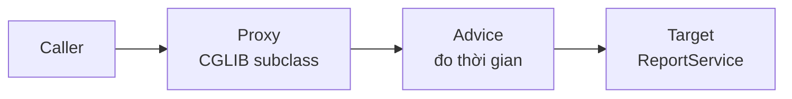
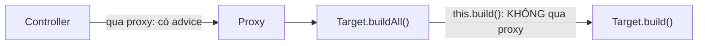
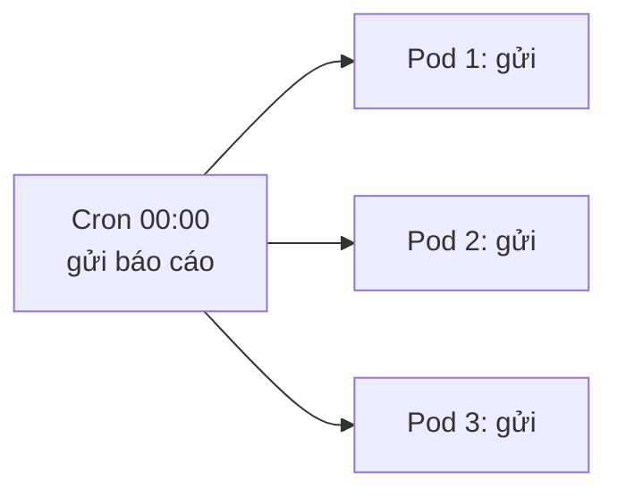

# Exception Handling, Validation & AOP

> **Tuần 4 · Ngày 26** · Thuộc [[04 - Spring Core, Boot & MVC]] · Bài trước: [[04.04 - Spring MVC Request Flow]] · Bài sau: [[05.01 - Transaction Proxy Mechanism]]
> Bài này nối thẳng sang Tuần 5: `@Async`, `@Scheduled`, `@Transactional` đều chạy bằng **proxy**, nên hiểu AOP và bẫy self-invocation hôm nay là đã hiểu một nửa câu "vì sao @Transactional không chạy".
> Mọi JSON, exception message và tên thread trong bài đã được **chạy thử trên Spring Boot 3.5.16 (Hibernate Validator 8), JDK 21**.

**Mục lục**
1. [[#1. Xử lý exception tập trung với ProblemDetail|Xử lý exception tập trung với ProblemDetail]]
2. [[#2. Validation|Validation]]
3. [[#3. Spring AOP và aspect đo thời gian|Spring AOP và aspect đo thời gian]]
4. [[#4. Giới hạn của proxy: self-invocation|Giới hạn của proxy: self-invocation]]
5. [[#5. @Async|@Async]]
6. [[#6. @Scheduled|@Scheduled]]
7. [[#7. Kịch bản Feynman hôm nay|Kịch bản Feynman hôm nay]]

---

## 1. Xử lý exception tập trung với ProblemDetail

### Hiểu bản chất

Không xử lý tập trung thì mỗi controller tự `try/catch`, mỗi API trả lỗi một kiểu, client không biết parse thế nào. `@RestControllerAdvice` gom mọi `@ExceptionHandler` về **một chỗ**, áp dụng cho mọi controller.

`ProblemDetail` (Spring 6) là định dạng lỗi chuẩn theo **RFC 9457** (trước là RFC 7807), gồm các field `type`, `title`, `status`, `detail`, `instance`, cộng thêm field tuỳ ý. Content-Type là `application/problem+json`.

### Code minh hoạ

```java
@RestControllerAdvice
public class GlobalExceptionHandler {

    @ExceptionHandler(OrderNotFoundException.class)
    public ProblemDetail notFound(OrderNotFoundException ex) {
        ProblemDetail pd = ProblemDetail.forStatusAndDetail(HttpStatus.NOT_FOUND,
                ex.getMessage());
        pd.setTitle("Order not found");
        return pd;
    }

    @ExceptionHandler(MethodArgumentNotValidException.class)
    public ProblemDetail invalid(MethodArgumentNotValidException ex) {
        ProblemDetail pd = ProblemDetail.forStatusAndDetail(HttpStatus.BAD_REQUEST,
                "Validation failed");
        pd.setProperty("errors", ex.getBindingResult().getFieldErrors().stream()
                .map(e -> e.getField() + ": " + e.getDefaultMessage()).sorted().toList());
        return pd;
    }
}
```

Response thật cho `GET /orders/0` (404, `application/problem+json`):

```json
{
  "type": "about:blank",
  "title": "Order not found",
  "status": 404,
  "detail": "Order 0 not found",
  "instance": "/orders/0"
}
```

Response thật cho `POST /orders` với body `{"customer":"","quantity":0,"phone":"123"}` (400):

```json
{
  "type": "about:blank",
  "title": "Bad Request",
  "status": 400,
  "detail": "Validation failed",
  "instance": "/orders",
  "errors": [
    "customer: must not be blank",
    "phone: số điện thoại không hợp lệ",
    "quantity: must be greater than or equal to 1"
  ]
}
```

`instance` được Spring tự điền bằng path của request.

### Không có advice thì sao? (đo thực tế)

Cùng request body sai ở trên, **không** có `@RestControllerAdvice`:

| Cấu hình | Status | Body |
|---|---|---|
| Mặc định Boot | 400 | `{"timestamp":...,"status":400,"error":"Bad Request","path":"/orders"}`: **không nói field nào sai** |
| `spring.mvc.problemdetails.enabled=true` | 400 | ProblemDetail với `"detail":"Invalid request content."`: vẫn không có danh sách field |
| Exception tự định nghĩa, không có handler | **500** | `{"status":500,"error":"Internal Server Error",...}` |

Kết luận: bật `problemdetails.enabled` giúp exception **có sẵn** của Spring trả đúng chuẩn, nhưng muốn client biết **field nào sai** và exception nghiệp vụ trả đúng status thì vẫn phải viết advice.

### Bẫy hay gặp

- **Lộ thông tin nội bộ**: trả `ex.getMessage()` của `SQLException` hay stack trace ra client là lỗ hổng bảo mật. Với lỗi không lường trước: log đầy đủ ở server (kèm traceId), trả client một thông điệp chung.
- Thêm một handler `@ExceptionHandler(Exception.class)` làm "lưới cuối", nếu không exception lạ sẽ thành body mặc định 500 của Boot.
- Exception ném ra trong **Filter** (ví dụ Spring Security) không tới advice (xem [[04.04 - Spring MVC Request Flow]]).
- Có thể `extends ResponseEntityExceptionHandler` để kế thừa xử lý chuẩn cho mọi exception của Spring MVC, rồi override method cần tuỳ biến. Khi đó **không** khai báo thêm `@ExceptionHandler(MethodArgumentNotValidException.class)`, nếu không sẽ bị trùng handler.

> **Trả lời mẫu:** "Em xử lý exception tập trung bằng `@RestControllerAdvice`, mỗi loại exception một `@ExceptionHandler`, trả về `ProblemDetail` theo chuẩn RFC 9457 với content-type `application/problem+json`. Exception nghiệp vụ như không tìm thấy order trả 404; `MethodArgumentNotValidException` trả 400 kèm danh sách field lỗi; còn một handler cho `Exception` làm lưới cuối, chỉ trả thông điệp chung và log chi tiết kèm traceId ở server. Em đã thử bỏ advice đi thì body 400 mặc định của Boot không hề nói field nào sai, nên advice là bắt buộc với API cho frontend."

---

## 2. Validation

### Hiểu bản chất

Bean Validation (Jakarta, Hibernate Validator là implementation) cho phép khai báo ràng buộc bằng annotation: `@NotNull`, `@NotBlank`, `@Size`, `@Min`, `@Max`, `@Email`, `@Pattern`, `@Past`, `@Positive`...

| | `@Valid` | `@Validated` |
|---|---|---|
| Thuộc | Jakarta (chuẩn) | Spring |
| Validation groups | Không | **Có** |
| Validate nested object | Có (đặt trên field) | |
| Bật method validation trên class (service) | Không | **Có** (đặt trên class) |

### Exception nào, status nào: đo thực tế

| Validate ở đâu | Exception | Kết quả đo |
|---|---|---|
| `@Valid @RequestBody` | `MethodArgumentNotValidException` | 400 |
| `@RequestParam @Min(0) int page` (không cần `@Validated` trên class, Spring 6.1+) | `HandlerMethodValidationException` | 400, `"detail":"Validation failure"` |
| Service `@Validated` + `find(@NotBlank String email)` | `ConstraintViolationException` | Message: `find.email: must not be blank`. **Không** có handler thì thành **500** |

Hàng cuối hay bị quên: `ConstraintViolationException` từ tầng service không phải exception "web", nên cần handler riêng nếu muốn trả 400.

### Validation groups

Cùng một DTO, khi tạo thì `id` phải `null`, khi sửa thì `id` bắt buộc:

```java
public interface OnUpdate {}

public record UpdateOrderRequest(@NotNull(groups = OnUpdate.class) Long id,
                                 @NotBlank String customer) {}

@PutMapping("/{id}")
public String update(@PathVariable long id,
        @Validated({OnUpdate.class, Default.class}) @RequestBody UpdateOrderRequest req) { }
```

Đo thực tế: `PUT /orders/5` với body `{"customer":"An"}` trả 400, `errors: ["id: must not be null"]`.

Bẫy: khi chỉ định group, các ràng buộc **không có group** (thuộc `Default`) sẽ **không** được kiểm tra, trừ khi bạn liệt kê cả `Default.class` như trên.

### Custom constraint

```java
@Target(ElementType.FIELD) @Retention(RetentionPolicy.RUNTIME)
@Constraint(validatedBy = VnPhoneValidator.class)
public @interface VnPhone {
    String message() default "số điện thoại không hợp lệ";
    Class<?>[] groups() default {};
    Class<? extends Payload>[] payload() default {};
}

public class VnPhoneValidator implements ConstraintValidator<VnPhone, String> {
    @Override
    public boolean isValid(String value, ConstraintValidatorContext ctx) {
        return value == null || value.matches("0\\d{9}");   // null để @NotNull lo
    }
}
```

Đo được: `phone: "123"` cho lỗi `phone: số điện thoại không hợp lệ` (xem JSON ở mục 1).

Quy ước: validator trả `true` khi giá trị `null`, để việc "bắt buộc có" tách riêng cho `@NotNull`. Ba thuộc tính `message`, `groups`, `payload` là **bắt buộc** theo spec.

### Bẫy hay gặp

- Quên `@Valid` trước `@RequestBody`: annotation trên DTO **không có tác dụng gì**.
- Object lồng nhau (`List<OrderItemRequest> items`) cần `@Valid` trên field thì mới validate bên trong.
- `@NotNull` vs `@NotEmpty` vs `@NotBlank`: `""` qua được `@NotNull`; `"  "` qua được `@NotEmpty`; chỉ `@NotBlank` chặn cả hai.

> **Trả lời mẫu:** "Em đặt `@Valid` trước `@RequestBody`, lỗi sẽ ném `MethodArgumentNotValidException` và em trả 400 kèm danh sách field. `@Validated` là của Spring, khác `@Valid` ở chỗ hỗ trợ validation groups, ví dụ `id` bắt buộc khi update nhưng không khi create, và đặt trên class service để validate tham số method, lỗi là `ConstraintViolationException`. Từ Spring 6.1 thì `@RequestParam` có `@Min` được validate luôn mà không cần `@Validated` trên controller. Ràng buộc riêng như số điện thoại Việt Nam thì em viết custom annotation cộng `ConstraintValidator`."

### Câu hỏi xoáy

**Q1.** Service có `@Validated`, gọi `find(" ")` từ controller thì client nhận status gì nếu không có handler?
> [!success]- Gợi ý trả lời
> Đo thực tế: `ConstraintViolationException: find.email: must not be blank`, không có handler thì thành **500**. Cần thêm `@ExceptionHandler(ConstraintViolationException.class)` trả 400. Method validation trên service cũng dựa vào **proxy**, nên gọi nội bộ trong cùng class sẽ không validate.

**Q2.** Validate ở controller rồi, có cần validate ở service hay DB không?
> [!success]- Gợi ý trả lời
> Có, theo nhiều lớp: controller chặn input sai định dạng; service kiểm tra **quy tắc nghiệp vụ** (tồn kho đủ không, trạng thái order cho phép huỷ không); DB có constraint (`NOT NULL`, `UNIQUE`) là lớp bảo vệ cuối, vì service có thể được gọi từ nơi khác (Kafka consumer, job).

---

## 3. Spring AOP và aspect đo thời gian

### Hiểu bản chất

AOP tách **cross-cutting concern** (việc lặp lại ở nhiều nơi: log, transaction, security, cache, đo thời gian) ra khỏi code nghiệp vụ.

| Thuật ngữ | Nghĩa | Ví dụ |
|---|---|---|
| **Aspect** | Module chứa logic chung | `TimingAspect` |
| **Advice** | Đoạn code chạy và thời điểm chạy | `@Before`, `@AfterReturning`, `@AfterThrowing`, `@After`, `@Around` |
| **Pointcut** | Biểu thức chọn method | `execution(* com.shop..service..*(..))`, `@annotation(com.shop.Timed)` |
| **JoinPoint** | Điểm thực thi được chặn | Với Spring AOP: luôn là **lời gọi method** |
| **Target** | Object gốc bị bọc | `ReportService` |
| **Proxy** | Object bọc ngoài target | `ReportService$$SpringCGLIB$$0` |



Spring AOP dựa trên **proxy lúc runtime**, tạo ở bước `postProcessAfterInitialization` ([[04.02 - Bean Scope & Lifecycle]]). Có 2 loại: **JDK dynamic proxy** (khi bean implement interface và cấu hình cho phép) và **CGLIB** (subclass; Boot mặc định dùng CGLIB). AspectJ thì khác: **weave vào bytecode** lúc compile hoặc load, chặn được cả constructor, field, method private và self-call.

### Code minh hoạ

```java
@Target(ElementType.METHOD) @Retention(RetentionPolicy.RUNTIME)
public @interface Timed {}

@Aspect
@Component
@Slf4j
public class TimingAspect {
    @Around("@annotation(com.shop.Timed)")
    public Object time(ProceedingJoinPoint pjp) throws Throwable {
        long start = System.nanoTime();
        try {
            return pjp.proceed();                         // gọi method thật
        } finally {
            log.info("{} took {} ms", pjp.getSignature().toShortString(),
                    (System.nanoTime() - start) / 1_000_000);
        }
    }
}

@Service
public class ReportService {
    @Timed public void build() throws InterruptedException { Thread.sleep(50); }
}
```

Output thật khi gọi `reportService.build()` từ bean khác: `TIMING ReportService.build() took 62 ms`. Bean lấy từ context có class `ReportService$$SpringCGLIB$$0`.

### Bẫy hay gặp

- `@Around` mà quên `return pjp.proceed()` thì method thật **không chạy** hoặc caller nhận `null`.
- Bắt exception trong `@Around` rồi không ném lại là **nuốt lỗi**; `@Transactional` phía ngoài sẽ không rollback.
- Đo bằng `finally` để vẫn ghi được thời gian khi method ném exception.

---

## 4. Giới hạn của proxy: self-invocation

### Hiểu bản chất

Proxy chỉ chặn được lời gọi **đi từ bên ngoài, qua proxy**. Khi method trong class gọi method khác của **chính nó**, lời gọi đi qua `this`, tức là object gốc, **bỏ qua proxy**.



### Code minh hoạ

```java
public void buildAll() throws InterruptedException { build(); }   // gọi nội bộ
```

| Lời gọi | Có dòng `TIMING` không? |
|---|---|
| `reportService.build()` từ bên ngoài | **Có**: `took 62 ms` |
| `reportService.buildAll()` (bên trong gọi `build()`) | **Không** (đo thực tế: không có dòng nào) |

### Những trường hợp proxy không chặn được

| Trường hợp | Vì sao |
|---|---|
| Self-invocation (`this.method()`) | Không đi qua proxy |
| Method `private` | Subclass CGLIB không override được |
| Method `final`, class `final` | Không override/subclass được |
| Object tự `new`, không phải bean | Không có proxy nào cả |
| Gọi trong `@PostConstruct` của chính bean | Proxy chưa được tạo, `this` là object gốc |

Vì `@Transactional`, `@Async`, `@Cacheable`, `@Retryable`, `@PreAuthorize`, method validation đều chạy bằng proxy, **tất cả chung những điểm yếu này**.

**Cách sửa:** tách method sang bean khác (tốt nhất); hoặc inject chính mình bằng `@Lazy` / `ObjectProvider` (chạy được nhưng khó đọc); hoặc dùng AspectJ weaving (hiếm khi đáng).

> **Trả lời mẫu:** "Spring AOP chạy bằng proxy, nên chỉ chặn lời gọi từ bên ngoài đi qua proxy tới method public. Gọi nội bộ `this.method()`, method private hay final, object tự `new` đều không được chặn. Em đã thử: aspect đo thời gian in ra khi gọi `build()` từ ngoài, nhưng gọi `buildAll()` mà bên trong gọi `build()` thì không in gì. Điều này áp dụng cho mọi annotation dựa trên proxy như `@Transactional`, `@Async`, `@Cacheable`. Cách sửa của em là tách method sang một bean khác."

### Câu hỏi xoáy

**Q1.** AspectJ khác Spring AOP thế nào? Khi nào cần AspectJ?
> [!success]- Gợi ý trả lời
> Spring AOP: proxy lúc runtime, chỉ chặn được lời gọi method public của bean qua proxy, đơn giản, đủ cho đa số nhu cầu. AspectJ: sửa bytecode (compile-time hoặc load-time weaving), chặn được self-call, method private, constructor, truy cập field, nhưng cấu hình build phức tạp hơn. Thực tế hiếm khi cần AspectJ; tách bean là đủ.

---

## 5. @Async

### Hiểu bản chất

`@Async` (cần `@EnableAsync`) làm method chạy trên **thread khác**, caller không phải chờ. Nó cũng dựa trên proxy: proxy nhận lời gọi, submit vào executor, trả về ngay.

### Code minh hoạ: đo thực tế

```java
@Async public void sendMail(String to) { log(to + " MDC=" + MDC.get("traceId")); }
public void placeOrder() { log("placeOrder"); sendMail("self@x"); }      // self-invocation
@Async public CompletableFuture<String> compute() { ... }
@Async public void boom() { throw new IllegalStateException("mail server down"); }
```

Caller đặt `MDC.put("traceId", "abc-123")` rồi gọi lần lượt. Output thật (tên thread trong ngoặc vuông):

| Lời gọi | Output |
|---|---|
| `sendMail("outside@x")` từ bean khác | `[task-1] sendMail to outside@x MDC=null` |
| `placeOrder()` gọi nội bộ `sendMail` | `[main] sendMail to self@x MDC=abc-123`: **chạy đồng bộ** trên thread gọi |
| `compute().get()` | Chạy trên `task-2` |
| `boom()` (void, ném exception) | Caller không biết gì; `AsyncUncaughtExceptionHandler` in `[task-3] ... caught: mail server down in boom` |
| `sendMail` khi có bean `TaskDecorator` copy MDC | `[task-1] sendMail to decorated@x MDC=abc-123` |

Bốn bài học từ bảng trên:
1. **Self-invocation**: `@Async` mất tác dụng, method chạy trên thread `main`.
2. **Mất context**: MDC, `SecurityContext`, transaction đều gắn với ThreadLocal của thread gốc, sang `task-1` thì **mất** (`MDC=null`).
3. **Exception của method `void` không về caller**: phải cấu hình `AsyncUncaughtExceptionHandler`. Method trả `CompletableFuture` thì exception nằm trong future.
4. **`TaskDecorator`** sửa được vấn đề 2: copy context sang thread mới trước khi chạy task, dọn sau khi xong.

### Executor mặc định: đo thực tế

Boot 3.5 tự tạo bean `applicationTaskExecutor`:

| Thuộc tính | Giá trị đo được |
|---|---|
| Kiểu | `ThreadPoolTaskExecutor` |
| `corePoolSize` | 8 |
| `maxPoolSize` | 2147483647 |
| `queueCapacity` | 2147483647 (gần như không giới hạn) |
| Tiền tố tên thread | `task-` |

Queue không giới hạn nghĩa là khi tải cao, task **xếp hàng vô tận** (tốn RAM, độ trễ tăng) và pool không bao giờ vượt quá 8 thread. Production nên tự cấu hình:

```java
@Configuration
@EnableAsync
public class AsyncConfig implements AsyncConfigurer {
    @Override
    public Executor getAsyncExecutor() {
        ThreadPoolTaskExecutor ex = new ThreadPoolTaskExecutor();
        ex.setCorePoolSize(4);
        ex.setMaxPoolSize(16);
        ex.setQueueCapacity(500);
        ex.setThreadNamePrefix("mail-");
        ex.setTaskDecorator(new MdcTaskDecorator());
        ex.setRejectedExecutionHandler(new ThreadPoolExecutor.CallerRunsPolicy());
        ex.initialize();
        return ex;
    }

    @Override
    public AsyncUncaughtExceptionHandler getAsyncUncaughtExceptionHandler() {
        return (e, method, params) -> log.error("Async {} failed", method.getName(), e);
    }
}
```

Hoặc chỉ chỉnh qua yml: `spring.task.execution.pool.core-size`, `max-size`, `queue-capacity`, `thread-name-prefix`.

```java
public class MdcTaskDecorator implements TaskDecorator {
    @Override
    public Runnable decorate(Runnable task) {
        Map<String, String> ctx = MDC.getCopyOfContextMap();   // chạy trên thread GỌI
        return () -> {
            if (ctx != null) MDC.setContextMap(ctx);           // chạy trên thread POOL
            try { task.run(); } finally { MDC.clear(); }
        };
    }
}
```

### Bẫy hay gặp

- Method `@Async` **trong cùng transaction**: thread mới không có transaction của caller. Gửi mail sau khi lưu order thì nên dùng `@TransactionalEventListener(phase = AFTER_COMMIT)` để chắc dữ liệu đã commit.
- `@Async` trên method `private` hoặc gọi nội bộ: chạy đồng bộ, không báo lỗi gì.

> **Trả lời mẫu:** "`@Async` chạy method trên thread của executor thông qua proxy, nên cũng dính self-invocation: em đã thử gọi nội bộ thì method chạy luôn trên thread `main`. Executor mặc định của Boot có 8 core thread và queue gần như vô hạn, nên em tự cấu hình `ThreadPoolTaskExecutor` với queue giới hạn, tên thread rõ ràng và rejection policy. Exception của method `void` không về caller nên em cấu hình `AsyncUncaughtExceptionHandler`. Và vì MDC, SecurityContext, transaction gắn với ThreadLocal nên sang thread mới là mất; em dùng `TaskDecorator` để copy MDC, đã thử thấy traceId từ `null` thành có giá trị."

### Câu hỏi xoáy

**Q1.** `@Async` method trả về gì thì caller lấy được kết quả?
> [!success]- Gợi ý trả lời
> `CompletableFuture<T>` (hoặc `Future<T>`), hoặc `void` nếu không cần kết quả. Nhiều tài liệu cũ nói "trả `String` thì caller nhận `null`", nhưng đo thực tế trên Spring 6.2 thì lời gọi ném ngay `IllegalArgumentException: Invalid return type for async method (only Future and void supported): class java.lang.String`.

**Q2.** Muốn `SecurityContext` có trong thread async thì làm sao?
> [!success]- Gợi ý trả lời
> Bọc executor bằng `DelegatingSecurityContextAsyncTaskExecutor`, hoặc viết `TaskDecorator` copy `SecurityContextHolder.getContext()`. Cách hoạt động giống `MdcTaskDecorator`.

---

## 6. @Scheduled

### Hiểu bản chất

`@Scheduled` (cần `@EnableScheduling`) chạy method theo lịch: `fixedRate` (cách nhau N ms tính từ lúc **bắt đầu** lần trước), `fixedDelay` (N ms tính từ lúc **kết thúc** lần trước), `cron`.

### Code minh hoạ: 1 thread mặc định

Hai job: `fast` chạy mỗi 200 ms; `slow` ngủ 1000 ms.

| | Pool mặc định | `spring.task.scheduling.pool.size=4` |
|---|---|---|
| Thread chạy job | Mọi job trên **`scheduling-1`** | `scheduling-1`, `scheduling-2`, `scheduling-3` |
| `fast` trong lúc `slow` chạy 1000 ms | **0 lần**: bị chặn hoàn toàn | 5 lần, đều đặn mỗi ~200 ms trên `scheduling-3` |
| Ngay khi `slow` xong | 5 lần `fast` chạy dồn trong ~1 ms để "bù" | Bình thường |

Một job chậm làm **trễ mọi job khác**, và `fixedRate` còn gây chạy dồn khi được giải phóng. Tăng `spring.task.scheduling.pool.size` hoặc tự khai báo `ThreadPoolTaskScheduler`.

### Chạy nhiều instance



Scale lên 3 pod thì **mỗi pod đều chạy job**: khách nhận 3 email, đơn bị xử lý 3 lần. `@Scheduled` không biết gì về các instance khác.

Cách xử lý:
- **ShedLock**: trước khi chạy, job ghi một bản ghi lock vào DB/Redis (`lockAtMostFor` để tự nhả nếu pod chết). Pod nào giành được lock mới chạy.

```java
@Scheduled(cron = "0 0 0 * * *")
@SchedulerLock(name = "dailyReport", lockAtMostFor = "10m", lockAtLeastFor = "1m")
public void dailyReport() { ... }
```

- Tách job ra một service/worker riêng chỉ chạy 1 replica, hoặc dùng Kubernetes CronJob, Quartz cluster mode.
- Dù có lock, job nên **idempotent** (chạy lại không gây hại), vì lock có thể hết hạn khi job chạy quá lâu.

> **Trả lời mẫu:** "`@Scheduled` mặc định chỉ có một thread `scheduling-1`, nên một job chậm chặn mọi job khác; em đã thử job 1 giây làm job 200 ms đứng im rồi chạy dồn 5 lần. Em tăng `spring.task.scheduling.pool.size`. Vấn đề lớn hơn là chạy nhiều instance thì job chạy trùng ở mọi pod, nên em dùng ShedLock lưu lock trong DB, kèm `lockAtMostFor` để tự nhả khi pod chết, và viết job idempotent."

### Câu hỏi xoáy

**Q1.** `@Scheduled` job chạy trên 3 instance thì sao? Scheduler mặc định có bao nhiêu thread?
> [!success]- Gợi ý trả lời
> Job chạy **3 lần**, mỗi instance một lần. Khắc phục bằng ShedLock hoặc distributed lock. Scheduler mặc định có **1 thread** (đo được: `scheduling-1`).

**Q2.** `fixedRate` vs `fixedDelay` khác nhau khi job chạy lâu hơn chu kỳ?
> [!success]- Gợi ý trả lời
> Với một thread, `fixedRate` không chạy chồng lên nhau, nhưng các lần bị lỡ sẽ chạy **dồn ngay** sau khi lần trước xong (đo được 5 lần trong ~1 ms). `fixedDelay` luôn chờ đủ N ms **sau khi xong**, nên không bao giờ dồn. Job đồng bộ dữ liệu thường hợp `fixedDelay` hơn.

---

## 7. Kịch bản Feynman hôm nay

1. Viết lại `@RestControllerAdvice` có 3 handler (404 nghiệp vụ, 400 validation, 500 lưới cuối) mà không nhìn bài, rồi giải thích vì sao không trả `ex.getMessage()` của lỗi lạ ra client.
2. Vẽ sơ đồ proxy và giải thích self-invocation bằng ví dụ `buildAll()` gọi `build()`. Kể 5 annotation dính cùng bẫy.
3. Nói trong 90 giây về 4 bẫy của `@Async`: self-invocation, executor mặc định, exception của `void`, mất MDC/SecurityContext.
4. Giải thích cho một bạn mới vì sao scale lên 3 pod thì khách nhận 3 email, và ShedLock giải quyết thế nào.

Ghi vào [[08 - Nhật ký học tập]].

## Tự kiểm tra nhanh (không mở tài liệu)

- [ ] Các field của `ProblemDetail`; content-type của nó
- [ ] Body sai với `@Valid @RequestBody`: exception gì, status gì?
- [ ] `@Valid` vs `@Validated`; khi dùng group thì ràng buộc `Default` có chạy không?
- [ ] `ConstraintViolationException` từ service không có handler thì status gì?
- [ ] Aspect, Advice, Pointcut, JoinPoint là gì?
- [ ] 5 trường hợp proxy không chặn được
- [ ] Executor mặc định của `@Async` trong Boot: core size, queue capacity
- [ ] Scheduler mặc định có mấy thread? Chạy 3 instance thì sao?
