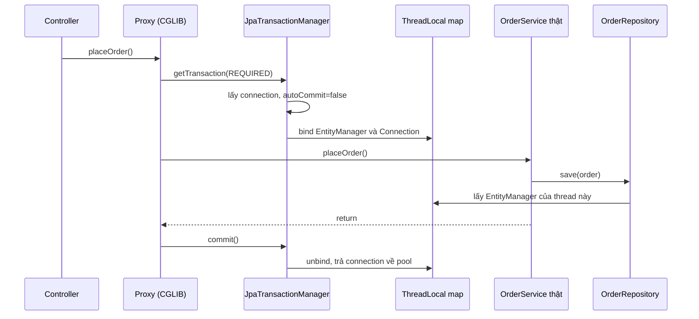

# Transaction Proxy Mechanism

> **Tuần 5 · Ngày 29** · Thuộc [[05 - Transaction & JPA]] · Bài trước: [[04.05 - Exception Handling, Validation & AOP]] · Bài sau: [[05.02 - Khi @Transactional không hoạt động]]
> "@Transactional hoạt động thế nào?" là câu mở màn cho cả chuỗi câu hỏi về transaction. Trả lời được cơ chế proxy và ThreadLocal thì các câu sau (self-invocation, propagation, @Async) đều tự suy ra được.
> Mọi output trong bài đã được **đo thực tế** bằng test `@SpringBootTest` trên Spring Boot 3.5.16 (Spring 6.2, Hibernate 6.6, H2 2.3), JDK 21.

**Mục lục**
1. [[#1. Transaction là gì: bắt đầu từ JDBC autocommit|Transaction là gì: bắt đầu từ JDBC autocommit]]
2. [[#2. Annotation chỉ là metadata, proxy mới làm việc|Annotation chỉ là metadata, proxy mới làm việc]]
3. [[#3. CGLIB vs JDK dynamic proxy|CGLIB vs JDK dynamic proxy]]
4. [[#4. TransactionInterceptor chạy từng bước|TransactionInterceptor chạy từng bước]]
5. [[#5. PlatformTransactionManager|PlatformTransactionManager]]
6. [[#6. ThreadLocal: vì sao mọi repository dùng chung một transaction|ThreadLocal: vì sao mọi repository dùng chung một transaction]]
7. [[#7. Trả lời mẫu tổng hợp|Trả lời mẫu tổng hợp]]
8. [[#8. Kịch bản Feynman hôm nay|Kịch bản Feynman hôm nay]]

---

## 1. Transaction là gì: bắt đầu từ JDBC autocommit

### Hiểu bản chất
Transaction là một nhóm thao tác DB **thành công cùng nhau hoặc thất bại cùng nhau** (ACID: Atomicity, Consistency, Isolation, Durability). Ví dụ chuyển tiền: trừ tài khoản A và cộng tài khoản B phải đi liền một khối.

Ở tầng thấp nhất, Java nói chuyện với DB qua JDBC `Connection`. Mặc định connection ở chế độ **autocommit = true**: **mỗi câu SQL là một transaction riêng**, chạy xong là commit luôn. Muốn gom nhiều câu thành một khối thì phải tự làm 3 việc:

1. `connection.setAutoCommit(false)`
2. Chạy các câu SQL
3. `commit()` nếu ổn, `rollback()` nếu lỗi

`@Transactional` thực chất chỉ là **Spring làm hộ 3 bước này** cho bạn, ở ngoài method của bạn.

### Code minh hoạ

```java
try (Connection c = dataSource.getConnection()) {          // autocommit mặc định
    var st = c.createStatement();
    st.executeUpdate("insert into acct values (1, 100)");  // commit ngay
    st.executeUpdate("insert into acct values (1, 200)");  // trùng khoá chính → lỗi
}
// Cách 2: tự quản lý transaction
try (Connection c = dataSource.getConnection()) {
    c.setAutoCommit(false);
    var st = c.createStatement();
    try {
        st.executeUpdate("insert into acct values (1, 100)");
        st.executeUpdate("insert into acct values (1, 200)");
        c.commit();
    } catch (SQLException e) {
        c.rollback();
    }
}
```

Kết quả đo được (H2, connection lấy từ HikariCP):

| Cách chạy | `getAutoCommit()` | Câu 2 lỗi | Số dòng còn lại |
|---|---|---|---|
| Autocommit mặc định | `true` | `JdbcSQLIntegrityConstraintViolationException` | **1** (câu 1 đã commit, dữ liệu "nửa vời") |
| `setAutoCommit(false)` + `rollback()` | `false` | như trên | **0** |

### Bẫy hay gặp
- Nghĩ rằng "không có `@Transactional` thì không có transaction". Thực ra **vẫn có**, nhưng mỗi câu SQL là một transaction riêng. Lỗi ở giữa method sẽ để lại dữ liệu nửa vời.
- Spring Data JPA: các method của `SimpleJpaRepository` (`save`, `findById`...) **tự có `@Transactional`** riêng. Vì vậy gọi `repo.save()` ở service không có annotation vẫn lưu được, nhưng mỗi lần `save` là một transaction độc lập.

---

## 2. Annotation chỉ là metadata, proxy mới làm việc

### Hiểu bản chất
Bản thân `@Transactional` **không chứa code nào**. Nó chỉ là một "nhãn dán" ghi lại cấu hình: propagation, isolation, readOnly, timeout, rollbackFor...

Người thực sự làm việc là **proxy**. Lúc khởi động, Spring thấy bean có method gắn `@Transactional`, nên thay vì đưa bean thật cho người khác inject, Spring đưa một **object đại diện** (proxy) bọc bên ngoài. Mọi lời gọi từ bên ngoài đi vào proxy trước, proxy mở transaction rồi mới gọi xuống object thật.

Ví von: proxy giống **lễ tân khách sạn**. Khách (controller) không đi thẳng vào phòng (service thật); lễ tân làm thủ tục (mở transaction), dẫn khách vào, khách ra thì lễ tân làm thủ tục trả phòng (commit hoặc rollback).

### Code minh hoạ

```java
@Autowired ProbeService probe;      // ProbeService có method @Transactional

probe.getClass().getName();         // class thật sự được inject
AopUtils.isCglibProxy(probe);
AopUtils.getTargetClass(probe);     // class gốc nằm phía sau proxy
((Advised) svc).getAdvisors();      // proxy gắn những "lớp xử lý" nào
```

Đo được:

| Kiểm tra | Kết quả |
|---|---|
| Class được inject | `demo.ProbeService$$SpringCGLIB$$1` |
| `isCglibProxy` | `true` |
| Target class | `demo.ProbeService` |
| Advisor | `BeanFactoryTransactionAttributeSourceAdvisor` |
| Advice bên trong advisor | `org.springframework.transaction.interceptor.TransactionInterceptor` |

Thứ bạn inject vào controller **không phải** `ProbeService`, mà là một subclass do Spring sinh ra lúc runtime (`$$SpringCGLIB$$`). Bên trong proxy có đúng một advisor, và advice của nó chính là `TransactionInterceptor`.

### Bẫy hay gặp
- `@Transactional` chỉ có tác dụng khi lời gọi **đi qua proxy**. Lời gọi `this.method()` bên trong class đi thẳng vào object thật, không qua lễ tân. Đây là gốc rễ của self-invocation (bài [[05.02 - Khi @Transactional không hoạt động]]).
- Cùng cơ chế proxy này được dùng cho `@Async`, `@Cacheable`, `@PreAuthorize`, `@Retryable`. Hiểu một cái là hiểu cả nhóm (xem lại AOP ở [[04.05 - Exception Handling, Validation & AOP]]).

> **Trả lời mẫu:** "@Transactional chỉ là metadata. Lúc khởi động, Spring tạo một AOP proxy bọc bean có annotation đó. Em đã in class của bean được inject và thấy nó là `OrderService$$SpringCGLIB$$`, bên trong có advisor mà advice là `TransactionInterceptor`. Khi controller gọi method, lời gọi vào proxy trước, interceptor mở transaction, gọi method thật, rồi commit hoặc rollback. Vì vậy chỉ lời gọi đi qua proxy mới có transaction."

### Câu hỏi xoáy

**Q1.** Nếu bỏ `@EnableTransactionManagement` thì `@Transactional` còn chạy trong Spring Boot không?
> [!success]- Gợi ý trả lời
> Vẫn chạy. Spring Boot có `TransactionAutoConfiguration` tự bật quản lý transaction khi có `PlatformTransactionManager` trong context (bài auto-configuration ở Tuần 4). Trong Spring thuần (không Boot) thì phải tự khai báo `@EnableTransactionManagement`.

**Q2.** Đặt `@Transactional` ở class và ở method khác nhau thế nào?
> [!success]- Gợi ý trả lời
> Ở class: áp dụng cho mọi method public của class đó. Ở method: ghi đè cấu hình của class. Pattern phổ biến: class `@Transactional(readOnly = true)`, method ghi thì gắn `@Transactional` thường (bài [[05.04 - Isolation & readOnly]]).

---

## 3. CGLIB vs JDK dynamic proxy

### Hiểu bản chất

| | JDK dynamic proxy | CGLIB proxy |
|---|---|---|
| Cách tạo | Tạo class mới **implement cùng interface** | Tạo **subclass** của class gốc |
| Điều kiện | Bean phải có interface | Class không được `final` |
| Proxy được method nào | Chỉ method khai báo trong interface | Mọi method override được (không `final`, không `private`) |
| Inject theo class impl | **Không được** | Được |
| Mặc định Spring Boot | Không | **Có** (`spring.aop.proxy-target-class=true` từ Boot 2.0) |

Vì sao Boot chọn CGLIB làm mặc định? Vì với JDK proxy, nếu ai đó inject theo **class cụ thể** (`@Autowired OrderServiceImpl`) thì app không khởi động được. CGLIB là subclass nên inject theo class hay interface đều được.

### Code minh hoạ

Chạy lại test với `@SpringBootTest(properties = "spring.aop.proxy-target-class=false")`:

```java
interface PaymentService { String pay(); }

@Service
class PaymentServiceImpl implements PaymentService {
    @Transactional public String pay() { return Tx.info(); }
}
```

| Kiểm tra | Kết quả đo được |
|---|---|
| Class của `PaymentService` được inject | `demo.$Proxy149` (JDK proxy) |
| `payment.pay()` | `active=true name=demo.PaymentServiceImpl.pay` |
| `ProbeService` (không có interface) | vẫn là `demo.ProbeService$$SpringCGLIB$$1` |
| `ctx.getBean(PaymentServiceImpl.class)` | `NoSuchBeanDefinitionException: No qualifying bean of type 'demo.PaymentServiceImpl' available` |

Hai điều rút ra:
- Kể cả khi tắt CGLIB, class **không có interface** vẫn được Spring dùng CGLIB (không còn cách nào khác).
- Bean đã bị bọc bằng JDK proxy thì **không còn là kiểu `PaymentServiceImpl`** nữa, nên lấy theo class impl sẽ lỗi.

Một chi tiết hay: **repository của Spring Data luôn là JDK proxy**, vì bạn chỉ khai báo interface. Đo được: class của `ItemRepo` là `demo.$Proxy116`, `isJdkDynamicProxy = true`.

### Bẫy hay gặp
- CGLIB tạo subclass nên **không override được method `final`** và không gọi được method `private` từ ngoài. Hậu quả đo cụ thể ở bài 05.02.
- CGLIB proxy là một **object riêng**, field của nó **không được inject** (đo được: gọi method `final` trên proxy thì field `repo` bằng `null`).
- Từ Spring 4, CGLIB dùng Objenesis nên **constructor của class gốc không bị gọi hai lần** khi tạo proxy.

### Câu hỏi xoáy

**Q1.** Service của em có interface, vậy Spring Boot dùng proxy nào?
> [!success]- Gợi ý trả lời
> Vẫn là **CGLIB**, vì Spring Boot đặt `proxy-target-class=true` mặc định, không quan tâm có interface hay không. Chỉ khi đặt `spring.aop.proxy-target-class=false` thì bean có interface mới dùng JDK proxy.

**Q2.** Có nên đặt `@Transactional` trên interface không?
> [!success]- Gợi ý trả lời
> Tài liệu Spring khuyên đặt trên **class implement** (hoặc method của class). Lý do: annotation trên interface từng chỉ có tác dụng với JDK proxy, và đặt trên class thì người đọc service thấy ngay ranh giới transaction. Trong bài này em chỉ đo trường hợp đặt trên class.

---

## 4. TransactionInterceptor chạy từng bước

### Hiểu bản chất
Khi lời gọi vào proxy, `TransactionInterceptor.invoke()` làm theo thứ tự:

1. **Đọc metadata**: tìm `@Transactional` của method (hoặc class), ra một `TransactionAttribute` gồm propagation, isolation, readOnly, timeout, rollback rules.
2. **Gọi `PlatformTransactionManager.getTransaction(...)`**: tuỳ propagation mà tạo transaction mới, tham gia transaction đang có, hoặc tạm dừng transaction cũ.
3. **Bind tài nguyên vào ThreadLocal** (mục 6).
4. **Gọi method thật** của bạn.
5. **Kết thúc**:
   - Method trả về bình thường: `commit()`.
   - Method ném exception: hỏi rollback rules. `RuntimeException` hoặc `Error` thì `rollback()`; checked exception thì **vẫn `commit()`** (bẫy lớn, bài 05.02).
6. **Dọn dẹp**: unbind khỏi ThreadLocal, trả connection về pool.

### Code minh hoạ: đọc log thật của transaction manager

Bật log trong `application.yml`:

```yaml
logging:
  level:
    org.springframework.orm.jpa.JpaTransactionManager: DEBUG
```

Log đo được khi gọi `probe.inTx()`:

```text
Creating new transaction with name [demo.ProbeService.inTx]:
    PROPAGATION_REQUIRED,ISOLATION_DEFAULT
Opened new EntityManager [SessionImpl(...)] for JPA transaction
Exposing JPA transaction as JDBC [...HibernateJpaDialect$HibernateConnectionHandle@...]
Initiating transaction commit
Committing JPA transaction on EntityManager [SessionImpl(...)]
```

Đọc từng dòng:
- Dòng 1: interceptor đã đọc metadata, tên transaction mặc định là `TênClass.tênMethod`, propagation và isolation mặc định.
- `Opened new EntityManager`: JPA mở persistence context mới cho transaction này.
- `Exposing JPA transaction as JDBC`: connection JDBC bên dưới được chia sẻ, nên `JdbcTemplate` trong cùng method cũng chạy chung transaction.
- `Initiating transaction commit` rồi `Committing`: method trả về bình thường nên commit.

Với `rollbackFor`, log in luôn rollback rule: `PROPAGATION_REQUIRED,ISOLATION_DEFAULT,-java.lang.Exception` (dấu `-` nghĩa là "rollback khi gặp"), còn `noRollbackFor` in dấu `+`.

### Bẫy hay gặp
- Interceptor chỉ "nhìn thấy" exception **ném ra khỏi method**. Bạn `catch` rồi nuốt mất thì nó coi như thành công và commit.
- Bật log DEBUG của `JpaTransactionManager` là cách nhanh nhất để debug "vì sao không rollback". Thấy dòng `Creating new transaction` hay không là biết proxy có chạy hay không.

> **Trả lời mẫu:** "Khi gọi vào proxy, `TransactionInterceptor` đọc thuộc tính của `@Transactional`, gọi `PlatformTransactionManager.getTransaction` để mở hoặc tham gia transaction, bind connection vào ThreadLocal, gọi method thật, rồi dựa vào kết quả để commit hay rollback: mặc định rollback với RuntimeException và Error, commit với checked exception. Ở dự án, khi nghi transaction không chạy, em bật log DEBUG của `JpaTransactionManager` và tìm dòng `Creating new transaction with name`."

### Câu hỏi xoáy

**Q1.** `getTransaction()` có luôn mở transaction mới không?
> [!success]- Gợi ý trả lời
> Không. Nó xem propagation và xem thread hiện tại đã có transaction chưa. Với `REQUIRED` mà đã có thì log in `Participating in existing transaction`, tức là chỉ tham gia, không mở mới. Chi tiết ở [[05.03 - Propagation]].

---

## 5. PlatformTransactionManager

### Hiểu bản chất
Spring không tự biết commit thế nào cho từng công nghệ. Nó định nghĩa interface chung `PlatformTransactionManager` với 3 method: `getTransaction`, `commit`, `rollback`. Mỗi công nghệ có một implementation:

| Implementation | Dùng khi | Thứ được bind vào thread |
|---|---|---|
| `DataSourceTransactionManager` (`JdbcTransactionManager`) | JDBC thuần, `JdbcTemplate`, MyBatis | `ConnectionHolder` |
| `JpaTransactionManager` | Spring Data JPA, Hibernate | `EntityManagerHolder` **và** `ConnectionHolder` |
| `JtaTransactionManager` | Transaction phân tán nhiều tài nguyên (XA) | Do JTA quản lý |
| `R2dbcTransactionManager` (reactive) | WebFlux + R2DBC | Lưu trong Reactor Context, **không** ThreadLocal |

Spring Boot tự tạo bean phù hợp. Đo được trong project có `spring-boot-starter-data-jpa`: bean là `org.springframework.orm.jpa.JpaTransactionManager`, DataSource là `com.zaxxer.hikari.HikariDataSource`.

Đây chính là **Strategy pattern**: `TransactionInterceptor` chỉ nói chuyện với interface, nên code của bạn không đổi khi chuyển từ JDBC sang JPA.

### Bẫy hay gặp
- Project có **2 DataSource** (ví dụ DB chính và DB báo cáo) thì có 2 transaction manager. `@Transactional` không ghi tên sẽ dùng bean `@Primary`. Ghi vào DB thứ hai mà quên `@Transactional(transactionManager = "reportTm")` thì thao tác đó **không nằm trong transaction** bạn nghĩ.

---

## 6. ThreadLocal: vì sao mọi repository dùng chung một transaction

### Hiểu bản chất
Service gọi `orderRepo.save()`, `stockRepo.save()`, `jdbcTemplate.update()`. Ba object khác nhau, không ai truyền connection cho ai, vậy làm sao chúng dùng chung một transaction?

Câu trả lời: `TransactionSynchronizationManager` giữ một **`ThreadLocal<Map>`**. Khi mở transaction, transaction manager bỏ connection (và EntityManager) vào map của **thread hiện tại**. Repository nào chạy sau đó trên cùng thread thì tra map này và lấy ra đúng connection đó.

Ví von: ThreadLocal giống **ngăn tủ riêng của từng nhân viên**. Request A và request B chạy trên 2 thread khác nhau nên có 2 ngăn tủ riêng, không lẫn connection của nhau.



### Code minh hoạ

```java
transactionTemplate.executeWithoutResult(s -> {
    TransactionSynchronizationManager.getResourceMap()
        .forEach((k, v) -> print(k.getClass().getSimpleName()
                + " -> " + v.getClass().getSimpleName()));
    print(jdbc.execute((ConnectionCallback<Boolean>) Connection::getAutoCommit));
    print(hikari.getHikariPoolMXBean().getActiveConnections());
});
print(TransactionSynchronizationManager.getResourceMap().size());   // sau transaction
```

| Thời điểm | Kết quả đo được |
|---|---|
| Gọi method không qua transaction | `isActualTransactionActive() = false` |
| Gọi `@Transactional` qua proxy | `active=true name=demo.ProbeService.inTx` |
| Resource bind vào thread | `$Proxy109 -> EntityManagerHolder` (key là EntityManagerFactory) |
| | `HikariDataSource -> ConnectionHolder` |
| `autoCommit` của connection trong transaction | `false` |
| Connection đang mượn từ pool | trong transaction: **1**, sau transaction: **0** |
| Số resource sau transaction | **0** (đã unbind) |

Thêm một phép đo quan trọng: gọi method `@Async` từ bên trong transaction. Thread gọi là `main` với `active=true`; method `@Async` chạy trên thread `task-1` với `active=false`, và **không nhìn thấy** dòng mà transaction ngoài vừa `saveAndFlush` (vì chưa commit). Ngăn tủ của `task-1` trống trơn.

### Bẫy hay gặp
- **Đổi thread là mất transaction**: `@Async`, `CompletableFuture.supplyAsync`, `parallelStream()`, `new Thread()`. Thread mới không có ngăn tủ của thread cũ.
- **Transaction giữ connection suốt thời gian method chạy**. Đo được: trong transaction có 1 connection bị mượn. Method chạy 5 giây (ví dụ chờ API bên ngoài) thì connection bị giữ 5 giây (bài [[05.04 - Isolation & readOnly]]).
- WebFlux không dùng ThreadLocal (một request nhảy qua nhiều thread), nên dùng `R2dbcTransactionManager` và Reactor Context.

> **Trả lời mẫu:** "Transaction manager bind connection và EntityManager vào ThreadLocal thông qua `TransactionSynchronizationManager`. Mọi repository hay JdbcTemplate chạy trên cùng thread tra ThreadLocal đó nên dùng chung một connection, tức là chung transaction. Em đã đo: trong transaction có hai resource được bind là `EntityManagerHolder` và `ConnectionHolder`, `autoCommit` bằng false, sau commit thì map rỗng và connection trả về pool. Hệ quả là chuyển sang thread khác như `@Async` thì mất transaction: em đo được method `@Async` chạy trên `task-1` với `isActualTransactionActive` bằng false."

### Câu hỏi xoáy

**Q1.** Hai request đồng thời cùng gọi `placeOrder()` có dùng chung transaction không?
> [!success]- Gợi ý trả lời
> Không. Mỗi request chạy trên một thread riêng của Tomcat, mỗi thread có ThreadLocal riêng, nên mỗi request mượn một connection riêng và có transaction riêng. Proxy và service là singleton dùng chung, nhưng **trạng thái transaction nằm ở thread**, không nằm trong bean.

**Q2.** Vì sao bên trong `@Async` method `repo.save()` vẫn lưu được dữ liệu?
> [!success]- Gợi ý trả lời
> Vì `save()` của `SimpleJpaRepository` có `@Transactional` riêng, nên nó tự mở một transaction mới trên thread `task-1`. Nhưng đó là transaction **khác** với transaction của caller: caller rollback thì dữ liệu của `@Async` không rollback theo, và ngược lại.

**Q3.** Nếu không dọn ThreadLocal thì sao?
> [!success]- Gợi ý trả lời
> Thread của Tomcat được tái sử dụng trong pool. Nếu resource không được unbind, request sau chạy trên thread đó sẽ "nhặt" connection cũ, gây rò rỉ connection và dữ liệu lẫn lộn. Vì vậy transaction manager luôn unbind trong khối `finally`; đo được map rỗng sau transaction.

---

## 7. Trả lời mẫu tổng hợp

> **"@Transactional hoạt động như thế nào?" (~90 giây)**
> "Annotation chỉ là metadata. Spring tạo một AOP proxy bọc bean, mặc định trong Spring Boot là CGLIB proxy, tức một subclass sinh lúc runtime; em in class ra thấy dạng `OrderService$$SpringCGLIB$$`. Khi gọi method qua proxy, `TransactionInterceptor` đọc cấu hình như propagation, isolation, readOnly, rồi gọi `PlatformTransactionManager`, với JPA là `JpaTransactionManager`, để lấy connection và tắt autocommit.
> Connection và EntityManager được bind vào ThreadLocal qua `TransactionSynchronizationManager`, nên mọi repository trên cùng thread dùng chung transaction. Sau đó method thật chạy; trả về bình thường thì commit, ném RuntimeException hoặc Error thì rollback, còn checked exception thì mặc định vẫn commit.
> Từ cơ chế này suy ra các bẫy: gọi `this.method()` không qua proxy nên mất transaction, method private hay final không bị proxy chặn, và chuyển sang thread khác như `@Async` cũng mất transaction vì ThreadLocal không đi theo. Khi debug em bật log DEBUG của `JpaTransactionManager`."

---

## 8. Kịch bản Feynman hôm nay

1. Vẽ lại sequence diagram ở mục 6 ra giấy, không nhìn. Giải thích to từng mũi tên, đặc biệt là bước bind và unbind ThreadLocal. So sánh với sơ đồ 1 trong [[06 - Sơ đồ cơ chế cốt lõi]].
2. Giải thích cho một người chỉ biết JDBC: "`@Transactional` thay bạn làm 3 việc nào với `Connection`?"
3. "Vì sao Spring Boot chọn CGLIB mặc định? Bean có interface thì sao?"
4. "Vì sao hai repository khác nhau lại dùng chung transaction mà không ai truyền connection cho ai?"

Ghi vào [[08 - Nhật ký học tập]].

## Tự kiểm tra nhanh (không mở tài liệu)

- [ ] Autocommit mặc định là gì? Không có `@Transactional` thì lỗi giữa chừng để lại gì?
- [ ] Kể tên class thực sự được inject khi service có `@Transactional`
- [ ] Advice nằm trong proxy transaction tên là gì?
- [ ] 6 bước của `TransactionInterceptor`
- [ ] CGLIB vs JDK proxy: 3 điểm khác; Spring Boot mặc định dùng cái nào?
- [ ] `JpaTransactionManager` bind những resource nào vào thread?
- [ ] Vì sao `@Async` làm mất transaction?
- [ ] Dòng log nào chứng minh proxy đã mở transaction?
