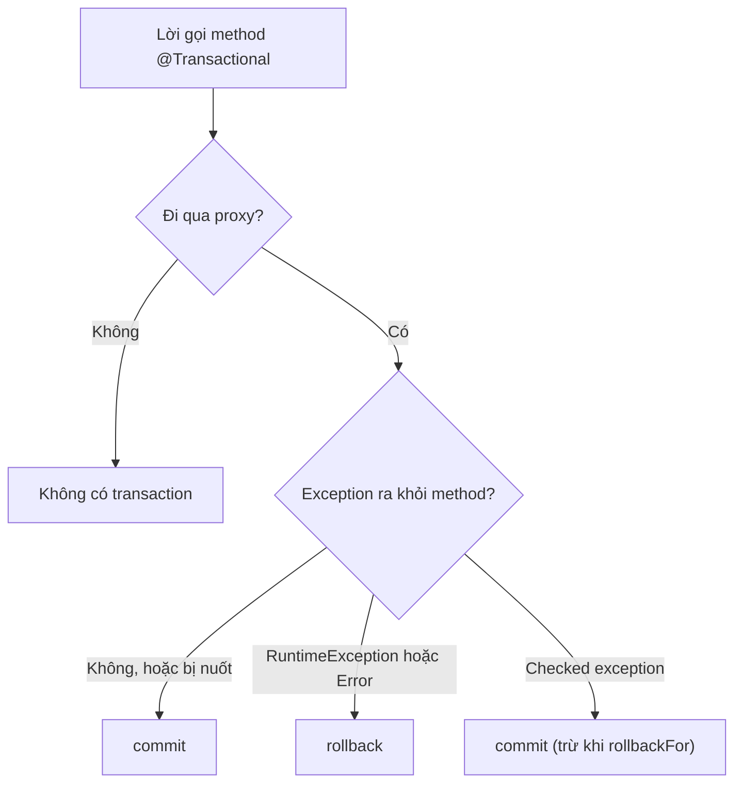

# Khi @Transactional không hoạt động

> **Tuần 5 · Ngày 30** · Thuộc [[05 - Transaction & JPA]] · Bài trước: [[05.01 - Transaction Proxy Mechanism]] · Bài sau: [[05.03 - Propagation]]
> "Kể các trường hợp @Transactional không có tác dụng" là câu **gần như chắc chắn bị hỏi**. Người phỏng vấn thường hỏi tiếp "em đã gặp chưa, sửa thế nào". Bài này đưa ra bằng chứng đo được cho từng trường hợp.
> Mọi output trong bài đã được **đo thực tế** bằng test `@SpringBootTest` trên Spring Boot 3.5.16 (Spring 6.2, Hibernate 6.6, H2 2.3), JDK 21. Mỗi dòng "active=..." là giá trị của `TransactionSynchronizationManager.isActualTransactionActive()` đo **bên trong** method.

**Mục lục**
1. [[#1. Quy tắc gốc: chỉ lời gọi qua proxy mới có transaction|Quy tắc gốc: chỉ lời gọi qua proxy mới có transaction]]
2. [[#2. Self-invocation|Self-invocation]]
3. [[#3. private, final, protected và object tự new|private, final, protected và object tự new]]
4. [[#4. Rollback rules: checked exception vẫn commit|Rollback rules: checked exception vẫn commit]]
5. [[#5. Exception bị nuốt|Exception bị nuốt]]
6. [[#6. Chạy trên thread khác|Chạy trên thread khác]]
7. [[#7. Các nguyên nhân khác và cách debug|Các nguyên nhân khác và cách debug]]
8. [[#8. Trả lời mẫu tổng hợp|Trả lời mẫu tổng hợp]]
9. [[#9. Kịch bản Feynman hôm nay|Kịch bản Feynman hôm nay]]

---

## 1. Quy tắc gốc: chỉ lời gọi qua proxy mới có transaction

### Hiểu bản chất
Từ bài [[05.01 - Transaction Proxy Mechanism]]: transaction được mở bởi `TransactionInterceptor` nằm **trong proxy**. Suy ra mọi trường hợp "không hoạt động" chỉ thuộc 3 nhóm:

| Nhóm | Ý nghĩa | Trường hợp |
|---|---|---|
| **Không đi qua proxy** | Interceptor không được gọi | Self-invocation, `private`, `final`, object tự `new` |
| **Đi qua proxy nhưng interceptor quyết định commit** | Interceptor không thấy lý do rollback | Checked exception, exception bị nuốt |
| **Transaction có nhưng code chạy ở chỗ khác** | ThreadLocal không theo sang | `@Async`, `CompletableFuture`, thread mới |

Nhớ 3 nhóm này thì khi bị hỏi không cần học thuộc danh sách, chỉ cần suy luận.



---

## 2. Self-invocation

### Hiểu bản chất
Method A trong class gọi method B **cùng class** bằng `this.b()` (hoặc chỉ `b()`). `this` là **object thật**, không phải proxy. Lời gọi đi thẳng vào object thật nên `@Transactional` trên B bị bỏ qua hoàn toàn.

Ví von lễ tân ở bài trước: khách đã vào trong phòng rồi thì đi sang phòng bên cạnh qua cửa thông nhau, không đi qua lễ tân nữa.

### Code minh hoạ

```java
@Service
class ProbeService {
    @Autowired @Lazy ProbeService self;          // proxy của chính mình

    @Transactional public String inTx() { return Tx.info(); }
    public String callSelfTx() { return this.inTx(); }          // ❌
    public String callViaSelfProxy() { return self.inTx(); }    // ✓
}
```

| Cách gọi | Đo được bên trong `inTx()` |
|---|---|
| Từ ngoài, qua proxy: `probe.inTx()` | `active=true name=demo.ProbeService.inTx` |
| Self-invocation: `probe.callSelfTx()` | **`active=false name=null`** |
| Qua proxy của chính mình: `probe.callViaSelfProxy()` | `active=true name=demo.ProbeService.inTx` |

Ví dụ thực tế hay gặp:

```java
public void importOrders(List<OrderDto> rows) {
    rows.forEach(this::importOne);                // ❌ không transaction nào cả
}

@Transactional
public void importOne(OrderDto row) { ... }       // mong mỗi dòng một transaction
```

### Cách sửa

| Cách | Ưu | Nhược |
|---|---|---|
| **Tách method sang bean khác** (`OrderImporter.importOne`) | Rõ ràng nhất, đúng thiết kế | Thêm một class |
| `TransactionTemplate` ngay trong method ([[05.05 - TransactionTemplate & Transaction Events]]) | Ranh giới transaction rõ ràng, không cần proxy | Code dài hơn annotation |
| Tự inject chính mình với `@Lazy` (đã đo ở trên) | Sửa nhanh | Khó đọc, dễ bị reviewer phản đối |
| `AopContext.currentProxy()` | | Phải bật `exposeProxy = true`; code phụ thuộc Spring AOP; không đo trong bài |

**Ở dự án em ưu tiên tách bean.** Nếu một method cần transaction riêng thì thường nó là một trách nhiệm riêng.

### Bẫy hay gặp
- Annotation đặt ở **method được gọi nội bộ** thì vô dụng. Nhưng nếu đặt ở **method ngoài** (method được controller gọi) thì method ngoài có transaction và method trong **chạy chung transaction đó**. Nhiều người sửa self-invocation bằng cách chuyển annotation lên method ngoài, nhưng như vậy là một transaction cho cả lô, khác hẳn ý định "mỗi dòng một transaction".
- Self-invocation áp dụng cho mọi annotation dựa trên proxy: `@Async`, `@Cacheable`, `@Retryable`, `@PreAuthorize`.

> **Trả lời mẫu:** "Self-invocation là khi method trong class gọi một method `@Transactional` khác cùng class qua `this`. `this` là object thật chứ không phải proxy, nên interceptor không chạy và không có transaction. Em đã đo: gọi qua proxy thì `isActualTransactionActive` là true, gọi qua `this` thì false. Cách sửa em hay dùng là tách method đó sang bean khác; nếu chỉ cần một khối nhỏ thì dùng `TransactionTemplate`."

### Câu hỏi xoáy

**Q1.** Method A có `@Transactional`, gọi `this.b()` mà B có `@Transactional(propagation = REQUIRES_NEW)`. B có transaction riêng không?
> [!success]- Gợi ý trả lời
> Không. B vẫn chạy, nhưng **trong transaction của A**, vì lời gọi không qua proxy nên cấu hình `REQUIRES_NEW` bị bỏ qua. Nếu B là audit log thì log sẽ mất khi A rollback. Đây là bẫy kép: self-invocation cộng propagation.

**Q2.** Inject chính mình mà không có `@Lazy` thì sao?
> [!success]- Gợi ý trả lời
> Từ Spring Boot 2.6, circular reference bị cấm mặc định, nên app có thể không khởi động được vì bean phụ thuộc vào chính nó. `@Lazy` inject một proxy trì hoãn, phá vòng tròn lúc khởi động.

---

## 3. private, final, protected và object tự new

### Hiểu bản chất
CGLIB proxy là một **subclass**. Subclass chỉ chặn được method mà nó **override được**. Java không cho override method `private` và `final`.

### Code minh hoạ

```java
@Transactional String packagePrivateTx() { return Tx.info(); }
@Transactional protected String protectedTx() { return Tx.info(); }
@Transactional public final String finalTx() {
    return Tx.info() + " repoNull=" + (repo == null);
}
public String callPrivate() { return privateTx(); }
@Transactional private String privateTx() { return Tx.info(); }
```

| Trường hợp | Đo được bên trong method |
|---|---|
| `public`, gọi qua proxy | `active=true` |
| package-private, gọi qua proxy (từ cùng package) | `active=true` |
| `protected`, gọi qua proxy | `active=true` |
| `public final`, gọi qua proxy | **`active=false`** và **`repoNull=true`** |
| `private`, gọi từ method khác trong class | **`active=false`** |
| `new ProbeService().inTx()` | **`active=false`** |

Ba điều đáng nhớ:

1. **Spring 6 đã hỗ trợ `protected` và package-private** với CGLIB proxy (đo được `active=true`). Nhiều tài liệu cũ ghi "chỉ public": đó là hành vi của Spring 5 trở về trước. Khi phỏng vấn, nói "Spring 6 hỗ trợ cả protected và package-private, nhưng em vẫn để public cho rõ ràng" là câu trả lời an toàn.
2. **Method `final` nguy hiểm hơn bạn nghĩ.** Proxy không override được nên method chạy **trên chính object proxy**. Object proxy không được inject field, nên `repo` là `null`. Kết quả không chỉ là mất transaction mà còn **`NullPointerException`** khi đụng tới repository. Bẫy này hay gặp với Kotlin, vì class và method Kotlin mặc định là `final`: class final thì app lỗi ngay lúc khởi động (`Cannot subclass final class`), còn mở class mà quên mở method thì gặp đúng bẫy field `null` này. Cần plugin `kotlin-spring`.
3. **Object tự `new`** không phải Spring bean, không có proxy, nên không có transaction và cũng không có field nào được inject.

### Bẫy hay gặp
- `@Transactional` trên method `private` **không báo lỗi gì**: không warning lúc compile, không exception lúc chạy. Nó im lặng không làm gì. IntelliJ có inspection cảnh báo việc này.
- Method `private` không thể gọi từ ngoài class, nên nó chỉ có thể được gọi nội bộ, tức là luôn rơi vào self-invocation.

### Câu hỏi xoáy

**Q1.** Vì sao gọi method `final` trên proxy lại thấy field `null`?
> [!success]- Gợi ý trả lời
> CGLIB proxy là một object riêng, được tạo bằng Objenesis (bỏ qua constructor), và Spring **không inject** field cho nó; field chỉ được inject vào object thật phía sau. Method không `final` thì proxy override và chuyển lời gọi sang object thật. Method `final` không override được nên chạy thẳng trên proxy, nơi mọi field đều `null`. Em đo được `repoNull=true`.

---

## 4. Rollback rules: checked exception vẫn commit

### Hiểu bản chất
Mặc định Spring chỉ rollback khi gặp **`RuntimeException`** hoặc **`Error`**. Với **checked exception** (`IOException`, `Exception` tự định nghĩa extends `Exception`), Spring **commit**.

Vì sao lại thiết kế như vậy? Quy ước này lấy từ EJB: checked exception được coi là **kết quả nghiệp vụ dự kiến** mà caller phải xử lý (ví dụ "số dư không đủ"), còn unchecked exception là **lỗi hệ thống** không lường trước.

### Code minh hoạ

```java
@Transactional public void checked(String n) throws IOException {
    repo.save(new Item(n)); throw new IOException("checked");
}
@Transactional(rollbackFor = Exception.class)
public void checkedRollbackFor(String n) throws IOException { /* như trên */ }

@Transactional(noRollbackFor = IllegalArgumentException.class)
public void noRollbackFor(String n) {
    repo.save(new Item(n)); throw new IllegalArgumentException("business warning");
}
```

| Method ném | Cấu hình | Dòng đã `save` có còn trong DB? |
|---|---|---|
| `IllegalStateException` (Runtime) | mặc định | **không** (rollback) |
| `AssertionError` (Error) | mặc định | **không** (rollback) |
| `IOException` (checked) | mặc định | **CÓ (commit!)** |
| `IOException` (checked) | `rollbackFor = Exception.class` | không |
| `IllegalArgumentException` | `noRollbackFor = IllegalArgumentException.class` | **có** |

Log của transaction manager cho trường hợp checked exception rất rõ: method ném `IOException` nhưng log in `Initiating transaction commit`. Exception vẫn được ném ra cho caller, nên caller **tưởng đã thất bại**, trong khi dữ liệu **đã được lưu**.

### Bẫy hay gặp
- Custom exception kiểu `class InsufficientBalanceException extends Exception`: ném ra là commit. **Best practice: business exception extends `RuntimeException`**, hoặc thống nhất `rollbackFor = Exception.class` cho cả dự án.
- `rollbackFor` khớp cả **subclass**: `rollbackFor = Exception.class` áp dụng cho mọi exception con.
- Kotlin không có checked exception, nhưng exception kế thừa `Exception` (không phải `RuntimeException`) vẫn bị Spring coi là checked và **commit**.

> **Trả lời mẫu:** "Mặc định Spring rollback với RuntimeException và Error, còn checked exception thì commit, quy ước này kế thừa từ EJB. Em đã viết test: method lưu một dòng rồi ném IOException, dòng đó vẫn nằm trong DB và log in ra `Initiating transaction commit`. Ở dự án, business exception của em đều extends RuntimeException; nếu buộc phải dùng checked exception thì khai báo `rollbackFor = Exception.class`."

### Câu hỏi xoáy

**Q1.** `@Transactional(rollbackFor = Exception.class)` có rollback khi gặp `Error` không?
> [!success]- Gợi ý trả lời
> Có. Rule mặc định (RuntimeException và Error) vẫn còn; `rollbackFor` chỉ **thêm** loại exception cần rollback.

**Q2.** Có `rollbackFor` và `noRollbackFor` cùng khớp một exception thì sao?
> [!success]- Gợi ý trả lời
> Spring chọn rule **gần nhất trong cây kế thừa** với exception thực tế. Ví dụ `rollbackFor = Exception.class` và `noRollbackFor = BusinessWarning.class`: ném `BusinessWarning` thì commit, vì `BusinessWarning` khớp sát hơn `Exception`.

---

## 5. Exception bị nuốt

### Hiểu bản chất
Interceptor chỉ biết có lỗi khi exception **bay ra khỏi method**. Nếu bạn `try/catch` rồi chỉ `log` mà không ném lại, interceptor thấy method trả về bình thường và commit.

### Code minh hoạ

```java
@Transactional public void swallow(String n) {
    repo.save(new Item(n));
    try { throw new IllegalStateException("boom"); }
    catch (RuntimeException e) { }                               // nuốt
}

@Transactional public void swallowButMark(String n) {
    repo.save(new Item(n));
    try { throw new IllegalStateException("boom"); }
    catch (RuntimeException e) {
        TransactionAspectSupport.currentTransactionStatus().setRollbackOnly();
    }
}
```

| Method | Exception ra ngoài? | Dòng đã `save` còn không? |
|---|---|---|
| `swallow` | không | **có (commit)** |
| `swallowButMark` | không | không. Log: `Transactional code has requested rollback` |

### Cách sửa
1. **Ném lại** (hoặc bọc vào exception nghiệp vụ): `catch (X e) { log...; throw new OrderFailedException(e); }`. Đây là cách nên dùng.
2. Nếu thật sự muốn trả về bình thường mà vẫn rollback: `setRollbackOnly()` như trên. Cách này gắn code với Spring API, chỉ dùng khi cần.

### Bẫy hay gặp
Có một ngoại lệ quan trọng: nếu exception được ném từ **method `@Transactional` của bean khác** (đi qua proxy của bean đó) rồi mới bị bạn nuốt, thì transaction **đã bị đánh dấu rollback-only** trước khi tới tay bạn. Lúc commit sẽ nổ `UnexpectedRollbackException`. Đo chi tiết ở [[05.03 - Propagation]].

---

## 6. Chạy trên thread khác

### Hiểu bản chất
Transaction nằm trong ThreadLocal của thread đã mở nó. Code chạy trên thread khác thì không thấy transaction đó.

### Code minh hoạ

```java
@Service
class AsyncService {
    @Async public CompletableFuture<String> probe(String name) {
        return completedFuture(Thread.currentThread().getName() + " " + Tx.info()
                + " seesItem=" + repo.existsByName(name));
    }
}

transactionTemplate.executeWithoutResult(s -> {
    repo.saveAndFlush(new Item("async-item"));       // đã flush, CHƯA commit
    asyncService.probe("async-item").get();
});
```

| Ở đâu | Thread | Transaction | Thấy dòng vừa lưu? |
|---|---|---|---|
| Caller | `main` | `active=true` | có |
| Method `@Async` | `task-1` | **`active=false`** | **không** |

Method `@Async` không chỉ mất transaction mà còn **không đọc được dữ liệu chưa commit** của caller. Lỗi thực tế: service lưu đơn hàng rồi gọi `@Async sendConfirmation(orderId)`, method async `findById(orderId)` ra rỗng vì đơn hàng chưa commit.

### Cách sửa
- Thread mới muốn có transaction thì **tự mở** (method `@Transactional` trên bean khác, hoặc `TransactionTemplate` bên trong).
- Muốn chạy việc phụ **sau khi commit** thì dùng `@TransactionalEventListener(phase = AFTER_COMMIT)` kết hợp `@Async` ([[05.05 - TransactionTemplate & Transaction Events]]).

---

## 7. Các nguyên nhân khác và cách debug

Các trường hợp dưới đây không đo trong bài, nhưng nên biết để kể khi được hỏi "còn gì nữa không":

| Nguyên nhân | Giải thích |
|---|---|
| Sai transaction manager | Project nhiều DataSource, method ghi vào DB thứ hai nhưng `@Transactional` dùng manager của DB chính |
| DB engine không hỗ trợ transaction | MySQL bảng `MyISAM` không có transaction; phải dùng `InnoDB` |
| `@PostConstruct` gọi method `@Transactional` của chính bean | Đó là gọi qua `this`; hơn nữa proxy chỉ được tạo **sau** bước init. Nên chuyển sang listener `ApplicationReadyEvent` |
| Nhầm annotation | `jakarta.transaction.Transactional` cũng được Spring hỗ trợ nhưng không có `readOnly`, `isolation`, `timeout` như annotation của Spring |

**Checklist debug ở dự án:**
1. Bật `logging.level.org.springframework.orm.jpa.JpaTransactionManager=DEBUG`, tìm dòng `Creating new transaction with name [...]`. Không có dòng này thì proxy không chạy.
2. In `TransactionSynchronizationManager.isActualTransactionActive()` ngay trong method.
3. In `getClass()` của bean: có `$$SpringCGLIB$$` hay không.
4. Xem exception có bay ra khỏi method không, và là checked hay unchecked.

---

## 8. Trả lời mẫu tổng hợp

> **"Khi nào @Transactional không có tác dụng?" (~90 giây)**
> "Em chia làm ba nhóm, đều suy ra từ cơ chế proxy.
> Nhóm một là lời gọi không đi qua proxy: self-invocation gọi qua `this`, method private, method final, hoặc object tự `new` không phải bean. Em đã đo: gọi qua `this` thì `isActualTransactionActive` là false. Method final còn tệ hơn vì chạy trên chính proxy nên field inject bị null. Spring 6 thì protected và package-private đã chạy được với CGLIB.
> Nhóm hai là đi qua proxy nhưng interceptor quyết định commit: ném checked exception mà không khai báo `rollbackFor`, hoặc bắt exception rồi nuốt mất.
> Nhóm ba là code chạy trên thread khác như `@Async` hay `CompletableFuture`, vì transaction gắn vào ThreadLocal.
> Ở dự án em từng gặp self-invocation khi import file: method public gọi `this.importOne()` có `@Transactional`, kết quả mỗi dòng không có transaction riêng. Em sửa bằng cách tách `importOne` sang bean `OrderImporter`."

---

## 9. Kịch bản Feynman hôm nay

1. Giải thích self-invocation bằng sơ đồ 2 trong [[06 - Sơ đồ cơ chế cốt lõi]], vẽ lại ra giấy.
2. "Vì sao method `final` vừa mất transaction vừa có thể gây NPE?"
3. "Vì sao Spring commit khi gặp checked exception? Em xử lý ở dự án thế nào?"
4. Kể 7 nguyên nhân trong 1 phút, theo 3 nhóm.

Ghi vào [[08 - Nhật ký học tập]].

## Tự kiểm tra nhanh (không mở tài liệu)

- [ ] 3 nhóm nguyên nhân là gì?
- [ ] 3 cách sửa self-invocation, em chọn cách nào và vì sao?
- [ ] Spring 6: `protected` và package-private có transaction không?
- [ ] Method `final` gọi qua proxy: hai hậu quả?
- [ ] Rollback mặc định với loại exception nào? Commit với loại nào?
- [ ] `setRollbackOnly()` gọi thế nào?
- [ ] Vì sao method `@Async` không thấy dữ liệu caller vừa lưu?
- [ ] Bật log nào để debug transaction?
