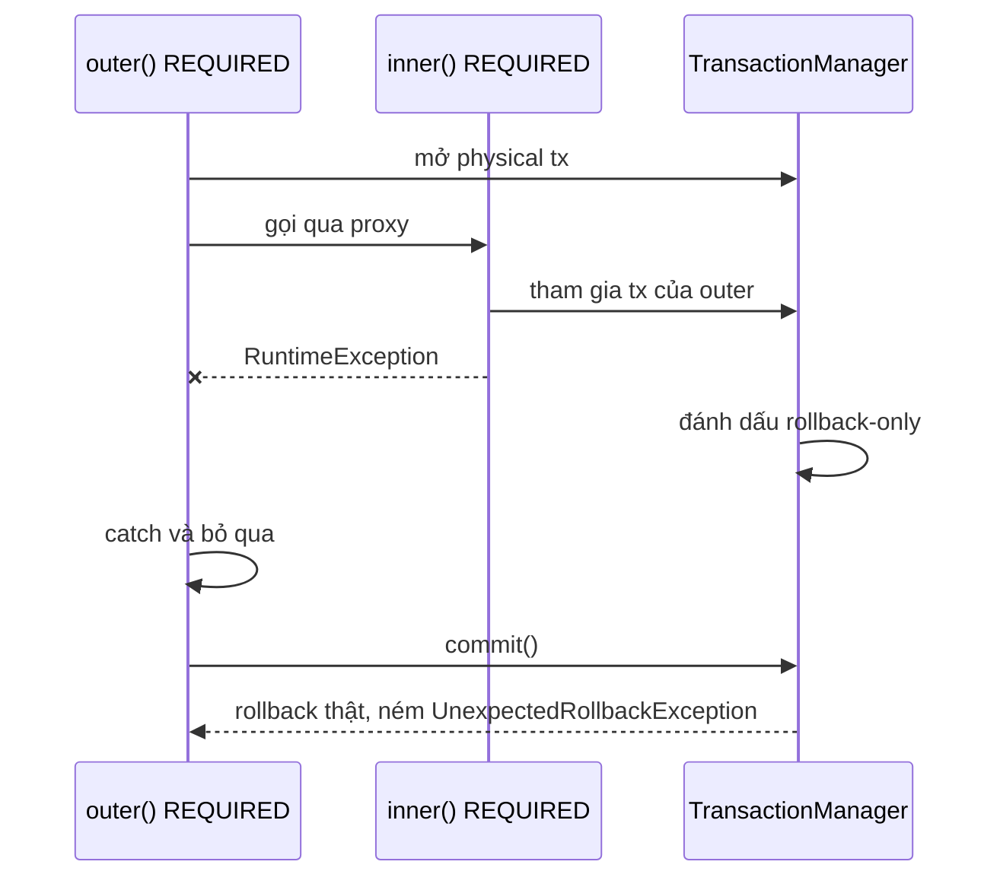
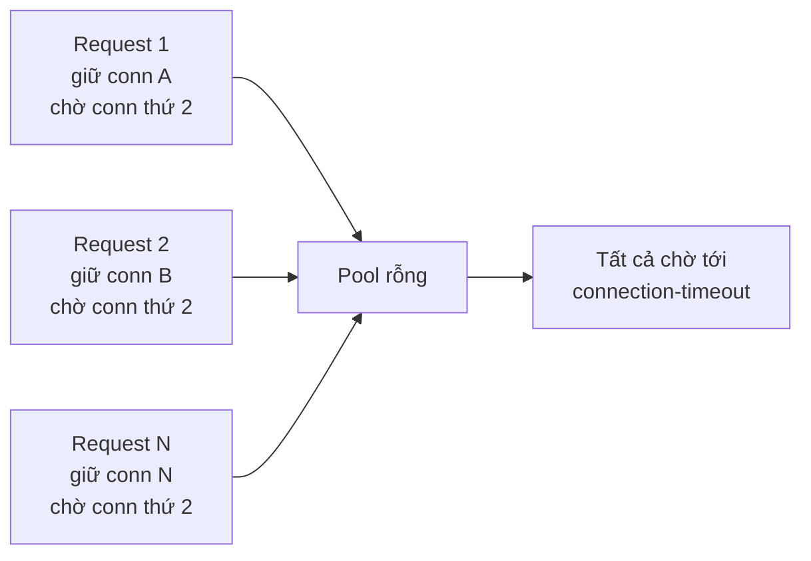

# Propagation

> **Tuần 5 · Ngày 31** · Thuộc [[05 - Transaction & JPA]] · Bài trước: [[05.02 - Khi @Transactional không hoạt động]] · Bài sau: [[05.04 - Isolation & readOnly]]
> Propagation là phần phân loại ứng viên: ai cũng kể được tên 7 loại, nhưng ít người giải thích được `UnexpectedRollbackException` hay biết `REQUIRES_NEW` có thể làm cạn connection pool. Bài này có số đo cho từng tình huống.
> Mọi output trong bài đã được **đo thực tế** bằng test `@SpringBootTest` trên Spring Boot 3.5.16 (Spring 6.2, Hibernate 6.6, H2 2.3, HikariCP), JDK 21. Log trích nguyên văn từ `JpaTransactionManager` ở mức DEBUG.

**Mục lục**
1. [[#1. Logical transaction vs physical transaction|Logical transaction vs physical transaction]]
2. [[#2. Bảy loại propagation|Bảy loại propagation]]
3. [[#3. REQUIRED và UnexpectedRollbackException|REQUIRED và UnexpectedRollbackException]]
4. [[#4. REQUIRES_NEW: transaction độc lập|REQUIRES_NEW: transaction độc lập]]
5. [[#5. NESTED: savepoint, và bất ngờ với JPA|NESTED: savepoint, và bất ngờ với JPA]]
6. [[#6. REQUIRES_NEW và nguy cơ cạn connection pool|REQUIRES_NEW và nguy cơ cạn connection pool]]
7. [[#7. Trả lời mẫu tổng hợp|Trả lời mẫu tổng hợp]]
8. [[#8. Kịch bản Feynman hôm nay|Kịch bản Feynman hôm nay]]

---

## 1. Logical transaction vs physical transaction

### Hiểu bản chất
Propagation trả lời câu hỏi: **"method `@Transactional` được gọi khi đã có transaction đang chạy thì làm gì?"**

Để hiểu, cần phân biệt hai khái niệm (thuật ngữ của tài liệu Spring):

- **Physical transaction**: transaction thật ở DB, gắn với **một connection**, có một lần `COMMIT` hoặc `ROLLBACK` thật.
- **Logical transaction**: mỗi method `@Transactional` mà proxy chặn được tạo ra một "phạm vi transaction" logic. Nhiều logical transaction có thể **cùng nằm trên một physical transaction**.

Ví von: physical transaction là **một chuyến xe**. Mỗi method `@Transactional` là **một hành khách**. Với `REQUIRED`, hành khách sau lên chung xe với hành khách trước. Chỉ người **mở chuyến** (method ngoài cùng) mới quyết định xe về bến (commit). Hành khách nào gặp sự cố thì có thể **gắn biển "xe hỏng"** (rollback-only), và khi đó cả chuyến phải quay đầu.

| | Logical | Physical |
|---|---|---|
| Số lượng | Một cho mỗi method được proxy chặn | Một cho mỗi connection đang mở transaction |
| Ai commit thật | Chỉ logical ngoài cùng ("người mở chuyến") | Connection `COMMIT` |
| Logical bên trong lỗi | Chỉ có thể **đánh dấu rollback-only** | Bị rollback khi logical ngoài cùng kết thúc |

---

## 2. Bảy loại propagation

| Propagation | Đã có transaction | Chưa có transaction | Đo được |
|---|---|---|---|
| **REQUIRED** (mặc định) | Tham gia | Tạo mới | Log: `Participating in existing transaction` |
| **REQUIRES_NEW** | **Tạm dừng** cái cũ, tạo cái mới độc lập | Tạo mới | Log: `Suspending current transaction, creating new transaction` |
| **NESTED** | Tạo **savepoint** trong transaction hiện tại | Tạo mới | Với JPA: lỗi, xem mục 5 |
| SUPPORTS | Tham gia | Chạy không transaction | Trong tx: `active=true`; ngoài: `active=false` |
| NOT_SUPPORTED | Tạm dừng, chạy không transaction | Chạy không transaction | Trong tx vẫn ra `active=false` |
| MANDATORY | Tham gia | **Ném exception** | Xem bên dưới |
| NEVER | **Ném exception** | Chạy không transaction | Xem bên dưới |

Exception đo được (nguyên văn):

```text
MANDATORY, gọi khi không có tx:
IllegalTransactionStateException: No existing transaction found for transaction
marked with propagation 'mandatory'
NEVER, gọi khi đang có tx:
IllegalTransactionStateException: Existing transaction found for transaction
marked with propagation 'never'
```

**Khi nào dùng gì trong thực tế:**
- `REQUIRED`: 95% trường hợp.
- `REQUIRES_NEW`: audit log, ghi lịch sử lỗi, cấp số thứ tự (sequence nghiệp vụ) phải lưu kể cả khi nghiệp vụ chính rollback.
- `MANDATORY`: method ở tầng thấp **bắt buộc** caller phải mở transaction trước (ví dụ method trừ kho chỉ được gọi bên trong luồng đặt hàng). Gắn để phát hiện sai sót sớm.
- `SUPPORTS`, `NOT_SUPPORTED`, `NEVER`: hiếm gặp.

### Bẫy hay gặp
- Propagation chỉ có tác dụng khi lời gọi **đi qua proxy**. `this.audit()` với `REQUIRES_NEW` vẫn chạy chung transaction của caller (self-invocation, bài [[05.02 - Khi @Transactional không hoạt động]]).
- `SUPPORTS` khi không có tx vẫn có **tên** transaction: đo được `getCurrentTransactionName()` trả về `demo.InnerService.supports` trong khi `isActualTransactionActive()` là `false`. Đó chỉ là "phạm vi đồng bộ", **không có transaction thật**. Luôn kiểm tra bằng `isActualTransactionActive()`, không dựa vào tên.

---

## 3. REQUIRED và UnexpectedRollbackException

### Hiểu bản chất
`outer()` và `inner()` đều `REQUIRED`, ở **hai bean khác nhau**. `inner()` ném RuntimeException, `outer()` bắt lại rồi chạy tiếp như không có gì.

Nhiều người đoán: "outer đã bắt exception, nên outer commit bình thường". **Sai.**

Diễn biến:
1. `inner()` tham gia physical transaction của `outer()`.
2. Exception bay qua **proxy của `inner()`**. Interceptor của `inner()` thấy RuntimeException, nhưng nó không phải người mở chuyến nên không được rollback thật. Nó chỉ **đánh dấu cả physical transaction là rollback-only**.
3. `outer()` nuốt exception, trả về bình thường, interceptor của `outer()` gọi commit.
4. Transaction manager thấy cờ rollback-only, nên **rollback thật**, rồi ném `UnexpectedRollbackException` để báo cho caller biết "anh tưởng commit nhưng thực ra đã rollback".

### Code minh hoạ

```java
@Service class OuterService {
    @Transactional public void requiredSwallow(String n) {
        repo.save(new Item(n));
        try { inner.requiredThrows(n + "-inner"); }       // bean khác, REQUIRED
        catch (RuntimeException e) { }                       // nuốt
    }
}
```

Kết quả đo được:

```text
UnexpectedRollbackException: Transaction silently rolled back
because it has been marked as rollback-only
```

| Dòng | Có trong DB? |
|---|---|
| `rq` (outer lưu) | **không** |
| `rq-inner` (inner lưu) | không |

Log nguyên văn (rút gọn phần EntityManager):

```text
Creating new transaction with name [demo.OuterService.requiredSwallow]
Participating in existing transaction
Participating transaction failed - marking existing transaction as rollback-only
Setting JPA transaction on EntityManager [...] rollback-only
Initiating transaction commit
```

Dòng thứ 3 là thời điểm "gắn biển xe hỏng". Dòng cuối là outer cố commit, và ngay sau đó exception được ném.



### Cách sửa (tuỳ ý định nghiệp vụ)

| Ý định | Cách làm |
|---|---|
| Inner lỗi thì cả nghiệp vụ phải thất bại | **Đừng nuốt exception**, ném tiếp ra |
| Inner là việc phụ, lỗi cũng được bỏ qua | Cho inner chạy **`REQUIRES_NEW`** (mục 4) |
| Inner lỗi thì chỉ huỷ phần của inner | `NESTED` với JDBC (mục 5), hoặc kiểm tra điều kiện trước để inner không ném |
| Inner không cần transaction | Bỏ `@Transactional` ở inner (khi đó exception không đi qua interceptor nào) |

> **Trả lời mẫu:** "`UnexpectedRollbackException` xảy ra khi method trong và ngoài cùng REQUIRED, tức là chung một physical transaction. Method trong ném RuntimeException, exception đi qua proxy của nó nên transaction bị đánh dấu rollback-only. Method ngoài bắt exception rồi cố commit, Spring thấy cờ rollback-only nên rollback và ném exception với message 'Transaction silently rolled back because it has been marked as rollback-only'. Em đã tái hiện bằng test, và log in rõ dòng 'Participating transaction failed - marking existing transaction as rollback-only'. Cách sửa tuỳ nghiệp vụ: nếu lỗi trong phải làm hỏng cả luồng thì đừng nuốt exception; nếu là việc phụ thì cho nó REQUIRES_NEW."

### Câu hỏi xoáy

**Q1.** Nếu `inner()` ở **cùng class** với `outer()` (gọi qua `this`) thì còn `UnexpectedRollbackException` không?
> [!success]- Gợi ý trả lời
> Không. Lời gọi không qua proxy của inner, nên không có interceptor nào đánh dấu rollback-only. Outer nuốt exception thì commit bình thường, kể cả dòng inner đã lưu. Đây là trường hợp "exception bị nuốt" thông thường của bài 05.02.

**Q2.** Inner ném **checked exception** (không có `rollbackFor`), outer bắt lại. Kết quả?
> [!success]- Gợi ý trả lời
> Commit bình thường, không có `UnexpectedRollbackException`. Rollback rules của inner nói "checked exception thì không rollback", nên interceptor của inner không đánh dấu rollback-only. Đã đo: outer bắt `IOException` của inner, không có exception nào ra ngoài, cả dòng của outer lẫn dòng của inner đều được lưu.

---

## 4. REQUIRES_NEW: transaction độc lập

### Hiểu bản chất
`REQUIRES_NEW` **tạm dừng** (suspend) transaction hiện tại: tháo resource ra khỏi ThreadLocal, cất sang một bên. Sau đó mở **transaction mới trên connection mới**, chạy xong thì commit hoặc rollback riêng, rồi **khôi phục** (resume) transaction cũ.

Hai transaction **hoàn toàn độc lập**: cái này rollback không kéo theo cái kia.

### Code minh hoạ

**Tình huống 1: audit log phải được lưu dù nghiệp vụ thất bại**

```java
@Service class AuditService {
    @Transactional(propagation = Propagation.REQUIRES_NEW)
    public void log(String msg) { auditRepo.save(new AuditLog(msg)); }
}

@Transactional public void auditThenFail(String n) {
    repo.save(new Item(n));
    audit.log("attempt " + n);                          // bean khác
    throw new IllegalStateException("outer failed");
}
```

| Kết quả đo được | |
|---|---|
| Exception ra ngoài | `IllegalStateException: outer failed` |
| Dòng `au` của outer | **không** còn (rollback) |
| Số dòng audit `attempt au` | **1** (đã commit riêng) |

Log nguyên văn:

```text
Suspending current transaction, creating new transaction with name [demo.AuditService.log]
Committing JPA transaction on EntityManager [SessionImpl(85284187<open>)]
Resuming suspended transaction after completion of inner transaction
Rolling back JPA transaction on EntityManager [SessionImpl(1860900345<open>)]
```

Hai `SessionImpl` khác số: hai EntityManager, hai connection, hai physical transaction.

**Tình huống 2: inner REQUIRES_NEW lỗi, outer nuốt exception**

| Kết quả đo được | |
|---|---|
| Exception ra ngoài | không có |
| Dòng của outer | **có** (commit) |
| Dòng của inner | không (inner rollback riêng) |

Khác hẳn REQUIRED: không còn `UnexpectedRollbackException`, vì inner rollback trên transaction **của riêng nó**, không đánh dấu gì lên transaction của outer.

### Bẫy hay gặp
- **Inner không nhìn thấy dữ liệu chưa commit của outer**, vì nó chạy trên connection khác. Outer vừa `save(order)` rồi gọi inner `REQUIRES_NEW` đọc lại order đó thì không thấy. Nếu inner cập nhật **cùng dòng** mà outer đang giữ lock thì inner sẽ **chờ outer**, trong khi outer đang chờ inner trả về: **deadlock** trong cùng một thread. Đo trên H2 (outer `update product ... id = 77`, inner `REQUIRES_NEW` update cùng dòng): sau khoảng 2,2 giây ném `QueryTimeoutException`, cause `Timeout trying to lock table "PRODUCT"` (H2 báo dòng bị `locked by tx 1 and can not be updated by tx 2 within allocated time interval 2000 ms`). DB không đặt lock timeout thì thread sẽ treo luôn.
- Phải đặt method `REQUIRES_NEW` ở **bean khác**.
- Tốn thêm một connection (mục 6).

---

## 5. NESTED: savepoint, và bất ngờ với JPA

### Hiểu bản chất
`NESTED` không mở transaction mới. Nó đặt một **savepoint** (điểm lưu) trong physical transaction hiện tại:
- Inner lỗi: rollback **về savepoint**, phần của outer trước đó vẫn giữ, outer chạy tiếp.
- Outer rollback: **mọi thứ mất**, kể cả phần inner đã "thành công".

So với `REQUIRES_NEW`: cùng một connection, không độc lập, nhưng rollback được một phần.

### Code minh hoạ: với JdbcTemplate + DataSourceTransactionManager

```java
var jdbcTm = new DataSourceTransactionManager(dataSource);
var nested = new TransactionTemplate(jdbcTm);
nested.setPropagationBehavior(TransactionDefinition.PROPAGATION_NESTED);

new TransactionTemplate(jdbcTm).executeWithoutResult(s -> {
    jdbc.update("insert into t values ('outer')");
    try {
        nested.executeWithoutResult(n -> {
            jdbc.update("insert into t values ('inner')");
            throw new IllegalStateException("inner failed");
        });
    } catch (IllegalStateException e) { }
});
```

| Tình huống | Dòng còn lại sau cùng (đo được) |
|---|---|
| Inner lỗi, outer bắt và commit | `[outer]` |
| Inner thành công, outer ném exception | `[]` |

Đúng như lý thuyết savepoint.

### Code minh hoạ: với JpaTransactionManager (mặc định của Spring Data JPA)

Cùng kịch bản nhưng dùng `@Transactional(propagation = NESTED)` trong project JPA. Kết quả đo được:

```text
NestedTransactionNotSupportedException: JpaDialect does not support savepoints
- check your JPA provider's capabilities
```

Log có dòng `Creating nested transaction with name [demo.InnerService.nestedThrows]` rồi ném exception **ngay lúc tạo savepoint**, trước khi method inner kịp chạy.

**Bẫy cực khó thấy:** trong test đầu tiên, outer có `try/catch (RuntimeException e)` để "bỏ qua lỗi của inner". `NestedTransactionNotSupportedException` cũng là RuntimeException, nên nó bị nuốt luôn. Kết quả nhìn qua có vẻ đúng: dòng outer được lưu, dòng inner không có. Thực ra **method inner chưa bao giờ chạy**. Chỉ khi in exception bị nuốt ra mới thấy sự thật.

Vì sao? `HibernateJpaDialect` không hỗ trợ savepoint, vì rollback về savepoint chỉ quay lại dữ liệu trong DB, còn các entity trong **persistence context** của Hibernate thì không quay lại được, dễ gây sai lệch trạng thái.

### Bẫy hay gặp
- Nói "NESTED dùng cho rollback một phần" là đúng về lý thuyết, nhưng phải nói thêm: **cần transaction manager hỗ trợ savepoint**. Với Spring Data JPA + Hibernate mặc định thì không dùng được (đã đo).
- Khi cần "rollback một phần" trong project JPA: dùng `REQUIRES_NEW` cho phần được phép thất bại, hoặc thiết kế lại để kiểm tra điều kiện trước khi ghi.

> **Trả lời mẫu:** "REQUIRED tham gia transaction đang có, nên lỗi ở trong làm hỏng cả transaction ngoài. REQUIRES_NEW tạm dừng transaction ngoài và mở transaction mới trên connection mới, commit hay rollback độc lập; em dùng nó cho audit log, và đã test được: outer rollback nhưng audit vẫn còn 1 dòng. NESTED tạo savepoint trong cùng transaction, rollback được phần trong mà giữ phần ngoài, nhưng outer rollback thì mất hết. Lưu ý NESTED cần savepoint: với JdbcTemplate thì chạy đúng, còn với JpaTransactionManager và Hibernate em đo được `NestedTransactionNotSupportedException`."

### Câu hỏi xoáy

**Q1.** NESTED khác REQUIRES_NEW thế nào khi **outer rollback**?
> [!success]- Gợi ý trả lời
> REQUIRES_NEW đã commit riêng nên **vẫn còn**. NESTED chỉ là savepoint trong transaction của outer nên **mất theo**. Đo được với JDBC: inner thành công, outer ném exception thì bảng rỗng `[]`.

---

## 6. REQUIRES_NEW và nguy cơ cạn connection pool

### Hiểu bản chất
Khi `REQUIRES_NEW` chạy, transaction ngoài chỉ bị tạm dừng, **connection của nó vẫn bị giữ**. Transaction mới cần **thêm một connection**. Một request lúc này chiếm **2 connection**.

### Code minh hoạ

```java
@Transactional public String outerCallsRequiresNew() {          // OuterService
    return "outer activeConnections=" + hikari.getActiveConnections()
         + " | inner " + inner.requiresNewInfo();               // REQUIRES_NEW
}
```

| Đo được | Connection đang mượn |
|---|---|
| Trong outer | **1** |
| Trong inner `REQUIRES_NEW` | **2** |

Chạy lại với pool chỉ có 1 connection (`maximum-pool-size=1`, `connection-timeout=500`):

```text
CannotCreateTransactionException: Could not open JPA EntityManager for transaction
  cause SQLTransientConnectionException: HikariPool-2 - Connection is not available,
  request timed out after 504ms (total=1, active=1, idle=0, waiting=0)
```

Inner chờ connection mà connection duy nhất đang bị chính outer (cùng thread) giữ, nên chờ tới hết timeout (đo được 533 ms tổng thời gian).

**Ở production chuyện này xảy ra thế nào?** Pool có 10 connection, cùng lúc có 10 request vào. Mỗi request mượn 1 connection cho outer, rồi cả 10 cùng chờ connection thứ hai cho `REQUIRES_NEW`. Không ai trả connection vì ai cũng đang chờ. Tất cả treo tới `connection-timeout` (HikariCP mặc định 30 giây), rồi đồng loạt lỗi. Đây gọi là **pool deadlock**.



### Cách phòng tránh
- Chỉ dùng `REQUIRES_NEW` khi thật sự cần độc lập.
- Giữ phần `REQUIRES_NEW` **ngắn**.
- Pool size phải tính cả số connection tối đa mà một request cần (công thức hay nhắc: `threads × (connection mỗi request − 1) + 1` là mức tối thiểu để không deadlock).
- Với audit log: có thể ghi **sau khi transaction kết thúc** (`@TransactionalEventListener`, bài [[05.05 - TransactionTemplate & Transaction Events]]), hoặc ghi qua message queue.

### Câu hỏi xoáy

**Q1.** Vì sao lỗi cạn pool do REQUIRES_NEW thường không lộ ra khi test ở máy local?
> [!success]- Gợi ý trả lời
> Local chỉ có 1 request mỗi lúc, pool mặc định của HikariCP có 10 connection, nên luôn còn connection thứ hai. Lỗi chỉ xuất hiện khi số request đồng thời xấp xỉ pool size, tức là lúc tải cao, và thường biểu hiện là "hệ thống treo 30 giây rồi lỗi hàng loạt".

---

## 7. Trả lời mẫu tổng hợp

> **"Giải thích propagation REQUIRED, REQUIRES_NEW, NESTED" (~90 giây)**
> "Propagation quyết định method transactional làm gì khi đã có transaction. REQUIRED là mặc định: tham gia transaction đang có, nên trong và ngoài là một physical transaction. Nếu method trong ném RuntimeException qua proxy của nó, transaction bị đánh dấu rollback-only; ngoài có bắt exception thì lúc commit vẫn bị `UnexpectedRollbackException`, em đã tái hiện được.
> REQUIRES_NEW tạm dừng transaction ngoài, mở transaction mới trên connection mới, commit hay rollback độc lập. Em dùng nó cho audit log và test được là outer rollback nhưng audit vẫn lưu. Cái giá là một request chiếm hai connection: em đo được số connection active từ 1 lên 2, và với pool 1 connection thì timeout ngay. Tải cao có thể gây pool deadlock.
> NESTED dùng savepoint trong cùng transaction, rollback được phần trong mà giữ phần ngoài. Nhưng cần savepoint: với JDBC thì chạy, với JpaTransactionManager và Hibernate thì ném `NestedTransactionNotSupportedException`."

---

## 8. Kịch bản Feynman hôm nay

1. Vẽ lại sơ đồ 3 trong [[06 - Sơ đồ cơ chế cốt lõi]] (REQUIRED vs REQUIRES_NEW), giải thích bằng ví von "chuyến xe và biển xe hỏng".
2. "Tại sao bắt exception rồi mà vẫn bị `UnexpectedRollbackException`?" Trả lời trong 1 phút, có nhắc dòng log `marking existing transaction as rollback-only`.
3. "Vì sao REQUIRES_NEW có thể làm treo hệ thống khi tải cao?"
4. "NESTED khác REQUIRES_NEW ở đâu, và vì sao project JPA của em không dùng NESTED?"

Ghi vào [[08 - Nhật ký học tập]].

## Tự kiểm tra nhanh (không mở tài liệu)

- [ ] Logical vs physical transaction: ai được commit thật?
- [ ] Kể 7 propagation và hành vi khi có/không có transaction
- [ ] Message chính xác của `UnexpectedRollbackException`?
- [ ] 3 cách xử lý tuỳ ý định nghiệp vụ khi inner lỗi
- [ ] REQUIRES_NEW: inner có thấy dữ liệu chưa commit của outer không?
- [ ] NESTED với JpaTransactionManager thì sao?
- [ ] Một request dùng REQUIRES_NEW chiếm mấy connection? Hậu quả khi tải cao?
- [ ] `MANDATORY` dùng để làm gì?
