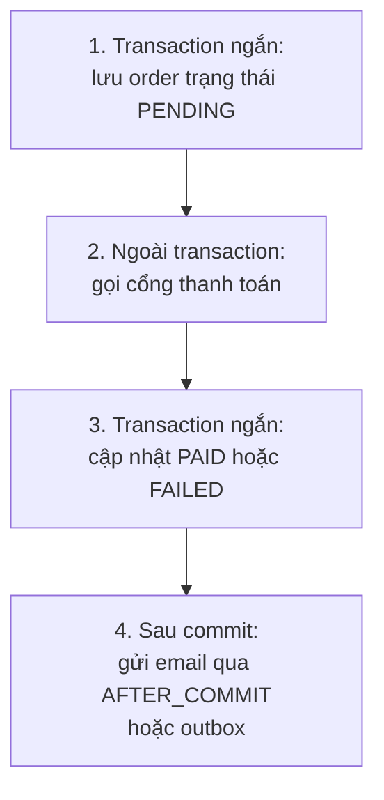

# Isolation & readOnly

> **Tuần 5 · Ngày 32** · Thuộc [[05 - Transaction & JPA]] · Bài trước: [[05.03 - Propagation]] · Bài sau: [[05.05 - TransactionTemplate & Transaction Events]]
> Câu hỏi isolation thường bắt đầu bằng "kể các level" nhưng kết thúc bằng tình huống thật: "hai người cùng mua sản phẩm cuối cùng thì sao?". Bài này tái hiện từng anomaly trên PostgreSQL thật để bạn kể bằng trải nghiệm, không phải học thuộc bảng.
> Mọi output trong bài đã được **đo thực tế** bằng test `@SpringBootTest` trên Spring Boot 3.5.16, JDK 21. Phần isolation chạy trên **PostgreSQL 16.14** (Testcontainers); một số phép đo trên H2 2.3 và MySQL 8.4.13 được ghi rõ.

**Mục lục**
1. [[#1. Các anomaly: chuyện gì có thể sai khi chạy đồng thời|Các anomaly: chuyện gì có thể sai khi chạy đồng thời]]
2. [[#2. Bốn isolation level và default của từng DB|Bốn isolation level và default của từng DB]]
3. [[#3. MVCC: vì sao đọc không chặn ghi|MVCC: vì sao đọc không chặn ghi]]
4. [[#4. Tái hiện non-repeatable read và phantom|Tái hiện non-repeatable read và phantom]]
5. [[#5. Lost update và ba cách sửa|Lost update và ba cách sửa]]
6. [[#6. Write skew|Write skew]]
7. [[#7. readOnly = true thực sự làm gì|readOnly = true thực sự làm gì]]
8. [[#8. Không gọi API bên ngoài trong transaction|Không gọi API bên ngoài trong transaction]]
9. [[#9. Kịch bản Feynman hôm nay|Kịch bản Feynman hôm nay]]

---

## 1. Các anomaly: chuyện gì có thể sai khi chạy đồng thời

### Hiểu bản chất
Nếu mọi transaction chạy **lần lượt**, không bao giờ có lỗi đồng thời. Nhưng như vậy quá chậm, nên DB cho chúng chạy song song và chấp nhận một số "hiện tượng lạ" (anomaly). **Isolation level** là mức bạn chọn: chặn bao nhiêu anomaly, đổi lại chậm hơn bao nhiêu.

| Anomaly | Chuyện gì xảy ra | Ví dụ |
|---|---|---|
| **Dirty read** | Đọc dữ liệu tx khác **chưa commit** | Thấy số dư 999 mà tx kia sau đó rollback |
| **Non-repeatable read** | Đọc **một dòng** 2 lần, ra 2 giá trị khác nhau | Lần 1 stock = 10, lần 2 stock = 50 |
| **Phantom read** | Chạy lại **cùng query điều kiện**, số dòng thay đổi | `count(*)` lần 1 = 1, lần 2 = 2 |
| **Lost update** | Hai tx cùng đọc rồi cùng ghi, một bên **ghi đè** bên kia | 2 người mua, stock 10 chỉ còn 9 thay vì 8 |
| **Write skew** | Hai tx đọc cùng điều kiện, mỗi bên ghi **một dòng khác nhau**, tổng thể vi phạm quy tắc | Hai bác sĩ cùng xin nghỉ, ca trực còn 0 người |

Ba anomaly đầu có trong chuẩn SQL. **Lost update và write skew mới là thứ hay gây bug thật ở dự án**, và người phỏng vấn giỏi sẽ hỏi tới.

---

## 2. Bốn isolation level và default của từng DB

| Level | Dirty read | Non-repeatable | Phantom | Ghi chú |
|---|---|---|---|---|
| READ_UNCOMMITTED | có thể | có thể | có thể | PostgreSQL **không hỗ trợ**, tự coi như READ_COMMITTED |
| **READ_COMMITTED** | chặn | có thể | có thể | Default PostgreSQL, Oracle, SQL Server |
| **REPEATABLE_READ** | chặn | chặn | chuẩn SQL: có thể | PostgreSQL: chặn cả phantom (đo ở mục 4) |
| SERIALIZABLE | chặn | chặn | chặn | Chặn cả write skew, đổi lại có thể ném lỗi serialization |

Default đo được:

| DB | Lệnh kiểm tra | Kết quả |
|---|---|---|
| PostgreSQL 16.14 | `show transaction_isolation` | `read committed` |
| MySQL 8.4.13 (InnoDB) | `select @@transaction_isolation` | `REPEATABLE-READ` |
| H2 2.3 | `Connection.getTransactionIsolation()` | `2` (= READ_COMMITTED) |

Trong Spring: `@Transactional(isolation = Isolation.DEFAULT)` (mặc định) nghĩa là **dùng default của DB**. Muốn đổi thì ghi rõ, ví dụ `isolation = Isolation.REPEATABLE_READ`.

### Bẫy hay gặp
- Cùng một code, chạy trên MySQL (REPEATABLE READ) và PostgreSQL (READ COMMITTED) có thể cho kết quả khác. Chuyển DB phải xem lại.
- **Dirty read đo được thật trên H2**: transaction A update stock thành 999 chưa commit, transaction B (`READ_UNCOMMITTED`) đọc ra **999**. Cùng kịch bản trên PostgreSQL, B đọc ra **10** (giá trị đã commit), vì PostgreSQL không có dirty read ở bất kỳ level nào.

---

## 3. MVCC: vì sao đọc không chặn ghi

### Hiểu bản chất
PostgreSQL, MySQL InnoDB, Oracle đều dùng **MVCC** (Multi-Version Concurrency Control). Ý tưởng đơn giản:

- Khi update một dòng, DB **không ghi đè** dòng cũ mà tạo **phiên bản mới**. Phiên bản cũ vẫn giữ lại một thời gian.
- Mỗi transaction đọc theo một **snapshot**: "ảnh chụp" dữ liệu đã commit tại một thời điểm.
- Người đọc chỉ nhìn snapshot nên **không cần khoá**, không chặn người ghi. Người ghi cũng không chặn người đọc.

Ví von: snapshot giống **ảnh chụp bảng giá** lúc bạn bước vào cửa hàng. Nhân viên có đổi giá trên bảng thật thì ảnh của bạn vẫn như cũ.

Khác biệt giữa hai level hay dùng nằm ở **lúc nào chụp ảnh**:

| Level | Khi nào chụp snapshot | Hệ quả |
|---|---|---|
| READ_COMMITTED | **Mỗi câu lệnh** chụp một ảnh mới | Câu sau thấy dữ liệu tx khác vừa commit, nên có non-repeatable read |
| REPEATABLE_READ (PostgreSQL) | **Câu lệnh đầu tiên** của transaction chụp một ảnh, dùng tới cuối | Đọc lại luôn ra như cũ, không có phantom |

**Ghi thì vẫn cần khoá.** Hai transaction cùng update một dòng thì người sau phải chờ người trước commit hoặc rollback. Đo được ở mục 5: `SELECT ... FOR UPDATE` làm thread thứ hai chờ **306 ms**.

---

## 4. Tái hiện non-repeatable read và phantom

### Code minh hoạ
Ý tưởng: transaction ngoài đọc 2 lần; giữa 2 lần, một transaction `REQUIRES_NEW` (connection khác) sửa dữ liệu và commit.

```java
outer(isolation).executeWithoutResult(s -> {
    int a = jdbc.queryForObject("select stock from product where id = 1", Integer.class);
    requiresNew.executeWithoutResult(x ->
        jdbc.update("update product set stock = 50 where id = 1"));   // commit ngay
    int b = jdbc.queryForObject("select stock from product where id = 1", Integer.class);
});
```

Kết quả đo được trên PostgreSQL:

| Kịch bản | READ_COMMITTED | REPEATABLE_READ |
|---|---|---|
| Đọc stock 2 lần, giữa chừng tx khác đổi 10 thành 50 | `first=10 second=50` | `first=10 second=10` |
| `count(*)` 2 lần, giữa chừng tx khác insert 1 dòng | `first=1 second=2` | `first=1 second=1` |

REPEATABLE_READ của PostgreSQL chặn **cả phantom**, mạnh hơn yêu cầu của chuẩn SQL.

### Bẫy hay gặp: first-level cache của JPA che mất non-repeatable read
Cùng kịch bản nhưng đọc bằng `productRepo.findById(1L)` hai lần, ở READ_COMMITTED:

| Đo được | Giá trị |
|---|---|
| `findById` lần 1 | stock = 10 |
| `findById` lần 2 | stock = **10** |
| Cùng một object? | `sameInstance=true` |
| Đọc bằng JDBC lúc đó | **50** |

Lần 2 Hibernate **không chạy SQL**, trả luôn entity trong persistence context. Ứng dụng nhìn thấy "repeatable read" dù DB đang ở READ COMMITTED. Muốn đọc giá trị mới phải `entityManager.refresh(entity)` hoặc query bằng JPQL/native (bài [[05.06 - Entity Lifecycle & Persistence Context]]).

> **Trả lời mẫu:** "Isolation level quyết định transaction thấy thay đổi của transaction khác tới đâu. READ COMMITTED chặn dirty read, nhưng đọc lại một dòng có thể ra giá trị mới; REPEATABLE READ giữ nguyên snapshot nên đọc lại vẫn như cũ; SERIALIZABLE chặn hết. Default của PostgreSQL là READ COMMITTED, MySQL InnoDB là REPEATABLE READ, em đã kiểm tra trực tiếp. Hai DB này dùng MVCC: mỗi transaction đọc theo snapshot nên đọc không chặn ghi. Em tái hiện trên PostgreSQL: READ COMMITTED đọc 2 lần ra 10 rồi 50, REPEATABLE READ ra 10 và 10. Một chi tiết hay: đọc bằng `findById` hai lần thì luôn ra giá trị cũ vì first-level cache của Hibernate."

### Câu hỏi xoáy

**Q1.** Vì sao không đặt SERIALIZABLE cho mọi thứ để an toàn?
> [!success]- Gợi ý trả lời
> Ở PostgreSQL, SERIALIZABLE không khoá nhiều hơn mà **phát hiện xung đột** và huỷ một transaction với lỗi `could not serialize access`. Ứng dụng phải **retry** những transaction đó. Tải cao thì tỷ lệ retry tăng, throughput giảm. Thường chỉ dùng cho vài nghiệp vụ nhạy cảm, còn lại dùng READ COMMITTED kèm lock có chủ đích.

---

## 5. Lost update và ba cách sửa

### Hiểu bản chất
Kịch bản bán hàng kinh điển: stock = 10, hai người cùng mua 1 sản phẩm.

```java
Product p = repo.findById(id).get();   // cả hai cùng đọc 10
p.setStock(p.getStock() - 1);         // cả hai cùng tính 9
// commit: cả hai cùng ghi 9 → mất một lần trừ
```

Đây là mẫu **read-modify-write**: đọc vào Java, tính, rồi ghi đè. **READ COMMITTED không chặn được**, vì mỗi bên chỉ đọc dữ liệu đã commit, không có gì "sai" theo định nghĩa của level đó.

### Code minh hoạ
Tái hiện chắc chắn bằng một thread: transaction ngoài đọc, transaction `REQUIRES_NEW` chen vào đọc, trừ và commit, rồi transaction ngoài ghi giá trị nó đã tính.

| Cách làm (PostgreSQL) | Kết quả đo được (đúng phải là 8) |
|---|---|
| READ_COMMITTED, read-modify-write | `final stock=9`: **mất 1 lần trừ** |
| REPEATABLE_READ, read-modify-write | `CannotAcquireLockException`, cause `PSQLException: ERROR: could not serialize access due to concurrent update` |
| **Atomic UPDATE**: `set stock = stock - 1 where id = 1 and stock > 0` | `final stock=8` |
| **`@Version`** (optimistic lock) | `ObjectOptimisticLockingFailureException: Row was updated or deleted by another transaction (or unsaved-value mapping was incorrect): [demo.Product#1]` |

Với `SELECT ... FOR UPDATE` cần hai thread thật: thread A đọc, giữ 300 ms rồi ghi; thread B đọc ngay sau A.

| Hai thread, READ_COMMITTED | Stock cuối | Thread B phải chờ |
|---|---|---|
| `SELECT` thường | **9** (lost update) | 6 ms |
| `SELECT ... FOR UPDATE` | **8** | **306 ms** (chờ A commit) |

### So sánh ba cách sửa

| Cách | Cơ chế | Khi nào dùng |
|---|---|---|
| **Atomic UPDATE** | DB tự đọc và ghi trong một câu lệnh có khoá dòng | Phép tính đơn giản (cộng trừ số lượng, số dư). Đơn giản và nhanh nhất. Kiểm tra số dòng bị ảnh hưởng: 0 nghĩa là hết hàng |
| **Optimistic lock `@Version`** | Thêm `where version = ?` khi update; lệch version thì ném exception | Xung đột **hiếm**, ví dụ sửa hồ sơ, sửa đơn hàng. Bắt exception rồi báo người dùng hoặc retry |
| **Pessimistic lock `FOR UPDATE`** (`@Lock(PESSIMISTIC_WRITE)`) | Khoá dòng ngay lúc đọc, người khác chờ | Xung đột **thường xuyên** trên cùng dòng (flash sale). Giữ transaction ngắn để không ai chờ lâu |

Đo được thêm: sau lỗi `@Version`, stock = 9 và version = 1. Transaction thắng đã commit, transaction thua bị rollback toàn bộ, **không có dữ liệu sai**.

### Bẫy hay gặp
- Đổi lên REPEATABLE READ trên PostgreSQL **không làm bài toán đúng**, nó chỉ biến lost update thành **exception**. Bạn vẫn phải bắt và retry.
- MySQL REPEATABLE READ thì **khác** PostgreSQL: update dựa trên giá trị mới nhất mà không báo lỗi, nên read-modify-write vẫn có thể mất update. Không đo trong bài; ý chính là đừng dựa vào isolation level để chống lost update.
- `@Version` chỉ có tác dụng khi update đi qua **entity**. Câu `@Modifying @Query("update ...")` tự viết sẽ bỏ qua version nếu bạn không tự thêm điều kiện.

> **Trả lời mẫu:** "Lost update là khi hai transaction cùng đọc một giá trị, cùng tính toán trong Java rồi ghi đè, nên một lần cập nhật bị mất. READ COMMITTED không chặn được: em tái hiện trên PostgreSQL, stock 10 trừ hai lần còn 9. Có ba cách sửa. Cách đơn giản nhất là atomic update `stock = stock - 1 where stock > 0`, đo được còn đúng 8. Nếu xung đột hiếm thì dùng `@Version`, bên thua nhận `ObjectOptimisticLockingFailureException` và retry. Nếu xung đột nhiều trên cùng dòng thì `SELECT FOR UPDATE`, bên sau chờ bên trước commit; em đo được thread thứ hai chờ khoảng 300 ms và kết quả đúng 8."

### Câu hỏi xoáy

**Q1.** `@Version` và `FOR UPDATE`, chọn cái nào cho trừ kho flash sale?
> [!success]- Gợi ý trả lời
> Flash sale có rất nhiều request cùng một dòng, `@Version` sẽ làm phần lớn request thất bại và retry liên tục. Nên ưu tiên **atomic UPDATE** (nhanh nhất, một câu lệnh). Nếu logic phức tạp hơn một phép trừ thì dùng `FOR UPDATE` với transaction thật ngắn. Ở quy mô rất lớn thì đưa sang Redis hoặc hàng đợi, nhưng đó là câu chuyện system design.

---

## 6. Write skew

### Hiểu bản chất
Quy tắc: luôn có **ít nhất 1 bác sĩ trực**. Hiện có 2 người trực. Bác sĩ A và B cùng xin nghỉ cùng lúc:

1. Tx A đếm: 2 người trực, "nghỉ được". Tx B cũng đếm: 2 người trực, "nghỉ được".
2. Tx A update dòng của A. Tx B update dòng của B.
3. Hai tx sửa **hai dòng khác nhau**, không đụng khoá của nhau, cùng commit. Kết quả: **0 người trực**.

Đây không phải lost update (không ai ghi đè ai). Mỗi tx đúng khi đứng riêng, nhưng **gộp lại thì vi phạm quy tắc**.

### Code minh hoạ
Tái hiện trên PostgreSQL bằng transaction ngoài và transaction `REQUIRES_NEW` cùng isolation:

| Level | Kết quả đo được |
|---|---|
| REPEATABLE_READ | Cả hai commit, `on call now=0`: **vi phạm quy tắc** |
| SERIALIZABLE | Tx còn lại (tx ngoài) lỗi ngay ở câu `update`: `could not serialize access due to read/write dependencies among transactions`, quy tắc được giữ |

### Cách sửa
- `SERIALIZABLE` cho riêng nghiệp vụ này, kèm retry.
- Khoá có chủ đích: `SELECT ... FOR UPDATE` **các dòng được dùng để kiểm tra điều kiện** (khoá cả 2 dòng bác sĩ trực), để tx thứ hai phải chờ rồi đếm lại.
- Đưa quy tắc xuống DB nếu có thể (constraint, hoặc một dòng "tổng" được update nguyên tử).

---

## 7. readOnly = true thực sự làm gì

### Hiểu bản chất
`@Transactional(readOnly = true)` là một **gợi ý** truyền xuống nhiều tầng. Mỗi tầng tự quyết định làm gì với nó.

### Code minh hoạ

```java
@Transactional(readOnly = true)
public String changeInReadOnly(Long id, int stock) {
    Product p = repo.findById(id).orElseThrow();
    p.stock = stock;                                  // sửa entity managed
    Session s = em.unwrap(Session.class);
    return "flushMode=" + s.getHibernateFlushMode() + " defaultReadOnly="
            + s.isDefaultReadOnly() + " entityReadOnly=" + s.isReadOnly(p);
}
```

| Đo được | `readOnly = true` | `@Transactional` thường |
|---|---|---|
| Hibernate flush mode | `MANUAL` | `AUTO` |
| Session default read-only | `true` | `false` |
| Entity được load ở chế độ read-only | `true` | `false` |
| `Connection.isReadOnly()` | `true` | `false` |
| Sửa field entity, kết thúc method | **không có UPDATE**, stock giữ nguyên 10 | UPDATE, stock thành 555 |

Ghi rõ hơn vào DB trong method `readOnly`:

| Thao tác trong `readOnly = true` | H2 | PostgreSQL |
|---|---|---|
| `repo.save(new Product(...))` | **Im lặng không lưu** (không flush) | không đo |
| `repo.saveAndFlush(...)` | **Lưu được** | `ERROR: cannot execute INSERT in a read-only transaction` |
| `jdbcTemplate.update("insert ...")` | **Lưu được** | `ERROR: cannot execute INSERT in a read-only transaction` (SQL state `25006`) |

Tóm lại:
1. **Hibernate**: không giữ snapshot để dirty checking, không tự flush. Tiết kiệm bộ nhớ và CPU khi load nhiều entity. Đây là lợi ích chính.
2. **JDBC driver**: Spring gọi `Connection.setReadOnly(true)`. PostgreSQL driver mở transaction `READ ONLY` nên DB **chặn ghi**. H2 thì bỏ qua.
3. **Routing**: nếu có `AbstractRoutingDataSource` đọc cờ readOnly, có thể đẩy truy vấn sang **read replica**.

### Bẫy hay gặp
- `readOnly` **không phải cơ chế bảo mật**. Có DB chặn ghi (PostgreSQL), có DB không (H2 trong bài). Đừng dựa vào nó để "cấm ghi".
- Bẫy im lặng: `save()` một entity mới trong method `readOnly` trên H2 **không lỗi, không lưu**. Ai lỡ gọi method ghi từ method `readOnly` (REQUIRED tham gia transaction readOnly) sẽ mất dữ liệu mà không biết.
- Pattern phổ biến: class service đặt `@Transactional(readOnly = true)`, method ghi đặt `@Transactional` để ghi đè. Spring Data JPA cũng làm vậy trong `SimpleJpaRepository`.

### Câu hỏi xoáy

**Q1.** Method đọc có cần `@Transactional(readOnly = true)` không, hay để trống cho nhanh?
> [!success]- Gợi ý trả lời
> Nên có, vì: (1) nhiều query trong method dùng chung một connection và một persistence context (lazy loading chạy được, kết quả nhất quán hơn); (2) Hibernate bỏ dirty checking nên nhẹ hơn; (3) có thể route sang replica. Để trống thì mỗi lần gọi repository là một transaction riêng, và truy cập quan hệ lazy sau đó dễ gặp `LazyInitializationException` (khi `open-in-view=false`).

---

## 8. Không gọi API bên ngoài trong transaction

### Hiểu bản chất
Ví dụ xấu, rất hay gặp:

```java
@Transactional
public void checkout(Order order) {
    orderRepo.save(order);
    paymentClient.charge(order);      // HTTP sang cổng thanh toán, 2–5 giây
    emailClient.sendConfirmation();   // HTTP sang dịch vụ email
}
```

Hai vấn đề:

1. **Giữ connection và lock suốt thời gian chờ.** Đo được: trong transaction có **1 connection bị mượn** từ pool, chỉ trả lại khi transaction kết thúc. HTTP mất 5 giây thì connection bị giữ 5 giây. Pool 10 connection, chỉ cần khoảng 10 request đồng thời là pool cạn; request thứ 11 chờ tới `connection-timeout` rồi lỗi (đo được với pool 1 connection: `Connection is not available, request timed out after 504ms`, xem [[05.03 - Propagation]]). Dòng đã update còn bị khoá suốt thời gian đó.
2. **Rollback DB không thu hồi được việc đã làm bên ngoài.** Đã trừ tiền ở cổng thanh toán, sau đó `sendConfirmation` lỗi làm transaction rollback: đơn hàng biến mất nhưng tiền đã bị trừ.

### Cách làm đúng



- Chia thành nhiều transaction ngắn, gọi API ở **giữa** các transaction.
- Việc phụ sau commit (email, notify): `@TransactionalEventListener(phase = AFTER_COMMIT)`.
- Cần đảm bảo "DB và message broker cùng thành công": **outbox pattern** (cả hai ở [[05.05 - TransactionTemplate & Transaction Events]]).
- Gọi API thanh toán phải có **idempotency key** để retry an toàn.

### Long transaction nói chung
Các nguyên nhân làm transaction dài: gọi API ngoài, xử lý file lớn, vòng lặp batch hàng chục nghìn dòng trong một transaction, chờ người dùng. Hậu quả: giữ connection, giữ lock (request khác chờ), MVCC phải giữ phiên bản cũ lâu (PostgreSQL không dọn được, bảng phình to). Đặt `@Transactional(timeout = 5)` để chặn transaction chạy quá lâu, và theo dõi metric `hikaricp.connections.active` / `pending` qua Actuator.

> **Trả lời mẫu:** "Em không gọi API ngoài trong transaction vì hai lý do. Một là transaction giữ connection và lock suốt thời gian chờ HTTP; em đo được trong transaction luôn có một connection bị mượn, API chậm vài giây mà tải cao thì pool cạn và cả hệ thống treo. Hai là rollback DB không thu hồi được lời gọi bên ngoài, ví dụ đã trừ tiền rồi mới rollback đơn hàng. Em chia luồng thành transaction ngắn lưu đơn PENDING, gọi thanh toán ở ngoài, rồi transaction ngắn cập nhật trạng thái; email thì gửi bằng `@TransactionalEventListener` AFTER_COMMIT hoặc outbox."

---

## 9. Kịch bản Feynman hôm nay

1. Giải thích MVCC bằng ví von "ảnh chụp bảng giá", rồi nói READ COMMITTED và REPEATABLE READ khác nhau ở thời điểm chụp ảnh.
2. "Hai người mua sản phẩm cuối cùng." Trình bày lost update và 3 cách sửa, có số đo (9 vs 8, chờ 306 ms).
3. Kể ví dụ bác sĩ trực để giải thích write skew, và vì sao REPEATABLE READ không chặn được.
4. "`readOnly = true` làm gì?" Phải nhắc: flush mode MANUAL, connection read-only, PostgreSQL chặn ghi còn H2 thì không.

Ghi vào [[08 - Nhật ký học tập]].

## Tự kiểm tra nhanh (không mở tài liệu)

- [ ] 5 anomaly và ví dụ của từng cái
- [ ] Default isolation của PostgreSQL, MySQL InnoDB
- [ ] MVCC: READ COMMITTED chụp snapshot lúc nào, REPEATABLE READ lúc nào?
- [ ] Vì sao `findById` hai lần lại "repeatable" ở READ COMMITTED?
- [ ] 3 cách sửa lost update, khi nào dùng cách nào?
- [ ] Write skew khác lost update thế nào? Level nào chặn được?
- [ ] 3 tác dụng của `readOnly = true`; nó có chặn ghi không?
- [ ] 2 lý do không gọi API ngoài trong transaction, và cách chia lại luồng
