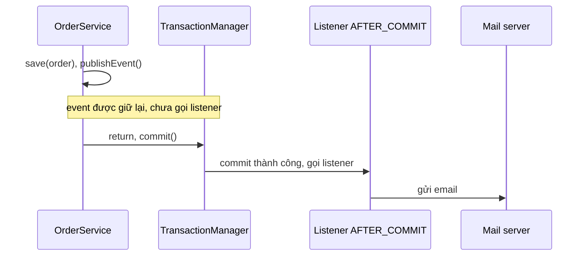
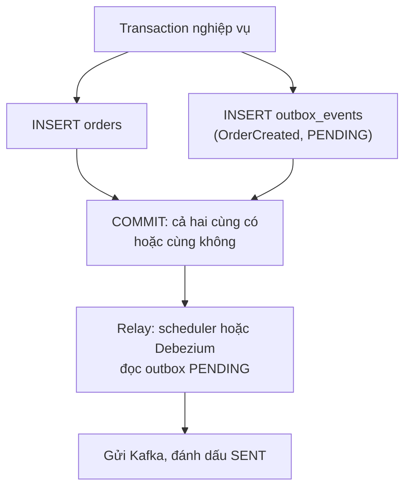

# TransactionTemplate & Transaction Events

> **Tuần 5 · Ngày 33** · Thuộc [[05 - Transaction & JPA]] · Bài trước: [[05.04 - Isolation & readOnly]] · Bài sau: [[05.06 - Entity Lifecycle & Persistence Context]]
> Bài cuối tuần 5 gom ba công cụ để **làm transaction đúng** sau khi đã biết nó hỏng thế nào: `TransactionTemplate` (kiểm soát ranh giới bằng code), `@TransactionalEventListener` (làm việc phụ sau commit), và cách test code có transaction mà không bị test "pass giả".
> Mọi output trong bài đã được **đo thực tế** bằng test `@SpringBootTest` trên Spring Boot 3.5.16 (Spring 6.2, Hibernate 6.6, H2 2.3), JDK 21.

**Mục lục**
1. [[#1. TransactionTemplate: transaction bằng code|TransactionTemplate: transaction bằng code]]
2. [[#2. @TransactionalEventListener: làm việc phụ sau commit|@TransactionalEventListener: làm việc phụ sau commit]]
3. [[#3. Bẫy: ghi DB bên trong AFTER_COMMIT|Bẫy: ghi DB bên trong AFTER_COMMIT]]
4. [[#4. Outbox pattern: nhập môn|Outbox pattern: nhập môn]]
5. [[#5. Test code có transaction|Test code có transaction]]
6. [[#6. Trả lời mẫu tổng hợp|Trả lời mẫu tổng hợp]]
7. [[#7. Kịch bản Feynman hôm nay|Kịch bản Feynman hôm nay]]

---

## 1. TransactionTemplate: transaction bằng code

### Hiểu bản chất
`@Transactional` là cách **khai báo** (declarative): ranh giới transaction là **cả method**, và chỉ chạy khi gọi qua proxy. `TransactionTemplate` là cách **lập trình** (programmatic): bạn truyền một lambda, template mở transaction, chạy lambda, rồi commit hoặc rollback.

Bên trong nó dùng **cùng `PlatformTransactionManager`**, cùng ThreadLocal, cùng propagation. Chỉ khác ở chỗ **không cần proxy**.

### Code minh hoạ

```java
TransactionTemplate tt = new TransactionTemplate(transactionManager);

Long id = tt.execute(status -> repo.save(new Item("tt-1")).id);     // có kết quả

tt.executeWithoutResult(status -> {                                  // rollback bằng tay
    repo.save(new Item("tt-2"));
    status.setRollbackOnly();
});

tt.executeWithoutResult(status -> {                                  // exception → rollback
    repo.save(new Item("tt-3"));
    throw new IllegalStateException("fail");
});
```

| Kịch bản | Đo được |
|---|---|
| Bên trong lambda | `active=true newTx=true` |
| `execute` trả về id | `1`, dòng đã lưu |
| `status.setRollbackOnly()` | không lưu |
| Ném RuntimeException trong lambda | không lưu, exception bay ra ngoài |

Cấu hình như annotation:

```java
TransactionTemplate ro = new TransactionTemplate(transactionManager);
ro.setReadOnly(true);
ro.setTimeout(5);
ro.setIsolationLevel(TransactionDefinition.ISOLATION_READ_COMMITTED);
ro.setPropagationBehavior(TransactionDefinition.PROPAGATION_REQUIRES_NEW);
```

Đo được bên trong template `readOnly`: `isCurrentTransactionReadOnly() = true`.

### Use case 1: mỗi phần tử một transaction trong batch

```java
for (String name : List.of("b-1", "b-2", "b-1", "b-3")) {
    try {
        tt.executeWithoutResult(s -> repo.saveAndFlush(new Item(name)));
        ok++;
    } catch (RuntimeException e) {
        failed++;                       // ghi lại dòng lỗi, chạy tiếp dòng sau
    }
}
```

Đo được: `ok=3 failed=1`, dòng `b-1` thứ hai lỗi `DataIntegrityViolationException` (trùng unique), **`b-3` sau nó vẫn được lưu**. Nếu bọc cả vòng lặp trong một `@Transactional` thì một dòng lỗi làm mất cả lô.

Đây cũng là cách sửa self-invocation gọn nhất (bài [[05.02 - Khi @Transactional không hoạt động]]): không cần tách bean, vì template không dựa vào proxy.

### Use case 2: transaction ngắn xen giữa việc chậm

```java
Order order = tt.execute(s -> orderRepo.save(Order.pending(req)));   // tx 1, ngắn
PaymentResult r = paymentClient.charge(order);                       // ngoài tx
tt.executeWithoutResult(s -> orderService.markPaid(order.getId(), r)); // tx 2, ngắn
```

Đúng như luồng "không gọi API trong transaction" của [[05.04 - Isolation & readOnly]].

### So sánh

| | `@Transactional` | `TransactionTemplate` |
|---|---|---|
| Ranh giới | Cả method | Một khối code bất kỳ |
| Cần proxy | Có (dính self-invocation, private, final) | **Không** |
| Rollback bằng tay | `TransactionAspectSupport.currentTransactionStatus().setRollbackOnly()` | `status.setRollbackOnly()` |
| Đọc code | Gọn | Dài hơn nhưng nhìn thấy rõ ranh giới |
| Dùng khi | Mặc định cho service | Batch từng phần tử, chia nhỏ transaction, tránh self-invocation |

### Bẫy hay gặp
- `TransactionTemplate` vẫn tôn trọng propagation: gọi nó **bên trong** một `@Transactional` khác thì mặc định (`REQUIRED`) nó **tham gia** transaction ngoài, không tạo mới. Muốn transaction riêng thì `setPropagationBehavior(PROPAGATION_REQUIRES_NEW)`.
- `TransactionTemplate` thread-safe sau khi cấu hình xong, nên tạo một lần (ví dụ làm bean hoặc field) và dùng lại.

---

## 2. @TransactionalEventListener: làm việc phụ sau commit

### Hiểu bản chất
Bài toán: đặt hàng xong thì gửi email. Gửi ngay trong method `@Transactional` thì có thể **gửi email cho đơn hàng sau đó bị rollback**. Ta muốn: **chỉ gửi khi đã commit thành công**.

`@TransactionalEventListener` làm đúng việc đó: event được publish trong transaction sẽ được **giữ lại**, và listener chỉ chạy ở **pha** (phase) bạn chọn:

| Phase | Chạy khi | Dùng cho |
|---|---|---|
| `BEFORE_COMMIT` | Ngay trước commit, vẫn trong transaction | Kiểm tra hoặc ghi thêm dữ liệu cùng transaction |
| **`AFTER_COMMIT`** (mặc định) | Commit thành công | Gửi email, notify, đẩy cache, publish message |
| `AFTER_ROLLBACK` | Rollback | Log, cảnh báo |
| `AFTER_COMPLETION` | Sau commit **hoặc** rollback | Dọn dẹp |

### Code minh hoạ

```java
@Transactional
public void place(String n, boolean fail) {
    repo.save(new Item(n));
    publisher.publishEvent(new OrderPlaced(n));
    if (fail) throw new IllegalStateException("place failed");
}

@EventListener void plain(OrderPlaced e) { ... }
@TransactionalEventListener(phase = TransactionPhase.AFTER_COMMIT)
void afterCommit(OrderPlaced e) { ... }
// tương tự cho BEFORE_COMMIT, AFTER_ROLLBACK, AFTER_COMPLETION
```

Listener đã chạy, đo được:

| Kịch bản | Listener đã chạy |
|---|---|
| Commit thành công | `EventListener` → `BEFORE_COMMIT` → (`AFTER_COMMIT`, `AFTER_COMPLETION`) |
| Method ném exception (rollback) | `EventListener` → (`AFTER_ROLLBACK`, `AFTER_COMPLETION`) |
| Publish **ngoài** transaction | **chỉ** `EventListener` |

Các pha trong ngoặc cùng chạy trong callback `afterCompletion` của `TransactionSynchronization`, nên thứ tự giữa chúng theo `@Order` (bằng nhau thì theo thứ tự đăng ký listener, thực tế phụ thuộc tên method), không theo tên pha. Đo lại trên Boot 3.5.16: commit in `AFTER_COMPLETION` trước `AFTER_COMMIT`; đổi tên method thì thứ tự rollback đảo. Chỉ `BEFORE_COMMIT` chắc chắn chạy trước commit.

Ba điều rút ra:
1. `@EventListener` thường chạy **ngay lúc publish**, trong transaction (đo được `active=true`), **kể cả khi sau đó rollback**. Gửi email bằng `@EventListener` là sai.
2. Rollback thì `AFTER_COMMIT` **không chạy**. Đây chính là thứ ta cần.
3. Publish khi **không có transaction** thì `@TransactionalEventListener` **bị bỏ qua im lặng**. Muốn nó vẫn chạy thì đặt `fallbackExecution = true` (không đo trong bài).



### Bẫy hay gặp
- Listener `AFTER_COMMIT` chạy **đồng bộ trên cùng thread**, sau commit nhưng **trước khi method trả về cho controller**. Gửi email chậm 3 giây thì response chậm 3 giây. Thêm `@Async` vào listener để chạy ở thread khác.
- Listener lỗi ở `AFTER_COMMIT` không rollback được gì nữa (đã commit). Email gửi thất bại thì mất, trừ khi bạn tự retry. Nếu bắt buộc không được mất, cần outbox (mục 4).

---

## 3. Bẫy: ghi DB bên trong AFTER_COMMIT

### Hiểu bản chất
Muốn ghi audit log sau khi commit, nhiều người viết:

```java
@TransactionalEventListener                       // mặc định AFTER_COMMIT
void saveAudit(SaveAuditAfterCommit e) {
    auditRepo.save(new AuditLog(e.msg()));       // REQUIRED
}
```

### Code minh hoạ

| Listener `AFTER_COMMIT` ghi audit bằng | Số dòng audit sau đó (đo được) |
|---|---|
| `auditRepo.save(...)` (REQUIRED) | **0** |
| Gọi method `@Transactional(propagation = REQUIRES_NEW)` ở bean khác | **1** |

Vì sao mất? Đo được bên trong listener `AFTER_COMMIT`: `isActualTransactionActive() = true`, tên transaction vẫn là `demo.OrderService.place`. Transaction **đã commit** nhưng resource **chưa được unbind** khỏi ThreadLocal. `save()` với REQUIRED thấy "đang có transaction" nên **tham gia** vào đó, và không còn ai commit lần nữa. Không lỗi, không cảnh báo, dữ liệu **mất im lặng**.

Tài liệu Spring nói rõ: trong `AFTER_COMMIT`, code truy cập dữ liệu vẫn "tham gia" transaction gốc và thay đổi sẽ không được commit; muốn ghi thì dùng `REQUIRES_NEW`.

> **Trả lời mẫu:** "Em dùng `@TransactionalEventListener` với phase AFTER_COMMIT cho việc phụ như gửi email, để chỉ gửi khi đơn hàng đã commit. Em đã test: commit thì BEFORE_COMMIT chạy trước, sau đó AFTER_COMMIT và AFTER_COMPLETION (thứ tự hai cái này theo @Order, không theo tên pha); rollback thì chỉ có AFTER_ROLLBACK và AFTER_COMPLETION; còn `@EventListener` thường thì luôn chạy ngay lúc publish, kể cả khi sau đó rollback. Có hai bẫy: listener chạy đồng bộ nên em thêm `@Async`, và nếu trong AFTER_COMMIT cần ghi DB thì phải dùng REQUIRES_NEW, vì em đo được `repo.save` với REQUIRED trong đó mất dữ liệu im lặng."

### Câu hỏi xoáy

**Q1.** Listener `AFTER_COMMIT` có `@Async` thì còn cần `REQUIRES_NEW` khi ghi DB không?
> [!success]- Gợi ý trả lời
> Không bắt buộc: `@Async` chạy trên thread khác, ThreadLocal trống, nên `repo.save()` tự mở transaction mới của nó. Nhưng nếu listener ghi nhiều bảng cần đi cùng nhau thì vẫn nên gắn `@Transactional` cho method đó.

**Q2.** App sập ngay sau commit, trước khi listener gửi email. Chuyện gì xảy ra?
> [!success]- Gợi ý trả lời
> Email **mất**. Event chỉ nằm trong bộ nhớ, không được lưu ở đâu. Đó là giới hạn của `@TransactionalEventListener`, và là lý do có outbox pattern.

---

## 4. Outbox pattern: nhập môn

### Hiểu bản chất
Bài toán "dual write": đặt hàng xong phải **lưu DB** và **gửi message** sang Kafka để service khác xử lý. Hai hệ thống khác nhau, không có transaction chung:
- Gửi Kafka **trong** transaction: Kafka nhận message rồi DB rollback, service khác xử lý một đơn hàng không tồn tại.
- Gửi Kafka **sau** commit (AFTER_COMMIT): app sập giữa chừng thì message mất (Q2 ở trên).

**Outbox pattern** giải quyết bằng cách biến "gửi message" thành "**ghi một dòng vào DB**", nằm chung transaction với nghiệp vụ:



- Nghiệp vụ và event **commit cùng nhau**, không bao giờ lệch.
- Một tiến trình riêng (relay) đọc bảng outbox và gửi đi. Relay sập thì khởi động lại đọc tiếp, **không mất**.
- Đổi lại: message có thể được gửi **hơn một lần** (gửi xong, chưa kịp đánh dấu SENT thì sập), nên bên nhận phải **idempotent** (bỏ qua message trùng theo event id). Đây là "at-least-once delivery".

### Khi nào cần

| Mức yêu cầu | Giải pháp |
|---|---|
| Mất vài email cũng chấp nhận được | `@TransactionalEventListener(AFTER_COMMIT)` + `@Async` |
| Message **không được mất** (thanh toán, tồn kho giữa các service) | Outbox |

Phần Kafka và idempotency học kỹ hơn ở các tuần sau.

---

## 5. Test code có transaction

### Hiểu bản chất
Đặt `@Transactional` lên **class test** (hoặc dùng `@DataJpaTest`, vốn đã có sẵn) thì Spring TestContext mở transaction **trước mỗi test** và **rollback sau mỗi test**. Tiện vì DB tự sạch, nhưng có ba cái bẫy.

### Code minh hoạ

```java
@SpringBootTest
@Transactional
class TestManagedTxTest {

    @AfterTransaction void after() {          // chạy SAU khi test tx đã kết thúc
        print(jdbc.queryForObject("select count(*) from item where name like 'tm-%'",
                Integer.class));
    }

    @Test void savedButRolledBack() {
        repo.save(new Item("tm-1"));
        print(TestTransaction.isActive() + " " + TestTransaction.isFlaggedForRollback());
        print(repo.existsByName("tm-1"));
    }

    @Test void duplicateWithoutFlush() {
        repo.save(new Item("tm-dup"));
        repo.save(new Item("tm-dup"));        // vi phạm unique!
    }

    @Test @Commit void committed() { repo.save(new Item("tm-commit")); }
}
```

| Test | Đo được trong test | Số dòng sau test |
|---|---|---|
| `savedButRolledBack` | `isActive=true`, `flaggedForRollback=true`, `exists=true` | **0** (rollback) |
| `duplicateWithoutFlush` | **PASS**, không exception | 0 |
| Như trên nhưng gọi `em.flush()` | `org.hibernate.exception.ConstraintViolationException` | 0 |
| `@Commit` | | **1** (đã commit thật) |

### Bẫy 1: chưa flush thì SQL chưa chạy
Entity dùng id kiểu sequence (mặc định của `@GeneratedValue` với H2 và PostgreSQL) thì `save()` **chưa chạy INSERT**, chỉ đưa entity vào persistence context. INSERT chạy khi **flush**, mà flush thường xảy ra lúc **commit**. Test rollback nên **không bao giờ flush**, nên lỗi unique, not null, foreign key **không bao giờ lộ ra**. Test xanh, production đỏ.

Cách sửa: gọi `entityManager.flush()` (hoặc `saveAndFlush`) trước khi assert.

### Bẫy 2: hành vi lúc commit không xảy ra trong test
Test có transaction thì method service `REQUIRED` **tham gia** transaction của test. Mọi thứ chỉ xảy ra lúc commit đều **không xảy ra**:

| Gọi `orders.place(...)` trong test `@Transactional` | Listener đã chạy (đo được) |
|---|---|
| Ngay sau khi gọi | chỉ `EventListener` (không có `AFTER_COMMIT`) |
| Sau `TestTransaction.flagForCommit()` + `TestTransaction.end()` | thêm `BEFORE_COMMIT`, `AFTER_COMMIT`, `AFTER_COMPLETION` |

Tương tự: `UnexpectedRollbackException` không bao giờ ném ra trong test (test tx vốn sẽ rollback), và `LazyInitializationException` bị che vì persistence context của test còn mở suốt test.

### Bẫy 3: dữ liệu `@Commit` ở lại
Test `@Commit` (hoặc test không có transaction) để lại dữ liệu cho test sau. Phải tự dọn (`@Sql`, `deleteAll` trong `@AfterEach`) hoặc dùng tên dữ liệu riêng cho từng test.

### Khi nào dùng gì

| Loại test | Cách |
|---|---|
| Test repository, query | `@DataJpaTest` (tự rollback), nhớ `flush()` |
| Test logic service đơn giản | `@Transactional` trên test cũng được |
| Test hành vi transaction (rollback, propagation, event AFTER_COMMIT) | **Không** để `@Transactional` trên test; tự dọn dữ liệu. Toàn bộ phép đo trong tuần này viết theo cách đó |
| Test với DB thật | Testcontainers PostgreSQL (như bài 05.04) |

> **Trả lời mẫu:** "Test có `@Transactional` hoặc `@DataJpaTest` thì mặc định rollback sau mỗi test, DB tự sạch. Bẫy lớn nhất là SQL chưa được flush: em thử lưu hai entity trùng unique, test vẫn pass; thêm `flush()` thì mới ném ConstraintViolationException. Bẫy thứ hai là service tham gia transaction của test, nên hành vi lúc commit như `AFTER_COMMIT` listener hay `UnexpectedRollbackException` không bao giờ xảy ra; em đo được listener AFTER_COMMIT chỉ chạy sau khi gọi `TestTransaction.flagForCommit()` và `end()`. Vì vậy test hành vi transaction thì em không đặt `@Transactional` trên test mà tự dọn dữ liệu."

### Câu hỏi xoáy

**Q1.** `@Rollback(false)` và `@Commit` khác nhau không?
> [!success]- Gợi ý trả lời
> Như nhau. `@Commit` là cách viết dễ đọc hơn của `@Rollback(false)`.

**Q2.** Test có `@Transactional`, gọi API qua `MockMvc`, controller gọi service lưu dữ liệu. Dữ liệu có bị rollback không?
> [!success]- Gợi ý trả lời
> Có, vì `MockMvc` chạy **cùng thread** với test, nên service tham gia transaction của test. Ngược lại, test với `webEnvironment = RANDOM_PORT` gọi qua HTTP thật thì request chạy trên **thread của server**, không có transaction của test, nên dữ liệu được commit thật và **không** rollback.

---

## 6. Trả lời mẫu tổng hợp

> **"Ngoài @Transactional, em quản lý transaction thế nào?" (~90 giây)**
> "Mặc định em dùng `@Transactional` ở service. Khi cần ranh giới nhỏ hơn method, em dùng `TransactionTemplate`: ví dụ import file mỗi dòng một transaction, em đo được một dòng lỗi thì các dòng sau vẫn được lưu; nó cũng tránh được self-invocation vì không cần proxy. Với việc phụ sau khi lưu như gửi email, em publish event và xử lý bằng `@TransactionalEventListener` phase AFTER_COMMIT, để rollback thì không gửi; listener chạy đồng bộ nên em thêm `@Async`, và nếu cần ghi DB trong đó thì dùng REQUIRES_NEW, vì REQUIRED sẽ mất dữ liệu im lặng. Nếu message tuyệt đối không được mất, ví dụ đồng bộ tồn kho giữa các service, thì dùng outbox: ghi event vào bảng outbox cùng transaction, một relay gửi sang Kafka, bên nhận phải idempotent.
> Khi test, em nhớ test `@Transactional` mặc định rollback nên phải `flush()` để lộ lỗi constraint, và test hành vi lúc commit thì không đặt `@Transactional` trên test."

---

## 7. Kịch bản Feynman hôm nay

1. "Vì sao gửi email bằng `@EventListener` là sai, còn `@TransactionalEventListener` là đúng?" Kể thứ tự listener khi commit và khi rollback.
2. "Vì sao `repo.save()` trong listener AFTER_COMMIT không lưu được?" Giải thích bằng ThreadLocal chưa unbind.
3. Vẽ sơ đồ outbox ra giấy và giải thích vì sao bên nhận phải idempotent.
4. "Test của em xanh nhưng production lỗi unique constraint. Vì sao?"
5. Tổng kết tuần: giải thích @Transactional trong 3 phút không nhìn tài liệu (mục tiêu Chủ nhật trong [[01 - Lộ trình 8 tuần]]).

Ghi vào [[08 - Nhật ký học tập]].

## Tự kiểm tra nhanh (không mở tài liệu)

- [ ] Viết một khối `TransactionTemplate` có rollback bằng tay
- [ ] `TransactionTemplate` gọi trong một `@Transactional` khác thì tạo transaction mới không?
- [ ] 4 phase của `@TransactionalEventListener`; phase mặc định?
- [ ] Publish event ngoài transaction thì `@TransactionalEventListener` có chạy không?
- [ ] Ghi DB trong AFTER_COMMIT cần propagation gì?
- [ ] Outbox giải quyết vấn đề gì? Đổi lại phải chấp nhận điều gì?
- [ ] Vì sao test `@Transactional` lưu dữ liệu trùng unique vẫn pass?
- [ ] MockMvc vs RANDOM_PORT: dữ liệu có bị rollback không?
