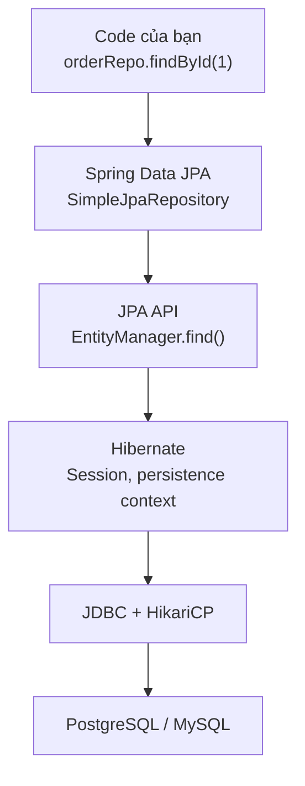
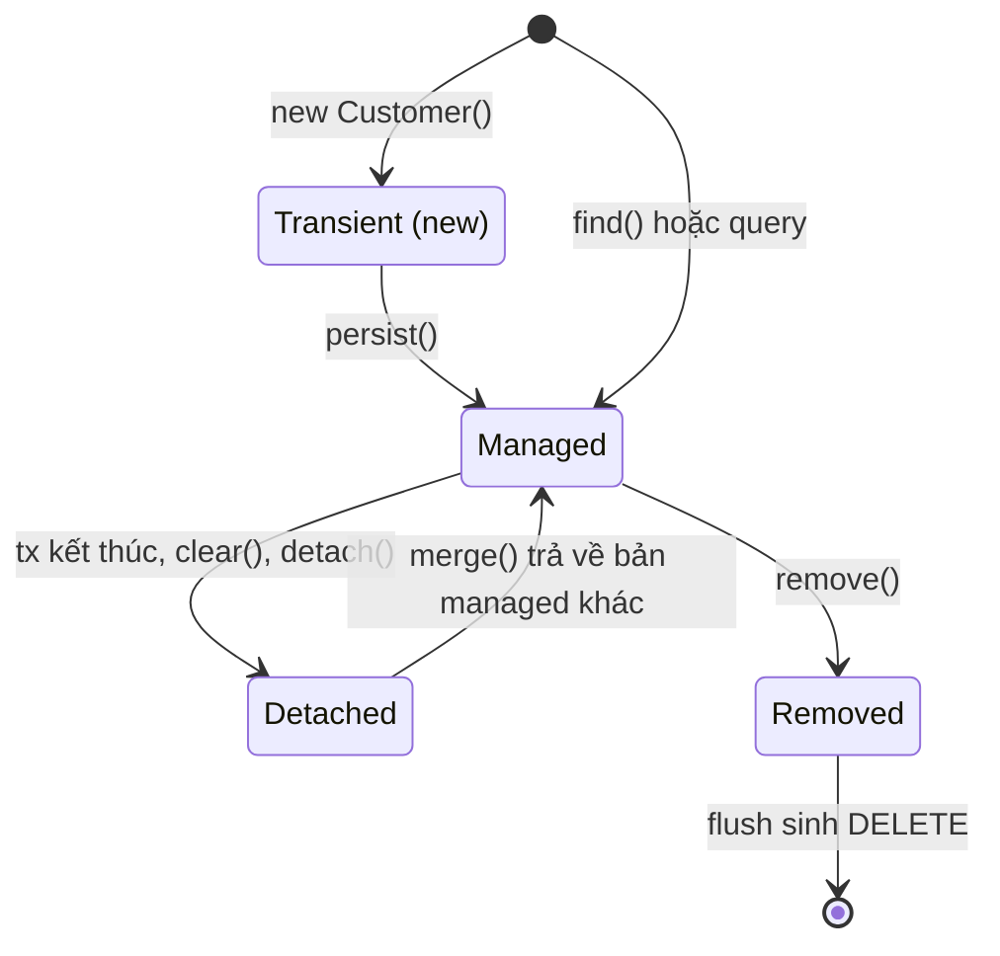
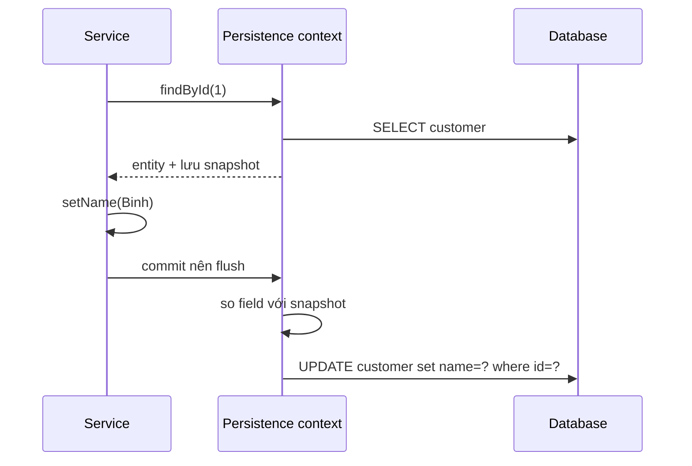

# Entity Lifecycle & Persistence Context

> **Tuần 6 · Ngày 36** · Thuộc [[05 - Transaction & JPA]] · Bài trước: [[05.05 - TransactionTemplate & Transaction Events]] · Bài sau: [[05.07 - Lazy Loading & N+1]]
> Hầu hết các câu "khó" về JPA (N+1, LazyInitializationException, update không cần save, dữ liệu cũ sau bulk update) đều quy về một thứ: **persistence context**. Hiểu chắc bài này thì 2 bài sau dễ hơn nhiều.
> Mọi output trong bài đã được chạy thật trên **Spring Boot 3.5.16 + Hibernate ORM 6.6.53 + PostgreSQL 16.14** (Docker), JDK 21. Số query đếm bằng Hibernate statistics (`getPrepareStatementCount`).

**Mục lục**
1. [[#1. JPA vs Hibernate vs Spring Data JPA|JPA vs Hibernate vs Spring Data JPA]]
2. [[#2. Bốn trạng thái của entity|Bốn trạng thái của entity]]
3. [[#3. persist vs merge vs save|persist vs merge vs save]]
4. [[#4. Persistence context và first-level cache|Persistence context và first-level cache]]
5. [[#5. Dirty checking|Dirty checking]]
6. [[#6. Flush: khi nào SQL thật sự chạy|Flush: khi nào SQL thật sự chạy]]
7. [[#7. Kịch bản Feynman hôm nay|Kịch bản Feynman hôm nay]]

---

## 1. JPA vs Hibernate vs Spring Data JPA

### Hiểu bản chất
Ba cái tên này hay bị dùng lẫn lộn, nhưng chúng là **ba tầng** chồng lên nhau:

| Tầng | Là gì | Bạn chạm vào nó qua |
|---|---|---|
| **JPA** (Jakarta Persistence) | **Specification**: tập interface và annotation, không tự chạy được | `@Entity`, `@Id`, `EntityManager`, JPQL |
| **Hibernate** | **Implementation** của JPA: ORM thật sự sinh SQL, quản lý cache, proxy | `Session`, HQL, `hibernate.*` properties |
| **Spring Data JPA** | Lớp tiện ích **bên trên** JPA: sinh code repository cho bạn | `JpaRepository`, derived query, `Pageable` |



Ví dụ: `orderRepo.save(o)` thực chất là `SimpleJpaRepository.save()`, bên trong gọi `entityManager.persist()` hoặc `entityManager.merge()`, và Hibernate là thứ sinh ra câu `INSERT`.

### Bẫy hay gặp
- "Spring Data JPA là ORM": **sai**. Nó không sinh SQL, nó chỉ gọi `EntityManager`. ORM là Hibernate.
- Đổi từ Hibernate sang EclipseLink "chỉ cần đổi dependency": về lý thuyết đúng vì cùng spec, nhưng thực tế code hay dùng tính năng riêng của Hibernate (`@BatchSize`, `@DynamicUpdate`, HQL đặc thù).

> **Trả lời mẫu:** "JPA là specification, chỉ định nghĩa interface và annotation như `@Entity`, `EntityManager`. Hibernate là implementation phổ biến nhất của JPA, nó mới là thứ quản lý persistence context và sinh SQL. Spring Data JPA nằm trên cùng: em chỉ khai báo interface kế thừa `JpaRepository`, Spring tạo proxy với implementation mặc định là `SimpleJpaRepository`, hỗ trợ derived query, phân trang. Khi gọi `repo.save()`, bên dưới là `entityManager.persist` hoặc `merge`, và Hibernate sinh câu INSERT hay UPDATE."

### Câu hỏi xoáy

**Q1.** `JpaRepository` có phải là một phần của JPA không?
> [!success]- Gợi ý trả lời
> Không. `JpaRepository` thuộc **Spring Data JPA** (package `org.springframework.data.jpa.repository`). JPA chỉ có `EntityManager`, `Query`, annotation mapping. Tên "Jpa" chỉ nói rằng nó dùng JPA bên dưới.

**Q2.** `@Transactional` của repository mặc định là gì?
> [!success]- Gợi ý trả lời
> `SimpleJpaRepository` được đánh `@Transactional(readOnly = true)` ở mức class, các method ghi như `save`, `delete` được đánh lại `@Transactional` (không readOnly). Vì vậy gọi `repo.findById()` ngoài service vẫn có một transaction ngắn riêng, kết thúc ngay khi method trả về (xem mục 4).

---

## 2. Bốn trạng thái của entity

### Hiểu bản chất
Một object entity luôn ở **một trong bốn trạng thái**, tuỳ việc nó có đang được persistence context "theo dõi" hay không.



| State | Có id? | Persistence context theo dõi? | Thay đổi field có tự UPDATE? |
|---|---|---|---|
| **Transient / New** | Thường chưa | Không | Không |
| **Managed** | Có | **Có** | **Có** (dirty checking) |
| **Detached** | Có | Không (đã từng) | Không |
| **Removed** | Có | Có, đánh dấu xoá | DELETE khi flush |

**Ý chính cần nói:** chỉ entity **Managed** mới được dirty checking và mới lazy load được. Trong Spring, entity thường trở thành **Detached ngay khi method `@Transactional` kết thúc**, vì persistence context đóng cùng transaction.

### Code minh hoạ

```java
Customer detached = customers.findById(id).orElseThrow(); // tx của repo đã đóng → detached
// tx khác: không ai theo dõi object này
tx().executeWithoutResult(s -> detached.setName("Dung"));
```

| Tình huống (đã đo) | Số câu UPDATE |
|---|---|
| Sửa entity **detached** bên trong một transaction khác | **0** |

Sửa object detached không có tác dụng gì, kể cả khi bạn đang đứng trong một transaction, vì object đó không thuộc persistence context của transaction này.

### Bẫy hay gặp
- "Có id là managed": sai. Detached cũng có id.
- "Đang trong `@Transactional` thì mọi entity đều managed": sai, chỉ entity được **load hoặc persist trong chính persistence context đó** mới managed.

### Câu hỏi xoáy

**Q1.** Entity detached thì có những cách nào để lưu thay đổi?
> [!success]- Gợi ý trả lời
> (1) `merge(detached)` rồi dùng **bản trả về**; (2) `repo.save(detached)` (bên trong gọi merge); (3) cách em hay dùng nhất: trong transaction, `findById` lấy bản managed rồi copy các field cần sửa từ DTO vào. Cách (3) rõ ràng nhất và tránh ghi đè field không mong muốn.

**Q2.** Có `remove()` một entity detached được không?
> [!success]- Gợi ý trả lời
> Không. Đo được: `em.remove(detached)` ném `IllegalArgumentException: Removing a detached instance demo.Customer#1`. Phải load lại hoặc `merge` trước. `repo.delete(entity)` của Spring Data tự xử lý bằng cách `find` hoặc `merge` trước khi remove.

---

## 3. persist vs merge vs save

### Hiểu bản chất

| | `persist(e)` | `merge(e)` | `repo.save(e)` |
|---|---|---|---|
| Dùng cho | Entity **mới** | Entity **detached** (hoặc mới) | Cả hai |
| Object truyền vào | **Trở thành managed** | **Vẫn detached** | Tuỳ nhánh |
| Giá trị trả về | `void` | **Một bản managed khác** | Bản managed (phải dùng nó) |
| SQL | INSERT (lúc flush, trừ IDENTITY) | SELECT để load bản managed, rồi UPDATE nếu khác | Theo nhánh |

`SimpleJpaRepository.save()` làm đúng một việc: `if (entityInformation.isNew(entity)) em.persist(entity) else return em.merge(entity)`. Entity được coi là "mới" khi id là `null` (hoặc `@Version` là `null` nếu có).

### Code minh hoạ

```java
tx().executeWithoutResult(s -> {
    Customer c = new Customer("New");
    em.persist(c);
    System.out.println(em.contains(c) + " " + (c.getId() != null));
});

Customer detached = customers.findById(id).orElseThrow();
tx().executeWithoutResult(s -> {
    Customer managed = em.merge(detached);
    System.out.println((managed == detached) + " " + em.contains(detached)
        + " " + em.contains(managed));
    detached.setName("ignored");   // sửa nhầm object cũ
});
```

| Đo được | Kết quả |
|---|---|
| Sau `persist(c)`: `em.contains(c)`, có id chưa | `true`, `true` (id lấy từ sequence, **chưa INSERT**) |
| `merge`: `managed == detached` | `false` |
| `merge`: `contains(detached)` / `contains(managed)` | `false` / `true` |
| Tên trong DB sau commit (sửa `detached` sau merge) | Vẫn là tên cũ `X`: thay đổi bị **bỏ qua** |
| `customers.save(detached)` trả về cùng object? | `false` |

### Bẫy hay gặp: `save()` với id tự gán

Entity có `@Id` tự gán (không có `@GeneratedValue`), ví dụ mã `Tag("java")`. Id khác `null` nên Spring Data coi là **không mới**, gọi `merge`, và merge phải SELECT trước:

```text
select t1_0.code from tag t1_0 where t1_0.code=?
insert into tag (code) values (?)
```

Đo được **2 câu SQL** cho một lần `save` entity mới. Insert hàng loạt kiểu này thì số query gấp đôi. Cách sửa: implement `Persistable<ID>` với `isNew()` tự quyết định, hoặc thêm field `@Version` (version `null` nghĩa là mới).

Bẫy thứ hai: **quên dùng giá trị trả về**.

```java
repo.save(dto.toEntity());          // entity detached có id
entity.getVersion();                 // sai: phải dùng object do save() trả về
Customer saved = repo.save(entity);  // đúng
```

> **Trả lời mẫu:** "`persist` dùng cho entity mới: chính object đó trở thành managed, INSERT chạy lúc flush. `merge` dùng cho entity detached: Hibernate load bản managed (SELECT), copy state từ object truyền vào sang, rồi **trả về bản managed đó**, còn object truyền vào vẫn detached. Em đã thử: sửa object cũ sau khi merge thì thay đổi bị bỏ qua. `repo.save()` của Spring Data gọi persist nếu entity mới (id null), ngược lại gọi merge, nên luôn phải dùng giá trị trả về. Một bẫy em gặp là entity tự gán id: save luôn đi nhánh merge, mỗi lần insert tốn thêm một SELECT."

### Câu hỏi xoáy

**Q1.** Gọi `persist()` với entity detached thì sao?
> [!success]- Gợi ý trả lời
> Đo được: `jakarta.persistence.EntityExistsException: detached entity passed to persist: demo.Customer`, cause là `org.hibernate.PersistentObjectException` cùng message. Lỗi này hay gặp khi gán id thủ công cho entity dùng `@GeneratedValue` rồi gọi persist, hoặc cascade PERSIST tới một entity con đã có id.

**Q2.** Trong một `@Transactional`, entity load bằng `findById` rồi sửa, có cần gọi `save()` không?
> [!success]- Gợi ý trả lời
> Không cần (xem mục 5). Gọi `save()` với entity đã managed cũng vô hại: nhánh merge thấy entity đã managed nên trả về chính nó. Nhiều team vẫn gọi để code "rõ ý", nhưng phải hiểu nó không phải là thứ tạo ra UPDATE.

---

## 4. Persistence context và first-level cache

### Hiểu bản chất
**Persistence context** là một `Map` trong bộ nhớ, key là `(loại entity, id)`, value là instance entity, kèm một **snapshot** giá trị lúc load. Hibernate gọi nó là `Session`, JPA gọi là `EntityManager`. Đây chính là **first-level cache**.

Trong Spring, persistence context **sống theo transaction**: mở khi transaction bắt đầu, đóng khi transaction kết thúc. Hai hệ quả:
1. Trong **cùng** transaction, `find` cùng id lần hai không xuống DB và trả về **đúng instance cũ** (đảm bảo "một dòng DB = một object" trong phạm vi context).
2. **Không có** transaction bao ngoài thì mỗi lần gọi repository là một context mới, cache không có tác dụng.

### Code minh hoạ

```java
tx().executeWithoutResult(s -> {
    Customer a = customers.findById(id).orElseThrow();
    Customer b = customers.findById(id).orElseThrow();
    // a == b ?  số query ?
});
Customer a = customers.findById(id).orElseThrow();   // không có tx bao ngoài
Customer b = customers.findById(id).orElseThrow();
```

| Tình huống (đã đo) | Số query | `a == b` |
|---|---|---|
| 2 lần `findById` **trong cùng transaction** | **1** | `true` |
| 2 lần `findById` **không có transaction bao ngoài** | **2** | `false` |
| `findById` rồi JPQL `where c.id = :id` trong cùng tx | **2** | `true` |

Dòng cuối rất hay bị hỏi: **JPQL luôn chạy SQL xuống DB** (first-level cache chỉ phục vụ tra theo id: `find`, `getReference`, lazy load). Nhưng khi kết quả trả về có id đã nằm trong context, Hibernate **trả lại instance đang có** chứ không tạo object mới, và **không ghi đè** giá trị trong memory bằng giá trị mới từ DB.

### Bẫy hay gặp
- "First-level cache giúp giảm tải DB cho cả ứng dụng": sai. Nó chỉ sống trong **một** transaction (một request), không chia sẻ giữa các user. Cache dùng chung là **second-level cache** (Ehcache, Redis...), mặc định tắt (log khởi động: `HHH000026: Second-level cache disabled`).
- Load hàng chục nghìn entity trong một transaction: context giữ tất cả cùng snapshot, tốn RAM và flush chậm (cách xử lý ở [[05.08 - Locking, Batch & Mapping]]).

> **Trả lời mẫu:** "Persistence context là bộ nhớ đệm mức transaction của Hibernate, map theo loại entity và id, mỗi entity kèm một snapshot. Trong cùng transaction, gọi `findById` hai lần chỉ có một câu SELECT và trả về cùng một instance, em đã đo bằng Hibernate statistics. Không có transaction bao ngoài thì mỗi lần gọi repository là một context mới nên query hai lần. Lưu ý JPQL vẫn luôn xuống DB, cache chỉ áp dụng cho tra theo id. Nó khác second-level cache là cache dùng chung giữa các session và mặc định tắt."

### Câu hỏi xoáy

**Q1.** Trong một transaction: load customer (tên "An"), một transaction khác cập nhật tên thành "Binh" và commit, rồi bạn chạy JPQL select lại customer đó. Bạn thấy tên gì?
> [!success]- Gợi ý trả lời
> Vẫn thấy **"An"** (đã đo, và `q == c` là `true`). Câu SQL chạy và trả về "Binh", nhưng Hibernate thấy id đã có trong context nên trả về instance cũ, **không refresh**. Muốn lấy giá trị mới thì `em.refresh(entity)` hoặc `em.clear()` trước khi query. Đây cũng là lý do bulk update gây "đọc dữ liệu cũ" (bài [[05.08 - Locking, Batch & Mapping]]).

**Q2.** `em.clear()` và `em.detach(e)` khác gì?
> [!success]- Gợi ý trả lời
> `detach(e)` gỡ **một** entity (và các entity cascade DETACH) khỏi context. `clear()` gỡ **tất cả**. Thay đổi chưa flush của các entity bị gỡ sẽ **mất**, nên với batch lớn phải `flush()` trước rồi mới `clear()`.

---

## 5. Dirty checking

### Hiểu bản chất
Khi load entity, Hibernate chụp một **snapshot** các giá trị. Lúc **flush**, nó so sánh từng field hiện tại với snapshot; field nào khác thì sinh `UPDATE`. Bạn không cần gọi `save()`.



### Code minh hoạ

```java
@Transactional
public void rename(Long id, String name) {
    Customer c = customers.findById(id).orElseThrow();
    c.setName(name);           // không gọi save()
}
```

| Tình huống (đã đo) | Số UPDATE | Giá trị trong DB |
|---|---|---|
| Setter trong transaction, **không** gọi `save()` | **1** | Đã đổi thành `Binh` |
| Setter gán **đúng giá trị cũ** | **0** | Không đổi |
| Setter trong transaction **`readOnly = true`** | **0** | Không đổi |
| Setter trên entity **detached** | **0** | Không đổi |

SQL sinh ra: `update customer set name=? where id=?`. Mặc định Hibernate UPDATE **tất cả cột** của entity (đo với `Product`: `update product set name=?,stock=?,version=? where id=? and version=?`, dù chỉ đổi `stock`). Muốn chỉ update cột thay đổi thì đánh `@DynamicUpdate` (đổi lại: không tái sử dụng được câu SQL đã prepare).

**Vì sao `readOnly` không UPDATE?** Với Hibernate, Spring đặt session ở chế độ read-only và `FlushMode.MANUAL`: không giữ snapshot, không flush tự động. Đây là lý do nên đánh `@Transactional(readOnly = true)` cho method chỉ đọc: tiết kiệm RAM và CPU dirty checking.

### Bẫy hay gặp
- Sửa entity "cho tiện" để tính toán hiển thị (ví dụ `order.setTotal(total * 0.9)` để hiển thị giá sau giảm) **trong transaction**: commit xong DB bị ghi đè. Tính toán hiển thị nên làm trên DTO.
- Gọi `save()` không làm UPDATE "nhanh hơn": UPDATE vẫn chỉ chạy lúc flush.

> **Trả lời mẫu:** "Khi load entity, Hibernate giữ một snapshot. Lúc flush, thường là ngay trước commit, nó so field hiện tại với snapshot và tự sinh UPDATE cho entity đã thay đổi. Vì vậy trong `@Transactional`, em chỉ cần `findById` rồi gọi setter, không cần `save`. Em đã đo: không save vẫn có đúng 1 câu UPDATE; gán lại đúng giá trị cũ thì 0; transaction `readOnly` thì 0 vì Spring tắt flush; entity detached thì 0. Bẫy thực tế là sửa entity để hiển thị trong transaction làm ghi đè DB, nên em map sang DTO trước."

### Câu hỏi xoáy

**Q1.** Dirty checking có tốn kém không? Khi nào thành vấn đề?
> [!success]- Gợi ý trả lời
> Mỗi lần flush, Hibernate duyệt **mọi entity managed** và so từng field. Với vài chục entity thì không đáng kể. Với hàng chục nghìn entity (job import, báo cáo) thì tốn RAM cho snapshot và CPU khi flush, đặc biệt nếu có nhiều flush (mỗi JPQL trong FlushMode.AUTO có thể kích hoạt flush). Cách xử lý: `readOnly = true` cho đọc, DTO projection, `flush()` + `clear()` theo lô cho ghi.

**Q2.** Exception xảy ra sau khi đã gọi setter thì sao?
> [!success]- Gợi ý trả lời
> RuntimeException làm transaction rollback, flush trước commit không xảy ra (hoặc đã flush thì DB rollback), nên DB không đổi. Nhưng **object trong memory vẫn mang giá trị đã sửa**: đừng dùng lại object đó sau khi bắt exception.

---

## 6. Flush: khi nào SQL thật sự chạy

### Hiểu bản chất
**Flush** = đẩy các thay đổi đang chờ trong persistence context xuống DB bằng SQL. Flush **không phải commit**: sau flush, dữ liệu vẫn nằm trong transaction chưa commit, có thể rollback.

Với `FlushMode.AUTO` (mặc định), Hibernate flush khi:
1. **Trước commit**.
2. **Trước một query** mà kết quả có thể bị ảnh hưởng bởi thay đổi đang chờ.
3. Khi bạn gọi `flush()` hoặc `saveAndFlush()`.

### Code minh hoạ

```java
tx().executeWithoutResult(s -> {
    em.persist(new Customer("Flush"));                               // (1)
    em.createQuery("select count(p) from Product p").getSingleResult();   // (2)
    em.createQuery("select count(c) from Customer c").getSingleResult();  // (3)
    em.persist(new Customer("Flush2"));
    em.createNativeQuery("select count(*) from customer").getSingleResult(); // (4)
});
```

| Thời điểm (đã đo) | Số INSERT đã chạy |
|---|---|
| (1) Ngay sau `persist` | **0** (id lấy từ sequence, INSERT còn chờ) |
| (2) Sau JPQL trên bảng **khác** (`Product`) | **0**: Hibernate thấy query không đụng `customer` nên không flush |
| (3) Sau JPQL trên **`Customer`** | **1**: flush để count thấy bản ghi mới |
| (4) Sau **native query** | **2**: Hibernate không phân tích được SQL thuần nên flush tất cả |

Ngoại lệ quan trọng: entity dùng **`GenerationType.IDENTITY`** thì `persist` phải **INSERT ngay** để DB sinh id. Đã đo: 1000 lần `persist` entity IDENTITY tạo ra 1000 câu INSERT riêng lẻ, ngay lúc gọi. Hệ quả với batch insert xem [[05.08 - Locking, Batch & Mapping]].

### save vs saveAndFlush vs flush

| Method | Làm gì | Khi nào dùng |
|---|---|---|
| `save()` | persist/merge vào context, SQL có thể chưa chạy | Mặc định |
| `saveAndFlush()` | save rồi flush ngay (chưa commit) | Cần bắt lỗi constraint (unique, FK) **ngay tại chỗ** để xử lý |
| `flush()` | Flush toàn bộ context | Batch lớn (flush rồi clear), hoặc trước khi gọi native SQL/stored procedure tự viết |

### Bẫy hay gặp
- Bắt `DataIntegrityViolationException` quanh `repo.save()`: thường **không bắt được**, vì INSERT chạy lúc commit, sau khi method đã thoát khỏi `try`. Muốn bắt thì `saveAndFlush`.
- `saveAndFlush` trong vòng lặp: phá batch, mỗi vòng một round trip.

> **Trả lời mẫu:** "Flush là đẩy thay đổi trong persistence context xuống DB bằng SQL, nhưng chưa commit. Ở FlushMode.AUTO, Hibernate flush trước commit, trước query có thể bị ảnh hưởng, và khi gọi flush. Em đã thử: persist một Customer, query trên Product thì chưa INSERT, query trên Customer thì INSERT chạy trước, native query thì flush hết. Ngoại lệ là IDENTITY: persist phải INSERT ngay để lấy id. Thực tế em dùng `saveAndFlush` khi muốn bắt lỗi unique constraint ngay trong service, còn bình thường để Hibernate tự flush lúc commit."

### Câu hỏi xoáy

**Q1.** Flush xong rồi exception thì dữ liệu đã flush có vào DB không?
> [!success]- Gợi ý trả lời
> Không. Flush chỉ gửi SQL trong transaction đang mở. Transaction rollback thì mọi thay đổi (kể cả đã flush) đều bị huỷ. Các transaction khác (isolation READ COMMITTED) cũng không thấy dữ liệu đã flush nhưng chưa commit.

**Q2.** `FlushMode.COMMIT` khác `AUTO` thế nào? Khi nào dùng?
> [!success]- Gợi ý trả lời
> `COMMIT` chỉ flush lúc commit, không flush trước query. Query có thể **không thấy** thay đổi của chính transaction mình. Đổi lại ít flush hơn. Hiếm khi cần đổi; trong Spring, `readOnly = true` còn đặt `MANUAL` (không bao giờ tự flush).

**Q3.** Thứ tự SQL khi flush có giống thứ tự bạn gọi method không?
> [!success]- Gợi ý trả lời
> Không hẳn. Hibernate flush theo thứ tự cố định: INSERT, rồi UPDATE, rồi xoá phần tử collection, rồi DELETE. Đã đo: trong cùng transaction, `remove` một member rồi `persist` member mới **cùng email unique** ném `DataIntegrityViolationException` (`duplicate key value violates unique constraint "member_email_key"`), vì INSERT chạy trước DELETE. Cách xử lý: gọi `flush()` sau khi delete.

---

## 7. Kịch bản Feynman hôm nay

1. Vẽ lại state diagram 4 trạng thái entity ra giấy, rồi giải thích vì sao entity trả về từ service ra controller là detached.
2. "Vì sao em không cần gọi `save()` sau khi sửa entity?" Trả lời trong 60 giây, phải có từ: snapshot, flush, managed.
3. Giải thích `merge` bằng ví dụ: sửa object cũ sau khi merge thì chuyện gì xảy ra.
4. Kể bảng đo flush 4 dòng (persist, query bảng khác, query cùng bảng, native) mà không nhìn bài.

Ghi vào [[08 - Nhật ký học tập]].

## Tự kiểm tra nhanh (không mở tài liệu)

- [ ] JPA, Hibernate, Spring Data JPA: mỗi cái là gì?
- [ ] 4 trạng thái entity, trạng thái nào được dirty checking?
- [ ] `merge(detached)` trả về gì? Object truyền vào có thành managed không?
- [ ] `save()` quyết định persist hay merge dựa vào đâu? Bẫy với id tự gán?
- [ ] 2 lần `findById` trong cùng tx: mấy query? Ngoài tx: mấy query?
- [ ] Transaction `readOnly` có UPDATE khi gọi setter không? Vì sao?
- [ ] 3 thời điểm flush ở FlushMode.AUTO
- [ ] Vì sao `try { repo.save(x) } catch (DataIntegrityViolationException e)` thường không bắt được?
