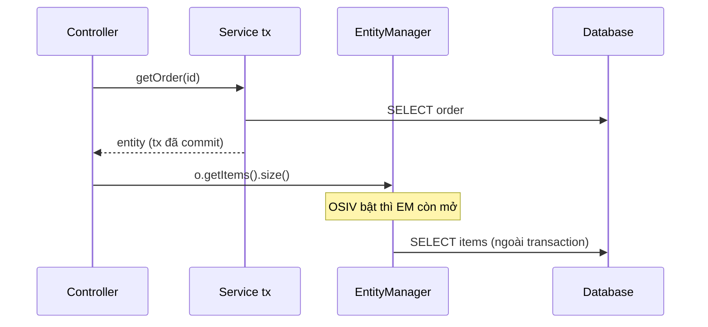

# Lazy Loading & N+1

> **Tuần 6 · Ngày 37** · Thuộc [[05 - Transaction & JPA]] · Bài trước: [[05.06 - Entity Lifecycle & Persistence Context]] · Bài sau: [[05.08 - Locking, Batch & Mapping]]
> N+1 là câu **gần như chắc chắn bị hỏi** khi phỏng vấn JPA, và người phỏng vấn thường hỏi tiếp: "Đo bằng gì? Sửa thế nào? Phân trang thì sao?". Bài này trả lời cả ba bằng số đo thật.
> Mọi output đã chạy trên **Spring Boot 3.5.16 + Hibernate ORM 6.6.53 + PostgreSQL 16.14** (Docker), JDK 21. Dữ liệu: **10 order, mỗi order 3 item, 10 customer**. Số query đếm bằng Hibernate statistics.

**Mục lục**
1. [[#1. FetchType mặc định và proxy|FetchType mặc định và proxy]]
2. [[#2. LazyInitializationException và OSIV|LazyInitializationException và OSIV]]
3. [[#3. N+1: tái hiện và phát hiện|N+1: tái hiện và phát hiện]]
4. [[#4. Bốn cách sửa N+1 (đã đo)|Bốn cách sửa N+1 (đã đo)]]
5. [[#5. Bẫy: JOIN FETCH + phân trang|Bẫy: JOIN FETCH + phân trang]]
6. [[#6. Bẫy: MultipleBagFetchException|Bẫy: MultipleBagFetchException]]
7. [[#7. Kịch bản Feynman hôm nay|Kịch bản Feynman hôm nay]]

Mô hình dùng trong bài:

```java
@Entity @Table(name = "orders")
public class Order {
    @Id @GeneratedValue(strategy = GenerationType.SEQUENCE) Long id;
    @ManyToOne(fetch = FetchType.LAZY) Customer customer;
    @OneToMany(mappedBy = "order", cascade = CascadeType.ALL, orphanRemoval = true)
    List<OrderItem> items = new ArrayList<>();
    @OneToMany(mappedBy = "order", cascade = CascadeType.ALL)
    List<Payment> payments = new ArrayList<>();
}
```

---

## 1. FetchType mặc định và proxy

### Hiểu bản chất

| Association | Default theo spec JPA | Nên đặt |
|---|---|---|
| `@ManyToOne`, `@OneToOne` | **EAGER** | `LAZY` |
| `@OneToMany`, `@ManyToMany` | **LAZY** | Giữ `LAZY` |

Mẹo nhớ: phía "một" (to-One) mặc định EAGER, phía "nhiều" (to-Many) mặc định LAZY.

**LAZY hoạt động thế nào?** Hibernate không load association ngay mà đặt vào đó một **vật thế chỗ**:
- To-one: một **proxy**, là subclass của entity do Hibernate sinh lúc runtime, chỉ biết id.
- Collection: một wrapper như `PersistentBag` (cho `List`) hay `PersistentSet` (cho `Set`).

Lần đầu bạn gọi method cần dữ liệu, proxy mới chạy SELECT, **với điều kiện persistence context còn mở**.

### Code minh hoạ

```java
Order x = orders.findById(oid).orElseThrow();   // trong transaction
Customer c = x.getCustomer();
c.getClass().getSimpleName();   // proxy
c.getId();                      // có SELECT không?
c.getName();                    // có SELECT không?
x.getItems().getClass().getName();
```

| Đo được | Kết quả |
|---|---|
| Class của `getCustomer()` | `Customer$HibernateProxy` |
| Query sau `c.getId()` | **0** (proxy đã biết id) |
| Query sau `c.getName()` | **1** |
| Class của `getItems()` | `org.hibernate.collection.spi.PersistentBag` |

### Bẫy hay gặp: EAGER cũng gây N+1

Nhiều người nghĩ EAGER "load sẵn nên không N+1". Đo với `Invoice` có `@ManyToOne Customer customer` (không ghi fetch, tức EAGER mặc định), 10 invoice thuộc 10 customer khác nhau:

| Cách gọi (đã đo) | Số query |
|---|---|
| `invoiceRepo.findAll()` | **11** |
| JPQL `select i from Invoice i` | **11** |

JPQL chỉ select bảng `invoice`, sau đó Hibernate thấy association EAGER nên **bắt buộc** phải load customer cho từng dòng. EAGER không tắt được ở mức query, nên đó là lý do best practice là **mọi association đều LAZY**, rồi fetch theo từng use case.

> **Trả lời mẫu:** "Theo spec, to-one mặc định EAGER, to-many mặc định LAZY. Em đặt tất cả thành LAZY, vì EAGER không tắt được ở mức query và vẫn gây N+1: em đã đo `findAll` 10 invoice có `@ManyToOne` mặc định ra 11 query. LAZY hoạt động nhờ proxy: với to-one là subclass của entity chỉ chứa id, với collection là `PersistentBag` hay `PersistentSet`. Gọi `getId()` trên proxy không tốn query, gọi field khác mới SELECT, và chỉ được khi persistence context còn mở."

### Câu hỏi xoáy

**Q1.** `em.find()` và `em.getReference()` khác nhau thế nào?
> [!success]- Gợi ý trả lời
> `find` SELECT ngay (hoặc lấy từ first-level cache), không có thì trả `null`. `getReference` trả về **proxy** chưa query; chỉ khi truy cập field mới SELECT, không tồn tại thì ném `EntityNotFoundException` lúc đó. Dùng `getReference` (Spring Data: `getReferenceById`) khi chỉ cần gán khoá ngoại: `item.setOrder(orderRepo.getReferenceById(orderId))` không tốn SELECT order (đo được: 0 query).

**Q2.** Vì sao `instanceof` hoặc `getClass()` với proxy có thể gây bug?
> [!success]- Gợi ý trả lời
> Proxy là subclass sinh động, nên `c.getClass() == Customer.class` là `false` (đo được tên class `Customer$HibernateProxy`). `equals` viết bằng `getClass() != o.getClass()` sẽ sai khi so entity thật với proxy. Dùng `Hibernate.getClass(obj)` hoặc `instanceof`, và truy cập field qua getter thay vì truy cập trực tiếp `o.id` trong `equals`.

---

## 2. LazyInitializationException và OSIV

### Hiểu bản chất
`LazyInitializationException` xảy ra khi bạn chạm vào proxy hoặc collection LAZY **sau khi persistence context đã đóng**, tức entity đã detached. Proxy muốn SELECT nhưng không còn session nào để chạy.

Message thật đo được (Hibernate 6.6):

```text
LazyInitializationException: failed to lazily initialize a collection of role:
  demo.Order.items: could not initialize proxy - no Session

LazyInitializationException: Could not initialize proxy [demo.Customer#6] - no session
```

Dòng 1 là collection, dòng 2 là proxy to-one. Đọc message là biết ngay association nào bị truy cập.

### OSIV: vì sao lỗi "tự biến mất"

**OSIV** (Open Session In View) là interceptor của Spring MVC giữ `EntityManager` mở **từ đầu tới cuối HTTP request**, kể cả khi transaction của service đã kết thúc. Spring Boot **bật mặc định** và log WARN lúc khởi động:

```text
spring.jpa.open-in-view is enabled by default. Therefore, database queries may be
performed during view rendering. Explicitly configure spring.jpa.open-in-view
to disable this warning
```

Đo với cùng một controller truy cập lazy collection:

```java
@GetMapping("/orders/{id}/item-count")
int itemCount(@PathVariable Long id) {
    Order o = orders.findById(id).orElseThrow();   // tx của repository kết thúc ở đây
    return o.getItems().size();                      // lazy load ở controller
}
```

| Cấu hình (đã đo bằng MockMvc) | Kết quả |
|---|---|
| OSIV bật (mặc định) | HTTP 200, body `3`, **2 query** (1 order + 1 items) |
| `spring.jpa.open-in-view=false` | `LazyInitializationException` (message như trên) |



**Vì sao nên tắt OSIV?**
1. Query lazy chạy ở controller hoặc lúc Jackson serialize, **ngoài transaction**, rất dễ thành N+1 mà không ai thấy trong service.
2. Connection DB bị giữ suốt request (kể cả lúc render, gọi API khác), pool nhanh cạn khi tải cao.
3. Lỗi bị che: chạy ổn ở dev, nhưng code phụ thuộc ngầm vào việc session còn mở.

### Cách xử lý đúng

| Cách | Đánh giá |
|---|---|
| Tắt OSIV, fetch đủ trong service bằng `JOIN FETCH` / `@EntityGraph` | ✓ Nên làm |
| Map sang **DTO** ngay trong transaction, controller không thấy entity | ✓ Nên làm |
| Đổi association sang EAGER | ✗ Gây N+1 ở mọi chỗ khác |
| `hibernate.enable_lazy_load_no_trans=true` | ✗ Mỗi lần lazy load mở session và connection mới, N+1 trá hình |
| Thêm `@Transactional` lên controller | ✗ Transaction kéo dài cả request |

> **Trả lời mẫu:** "LazyInitializationException xảy ra khi truy cập association LAZY sau khi persistence context đóng, ví dụ entity trả từ service ra controller rồi Jackson serialize collection. Spring Boot bật OSIV mặc định nên lỗi thường bị giấu: em đã thử cùng một controller, OSIV bật thì trả 200 kèm thêm một query ngoài transaction, tắt OSIV thì ném đúng exception đó. Em tắt OSIV vì nó giữ connection suốt request và gây N+1 ngầm ở tầng view. Cách sửa đúng là fetch đủ dữ liệu trong service bằng JOIN FETCH hoặc EntityGraph, và trả DTO thay vì entity."

### Câu hỏi xoáy

**Q1.** Tắt OSIV trên dự án đang chạy thì rủi ro gì? Làm thế nào an toàn?
> [!success]- Gợi ý trả lời
> Mọi chỗ đang lazy load ngoài service (controller, mapper, Jackson) sẽ ném `LazyInitializationException`. Cách làm: bật log SQL ở môi trường test, chạy bộ integration test hoặc test tay các API chính, sửa từng chỗ bằng fetch join hoặc DTO, rồi mới tắt ở production.

**Q2.** Vì sao trả entity ra JSON là ý tưởng tồi kể cả khi không có lỗi lazy?
> [!success]- Gợi ý trả lời
> (1) Lộ cấu trúc DB và field nhạy cảm; (2) quan hệ hai chiều gây vòng lặp vô hạn khi serialize; (3) Jackson gọi mọi getter, kích hoạt lazy load ngoài ý muốn; (4) đổi entity là đổi API contract. DTO tách hai thứ này ra.

---

## 3. N+1: tái hiện và phát hiện

### Hiểu bản chất
**N+1** = 1 query lấy danh sách cha, rồi **N query** nữa, mỗi query lấy association của một phần tử. Nguyên nhân gốc: lazy load chạy **từng phần tử một** trong vòng lặp.

```java
@Transactional(readOnly = true)
public int countItems() {
    List<Order> list = orderRepo.findAll();        // 1 query
    int n = 0;
    for (Order o : list) n += o.getItems().size(); // mỗi order thêm 1 query
    return n;
}
```

| Vòng lặp truy cập (đã đo, 10 order) | Số query |
|---|---|
| `o.getItems().size()` | **11** |
| `o.getCustomer().getName()` | **11** |

Trên log SQL, dấu hiệu nhận biết là **cùng một câu lặp lại N lần**, chỉ khác tham số:

```text
select ... from orders o1_0
select ... from order_item i1_0 where i1_0.order_id=?
select ... from order_item i1_0 where i1_0.order_id=?
... (lặp 10 lần)
```

Với 10 order thì vô hại. Với API trả 500 order, mỗi query 1 ms qua mạng, là 500 ms chỉ để chờ round trip.

### Phát hiện

| Công cụ | Cấu hình | Dùng khi |
|---|---|---|
| Log SQL | `logging.level.org.hibernate.SQL=DEBUG` | Dev: nhìn bằng mắt |
| Hibernate statistics | `spring.jpa.properties.hibernate.generate_statistics=true` | Đếm số statement trong test |
| Assert số query trong test | datasource-proxy, hoặc `Statistics.getPrepareStatementCount()` | Chặn N+1 quay lại (regression) |
| APM | Datadog, New Relic, Glowroot | Production: thấy một request có hàng trăm span SQL |

Em khuyên dùng `logging.level.org.hibernate.SQL` thay vì `spring.jpa.show-sql=true`: show-sql in thẳng ra stdout, không qua logger, không tắt bật theo package được.

> **Trả lời mẫu:** "N+1 là khi load một danh sách cha bằng 1 query, rồi truy cập association lazy trong vòng lặp nên mỗi phần tử sinh thêm 1 query. Em tái hiện với 10 order: `findAll` rồi `getItems()` ra 11 query. Em phát hiện bằng log `org.hibernate.SQL`, dấu hiệu là một câu SELECT lặp lại với tham số khác nhau; trong test thì bật Hibernate statistics và assert số query, để N+1 không quay lại khi ai đó sửa code."

### Câu hỏi xoáy

**Q1.** N+1 có xảy ra với `@ManyToOne` LAZY không, hay chỉ với collection?
> [!success]- Gợi ý trả lời
> Có. Đo được: duyệt 10 order và gọi `getCustomer().getName()` cũng ra 11 query. Nếu nhiều order cùng một customer thì ít hơn, vì customer đã load nằm trong first-level cache.

---

## 4. Bốn cách sửa N+1 (đã đo)

### Code minh hoạ

```java
// 1. JOIN FETCH
@Query("select o from Order o join fetch o.items")
List<Order> findAllWithItems();

// 2. @EntityGraph
@EntityGraph(attributePaths = "items")
@Query("select o from Order o")
List<Order> findAllGraph();

// 3. Batch fetching (application.properties)
// spring.jpa.properties.hibernate.default_batch_fetch_size=50
// hoặc @BatchSize(size = 50) trên association

// 4. DTO projection
public record OrderSummary(Long id, String customer, long total, int itemCount) {}

@Query("select new demo.OrderSummary(o.id, c.name, o.total, size(o.items)) "
     + "from Order o join o.customer c")
List<OrderSummary> summaries();
```

### Kết quả đo (10 order, 30 item)

| Cách | Số query | SQL chính |
|---|---|---|
| Không sửa | **11** | 1 + 10 lần `where order_id=?` |
| `JOIN FETCH` | **1** | `from orders o1_0 join order_item i1_0 on o1_0.id=i1_0.order_id` |
| `@EntityGraph` | **1** | Giống JOIN FETCH (`left join`) |
| `default_batch_fetch_size=4` | **4** | 1 + 3 lần `where i1_0.order_id = any (?)` |
| `default_batch_fetch_size=50` | **2** | 1 + 1 lần `= any (?)` |
| DTO projection | **1** | `select o1_0.id,c1_0.name,o1_0.total,(select count(*) ...)` |

Batch fetching: khi lazy load collection của order đầu tiên, Hibernate lấy luôn collection của tối đa `N` order khác đang chờ trong context, gom id vào **một** câu. 10 order với size 4 nên cần `ceil(10/4) = 3` câu. Trên PostgreSQL, Hibernate 6 truyền cả mảng id vào một tham số `= any (?)` thay vì `IN (?, ?, ?...)`.

**Điểm mới ở Hibernate 6:** JOIN FETCH collection trả về **10 order, không bị nhân bản** thành 30 dòng như Hibernate 5. Hibernate 6 tự loại trùng parent, nên `distinct` trong JPQL không còn bắt buộc (vẫn được, vô hại).

### Chọn cách nào?

| Cách | Ưu điểm | Nhược điểm |
|---|---|---|
| `JOIN FETCH` | 1 query, kiểm soát rõ | Phải viết JPQL; bẫy phân trang (mục 5), nhiều bag (mục 6) |
| `@EntityGraph` | Gắn lên derived query, không viết JPQL | Cùng các bẫy như JOIN FETCH |
| Batch fetching | Bật một lần, sửa N+1 ở **mọi nơi**; không vỡ phân trang | Vẫn nhiều hơn 1 query; là "lưới an toàn" chứ không tối ưu nhất |
| DTO projection | Nhẹ nhất: chỉ cột cần, không dirty checking, không proxy | Không sửa được entity; phải tạo DTO |

Ở dự án, em đặt `default_batch_fetch_size` (khoảng 50–100) làm lưới an toàn toàn cục, dùng `@EntityGraph`/JOIN FETCH cho màn hình chi tiết cần entity, và DTO projection cho API danh sách chỉ đọc.

### Bẫy hay gặp
- `JOIN FETCH` với `join` (inner) **bỏ mất** order không có item nào. Cần giữ thì `left join fetch`. `@EntityGraph` luôn sinh `left join`.
- Điều kiện `where` trên alias fetch (`join fetch o.items i where i.qty > 1`) làm collection trong memory **thiếu phần tử** so với DB, và Hibernate có thể ghi sai nếu cascade. Lọc collection thì dùng DTO hoặc query riêng.

> **Trả lời mẫu:** "Em có bốn cách và đã đo trên 10 order: không sửa là 11 query; `JOIN FETCH` và `@EntityGraph` còn 1 query; `default_batch_fetch_size` gom id thành mảng, size 50 còn 2 query, size 4 thì 4 query; DTO projection 1 query và chỉ lấy cột cần. Trong dự án em bật batch fetch size toàn cục làm lưới an toàn, dùng EntityGraph cho màn chi tiết, DTO cho API danh sách. Lưu ý JOIN FETCH collection không đi chung với phân trang được, và Hibernate 6 đã tự loại trùng parent nên không cần `distinct` nữa."

### Câu hỏi xoáy

**Q1.** `@BatchSize` và `default_batch_fetch_size` khác gì nhau?
> [!success]- Gợi ý trả lời
> `@BatchSize(size = 50)` đặt trên một association (hoặc class entity) cụ thể. `hibernate.default_batch_fetch_size` áp dụng cho **mọi** lazy association và proxy chưa có `@BatchSize`. Dùng property toàn cục cho đơn giản, ghi đè bằng annotation khi cần.

**Q2.** Fetch 3 cấp (order → items → product) thì làm sao?
> [!success]- Gợi ý trả lời
> `@EntityGraph(attributePaths = {"items", "items.product"})` hoặc `join fetch o.items i join fetch i.product`. `product` là to-one nên không gây tích Descartes. Nếu thêm một collection thứ hai ở cùng cấp thì xem mục 6.

---

## 5. Bẫy: JOIN FETCH + phân trang

### Hiểu bản chất
Muốn trang 1, 3 order, kèm items:

```java
@Query(value = "select o from Order o join fetch o.items",
       countQuery = "select count(o) from Order o")
Page<Order> pageWithItems(Pageable p);
```

`LIMIT 3` trên câu JOIN sẽ cắt theo **dòng kết quả** (dòng order nhân với item), nên có thể ra 1 order với 3 item. Hibernate biết điều này nên **không** thêm LIMIT vào SQL, mà load toàn bộ rồi cắt trang trong memory, kèm WARN.

Đo được:

```text
WARN  HHH90003004: firstResult/maxResults specified with collection fetch;
      applying in memory
select ... from orders o1_0 join order_item i1_0 on o1_0.id=i1_0.order_id
select count(o1_0.id) from orders o1_0
```

Kết quả: `content=3, total=10, 2 query`. Đúng kết quả, nhưng câu thứ nhất **không có LIMIT**: bảng có 1 triệu order thì 1 triệu order (nhân số item) được kéo lên RAM chỉ để lấy 3. Ở test thì nhanh, lên production thì OutOfMemoryError.

Có thể bắt Hibernate ném lỗi thay vì chỉ WARN: `spring.jpa.properties.hibernate.query.fail_on_pagination_over_collection_fetch=true`. Đo được khi bật: `JpaSystemException: setFirstResult() or setMaxResults() specified with collection fetch join (in-memory pagination was about to be applied, ...)`. Nên bật để phát hiện sớm ở test.

### Cách sửa: phân trang trên id trước, fetch sau

```java
@Query("select o.id from Order o")
Page<Long> pageIds(Pageable p);

@Query("select distinct o from Order o join fetch o.items where o.id in :ids")
List<Order> findWithItemsByIds(@Param("ids") List<Long> ids);

Page<Long> ids = orderRepo.pageIds(PageRequest.of(0, 3, Sort.by("id")));
List<Order> page = orderRepo.findWithItemsByIds(ids.getContent());
```

Đo được: **3 query** (trang id có LIMIT, count, fetch theo 3 id), ra 3 order với 9 item, và không còn WARN. Lưu ý query thứ hai không giữ thứ tự của `in`, cần sort lại theo thứ tự id nếu UI cần.

Cách khác: phân trang entity bình thường (không fetch), để `default_batch_fetch_size` load items: 1 query trang + 1 count + 1 batch.

> **Trả lời mẫu:** "JOIN FETCH collection kết hợp Pageable thì LIMIT trên SQL sẽ cắt theo dòng join chứ không theo order, nên Hibernate bỏ LIMIT, load hết rồi cắt trang trong memory và log `HHH90003004: firstResult/maxResults specified with collection fetch; applying in memory`. Em đã tái hiện: kết quả đúng nhưng SQL không có LIMIT, bảng lớn sẽ tràn RAM. Cách sửa của em là query trang id trước rồi fetch join theo danh sách id, hoặc phân trang thường và dựa vào batch fetching. Em cũng bật `fail_on_pagination_over_collection_fetch` để lỗi lộ ra ngay ở test."

### Câu hỏi xoáy

**Q1.** JOIN FETCH một **to-one** (`join fetch o.customer`) với Pageable có bị cảnh báo không?
> [!success]- Gợi ý trả lời
> Không. To-one không nhân số dòng (mỗi order đúng một customer), nên LIMIT vẫn đúng. Đo được: không có WARN, SQL kết thúc bằng `join customer c1_0 on ... fetch first ? rows only`. Vấn đề chỉ xảy ra với fetch **collection**.

---

## 6. Bẫy: MultipleBagFetchException

### Hiểu bản chất
"Bag" là cách Hibernate gọi collection kiểu `List` không có cột thứ tự (`@OrderColumn`): cho phép trùng, không có index. Fetch join **hai bag cùng lúc** tạo tích Descartes (items × payments), và Hibernate không có cách nào biết dòng nào trùng thật, dòng nào trùng do join. Nên nó từ chối.

```java
em.createQuery("select o from Order o join fetch o.items join fetch o.payments", Order.class)
  .getResultList();
```

Đo được:

```text
java.lang.IllegalArgumentException:
  org.hibernate.loader.MultipleBagFetchException:
  cannot simultaneously fetch multiple bags: [demo.Order.items, demo.Order.payments]
```

### Cách sửa

| Cách | Ghi chú |
|---|---|
| Fetch từng collection bằng **query riêng** trong cùng transaction | Query 1 fetch items, query 2 fetch payments cho cùng các order; first-level cache ghép lại. Khuyên dùng |
| Một collection fetch join, collection kia để **batch fetching** | Đơn giản, 2–3 query |
| Đổi `List` thành `Set` | Hết exception, nhưng **tích Descartes vẫn còn**: 10 item × 10 payment = 100 dòng cho 1 order. Dữ liệu lớn thì rất chậm |

> **Trả lời mẫu:** "Fetch join hai collection kiểu List cùng lúc thì Hibernate ném `MultipleBagFetchException: cannot simultaneously fetch multiple bags`, vì join hai collection tạo tích Descartes và với bag nó không phân biệt được bản ghi trùng. Đổi sang Set thì hết lỗi nhưng tích Descartes vẫn còn, nên em thường fetch từng collection bằng query riêng trong cùng transaction, hoặc fetch join một cái còn cái kia dùng batch fetching."

### Câu hỏi xoáy

**Q1.** Vì sao tích Descartes nguy hiểm dù đổi sang `Set` đã chạy được?
> [!success]- Gợi ý trả lời
> Số dòng DB trả về là tích kích thước các collection. Order có 50 item và 20 payment thì một order đã ra 1000 dòng; trang 20 order ra 20 000 dòng chỉ để dựng 20 object. Tốn băng thông, RAM và CPU dựng object. Query riêng cho mỗi collection chỉ trả 50 + 20 dòng.

---

## 7. Kịch bản Feynman hôm nay

1. Giải thích N+1 cho một bạn junior bằng ví dụ 10 order, rồi kể 4 cách sửa kèm số query đo được (11, 1, 1, 2).
2. "OSIV là gì, vì sao em tắt nó?" trong 60 giây, có ví dụ controller trả 200 khi bật và ném exception khi tắt.
3. Giải thích vì sao JOIN FETCH + Pageable bị phân trang trong memory, và cách sửa bằng 2 query.
4. Vẽ lại sơ đồ N+1 trong [[06 - Sơ đồ cơ chế cốt lõi]] (mục 5) mà không nhìn.

Ghi vào [[08 - Nhật ký học tập]].

## Tự kiểm tra nhanh (không mở tài liệu)

- [ ] FetchType mặc định của 4 loại association
- [ ] Gọi `getId()` trên proxy lazy có SELECT không?
- [ ] Message của `LazyInitializationException` với collection có những gì?
- [ ] OSIV mặc định bật hay tắt? 3 lý do nên tắt
- [ ] 4 cách sửa N+1 và số query đo được của mỗi cách
- [ ] `default_batch_fetch_size=4` với 10 order: mấy query?
- [ ] Mã cảnh báo khi JOIN FETCH + Pageable, và 2 cách sửa
- [ ] `MultipleBagFetchException` do đâu? Vì sao đổi sang Set chưa phải cách tốt?
