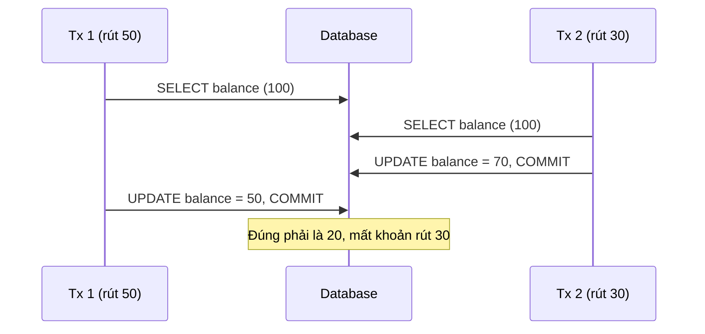

# Locking, Batch & Mapping

> **Tuần 6 · Ngày 38** · Thuộc [[05 - Transaction & JPA]] · Bài trước: [[05.07 - Lazy Loading & N+1]] · Bài sau: [[03.06 - Index & EXPLAIN]]
> "Hai người cùng mua sản phẩm cuối cùng thì sao?" là câu hỏi kinh điển cho level 2 năm. Bài này đo thật lost update, optimistic lock, pessimistic lock và câu UPDATE nguyên tử, rồi tới batch insert và các bẫy mapping hay bị hỏi.
> Mọi output đã chạy trên **Spring Boot 3.5.16 + Hibernate ORM 6.6.53 + PostgreSQL 16.14** (Docker), JDK 21. Số round trip JDBC đếm bằng một proxy bọc `DataSource`.

**Mục lục**
1. [[#1. Lost update: vấn đề cần giải|Lost update: vấn đề cần giải]]
2. [[#2. Optimistic locking với @Version|Optimistic locking với @Version]]
3. [[#3. Pessimistic locking: SELECT FOR UPDATE|Pessimistic locking: SELECT FOR UPDATE]]
4. [[#4. Câu UPDATE nguyên tử|Câu UPDATE nguyên tử]]
5. [[#5. Batch insert và bẫy IDENTITY|Batch insert và bẫy IDENTITY]]
6. [[#6. Bulk update với @Modifying|Bulk update với @Modifying]]
7. [[#7. Mapping quan hệ: best practices|Mapping quan hệ: best practices]]
8. [[#8. equals, hashCode và Lombok @Data|equals, hashCode và Lombok @Data]]
9. [[#9. Kịch bản Feynman hôm nay|Kịch bản Feynman hôm nay]]

---

## 1. Lost update: vấn đề cần giải

### Hiểu bản chất
Kiểu code "đọc, sửa trong Java, ghi lại" rất phổ biến:

```java
@Transactional
public void withdraw(Long id, long amount) {
    Account a = accountRepo.findById(id).orElseThrow();  // đọc balance = 100
    a.setBalance(a.getBalance() - amount);               // tính trong Java
}                                                         // dirty checking: UPDATE balance = ?
```

Hai transaction cùng đọc `100`, mỗi bên tính trên giá trị cũ, bên ghi sau **đè** kết quả bên ghi trước. Đây là **lost update**. Isolation mặc định READ COMMITTED (PostgreSQL, Oracle, SQL Server) không chặn được.



### Code minh hoạ (đã đo)

| Kịch bản trên entity **không** có `@Version` | Kỳ vọng | Đo được |
|---|---|---|
| Xen kẽ cố định như sơ đồ: balance 100, rút 50 và 30 | 20 | **50** |
| 10 thread cùng đọc rồi trừ 1, balance 100 | 90 | **99** |

Dòng 2: cả 10 thread đọc `100`, cùng ghi `99`. Mất 9 lần trừ. Ở hệ thống thật đây là bán quá số tồn kho hoặc số dư sai.

Ba cách giải ở 3 mục tiếp theo: **optimistic lock**, **pessimistic lock**, **UPDATE nguyên tử**.

---

## 2. Optimistic locking với @Version

### Hiểu bản chất
"Lạc quan": giả định ít xung đột, **không khoá** gì lúc đọc. Lúc ghi mới kiểm tra "dữ liệu có bị ai sửa từ lúc mình đọc không?" bằng một cột version.

```java
@Entity
public class Product {
    @Id @GeneratedValue(strategy = GenerationType.SEQUENCE) Long id;
    int stock;
    @Version Long version;
}
```

SQL Hibernate sinh ra (đã đo):

```sql
update product set name=?,stock=?,version=? where id=? and version=?
```

Version mới = version cũ + 1. Nếu bên khác đã tăng version trước, `where ... and version=?` khớp **0 dòng**, Hibernate biết có xung đột và ném exception.

### Code minh hoạ

```java
tx().executeWithoutResult(s -> {
    Product mine = products.findById(id).orElseThrow();      // version 0, stock 10
    requiresNew().executeWithoutResult(s2 -> {
        Product other = products.findById(id).orElseThrow();
        other.setStock(other.getStock() - 1);                  // commit: stock 9, version 1
    });
    mine.setStock(mine.getStock() - 2);                // commit: version=0 khớp 0 dòng
});
```

Exception đo được:

```text
org.springframework.orm.ObjectOptimisticLockingFailureException:
  Row was updated or deleted by another transaction (or unsaved-value mapping
  was incorrect): [demo.Product#2]
cause: org.hibernate.StaleObjectStateException (cùng message)
```

Sau đó DB có `stock = 9, version = 1`: bên commit trước thắng, bên sau bị từ chối thay vì âm thầm ghi đè.

| Tên exception | Ai ném |
|---|---|
| `org.hibernate.StaleObjectStateException` | Hibernate (lúc flush entity) |
| `jakarta.persistence.OptimisticLockException` | Chuẩn JPA (khi đi qua API JPA, ví dụ `em.lock`) |
| `ObjectOptimisticLockingFailureException` | Spring bọc lại; là con của `OptimisticLockingFailureException` |

Trong code, bắt `OptimisticLockingFailureException` của Spring là đủ cho mọi trường hợp.

### Xử lý khi xung đột
- **Retry** toàn bộ transaction (đọc lại dữ liệu mới), ví dụ Spring Retry `@Retryable(retryFor = OptimisticLockingFailureException.class, maxAttempts = 3)`. Retry phải ở **ngoài** `@Transactional`, nếu không lần retry vẫn dùng transaction cũ.
- Hoặc trả **409 Conflict** cho người dùng: "Dữ liệu đã bị người khác sửa, vui lòng tải lại". Hợp với form chỉnh sửa (2 admin cùng sửa một sản phẩm).

### Bẫy hay gặp
- Form web: client gửi DTO, server `findById` rồi copy field. Version lúc này là version **mới nhất trong DB**, nên không phát hiện được xung đột giữa lúc user mở form và lúc bấm lưu. Phải gửi `version` về client và so sánh (hoặc set vào entity) khi lưu.
- Bulk update JPQL **không** tự tăng version (mục 6).

> **Trả lời mẫu:** "Optimistic lock dùng cột `@Version`. Đọc thì không khoá; khi UPDATE, Hibernate thêm `where id=? and version=?` và tăng version. Nếu bên khác đã sửa trước thì khớp 0 dòng, Hibernate ném `StaleObjectStateException`, Spring bọc thành `ObjectOptimisticLockingFailureException`. Em đã tái hiện bằng hai transaction xen kẽ: bên commit trước thắng, bên sau bị exception chứ không ghi đè. Em dùng nó khi xung đột hiếm, như sửa thông tin sản phẩm, và xử lý bằng retry ở ngoài transaction hoặc trả 409."

### Câu hỏi xoáy

**Q1.** Optimistic lock có phù hợp cho flash sale 1000 người tranh 10 sản phẩm không?
> [!success]- Gợi ý trả lời
> Không tốt. Xung đột xảy ra liên tục, phần lớn transaction bị từ chối và retry, retry lại xung đột tiếp, tốn tài nguyên. Trường hợp này dùng UPDATE nguyên tử (mục 4) hoặc pessimistic lock, hay xếp hàng qua Redis/queue.

**Q2.** `@Version` dùng kiểu gì? Timestamp có được không?
> [!success]- Gợi ý trả lời
> Spec cho phép `int`, `long`, `short` (và wrapper) và `Timestamp`/`Instant`. Nên dùng số: timestamp có thể trùng khi hai lần ghi rơi vào cùng một tick đồng hồ. Dùng wrapper `Long` còn giúp Spring Data biết entity mới (version `null`).

---

## 3. Pessimistic locking: SELECT FOR UPDATE

### Hiểu bản chất
"Bi quan": giả định sẽ có xung đột, nên **khoá dòng ngay lúc đọc**. Transaction khác muốn khoá cùng dòng phải **chờ** tới khi bên giữ khoá commit hoặc rollback.

```java
@Lock(LockModeType.PESSIMISTIC_WRITE)
@Query("select a from Account a where a.id = :id")
Optional<Account> findForUpdate(@Param("id") Long id);
```

SQL đo được trên PostgreSQL:

```sql
select a1_0.id,a1_0.balance from account a1_0 where a1_0.id=? for no key update
```

Lưu ý: Hibernate 6 trên PostgreSQL sinh `FOR NO KEY UPDATE` chứ không phải `FOR UPDATE`. Nó vẫn chặn các transaction khác khoá ghi cùng dòng, nhưng nhẹ hơn: không chặn việc insert dòng con có khoá ngoại trỏ tới dòng này. MySQL sinh `for update`.

### Code minh hoạ (đã đo)

Thread A khoá account (balance 100), ngủ 1000 ms rồi trừ 50. Thread B bắt đầu sau khi A đã khoá, trừ 30.

| Đo được | Giá trị |
|---|---|
| Thời gian B phải chờ | **1125 ms** (chờ A commit) |
| Balance cuối | **20** (đúng, không mất cập nhật nào) |

Không muốn chờ thì đặt timeout. Với hint `jakarta.persistence.lock.timeout = 0`, Hibernate sinh `for no key update nowait`, và khi dòng đang bị khoá thì đo được:

```text
org.springframework.dao.PessimisticLockingFailureException
cause: org.hibernate.PessimisticLockException
cause: org.postgresql.util.PSQLException:
       ERROR: could not obtain lock on row in relation "account"
```

```java
@Lock(LockModeType.PESSIMISTIC_WRITE)
@QueryHints(@QueryHint(name = "jakarta.persistence.lock.timeout", value = "0"))
@Query("select a from Account a where a.id = :id")
Optional<Account> findForUpdateNoWait(@Param("id") Long id);
```

### Bẫy hay gặp
- `@Lock` bắt buộc có transaction: khoá chỉ sống tới khi transaction kết thúc. Gọi `findForUpdate` ngoài transaction, đo được: `InvalidDataAccessApiUsageException: Query requires transaction be in progress, but no transaction is known to be in progress`.
- **Deadlock**: Tx 1 khoá A rồi chờ B, Tx 2 khoá B rồi chờ A. DB phát hiện và huỷ một bên. Phòng tránh: luôn khoá theo **thứ tự cố định** (ví dụ id tăng dần khi chuyển tiền giữa 2 tài khoản).
- Giữ khoá trong lúc gọi API ngoài: mọi request khác cho cùng dòng phải xếp hàng chờ, và giữ connection lâu.

| | Optimistic (`@Version`) | Pessimistic (`FOR UPDATE`) |
|---|---|---|
| Khoá lúc đọc | Không | Có |
| Xung đột phát hiện | Lúc commit (exception) | Không xảy ra: bên sau chờ |
| Hợp khi | Xung đột hiếm, đọc nhiều | Xung đột nhiều, dữ liệu tiền/kho |
| Rủi ro | Retry nhiều khi tải cao | Chờ lâu, deadlock, giảm throughput |
| Dùng được qua nhiều request (form) | Có (gửi version về client) | Không (khoá chỉ sống trong 1 tx) |

> **Trả lời mẫu:** "Pessimistic lock khoá dòng ngay khi đọc bằng `@Lock(PESSIMISTIC_WRITE)`. Trên PostgreSQL Hibernate 6 sinh `for no key update`. Em đã đo: thread B chờ khoảng 1,1 giây đến khi thread A commit, và số dư cuối đúng. Em đặt lock timeout để không chờ vô hạn; với timeout 0 thì ra `nowait` và Spring ném `PessimisticLockingFailureException`. Rủi ro là deadlock, nên em khoá theo thứ tự id cố định, và không bao giờ gọi API ngoài khi đang giữ khoá."

### Câu hỏi xoáy

**Q1.** Chuyển tiền từ A sang B, làm sao tránh deadlock?
> [!success]- Gợi ý trả lời
> Khoá cả hai account theo thứ tự id tăng dần, bất kể chiều chuyển: `first = min(a, b)`, `second = max(a, b)`. Hai giao dịch A→B và B→A cùng lúc sẽ cùng khoá theo một thứ tự, bên sau chỉ chờ chứ không vòng chờ nhau.

**Q2.** `PESSIMISTIC_READ` khác `PESSIMISTIC_WRITE` thế nào?
> [!success]- Gợi ý trả lời
> READ là khoá chia sẻ (đo được trên PostgreSQL: `for share`): nhiều transaction cùng giữ được, nhưng không ai sửa được dòng đó. WRITE là khoá độc quyền: chỉ một bên giữ. Muốn đọc rồi sửa thì dùng WRITE; dùng READ cho cả hai bên rồi cùng muốn sửa dễ gây deadlock.

---

## 4. Câu UPDATE nguyên tử

### Hiểu bản chất
Với trừ kho hoặc trừ tiền, cách đơn giản và nhanh nhất là **để DB tự tính** trong một câu, kèm điều kiện:

```java
@Modifying
@Query("update Product p set p.stock = p.stock - :q where p.id = :id and p.stock >= :q")
int decrease(@Param("id") Long id, @Param("q") int q);

@Transactional
public void buy(Long id, int q) {
    if (productRepo.decrease(id, q) == 0) throw new OutOfStockException(id);
}
```

SQL đo được: `update product p1_0 set stock=(p1_0.stock-?) where p1_0.id=? and p1_0.stock>=?`

Câu UPDATE trên một dòng là **nguyên tử**: DB tự khoá dòng trong lúc cập nhật, transaction thứ hai chờ rồi đánh giá lại điều kiện `stock >= q` trên giá trị mới. Không cần đọc trước, không cần version.

### Code minh hoạ (đã đo)

| Kịch bản | Kết quả |
|---|---|
| Stock 10, **20 thread** cùng mua 1 cái | **10** thành công, 10 trả về 0 dòng, stock cuối **0** (không âm) |

> **Trả lời mẫu:** "Với trừ kho em hay dùng một câu UPDATE có điều kiện: `set stock = stock - :q where id = :id and stock >= :q`, rồi kiểm tra số dòng bị ảnh hưởng, bằng 0 nghĩa là hết hàng. DB khoá dòng trong lúc update nên không có lost update, không cần version hay SELECT FOR UPDATE. Em đã đo 20 thread tranh 10 sản phẩm: đúng 10 thành công và tồn kho về 0, không bị âm."

### Câu hỏi xoáy

**Q1.** Nhược điểm của cách UPDATE nguyên tử là gì?
> [!success]- Gợi ý trả lời
> (1) Logic nằm trong SQL, khó áp dụng khi quy tắc nghiệp vụ phức tạp (khuyến mãi, nhiều bảng); (2) là bulk JPQL nên **bỏ qua persistence context**: entity đã load trước đó vẫn giữ stock cũ (mục 6); (3) không tăng `@Version` trừ khi bạn tự `set p.version = p.version + 1`.

---

## 5. Batch insert và bẫy IDENTITY

### Hiểu bản chất
JDBC batching gom nhiều câu INSERT cùng dạng vào **một round trip** (`addBatch` nhiều lần, `executeBatch` một lần). Hibernate làm việc này khi bật:

```properties
spring.jpa.properties.hibernate.jdbc.batch_size=50
spring.jpa.properties.hibernate.order_inserts=true
spring.jpa.properties.hibernate.order_updates=true
```

Nhưng với `GenerationType.IDENTITY`, id do DB sinh **lúc INSERT**, mà Hibernate cần id ngay khi `persist` (để đưa vào persistence context). Nên nó phải INSERT **từng dòng ngay lập tức**, batching bị tắt.

Với `SEQUENCE` và `allocationSize = 50`, Hibernate gọi `nextval` một lần, tự cấp 50 id trong memory, INSERT để dồn tới lúc flush và gom batch.

```java
@Id
@GeneratedValue(strategy = GenerationType.SEQUENCE, generator = "log_seq")
@SequenceGenerator(name = "log_seq", sequenceName = "log_seq", allocationSize = 50)
private Long id;
```

### Code minh hoạ (đã đo)

`persist` N entity trong một transaction, `batch_size = 50`:

| Chiến lược id | N | Câu lẻ (`execute`) | `executeBatch` | Thời gian |
|---|---|---|---|---|
| IDENTITY | 1 000 | **1 000** INSERT | 0 | 4,0–18,3 s |
| SEQUENCE (alloc 50) | 1 000 | 20 (`nextval`) | **20** | 0,13–1,1 s |
| IDENTITY | 20 000 | **20 000** INSERT | 0 | 61–108 s |
| SEQUENCE (alloc 50) | 20 000 | 400 (`nextval`) | **400** | 1,1–2,0 s |

Số round trip là con số chắc chắn. Thời gian là khoảng giữa các lần chạy, đo trên máy đang rất tải (load average khoảng 30 trên 8 core, Docker trên macOS) nên số tuyệt đối cao hơn bình thường; tỉ lệ chênh lệch vài chục lần mới là điều đáng nhớ.

Muốn nhanh hơn nữa trên PostgreSQL: thêm `reWriteBatchedInserts=true` vào JDBC URL để driver gộp batch thành một câu `INSERT ... VALUES (...), (...)`.

### Batch lớn: flush và clear

```java
@Transactional
public void importAll(List<Row> rows) {
    for (int i = 0; i < rows.size(); i++) {
        em.persist(toEntity(rows.get(i)));
        if ((i + 1) % 50 == 0) { em.flush(); em.clear(); }   // trùng batch_size
    }
}
```

| 50 000 entity SEQUENCE (đã đo) | Entity còn trong persistence context cuối transaction |
|---|---|
| Không clear | **50 000** |
| `flush()` + `clear()` mỗi 50 | **0** |

Không clear thì context giữ 50 000 object kèm snapshot đến hết transaction: tốn heap và mỗi lần flush dirty checking phải duyệt hết. Về thời gian, trên máy đang tải cao hai lần đo cho kết quả ngược nhau (3,9 s so với 1,9 s, rồi 6,8 s so với 7,9 s), nên em không kết luận về tốc độ từ phép đo này; lợi ích chắc chắn là bộ nhớ không phình theo N.

Với hàng triệu dòng, cân nhắc bỏ qua JPA: `JdbcTemplate.batchUpdate` hoặc `COPY` của PostgreSQL.

> **Trả lời mẫu:** "Bật `jdbc.batch_size` và `order_inserts` thì Hibernate gom INSERT theo lô. Nhưng IDENTITY làm mất batching vì Hibernate cần id ngay khi persist nên phải INSERT từng dòng. Em đã đo 1000 bản ghi: IDENTITY ra 1000 câu INSERT riêng lẻ, SEQUENCE với allocationSize 50 chỉ 20 lần `executeBatch` cộng 20 lần lấy sequence, nhanh hơn vài chục lần. Với dữ liệu lớn em flush và clear mỗi 50 bản ghi để persistence context không phình. MySQL không có sequence nên em dùng `JdbcTemplate.batchUpdate` cho import lớn."

### Câu hỏi xoáy

**Q1.** `allocationSize` lớn có nhược điểm gì?
> [!success]- Gợi ý trả lời
> Id bị "nhảy cóc": mỗi instance ứng dụng giữ một khối id, restart thì phần chưa dùng bị bỏ. Id không liên tục nhưng vẫn duy nhất. Lưu ý `allocationSize` phải khớp `INCREMENT BY` của sequence trong DB (khi schema do Flyway/Liquibase tạo), lệch thì có thể trùng id.

**Q2.** Batch update có cần gì thêm không?
> [!success]- Gợi ý trả lời
> `order_updates=true` để Hibernate sắp các UPDATE cùng bảng liền nhau, nhờ đó gom batch được. Dirty checking nhiều entity trong một transaction rồi flush là đủ, không cần gọi `saveAll`.

---

## 6. Bulk update với @Modifying

### Hiểu bản chất
`@Modifying @Query("update ...")` chạy **thẳng xuống DB**, không đi qua persistence context. Entity đã load trong cùng transaction **không biết** gì về thay đổi đó.

### Code minh hoạ (đã đo)

```java
@Modifying
@Query("update Product p set p.stock = 0")
int resetAll();

@Modifying(clearAutomatically = true)
@Query("update Product p set p.stock = 0")
int resetAllAndClear();
```

| Kịch bản trong cùng transaction: load product (stock 10), bulk update, `findById` lại | Stock thấy được | Cùng instance? |
|---|---|---|
| `@Modifying` mặc định | **10** (cũ, DB đã là 0) | `true` (lấy từ first-level cache) |
| `@Modifying(clearAutomatically = true)` | **0** | `false` (context đã clear, load lại) |
| Load product, bulk update stock = 0, rồi `setStock(stock - 1)` trên entity cũ | DB cuối: **stock 9**, version 1 | Bulk update **bị ghi đè** |
| Gọi `@Modifying` **ngoài** transaction | `InvalidDataAccessApiUsageException: Executing an update/delete query` | |

Dòng 3 là bẫy nguy hiểm nhất: bulk update không tăng `@Version`, nên dirty checking của entity cũ ghi `9` dựa trên giá trị `10` cũ mà không có xung đột nào được phát hiện.

### Bẫy hay gặp
- `clearAutomatically = true` xoá cả các thay đổi **chưa flush** của entity khác. Thêm `flushAutomatically = true` để flush trước rồi mới chạy bulk.
- `@Modifying` cần transaction: query method tự khai báo trong repository **không** tự có transaction (dòng cuối bảng trên), nên đặt `@Transactional` ở service.

> **Trả lời mẫu:** "Bulk update bằng `@Modifying` chạy thẳng SQL, bỏ qua persistence context, nên entity đã load vẫn giữ giá trị cũ. Em đã đo: sau bulk update stock về 0, `findById` trong cùng transaction vẫn thấy 10 vì lấy từ first-level cache; tệ hơn, nếu sửa entity cũ thì dirty checking ghi đè luôn kết quả bulk. Em dùng `clearAutomatically = true` kèm `flushAutomatically = true`, và tách bulk update ra đầu hoặc cuối transaction."

---

## 7. Mapping quan hệ: best practices

### Hiểu bản chất
Trong quan hệ hai chiều, chỉ **một phía** quyết định giá trị khoá ngoại: phía **owner**, là phía có `@JoinColumn` (thường là `@ManyToOne`). Phía có `mappedBy` là phía **inverse**: Hibernate **bỏ qua** nó khi ghi khoá ngoại.

```java
@Entity class OrderItem {
    @ManyToOne(fetch = FetchType.LAZY)       // owner: giữ cột order_id
    private Order order;
}

@Entity class Order {
    @OneToMany(mappedBy = "order", cascade = CascadeType.ALL, orphanRemoval = true)
    private List<OrderItem> items = new ArrayList<>();

    public void addItem(OrderItem i) { items.add(i); i.setOrder(this); }   // đồng bộ 2 phía
    public void removeItem(OrderItem i) { items.remove(i); i.setOrder(null); }
}
```

Chỉ `order.getItems().add(item)` mà không `item.setOrder(order)` thì `order_id` lưu xuống là `null`. Vì vậy luôn có helper method đồng bộ hai phía.

### Quy tắc

| Quy tắc | Vì sao |
|---|---|
| Mọi association `LAZY` | EAGER gây N+1 ([[05.07 - Lazy Loading & N+1]]) |
| Ưu tiên `@ManyToOne` một chiều; chỉ thêm `@OneToMany` khi thật sự cần duyệt từ cha | Ít code đồng bộ, ít rủi ro load nhầm collection lớn |
| `cascade = ALL` + `orphanRemoval = true` chỉ cho **composition** (Order sở hữu OrderItem) | Con không tồn tại độc lập với cha |
| Không cascade trên `@ManyToOne` hay `@ManyToMany` | Xoá một order có thể xoá luôn customer hoặc tag dùng chung |
| Bảng trung gian có thêm cột (số lượng, ngày) thì map thành **entity riêng**, không dùng `@ManyToMany` | `@ManyToMany` không có chỗ cho cột thêm |
| `@ManyToMany` thì dùng `Set` | Với `List`, Hibernate xoá hết dòng trung gian rồi insert lại khi sửa |
| Không trả entity ra JSON | Quan hệ hai chiều gây vòng lặp vô hạn khi serialize |

Đo `orphanRemoval`: trong transaction, `order.removeItem(item)` (không gọi `delete`) sinh **1 câu DELETE** cho item đó lúc flush.

> **Trả lời mẫu:** "Trong quan hệ hai chiều, phía `@ManyToOne` có `@JoinColumn` là owner, quyết định khoá ngoại; phía `mappedBy` bị bỏ qua khi ghi, nên em luôn viết helper `addItem/removeItem` đồng bộ cả hai phía. Em để mọi association LAZY, ưu tiên `@ManyToOne` một chiều, chỉ dùng `cascade ALL` với `orphanRemoval` cho quan hệ sở hữu như Order với OrderItem, và khi bảng trung gian có thêm cột thì em map nó thành entity riêng thay vì `@ManyToMany`."

### Câu hỏi xoáy

**Q1.** `orphanRemoval = true` khác `CascadeType.REMOVE` thế nào?
> [!success]- Gợi ý trả lời
> `CascadeType.REMOVE`: xoá **cha** thì xoá con. `orphanRemoval`: ngoài việc đó, **gỡ con khỏi collection** (con thành "mồ côi") cũng xoá con. Đo được: `removeItem` sinh 1 DELETE dù không gọi `delete`.

---

## 8. equals, hashCode và Lombok @Data

### Hiểu bản chất
`@Data` sinh `equals`, `hashCode` và `toString` dùng **mọi field**, kể cả association. Với entity, điều này gây ba vấn đề:

```java
@Data @Entity
public class LomParent {
    @Id @GeneratedValue private Long id;
    @OneToMany(mappedBy = "parent", cascade = CascadeType.ALL)
    private Set<LomChild> children = new HashSet<>();
}

@Data @Entity
public class LomChild {
    @Id @GeneratedValue private Long id;
    @ManyToOne(fetch = FetchType.LAZY) private LomParent parent;
}
```

| Thao tác (đã đo) | Kết quả |
|---|---|
| `parent.hashCode()` khi parent và child trỏ vào nhau | **`StackOverflowError`** |
| `parent.toString()` | **`StackOverflowError`** |
| Thêm child mới (id `null`) vào `HashSet`, persist, rồi `set.contains(child)` | **`false`**, dù `size()` vẫn là 1 |

1. **Vòng lặp vô hạn**: hashCode của parent gọi hashCode của children, mỗi child gọi hashCode của parent...
2. **Kích hoạt lazy load**: `toString()` trong một câu log chạm vào collection LAZY, gây thêm query hoặc `LazyInitializationException`.
3. **hashCode đổi sau persist**: id từ `null` thành có giá trị, entity "mất tích" trong `HashSet` (cùng cơ chế với [[02.04 - HashMap Internals]] mục 7).

### Cách viết an toàn

```java
@Getter @Setter @Entity
public class Product {
    @Id @GeneratedValue Long id;

    @Override
    public boolean equals(Object o) {
        if (this == o) return true;
        if (!(o instanceof Product other)) return false;   // instanceof: an toàn với proxy
        return id != null && id.equals(other.getId());      // entity mới: chỉ bằng chính nó
    }

    @Override
    public int hashCode() {
        return getClass().hashCode();                        // hằng số: không đổi sau persist
    }
}
```

hashCode hằng số làm mọi entity cùng loại rơi vào một bucket, nhưng collection entity trong thực tế nhỏ nên không đáng kể. Nếu có **business key bất biến** (mã SKU, email đã chuẩn hoá) thì dùng nó cho cả equals và hashCode là tốt nhất.

> **Trả lời mẫu:** "Em không dùng `@Data` cho entity. Nó sinh equals, hashCode, toString trên mọi field kể cả association, nên quan hệ hai chiều gây StackOverflowError (em đã thử cả hashCode và toString), toString trong log kích hoạt lazy load, và hashCode đổi khi id được gán sau persist làm entity mất tích trong HashSet. Em dùng `@Getter @Setter`, equals so theo id có kiểm tra null và dùng instanceof để an toàn với proxy, hashCode trả hằng số theo class, hoặc dùng business key bất biến nếu có."

### Câu hỏi xoáy

**Q1.** Vì sao equals không nên so `getClass() != o.getClass()` với entity?
> [!success]- Gợi ý trả lời
> Entity có thể là proxy Hibernate (subclass sinh động). So entity thật với proxy của cùng dòng sẽ ra `false`. Dùng `instanceof` hoặc `Hibernate.getClass()`, và đọc id qua getter (`other.getId()`) vì field của proxy chưa khởi tạo.

---

## 9. Kịch bản Feynman hôm nay

1. "Hai người cùng mua sản phẩm cuối cùng." Trình bày 3 cách (optimistic, pessimistic, UPDATE nguyên tử), mỗi cách một câu SQL và một con số đo được.
2. Giải thích vì sao IDENTITY làm hỏng batch insert, kèm số 1000 so với 20.
3. Kể bẫy bulk update: vì sao `findById` sau bulk update vẫn thấy giá trị cũ.
4. Vì sao không dùng `@Data` cho entity: nói đủ 3 lý do.

Ghi vào [[08 - Nhật ký học tập]].

## Tự kiểm tra nhanh (không mở tài liệu)

- [ ] Lost update là gì? READ COMMITTED có chặn không?
- [ ] Câu UPDATE với `@Version` có dạng gì? Exception Hibernate và Spring tên gì?
- [ ] `PESSIMISTIC_WRITE` trên PostgreSQL với Hibernate 6 sinh mệnh đề gì?
- [ ] Viết câu UPDATE trừ kho nguyên tử và cách biết hết hàng
- [ ] Vì sao IDENTITY tắt JDBC batching? Thay bằng gì?
- [ ] Bulk update + `findById` trong cùng tx: thấy gì? Sửa bằng gì?
- [ ] Phía nào là owner trong `@OneToMany(mappedBy)` / `@ManyToOne`?
- [ ] 3 vấn đề của Lombok `@Data` trên entity
