# Sơ đồ cơ chế cốt lõi

> Xem trực tiếp trên GitHub, trong VS Code (extension "Markdown Preview Mermaid Support"), IntelliJ hoặc tại https://mermaid.live.
> **Cách học theo Feynman:** xem sơ đồ 2 phút → gấp lại → **tự vẽ lại ra giấy** và giải thích to từng mũi tên → so sánh với bản gốc. Chỗ vẽ sai là chỗ chưa hiểu.
> Giải thích chi tiết nằm trong các bài Q&A 02–05 (được dẫn ở từng sơ đồ).

Mục lục:
1. [[#1. @Transactional: proxy và TransactionInterceptor|@Transactional: proxy và TransactionInterceptor]]
2. [[#2. Self-invocation: vì sao transaction bị mất|Self-invocation: vì sao transaction bị mất]]
3. [[#3. Propagation REQUIRED vs REQUIRES_NEW + UnexpectedRollbackException|Propagation REQUIRED vs REQUIRES_NEW + UnexpectedRollbackException]]
4. [[#4. Trạng thái entity JPA|Trạng thái entity JPA]]
5. [[#5. N+1 và cách sửa|N+1 và cách sửa]]
6. [[#6. HashMap.put()|HashMap.put()]]
7. [[#7. ThreadPoolExecutor: xử lý khi submit task|ThreadPoolExecutor: xử lý khi submit task]]
8. [[#8. Luồng request Spring MVC|Luồng request Spring MVC]]
9. [[#9. Vòng đời Spring bean|Vòng đời Spring bean]]
10. [[#10. Auto-configuration của Spring Boot|Auto-configuration của Spring Boot]]
11. [[#11. Spring Security + JWT|Spring Security + JWT]]
12. [[#12. Cache-aside với Redis|Cache-aside với Redis]]

---

## 1. @Transactional: proxy và TransactionInterceptor

Chi tiết: [[05 - Transaction & JPA]] câu 1.

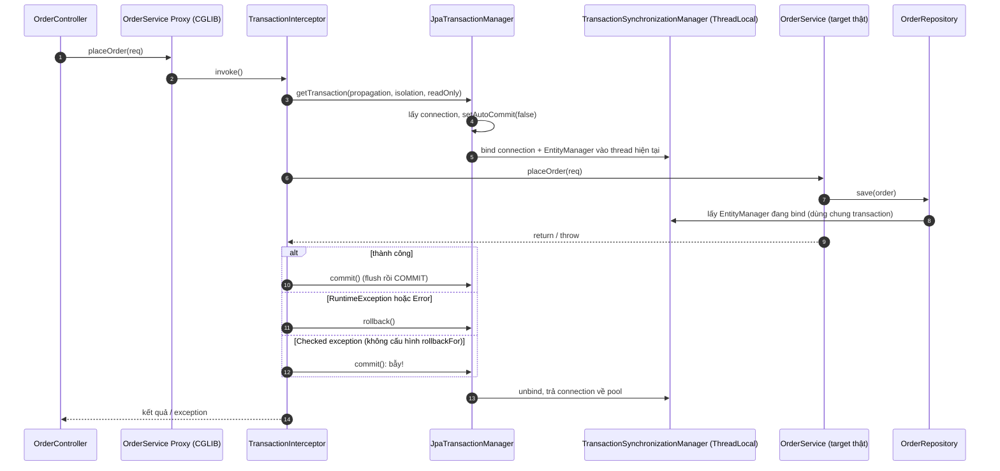

**Ý chính cần nói:** annotation chỉ là metadata; proxy mới làm việc; transaction gắn vào **ThreadLocal**, nên đổi sang thread khác là mất transaction.

---

## 2. Self-invocation: vì sao transaction bị mất

Chi tiết: [[05 - Transaction & JPA]] câu 2.

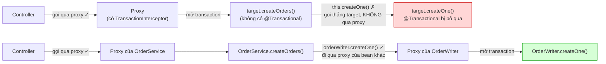

**Cách sửa:** tách sang bean khác (như nửa dưới của sơ đồ); dùng `TransactionTemplate`; hoặc tự inject chính bean với `@Lazy`. Bẫy này cũng áp dụng cho `@Async`, `@Cacheable`, `@Retryable`, `@PreAuthorize`.

---

## 3. Propagation REQUIRED vs REQUIRES_NEW + UnexpectedRollbackException

Chi tiết: [[05 - Transaction & JPA]] câu 4–5.

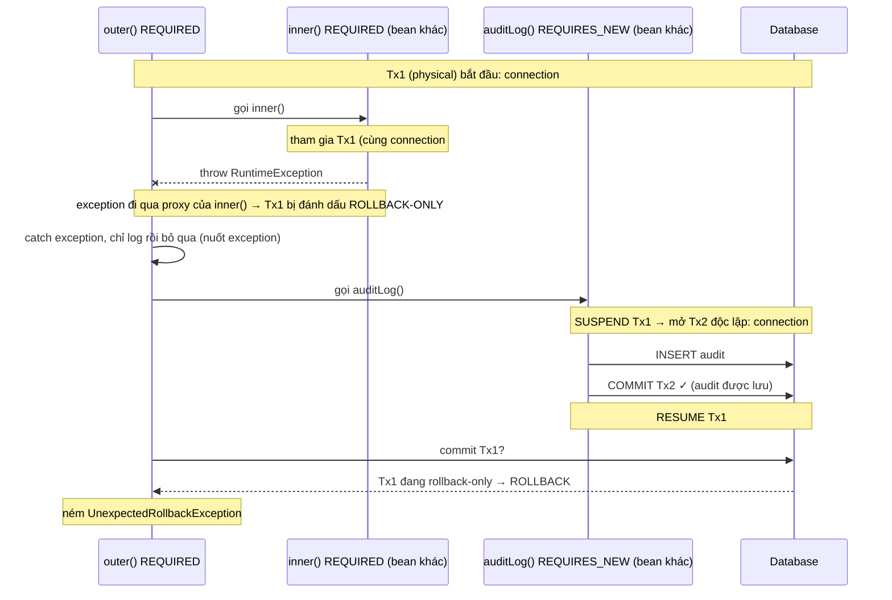

**Ý chính cần nói:**
- REQUIRED dùng chung **một** physical transaction, nên lỗi ở trong làm hỏng cả transaction ngoài.
- REQUIRES_NEW dùng transaction riêng **và chiếm connection riêng**, nên có nguy cơ cạn connection pool.

---

## 4. Trạng thái entity JPA

Chi tiết: [[05 - Transaction & JPA]] câu 12–13.

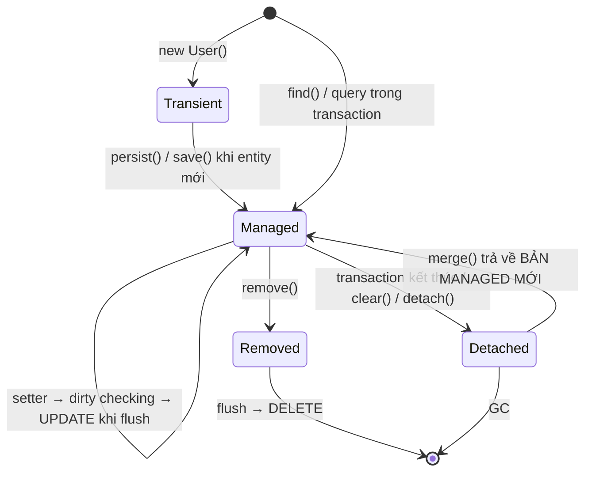

**Ý chính cần nói:** chỉ entity ở trạng thái **Managed** mới được dirty checking. Truy cập lazy association khi entity đã **Detached** thì gặp `LazyInitializationException`.

---

## 5. N+1 và cách sửa

Chi tiết: [[05 - Transaction & JPA]] câu 14–16.

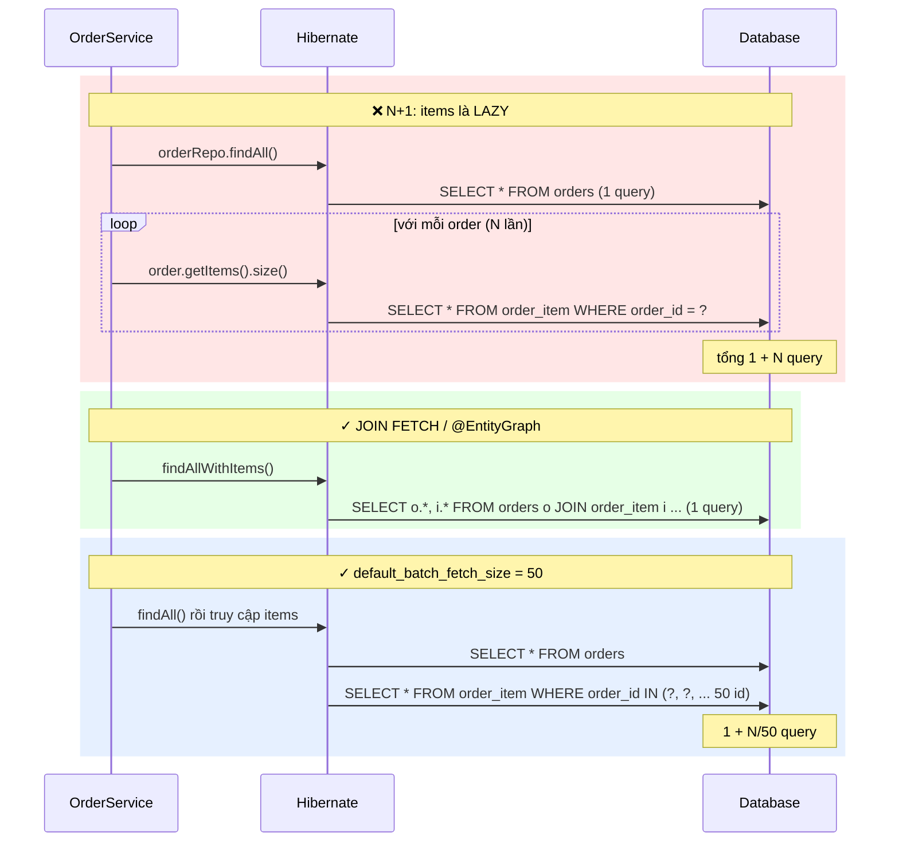

**Bẫy:** `JOIN FETCH` collection kết hợp `Pageable` làm Hibernate phân trang trong memory (HHH90003004).

---

## 6. HashMap.put()

Chi tiết: [[02 - Java Core, Collections & Stream API]] câu 10.

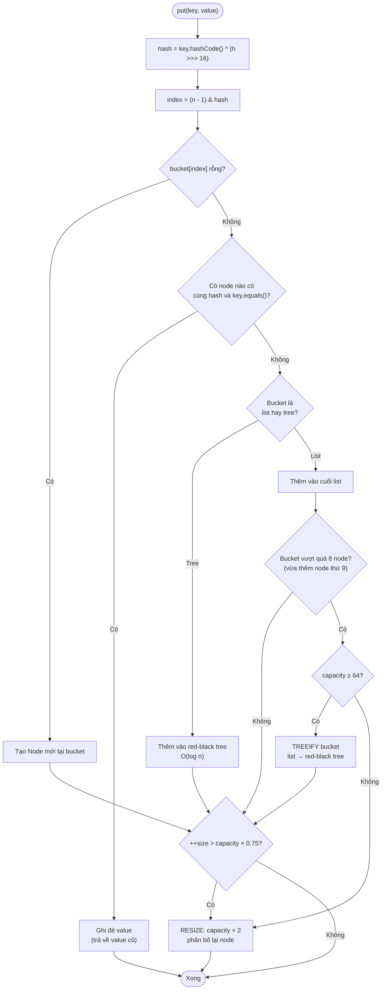

**Con số cần nhớ:** capacity mặc định 16, load factor 0.75, treeify khi bucket vượt quá 8 node (thêm node thứ 9) và capacity ≥ 64, untreeify khi ≤ 6.

---

## 7. ThreadPoolExecutor: xử lý khi submit task

Chi tiết: [[03 - Concurrency, SQL, REST & Security]] câu 4.

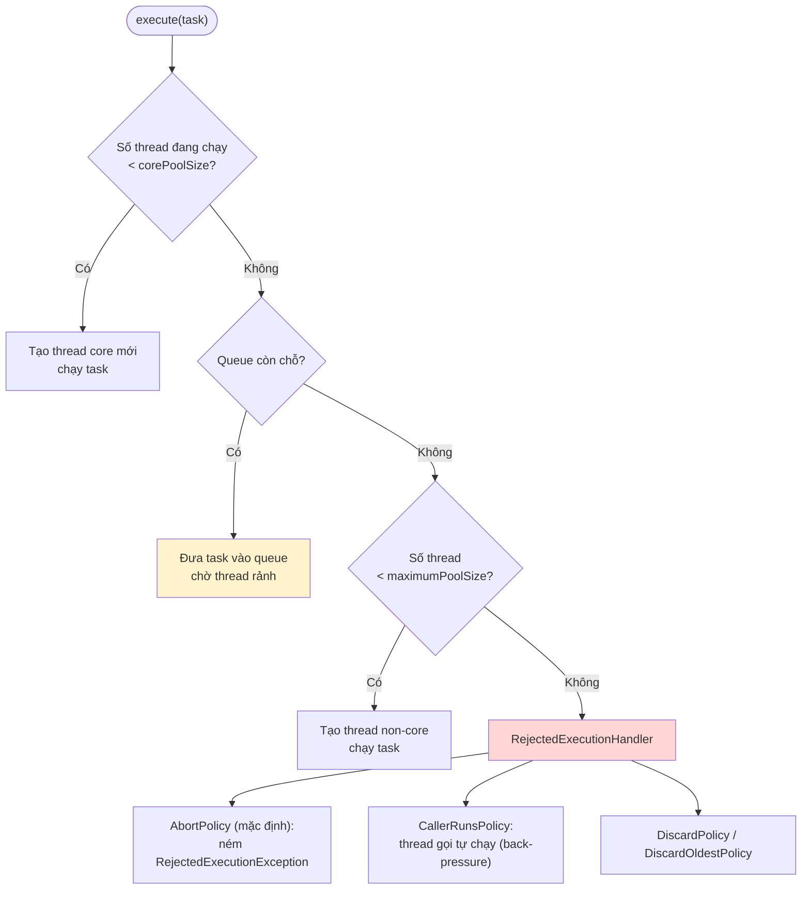

**Bẫy:** queue **không giới hạn** (`newFixedThreadPool`) khiến nhánh "Queue còn chỗ?" luôn là Có. Pool không bao giờ tăng lên max, task dồn mãi và cuối cùng gây OOM.

---

## 8. Luồng request Spring MVC

Chi tiết: [[04 - Spring Core, Boot & MVC]] câu 16–18.

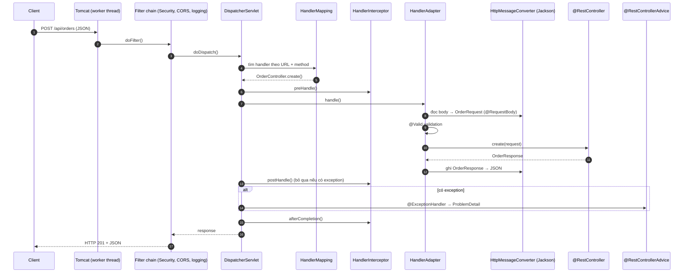

**Ý chính cần nói:** Filter thuộc Servlet API và đứng trước DispatcherServlet; Interceptor thuộc Spring MVC và bao quanh handler; JSON được chuyển đổi bởi `HttpMessageConverter`.

---

## 9. Vòng đời Spring bean

Chi tiết: [[04 - Spring Core, Boot & MVC]] câu 5.

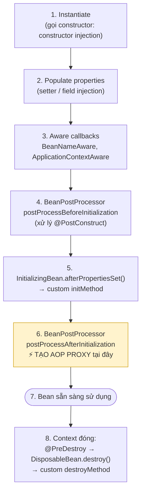

**Ý chính cần nói:** proxy (`@Transactional`, `@Async`, `@Cacheable`) được tạo **sau** `@PostConstruct`. Vì vậy logic cần transaction lúc khởi động nên đặt trong `ApplicationRunner` hoặc `@EventListener(ApplicationReadyEvent.class)`. Prototype bean không được gọi bước 8.

---

## 10. Auto-configuration của Spring Boot

Chi tiết: [[04 - Spring Core, Boot & MVC]] câu 9–10.

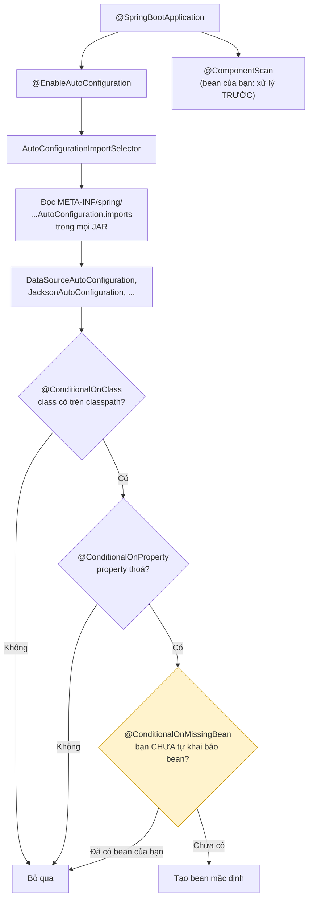

**Debug:** chạy với `--debug` để xem Condition Evaluation Report, hoặc gọi `/actuator/conditions`.

---

## 11. Spring Security + JWT

Chi tiết: [[03 - Concurrency, SQL, REST & Security]] câu 23–24.

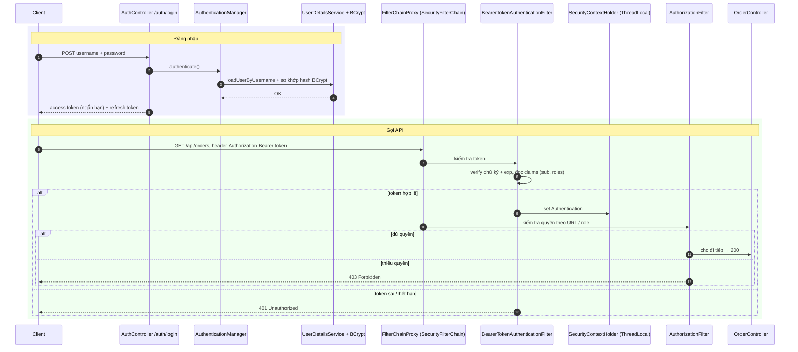

---

## 12. Cache-aside với Redis

Chi tiết: [[03 - Concurrency, SQL, REST & Security]] câu 26.

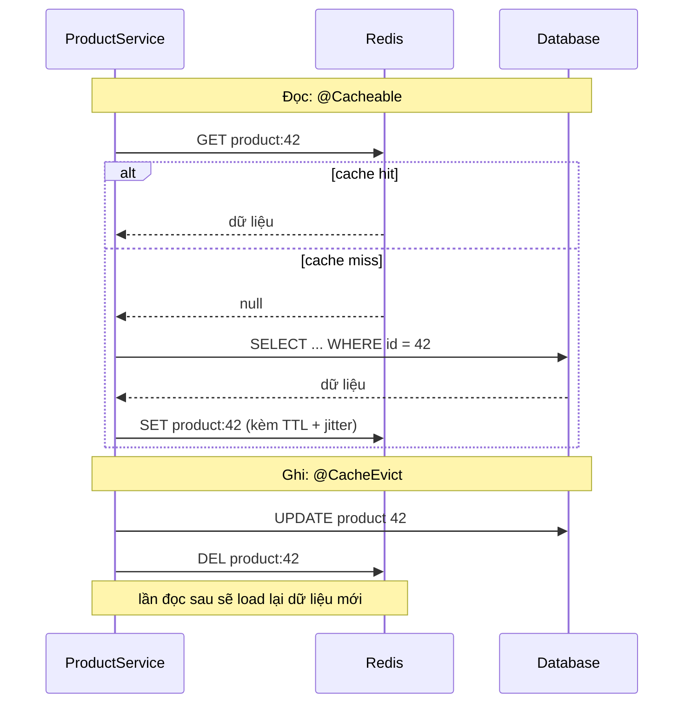

**3 sự cố cần nhớ:** penetration (key không tồn tại; xử lý bằng cache giá trị rỗng hoặc Bloom filter), stampede (key nóng hết hạn; xử lý bằng lock hoặc single-flight), avalanche (nhiều key hết hạn cùng lúc; xử lý bằng TTL có jitter).
