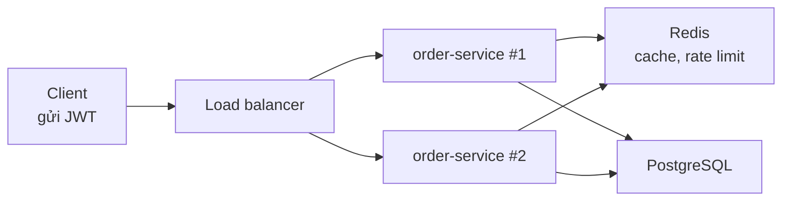
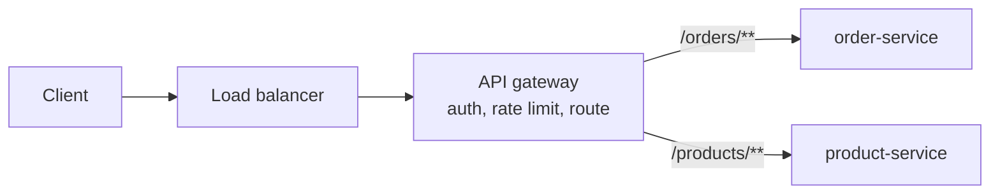
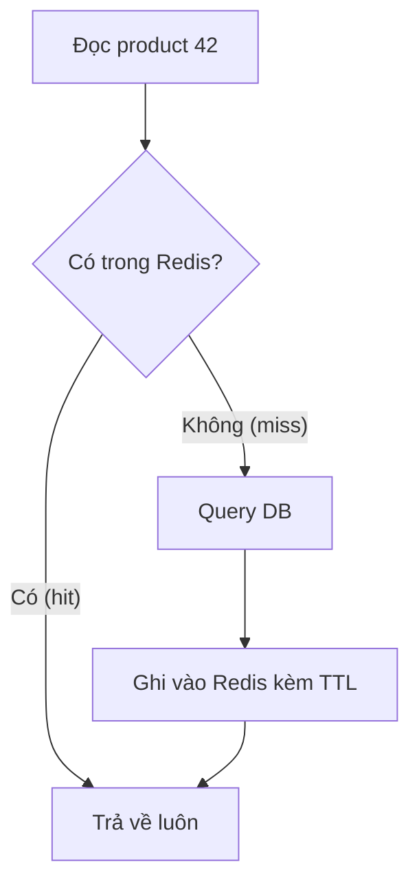
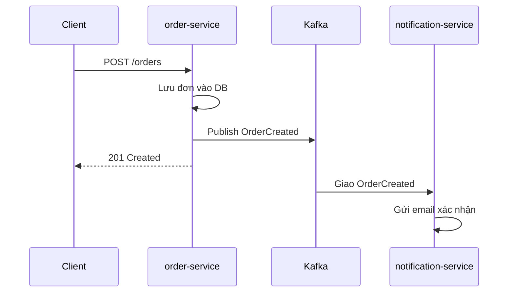
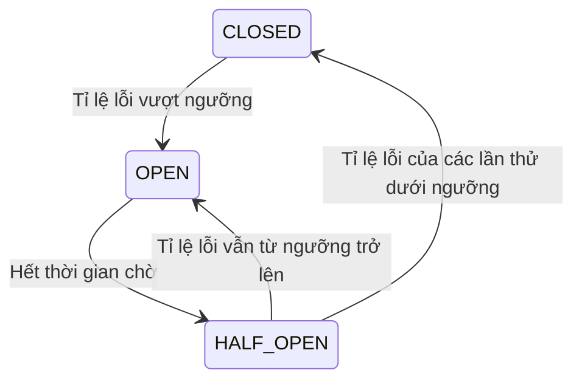
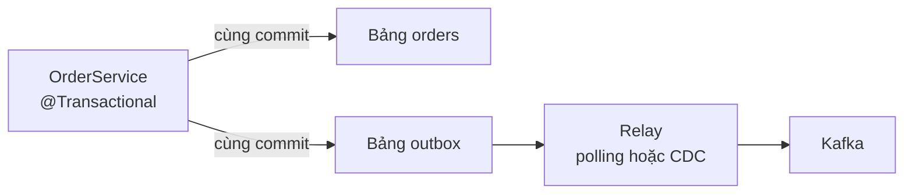

# System Design Concepts

> **Tuần 8 · Ngày 50** · Thuộc [[10 - System Design & Behavioral]] · Bài trước: [[03.12 - Testing Spring Boot]] · Bài sau: [[10.02 - System Design Practice]]
> Ở level 2 năm, nhà tuyển dụng không bắt bạn thiết kế Netflix. Họ muốn biết bạn **hiểu vì sao** hệ thống cần cache, queue, replica, circuit breaker, và **nói được trade-off** bằng ví dụ Spring Boot thật.
> Bài này thiên về khái niệm. Code trong bài là cấu hình và đoạn minh hoạ, không in ra output nên không có gì cần đo; bài không đưa ra con số hiệu năng nào chưa được kiểm chứng.

**Mục lục**
1. [[#1. Scale dọc, scale ngang và stateless|Scale dọc, scale ngang và stateless]]
2. [[#2. Load balancer, reverse proxy, API gateway|Load balancer, reverse proxy, API gateway]]
3. [[#3. Caching nhiều tầng|Caching nhiều tầng]]
4. [[#4. Message queue và xử lý bất đồng bộ|Message queue và xử lý bất đồng bộ]]
5. [[#5. Replication và read replica|Replication và read replica]]
6. [[#6. Partitioning và sharding|Partitioning và sharding]]
7. [[#7. CAP, strong và eventual consistency|CAP, strong và eventual consistency]]
8. [[#8. Monolith vs microservices|Monolith vs microservices]]
9. [[#9. Timeout, retry, circuit breaker với Resilience4j|Timeout, retry, circuit breaker với Resilience4j]]
10. [[#10. Saga và outbox|Saga và outbox]]
11. [[#11. Rate limiting|Rate limiting]]
12. [[#12. Observability, logs, metrics, traces|Observability, logs, metrics, traces]]
13. [[#13. Kịch bản Feynman hôm nay|Kịch bản Feynman hôm nay]]

---

## 1. Scale dọc, scale ngang và stateless

### Hiểu bản chất
Khi `order-service` bắt đầu chậm vì nhiều request, có 2 hướng:

| | Scale dọc (vertical, scale up) | Scale ngang (horizontal, scale out) |
|---|---|---|
| Làm gì | Tăng CPU, RAM cho **một** máy | Thêm **nhiều máy** chạy cùng một app |
| Ưu | Đơn giản, không sửa code | Gần như không có trần, chịu lỗi tốt hơn |
| Nhược | Có giới hạn phần cứng, đắt ở mức cao, vẫn là single point of failure | Cần load balancer, app phải **stateless** |
| Hay dùng cho | Database (OLTP), giai đoạn đầu | Web/API server, microservice |

Quy tắc thực tế: bắt đầu bằng scale dọc vì đơn giản, chuyển sang scale ngang khi cần chịu tải hoặc cần chịu lỗi.

**Stateless** nghĩa là server **không giữ trạng thái của client giữa các request**. Mỗi request tự mang đủ thông tin (JWT, tham số), nên **bất kỳ instance nào cũng xử lý được**. Trạng thái cần dùng chung thì đẩy ra ngoài: Redis, database.



### Bẫy hay gặp
- **Lưu thứ gì đó trong RAM của instance** rồi tưởng các instance khác thấy: `HttpSession`, `ConcurrentHashMap` làm cache, biến đếm trong bean singleton. Chạy 1 instance thì đúng, chạy 2 instance thì sai.
- **`@Scheduled` chạy trên mọi instance**: scale lên 3 instance thì job gửi email chạy 3 lần. Cần distributed lock (ví dụ ShedLock) hoặc tách job ra chỗ riêng.
- **Sticky session** (load balancer luôn đưa một user về cùng server) là cách chữa cháy cho app stateful. Server đó chết thì mất session, và tải dễ lệch.
- File upload lưu ổ đĩa local của instance: instance khác không đọc được. Lưu lên object storage (S3, MinIO).

> **Trả lời mẫu:** "Scale dọc là nâng cấu hình một máy, đơn giản nhưng có trần và vẫn là một điểm chết. Scale ngang là thêm instance sau load balancer, gần như không có trần nhưng đòi hỏi app stateless. Với Spring Boot em giữ app stateless bằng JWT thay cho session, cache và rate limit để ở Redis, file để ở object storage. Một bẫy em để ý là `@Scheduled`: scale lên nhiều instance thì job chạy trùng, nên phải thêm distributed lock như ShedLock."

### Câu hỏi xoáy

**Q1.** Ứng dụng đang dùng `HttpSession` để lưu giỏ hàng. Muốn scale ngang thì làm gì?
> [!success]- Gợi ý trả lời
> Có 3 hướng: (1) đưa session ra Redis bằng Spring Session, code gần như không đổi; (2) chuyển sang stateless: lưu giỏ hàng vào DB hoặc Redis theo `userId`, xác thực bằng JWT; (3) sticky session, chỉ là giải pháp tạm vì instance chết sẽ mất giỏ. Em chọn (1) nếu cần nhanh, (2) nếu thiết kế lại.

**Q2.** Database có scale ngang dễ như app không?
> [!success]- Gợi ý trả lời
> Không. App stateless thì thêm instance là xong, còn DB **chính là nơi giữ state**. Scale đọc thì dùng read replica (mục 5), scale ghi thì phải partition hoặc shard (mục 6), cả hai đều kéo theo độ phức tạp. Vì vậy thường scale dọc DB trước, thêm cache và replica, sharding là bước cuối.

---

## 2. Load balancer, reverse proxy, API gateway

### Hiểu bản chất
Ba khái niệm này hay bị trộn vì **một phần mềm có thể đóng cả ba vai** (Nginx làm được cả ba). Phân biệt theo **vai trò**:

| | Reverse proxy | Load balancer | API gateway |
|---|---|---|---|
| Đứng ở đâu | Trước server, client không biết server thật | Trước nhiều instance giống nhau | Cổng vào duy nhất cho nhiều service |
| Việc chính | Ẩn server, SSL termination, nén, cache tĩnh | **Chia tải** (round robin, least connections), health check | **Routing theo API**, xác thực, rate limit, gộp response |
| Tầng | L7 (HTTP) | L4 (TCP) hoặc L7 | L7, hiểu HTTP path, header |
| Ví dụ | Nginx, HAProxy | AWS ALB/NLB, Nginx, HAProxy | Spring Cloud Gateway, Kong, AWS API Gateway |

**Forward proxy** thì ngược lại: đứng trước **client** để ẩn client (proxy công ty, VPN). Interviewer hay hỏi để xem bạn có nhầm không.



Thực tế thường dùng chung: load balancer chia tải vào nhiều instance gateway, gateway route tới từng service (và mỗi service lại có nhiều instance).

### Bẫy hay gặp
- Nói "API gateway là load balancer": thiếu. Gateway **hiểu nghiệp vụ API** (path nào tới service nào, ai được gọi), load balancer chỉ chia tải giữa các bản sao giống nhau.
- Nhồi logic nghiệp vụ vào gateway: gateway nên chỉ làm việc chung (cross-cutting). Logic nghiệp vụ để trong service.
- Gateway là **single point of failure** nếu chỉ chạy 1 instance: nó cũng phải scale ngang sau load balancer.

> **Trả lời mẫu:** "Reverse proxy đứng trước server để ẩn server, làm SSL termination và cache tĩnh. Load balancer là một dạng reverse proxy chuyên chia tải giữa các instance giống nhau và health check. API gateway là cổng vào cho nhiều service, nó route theo path, xác thực JWT, rate limit. Trong Spring em có thể dùng Spring Cloud Gateway: `/orders/**` đi tới order-service, `/products/**` đi tới product-service, còn load balancer phía trước chia tải vào các instance gateway."

### Câu hỏi xoáy

**Q1.** Load balancer L4 và L7 khác nhau thế nào?
> [!success]- Gợi ý trả lời
> L4 chỉ nhìn IP và port (TCP/UDP), không đọc nội dung HTTP, nên nhanh và đơn giản. L7 đọc được HTTP (path, header, cookie), nên route theo URL được, làm SSL termination được, nhưng tốn xử lý hơn.

**Q2.** Load balancer biết instance nào còn sống bằng cách nào?
> [!success]- Gợi ý trả lời
> Health check định kỳ, ví dụ gọi `GET /actuator/health`. Instance trả lỗi hoặc không trả lời vài lần liên tiếp thì bị loại khỏi danh sách. Trên Kubernetes thì là readiness probe, Spring Boot có sẵn endpoint `/actuator/health/readiness`.

---

## 3. Caching nhiều tầng

### Hiểu bản chất
Cache là lưu kết quả ở nơi đọc **nhanh hơn và gần hơn** để giảm tải cho DB và giảm latency. Một request có thể đi qua nhiều tầng cache:

| Tầng | Ví dụ | Hợp với |
|---|---|---|
| Client / browser | `Cache-Control`, `ETag` | Tài nguyên tĩnh, response GET ít đổi |
| CDN | Cloudflare, CloudFront | Ảnh, JS, CSS, file tĩnh, gần người dùng |
| Local cache trong app | Caffeine | Dữ liệu rất nóng, ít đổi, chấp nhận mỗi instance lệch nhau một chút |
| Distributed cache | Redis | Dữ liệu dùng chung giữa các instance |
| DB | buffer pool của PostgreSQL | Do DB tự quản lý |

**Cache-aside** là pattern phổ biến nhất, và cũng là thứ `@Cacheable` làm (đã học ở lab tuần 7):



Khi **ghi**: cập nhật DB trước, sau đó **xoá** key cache (`@CacheEvict`), lần đọc sau tự nạp lại.

Các chiến lược ghi khác: **write-through** (ghi cache và DB cùng lúc, nhất quán hơn nhưng ghi chậm hơn), **write-behind** (ghi cache trước, ghi DB sau bất đồng bộ, nhanh nhưng có rủi ro mất dữ liệu).

### Bẫy hay gặp
- **Cache stampede**: key nóng hết hạn, hàng loạt request cùng miss và cùng đánh vào DB. Chữa: khoá để chỉ 1 request nạp lại (`@Cacheable(sync = true)` trong một instance). Jitter ngẫu nhiên trên TTL là cách chữa **cache avalanche** (nhiều key cùng hết hạn một lúc), không chặn được stampede của một key nóng.
- **Cache penetration**: truy vấn key **không tồn tại** liên tục, lần nào cũng miss. Chữa: cache cả giá trị rỗng với TTL ngắn, hoặc Bloom filter.
- **Cache avalanche**: rất nhiều key hết hạn cùng lúc. Chữa: TTL ngẫu nhiên.
- **Dữ liệu cũ (stale)**: cache và DB lệch nhau. Không có cache nào nhất quán tuyệt đối, phải chọn dữ liệu nào **chấp nhận được** việc cũ vài giây.
- **Không cache số tồn kho để quyết định bán**: cache dùng để hiển thị thì được, quyết định trừ kho phải dựa trên DB (xem [[10.02 - System Design Practice]]).

> **Trả lời mẫu:** "Cache giảm latency và giảm tải DB. Có nhiều tầng: browser, CDN cho file tĩnh, local cache như Caffeine, và distributed cache như Redis dùng chung giữa các instance. Em hay dùng cache-aside: đọc thì xem Redis trước, miss thì query DB rồi ghi lại kèm TTL; cập nhật thì ghi DB rồi xoá key. Ở lab em làm `@Cacheable` cho `GET /products/{id}` và `@CacheEvict` khi update. Rủi ro cần nói là stampede, penetration, avalanche và dữ liệu cũ, nên em chỉ cache dữ liệu đọc nhiều, chấp nhận cũ vài giây."

### Câu hỏi xoáy

**Q1.** Vì sao khi update thường **xoá** cache thay vì **ghi đè** giá trị mới vào cache?
> [!success]- Gợi ý trả lời
> Hai request update song song có thể ghi cache theo thứ tự khác thứ tự ghi DB, để lại giá trị sai trong cache cho tới khi hết TTL. Xoá key thì lần đọc sau sẽ nạp lại từ DB, đơn giản và ít sai hơn. Vẫn còn khe hở nhỏ (một request đọc giá trị cũ rồi ghi vào cache ngay sau khi key bị xoá), nên luôn đặt TTL làm lưới an toàn.

**Q2.** Khi nào dùng Caffeine thay cho Redis?
> [!success]- Gợi ý trả lời
> Khi dữ liệu rất nóng, ít đổi và chấp nhận mỗi instance có bản riêng (ví dụ danh mục cấu hình, danh sách tỉnh thành). Caffeine nằm trong JVM nên không tốn network, nhưng không chia sẻ giữa instance và mất khi restart. Có thể kết hợp 2 tầng: Caffeine trước, Redis sau.

---

## 4. Message queue và xử lý bất đồng bộ

### Hiểu bản chất
Không phải việc gì cũng phải làm xong **trước khi trả response**. Khi user đặt hàng, việc bắt buộc là lưu đơn. Gửi email, cộng điểm thưởng, đẩy sang hệ thống báo cáo thì làm **sau** cũng được.

Message queue (Kafka, RabbitMQ) cho phép service A **gửi message rồi đi tiếp**, service B xử lý khi sẵn sàng.



| Lợi ích | Giải thích |
|---|---|
| Decoupling | order-service không cần biết ai nghe event |
| Load leveling | Đợt cao điểm thì message xếp hàng, consumer xử lý dần |
| Chịu lỗi | notification-service chết thì message vẫn nằm đó, sống lại xử lý tiếp |
| Response nhanh hơn | User không phải chờ gửi email |

| | Kafka | RabbitMQ |
|---|---|---|
| Bản chất | Log lưu lâu, consumer tự giữ offset | Broker, message xoá sau khi ack |
| Đọc lại | Được, tua lại offset | Không |
| Thứ tự | Trong cùng partition | Trong cùng queue |
| Hợp với | Event streaming, nhiều consumer cùng đọc một event | Task queue, routing phức tạp |

### Bẫy hay gặp
- **At-least-once**: hầu hết cấu hình thực tế đảm bảo message tới **ít nhất một lần**, nghĩa là **có thể trùng**. Consumer phải **idempotent** (ví dụ lưu `eventId` đã xử lý, gặp lại thì bỏ qua).
- **Thứ tự**: Kafka chỉ giữ thứ tự **trong một partition**. Muốn các event của cùng một đơn đi đúng thứ tự thì dùng `orderId` làm key.
- **Message lỗi mãi**: retry vài lần rồi đưa vào **dead letter queue (DLQ)** để xem xét, đừng để chặn cả hàng đợi.
- **Lưu DB rồi publish event** là 2 việc tách rời: lưu thành công mà publish lỗi thì mất event. Đây là lý do có **outbox** (mục 10).
- Bất đồng bộ đổi lại là **eventual consistency**: user có thể chưa thấy email ngay.

> **Trả lời mẫu:** "Message queue giúp tách việc bắt buộc khỏi việc làm sau được. Khi đặt hàng, order-service chỉ cần lưu đơn và publish `OrderCreated`, rồi trả 201; notification-service đọc event và gửi email. Lợi ích là decoupling, chịu tải đột biến và chịu lỗi. Cái giá là eventual consistency, message có thể trùng nên consumer phải idempotent, và thứ tự trong Kafka chỉ đảm bảo trong một partition nên em dùng `orderId` làm key."

### Câu hỏi xoáy

**Q1.** `@Async` và message queue khác nhau thế nào? Khi nào dùng cái nào?
> [!success]- Gợi ý trả lời
> `@Async` chạy việc trên thread pool **trong cùng JVM**: app restart hoặc crash thì việc đang chờ mất luôn, và không có retry sẵn. Message queue lưu message **bền vững ngoài app**, có retry, có thể nhiều consumer, nhiều service. Việc phụ, mất cũng không sao (ghi log thống kê) thì `@Async` đủ. Việc phải đảm bảo xảy ra (trừ kho, gửi hoá đơn) thì dùng queue.

**Q2.** Làm consumer idempotent cụ thể thế nào?
> [!success]- Gợi ý trả lời
> Mỗi event có `eventId` duy nhất. Consumer lưu `eventId` vào bảng `processed_event` có unique constraint, **trong cùng transaction** với việc xử lý nghiệp vụ. Event trùng sẽ vi phạm unique, transaction rollback và bỏ qua. Hoặc thiết kế thao tác tự nhiên idempotent: "đặt trạng thái = PAID" thay vì "cộng thêm tiền".

---

## 5. Replication và read replica

### Hiểu bản chất
**Replication** là sao chép dữ liệu từ DB **primary** sang một hoặc nhiều **replica**:
- Mọi lệnh **ghi** vào primary.
- Lệnh **đọc** có thể chia sang replica, giảm tải cho primary (hợp với hệ thống đọc nhiều hơn ghi).
- Primary chết thì **promote** một replica lên làm primary (failover).

| Kiểu | Hoạt động | Đánh đổi |
|---|---|---|
| Synchronous | Primary chờ replica xác nhận rồi mới báo commit | Không mất dữ liệu khi primary chết, nhưng ghi chậm hơn |
| Asynchronous | Primary commit ngay, replica đuổi theo sau | Ghi nhanh, nhưng có **replication lag** và có thể mất dữ liệu mới nhất khi failover |

Trong Spring, cách hay gặp là `AbstractRoutingDataSource`: transaction `readOnly = true` đi replica, còn lại đi primary.

```java
public class ReadWriteRoutingDataSource extends AbstractRoutingDataSource {
    @Override
    protected Object determineCurrentLookupKey() {
        return TransactionSynchronizationManager.isCurrentTransactionReadOnly()
                ? "replica" : "primary";
    }
}

@Transactional(readOnly = true)          // đi replica
public List<OrderDto> findMyOrders(Long customerId) { ... }

@Transactional                           // đi primary
public OrderDto placeOrder(CreateOrderCommand cmd) { ... }
```

Thường phải bọc thêm `LazyConnectionDataSourceProxy` để connection chỉ được lấy **sau khi** cờ readOnly đã được đặt, nếu không routing có thể chọn sai.

### Bẫy hay gặp
- **Read-your-own-writes**: user vừa đặt hàng xong, trang "đơn của tôi" đọc từ replica chưa kịp đồng bộ nên **không thấy đơn vừa đặt**. Chữa: đọc ngay sau khi ghi thì đọc primary, hoặc chỉ đẩy sang replica các truy vấn chấp nhận trễ (báo cáo, danh sách sản phẩm).
- Replica **không giúp scale ghi**: mọi lệnh ghi vẫn dồn về một primary.
- Replication là để **sẵn sàng và scale đọc**, không thay cho **backup**: lỡ tay `DELETE` trên primary thì replica cũng xoá theo.

> **Trả lời mẫu:** "Replication là sao chép dữ liệu từ primary sang replica. Ghi vào primary, đọc có thể chia sang replica để giảm tải, và khi primary chết thì promote replica. Nếu đồng bộ bất đồng bộ thì có replication lag. Trong Spring em có thể route bằng `AbstractRoutingDataSource` dựa trên `@Transactional(readOnly = true)`. Bẫy em sẽ nói là read-your-own-writes: user vừa đặt đơn mà đọc từ replica thì chưa thấy, nên luồng đọc ngay sau ghi phải đi primary."

### Câu hỏi xoáy

**Q1.** Replication và backup khác nhau thế nào?
> [!success]- Gợi ý trả lời
> Replication sao chép **mọi thay đổi** gần như ngay lập tức, kể cả thay đổi sai (xoá nhầm, migration lỗi). Backup là bản chụp tại một thời điểm, dùng để **quay lại quá khứ**. Cần cả hai.

**Q2.** Multi-primary (nhiều node cùng nhận ghi) có vấn đề gì?
> [!success]- Gợi ý trả lời
> Hai node cùng sửa một bản ghi thì sinh **xung đột ghi**, phải có luật giải quyết (bản ghi sau thắng, merge…). Phức tạp hơn nhiều so với primary-replica, nên ở level ứng dụng thông thường hiếm khi tự chọn.

---

## 6. Partitioning và sharding

### Hiểu bản chất
Khi **một bảng quá lớn** hoặc **lượng ghi vượt sức một máy**, ta chia dữ liệu ra:

| | Partitioning (trong 1 DB) | Sharding (nhiều DB) |
|---|---|---|
| Là gì | Chia một bảng thành nhiều phần **trong cùng một server** | Chia dữ liệu ra **nhiều server DB khác nhau** |
| Ví dụ | Bảng `orders` partition theo tháng của `created_at` (PostgreSQL hỗ trợ sẵn) | User id chẵn ở DB 1, lẻ ở DB 2 |
| Lợi | Query theo tháng chỉ quét partition liên quan, xoá dữ liệu cũ bằng cách drop partition | Scale **cả ghi lẫn dung lượng** |
| Giá | Ít, DB lo hộ | Rất phức tạp: join và transaction xuyên shard, rebalance |

Ngoài ra còn **vertical partitioning**: tách cột (ví dụ cột `description` dài, ít đọc, ra bảng riêng).

Cách chọn shard (shard key):

| Chiến lược | Ưu | Nhược |
|---|---|---|
| Theo khoảng (range) | Query theo khoảng dễ | Dễ có **hot shard** (dữ liệu mới dồn vào shard cuối) |
| Theo hash: `hash(key) % N` | Phân bố đều | Query theo khoảng khó; thêm shard thì phải chuyển nhiều dữ liệu |
| Consistent hashing | Thêm hoặc bớt node chỉ chuyển một phần nhỏ dữ liệu | Khó hiểu hơn |
| Theo vùng địa lý | Gần user, hợp quy định lưu trữ theo vùng | Phân bố không đều |

### Bẫy hay gặp
- **Chọn shard key sai** là lỗi đắt nhất: mọi query không có shard key phải hỏi **tất cả** shard.
- Join, `ORDER BY` + phân trang, transaction xuyên shard đều khó. Thường phải denormalize dữ liệu.
- Ở level 2 năm, câu trả lời tốt là **"sharding là phương án cuối"**: trước đó tối ưu query và index, thêm cache, read replica, partition, scale dọc DB.

> **Trả lời mẫu:** "Partitioning là chia một bảng lớn thành nhiều phần trong cùng một DB, ví dụ bảng orders partition theo tháng, query theo thời gian chỉ quét partition cần thiết. Sharding là chia dữ liệu ra nhiều server DB theo một shard key, ví dụ `customer_id`, để scale được cả ghi. Đổi lại join và transaction xuyên shard rất khó, chọn sai shard key thì phải query mọi shard. Nên em coi sharding là bước cuối, sau index, cache, read replica và partition."

### Câu hỏi xoáy

**Q1.** Với hệ thống đơn hàng, chọn shard key là gì?
> [!success]- Gợi ý trả lời
> Thường là `customer_id`: các truy vấn phổ biến nhất ("đơn của tôi") có sẵn key này, nên chỉ chạm 1 shard. Nếu shard theo `order_id` thì "đơn của tôi" phải hỏi mọi shard. Shard theo ngày tạo thì shard mới nhất chịu hết lượng ghi (hot shard).

**Q2.** Vì sao `hash(key) % N` gây rắc rối khi thêm shard?
> [!success]- Gợi ý trả lời
> Đổi N thành N+1 thì kết quả `% N` của hầu hết key thay đổi, tức là phần lớn dữ liệu phải chuyển chỗ. Consistent hashing đặt node và key lên một vòng tròn, thêm node chỉ ảnh hưởng các key nằm giữa node mới và node liền trước nó.

---

## 7. CAP, strong và eventual consistency

### Hiểu bản chất
**CAP**: khi dữ liệu nằm trên nhiều node, có 3 tính chất:
- **C (Consistency)**: mọi lần đọc thấy **lần ghi mới nhất** (hoặc nhận lỗi).
- **A (Availability)**: mọi request đều nhận được response không lỗi (có thể là dữ liệu cũ).
- **P (Partition tolerance)**: hệ thống vẫn chạy khi mạng giữa các node bị đứt.

Mạng **luôn có thể đứt**, nên P gần như bắt buộc. Câu hỏi thực sự là: **khi mạng đứt**, chọn C hay A?

| Khi mạng đứt, chọn | Hành vi | Hợp với |
|---|---|---|
| **CP** | Từ chối hoặc báo lỗi thay vì trả dữ liệu có thể sai | Số dư tài khoản, tồn kho khi bán, đặt vé |
| **AP** | Vẫn trả lời, chấp nhận dữ liệu có thể cũ | Feed mạng xã hội, số lượt xem, giỏ hàng |

**Strong consistency**: ghi xong thì mọi lần đọc sau thấy giá trị mới. **Eventual consistency**: có một khoảng thời gian đọc thấy giá trị cũ, nhưng **cuối cùng** mọi node sẽ giống nhau.

Ví dụ ngay trong Spring project: đọc từ read replica (mục 5), đọc qua cache Redis (mục 3), nhận event qua Kafka (mục 4) đều là eventual consistency.

### Bẫy hay gặp
- **C trong CAP khác C trong ACID**. C của ACID là "dữ liệu thoả ràng buộc" (constraint, foreign key). C của CAP là "mọi node thấy cùng dữ liệu mới nhất".
- Nói "hệ thống em chọn CA": với hệ phân tán thì không chọn bỏ P được. Một PostgreSQL đơn lẻ không phải hệ phân tán nên CAP không áp dụng theo nghĩa đó.
- Không phải cả hệ thống chọn một kiểu: **từng chức năng** chọn riêng. Trừ kho cần strong, hiển thị số lượt xem thì eventual là đủ.

> **Trả lời mẫu:** "CAP nói rằng khi mạng giữa các node bị đứt, hệ thống phải chọn giữa consistency, tức trả dữ liệu mới nhất hoặc báo lỗi, và availability, tức vẫn trả lời dù dữ liệu có thể cũ. Partition thì không tránh được nên thực chất là chọn C hay A. Em chọn theo chức năng: trừ tồn kho và thanh toán cần strong consistency, nên làm trong transaction của DB primary; còn danh sách sản phẩm đọc qua cache hay replica thì eventual consistency chấp nhận được. Em cũng phân biệt C của CAP với C của ACID."

### Câu hỏi xoáy

**Q1.** Cho ví dụ eventual consistency ngay trong một ứng dụng Spring Boot một DB.
> [!success]- Gợi ý trả lời
> Cache: sau khi update product, nếu evict thất bại hoặc có request nạp lại giá trị cũ, user thấy giá cũ cho tới khi hết TTL. Hoặc gửi email qua `@TransactionalEventListener(AFTER_COMMIT)` + Kafka: đơn đã lưu nhưng email tới sau vài giây.

**Q2.** PACELC là gì?
> [!success]- Gợi ý trả lời
> Mở rộng của CAP: **khi có Partition** thì chọn A hoặc C; **Else** (lúc bình thường) thì vẫn phải chọn giữa **Latency** và **Consistency**, vì chờ đồng bộ replica luôn tốn thời gian. Chỉ cần biết ý chính, level 2 năm hiếm khi bị hỏi sâu.

---

## 8. Monolith vs microservices

### Hiểu bản chất

| | Monolith | Microservices |
|---|---|---|
| Triển khai | Một ứng dụng, deploy một lần | Nhiều service, deploy độc lập |
| Gọi nhau | Gọi method trong cùng JVM | Gọi qua mạng (REST, gRPC, message) |
| Transaction | Một `@Transactional` là xong | Không có transaction chung, phải dùng saga |
| Database | Thường một DB | Mỗi service sở hữu DB riêng |
| Debug | Dễ, một stack trace | Khó, cần distributed tracing |
| Scale | Scale cả khối | Scale riêng service đang nóng |
| Đội ngũ | Hợp team nhỏ | Hợp nhiều team, mỗi team một domain |

**Modular monolith** là điểm giữa: một ứng dụng nhưng chia module rõ ràng theo domain (`order`, `product`, `payment`), module chỉ gọi nhau qua interface công khai. Sau này tách ra service dễ hơn nhiều.

### Bẫy hay gặp
- Trả lời kiểu "microservices tốt hơn". Câu trả lời tốt là **"tuỳ"** kèm lý do: microservices giải quyết **vấn đề tổ chức và scale**, trả giá bằng **độ phức tạp vận hành**.
- **Distributed monolith**: tách thành nhiều service nhưng dùng chung một DB hoặc gọi đồng bộ dây chuyền, phải deploy cùng nhau. Có hết nhược điểm của cả hai.
- Gọi đồng bộ dây chuyền A gọi B gọi C: một service chậm kéo chậm cả chuỗi (xem mục 9).

> **Trả lời mẫu:** "Monolith là một ứng dụng deploy một lần, đơn giản, transaction chỉ cần `@Transactional`, debug dễ. Microservices tách theo domain, deploy và scale độc lập, hợp khi nhiều team, nhưng phải trả giá: gọi qua mạng nên cần timeout, retry, circuit breaker; không có transaction chung nên phải dùng saga; debug cần tracing. Với team nhỏ hoặc sản phẩm mới, em sẽ bắt đầu bằng modular monolith, tách service khi có ranh giới domain rõ và có nhu cầu scale riêng."

### Câu hỏi xoáy

**Q1.** Vì sao mỗi microservice nên có DB riêng?
> [!success]- Gợi ý trả lời
> Nếu dùng chung DB, service A đổi schema có thể làm hỏng service B, nên chúng không thể deploy độc lập: mất ý nghĩa của microservices. DB riêng buộc các service chỉ giao tiếp qua API hoặc event. Đổi lại, truy vấn join dữ liệu nhiều service trở nên khó.

**Q2.** Muốn tách một monolith thì bắt đầu từ đâu?
> [!success]- Gợi ý trả lời
> Tách dần (strangler fig): chọn một module có ranh giới rõ, ít phụ thuộc (ví dụ notification), dựng service mới, cho gateway route phần đó sang service mới, phần còn lại vẫn ở monolith. Không viết lại toàn bộ một lần.

---

## 9. Timeout, retry, circuit breaker với Resilience4j

### Hiểu bản chất
Khi order-service gọi payment-service qua mạng, payment có thể **chậm** hoặc **chết**. Nếu không phòng thủ, mỗi request chờ lâu sẽ giữ một thread của Tomcat. Thread pool cạn thì order-service cũng không phục vụ được ai: lỗi **lan dây chuyền** (cascading failure).

Ba lớp phòng thủ, theo thứ tự quan trọng:

| Cơ chế | Làm gì | Lưu ý |
|---|---|---|
| **Timeout** | Chờ tối đa X giây rồi bỏ | Bắt buộc. HTTP client mặc định có thể chờ rất lâu, thậm chí vô hạn |
| **Retry** | Lỗi tạm thời thì thử lại vài lần, có backoff | Chỉ retry thao tác **idempotent**, hoặc có idempotency key |
| **Circuit breaker** | Lỗi nhiều quá thì "ngắt mạch", trả lỗi ngay không gọi nữa | Cho service bên kia thời gian hồi phục |

Circuit breaker có 3 trạng thái:



- **CLOSED**: bình thường, gọi bình thường, đếm lỗi.
- **OPEN**: không gọi nữa, ném lỗi hoặc chạy fallback **ngay lập tức**.
- **HALF_OPEN**: cho một số request thử (`permitted-number-of-calls-in-half-open-state`), chờ đủ rồi tính tỉ lệ lỗi: dưới ngưỡng thì đóng lại, từ ngưỡng trở lên thì mở tiếp.

### Code minh hoạ
Cần dependency `resilience4j-spring-boot3` và `spring-boot-starter-aop`. Các con số dưới đây là **giá trị ví dụ tự chọn**, không phải mặc định của thư viện.

```yaml
resilience4j:
  circuitbreaker:
    instances:
      payment:
        sliding-window-size: 20          # xét 20 lần gọi gần nhất
        minimum-number-of-calls: 10      # chưa đủ 10 lần thì chưa tính tỉ lệ
        failure-rate-threshold: 50       # lỗi từ 50% thì OPEN
        wait-duration-in-open-state: 30s
        permitted-number-of-calls-in-half-open-state: 3
  retry:
    instances:
      payment:
        max-attempts: 3                  # tính cả lần gọi đầu
        wait-duration: 200ms
```

```java
@Service
public class PaymentGateway {

    @CircuitBreaker(name = "payment", fallbackMethod = "chargeFallback")
    @Retry(name = "payment")
    public PaymentResult charge(PaymentRequest req) {
        return paymentClient.charge(req);    // RestClient đã cấu hình timeout
    }

    // Cùng tham số + thêm Throwable ở cuối
    private PaymentResult chargeFallback(PaymentRequest req, Throwable ex) {
        return PaymentResult.pending(req.orderId());   // đánh dấu chờ, đối soát sau
    }
}
```

Timeout cho `RestClient` (Spring 6.1+):

```java
var factory = new SimpleClientHttpRequestFactory();
factory.setConnectTimeout(Duration.ofSeconds(1));
factory.setReadTimeout(Duration.ofSeconds(3));
RestClient paymentClient = RestClient.builder()
        .baseUrl("http://payment-service")
        .requestFactory(factory)
        .build();
```

### Bẫy hay gặp
- **Retry thao tác không idempotent**: retry `POST /charge` khi bị timeout có thể **trừ tiền 2 lần** (lần đầu thực ra đã thành công, chỉ là response về chậm). Phải gửi kèm idempotency key để bên payment nhận ra request trùng.
- **Retry không backoff** khi service bên kia đang quá tải: càng retry càng đè chết nó (retry storm). Dùng backoff tăng dần, có jitter, và giới hạn số lần.
- **Thứ tự aspect** trong Resilience4j mặc định: Retry bọc ngoài CircuitBreaker, nên mỗi lần retry đều được circuit breaker đếm.
- Fallback **trả dữ liệu giả như thật** là nguy hiểm. Fallback hợp lý: trả trạng thái "đang xử lý", trả dữ liệu từ cache, hoặc báo lỗi rõ ràng.
- Annotation hoạt động qua **proxy**: gọi method từ chính class đó (self-invocation) thì không có tác dụng, giống `@Transactional`.

> **Trả lời mẫu:** "Khi gọi service khác qua mạng, em luôn đặt timeout trước tiên, vì không có timeout thì thread của Tomcat bị giữ và lỗi lan sang cả service mình. Sau đó là retry có backoff, nhưng chỉ cho thao tác idempotent hoặc có idempotency key, vì retry một lệnh thanh toán có thể trừ tiền hai lần. Cuối cùng là circuit breaker của Resilience4j: khi tỉ lệ lỗi vượt ngưỡng thì chuyển OPEN, trả fallback ngay không gọi nữa, sau một khoảng thời gian thì HALF_OPEN để thử lại. Fallback của em là trả trạng thái PENDING để đối soát sau, không trả dữ liệu giả."

### Câu hỏi xoáy

**Q1.** Bulkhead là gì?
> [!success]- Gợi ý trả lời
> Giới hạn số lời gọi đồng thời tới một dependency (hoặc dùng thread pool riêng), giống vách ngăn khoang tàu: payment chậm thì chỉ chiếm tối đa N thread, phần còn lại của app vẫn phục vụ được. Resilience4j có `@Bulkhead`.

**Q2.** Timeout nên đặt bao nhiêu?
> [!success]- Gợi ý trả lời
> Dựa trên số liệu thật: xem latency p99 của service bên kia (qua metrics), đặt cao hơn một chút. Và phải nhỏ hơn timeout của bên gọi mình, nếu không client đã bỏ đi mà mình vẫn đang chờ. Không có con số chung cho mọi hệ thống.

**Q3.** Circuit breaker nên đặt ở bên gọi hay bên bị gọi?
> [!success]- Gợi ý trả lời
> Bên **gọi**. Mục đích là bảo vệ bên gọi khỏi bị kéo chậm theo, và giảm tải cho bên bị gọi khi nó đang gặp sự cố.

---

## 10. Saga và outbox

### Hiểu bản chất
**Vấn đề 1: không có transaction chung giữa các service.** Đặt hàng cần: tạo đơn (order DB), trừ kho (inventory DB), thu tiền (payment). Không thể bọc cả ba trong một `@Transactional`. Two-phase commit (2PC) thì chậm và dễ treo khi coordinator chết, nên microservices thường dùng **saga**.

**Saga** = chuỗi các **local transaction**, mỗi bước có một **compensating action** (hành động bù) để huỷ tác dụng khi bước sau thất bại.

| Bước | Hành động | Bù khi thất bại |
|---|---|---|
| 1 | Tạo đơn trạng thái PENDING | Đổi đơn sang CANCELLED |
| 2 | Giữ kho (reserve) | Trả kho lại |
| 3 | Thu tiền | Hoàn tiền (nếu đã thu) |

| | Choreography | Orchestration |
|---|---|---|
| Cách chạy | Mỗi service nghe event và tự phát event tiếp | Một orchestrator ra lệnh từng bước |
| Ưu | Không có trung tâm, ít coupling | Luồng nằm ở một chỗ, dễ đọc, dễ theo dõi |
| Nhược | Luồng rải rác, khó biết đơn đang ở bước nào | Orchestrator thành nơi tập trung logic |

**Vấn đề 2: lưu DB và publish event không atomic.** `orderRepository.save()` rồi `kafkaTemplate.send()`: DB commit xong mà Kafka lỗi thì mất event; gửi Kafka trước mà DB rollback thì event "ma".

**Outbox pattern**: ghi event vào **bảng `outbox` trong cùng transaction** với dữ liệu nghiệp vụ. Một tiến trình riêng đọc bảng outbox và publish lên Kafka.



```java
@Transactional
public Order placeOrder(CreateOrderCommand cmd) {
    Order order = orderRepository.save(Order.pending(cmd));
    outboxRepository.save(OutboxEvent.of("OrderCreated", order.getId(), toJson(order)));
    return order;     // 2 bản ghi cùng commit hoặc cùng rollback
}
```

Relay có thể là một `@Scheduled` đọc các dòng chưa gửi, gửi Kafka, xong thì đánh dấu đã gửi; hoặc dùng CDC (Debezium) đọc log của DB.

### Bẫy hay gặp
- Outbox cho **at-least-once**: relay gửi xong nhưng chết trước khi đánh dấu thì lần sau gửi lại. Consumer vẫn phải idempotent.
- Compensating action **không phải rollback**: tiền đã thu thì phải **hoàn tiền**, email đã gửi thì không "gửi ngược" được. Có bước không bù được thì đặt nó **cuối cùng**.
- Trong saga, trạng thái trung gian (đơn PENDING, kho đang giữ) **nhìn thấy được** từ bên ngoài. Phải thiết kế UI và nghiệp vụ chấp nhận điều đó.
- `@TransactionalEventListener(AFTER_COMMIT)` (đã học ở tuần 5) đảm bảo chỉ gửi sau commit, nhưng app chết ngay sau commit thì vẫn mất event. Outbox giải quyết được chỗ này.

> **Trả lời mẫu:** "Trong microservices không có transaction chung giữa các DB, nên em dùng saga: chuỗi local transaction, mỗi bước có hành động bù, ví dụ thanh toán thất bại thì trả kho và huỷ đơn. Có thể làm theo choreography qua event hoặc có một orchestrator điều phối. Còn để lưu DB và publish event không bị lệch nhau, em dùng outbox: ghi event vào bảng outbox trong cùng transaction với đơn hàng, một relay đọc bảng đó và publish lên Kafka. Cách này là at-least-once nên consumer phải idempotent."

### Câu hỏi xoáy

**Q1.** Vì sao không dùng 2PC cho microservices?
> [!success]- Gợi ý trả lời
> 2PC giữ lock trên mọi bên trong lúc chờ vote, nên chậm. Coordinator chết giữa chừng thì các bên bị treo ở trạng thái đã prepare, giữ lock. Nhiều hệ thống (Kafka, nhiều REST API) cũng không tham gia 2PC được. Saga chấp nhận eventual consistency để đổi lấy tính sẵn sàng.

**Q2.** Trong monolith một DB có cần outbox không?
> [!success]- Gợi ý trả lời
> Nếu chỉ có một DB và không gửi gì ra ngoài thì không cần, `@Transactional` là đủ. Cần outbox khi phải **vừa ghi DB vừa gửi message ra hệ thống khác** mà không được phép mất message.

---

## 11. Rate limiting

### Hiểu bản chất
Rate limiting giới hạn số request một client được gửi trong một khoảng thời gian, để **chống lạm dụng, chia công bằng và bảo vệ hệ thống** khỏi quá tải. Vượt giới hạn thì trả **HTTP 429 Too Many Requests**, kèm header `Retry-After`.

| Thuật toán | Cách hoạt động | Đặc điểm |
|---|---|---|
| Fixed window | Đếm request trong từng phút cố định | Đơn giản; ở ranh giới 2 cửa sổ có thể lọt gần gấp đôi giới hạn |
| Sliding window | Xét khoảng thời gian trượt | Chính xác hơn, tốn bộ nhớ hơn |
| Token bucket | Xô có N token, nạp lại R token mỗi giây, mỗi request lấy 1 token | Cho phép burst ngắn, phổ biến nhất |
| Leaky bucket | Request vào hàng đợi, xử lý ra với tốc độ cố định | Làm mượt traffic |

Khi chạy nhiều instance, bộ đếm phải nằm ở **chỗ dùng chung** (Redis), nếu không mỗi instance đếm riêng và giới hạn thực tế bị nhân lên theo số instance.

```java
// Fixed window 100 request/phút/client, đếm trên Redis
public boolean allow(String clientId) {
    String key = "rl:" + clientId + ":" + (System.currentTimeMillis() / 60_000);
    Long count = redis.opsForValue().increment(key);
    if (count != null && count == 1) {
        redis.expire(key, Duration.ofMinutes(1));
    }
    return count != null && count <= 100;
}
```

Thường đặt rate limit ở **API gateway** (Spring Cloud Gateway có `RequestRateLimiter` dùng Redis). Resilience4j cũng có `@RateLimiter`, nhưng nó đếm **trong từng instance**, hợp để giới hạn lời gọi **ra** một API bên ngoài hơn.

### Bẫy hay gặp
- `INCR` và `EXPIRE` là 2 lệnh riêng: app chết giữa 2 lệnh thì key không bao giờ hết hạn. Làm atomic bằng Lua script.
- Giới hạn theo IP: nhiều user sau cùng một NAT công ty dùng chung một IP. Giới hạn theo user id hoặc API key thì công bằng hơn.
- Rate limit ở mỗi instance thay vì ở chỗ dùng chung.

> **Trả lời mẫu:** "Rate limiting giới hạn số request của một client trong một khoảng thời gian để chống lạm dụng và bảo vệ hệ thống, vượt thì trả 429 kèm Retry-After. Thuật toán phổ biến là token bucket vì cho phép burst ngắn, còn fixed window thì đơn giản nhưng có vấn đề ở ranh giới cửa sổ. Khi chạy nhiều instance, bộ đếm phải để ở Redis. Em sẽ đặt ở API gateway, giới hạn theo user hoặc API key, và dùng Lua script để tăng đếm với đặt TTL là một thao tác atomic."

### Câu hỏi xoáy

**Q1.** Rate limiting khác circuit breaker thế nào?
> [!success]- Gợi ý trả lời
> Rate limiting bảo vệ **mình** khỏi client gửi quá nhiều (đặt ở phía nhận). Circuit breaker bảo vệ **mình** khỏi dependency đang hỏng (đặt ở phía gọi). Hai thứ bổ sung cho nhau.

**Q2.** Endpoint login cần rate limit kiểu gì?
> [!success]- Gợi ý trả lời
> Giới hạn chặt theo **tài khoản** và theo **IP** để chống dò mật khẩu: ví dụ vài lần sai liên tiếp thì khoá tạm hoặc yêu cầu captcha. Giới hạn theo token thì vô nghĩa vì lúc login chưa có token.

---

## 12. Observability, logs, metrics, traces

### Hiểu bản chất
Observability là khả năng **trả lời "chuyện gì đang xảy ra" từ bên ngoài** mà không phải sửa code. Ba trụ cột:

| Trụ cột | Trả lời câu hỏi | Trong Spring Boot |
|---|---|---|
| **Logs** | Chuyện gì đã xảy ra ở request này? | SLF4J + Logback, log dạng JSON, gom về ELK hoặc Loki |
| **Metrics** | Hệ thống khoẻ không, có xu hướng gì? | Micrometer + Actuator, `/actuator/prometheus`, Grafana |
| **Traces** | Request đi qua những service nào, chậm ở đâu? | Micrometer Tracing + OpenTelemetry, xem trên Zipkin, Jaeger, Tempo |

Trace hoạt động thế nào: service đầu tiên sinh **traceId**, truyền qua HTTP header (chuẩn W3C `traceparent`) hoặc header Kafka sang service sau. Mỗi đoạn xử lý là một **span**. Gom lại thấy được biểu đồ thời gian từng bước.

Ở Spring Boot 3, Micrometer Tracing thay cho Spring Cloud Sleuth. Khi có tracing, traceId có thể được đưa vào log, nên từ một dòng log lỗi có thể tìm ra cả trace.

Metrics nên theo dõi tối thiểu cho một API: **số request, tỉ lệ lỗi, latency (p95, p99)**, cộng với JVM (heap, GC), connection pool (HikariCP active, pending).

### Bẫy hay gặp
- **Log mà không có traceId hay correlation id**: nhiều request đan xen, không lần ra được dòng nào thuộc request nào.
- **Chỉ nhìn latency trung bình**: trung bình đẹp nhưng p99 có thể rất tệ. Dùng percentile.
- **Log dữ liệu nhạy cảm**: mật khẩu, token, số thẻ. Phải che (mask).
- Gắn tag metrics có **giá trị vô hạn** như `userId`, `orderId`: số time series bùng nổ, làm sập hệ thống metrics.

> **Trả lời mẫu:** "Observability có ba trụ cột. Log cho biết chuyện gì đã xảy ra, em log dạng JSON và luôn có traceId. Metrics cho biết hệ thống có khoẻ không: Spring Boot dùng Micrometer và Actuator để xuất ra Prometheus, em theo dõi số request, tỉ lệ lỗi, latency p95, p99, heap và HikariCP pool. Trace cho biết request đi qua những service nào và chậm ở đâu: Micrometer Tracing truyền traceId qua header, xem trên Zipkin hoặc Jaeger. Khi có sự cố, em xem metrics để biết từ lúc nào, trace để biết chậm ở đâu, log để biết lý do."

### Câu hỏi xoáy

**Q1.** API bỗng chậm, em điều tra theo thứ tự nào?
> [!success]- Gợi ý trả lời
> (1) Metrics: chậm từ lúc nào, tất cả endpoint hay một endpoint, có trùng lúc deploy không, HikariCP có request chờ connection không, GC có tăng không. (2) Trace của một request chậm: thời gian nằm ở DB, ở service khác hay ở code. (3) Log theo traceId đó để xem lỗi, câu SQL. (4) Nếu nghi DB thì `EXPLAIN` câu query (đã học ở tuần 6).

**Q2.** Health check `/actuator/health` khác metrics thế nào?
> [!success]- Gợi ý trả lời
> Health check trả lời có hoặc không: "instance này có nhận traffic được không", dùng cho load balancer và Kubernetes probe. Metrics là chuỗi số liệu theo thời gian để xem xu hướng và đặt cảnh báo.

---

## 13. Kịch bản Feynman hôm nay

1. "Vì sao muốn scale ngang thì app phải stateless? Kể 3 thứ trong Spring Boot làm app mất stateless."
2. "Giải thích cache-aside và 3 sự cố stampede, penetration, avalanche bằng ví dụ `GET /products/{id}`."
3. "Order-service gọi payment-service. Em phòng thủ bằng những gì, theo thứ tự nào, và vì sao retry có thể trừ tiền hai lần?"
4. "Giải thích outbox cho người chưa biết: vấn đề là gì, cách giải quyết, còn gì phải lo."

Ghi vào [[08 - Nhật ký học tập]].

## Tự kiểm tra nhanh (không mở tài liệu)

- [ ] So sánh scale dọc và scale ngang, kể 2 bẫy khi chuyển sang nhiều instance
- [ ] Phân biệt reverse proxy, load balancer, API gateway, forward proxy
- [ ] Vẽ luồng cache-aside, nói cách xử lý khi update dữ liệu
- [ ] Kể 3 lợi ích và 3 cái giá của message queue
- [ ] Read-your-own-writes là gì, chữa thế nào
- [ ] Chọn shard key cho bảng orders và giải thích
- [ ] C trong CAP khác C trong ACID thế nào
- [ ] Vẽ 3 trạng thái circuit breaker; nói saga và outbox mỗi cái giải quyết vấn đề gì
