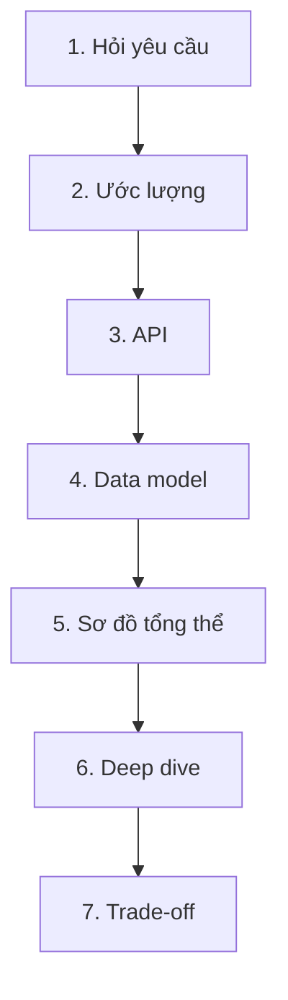
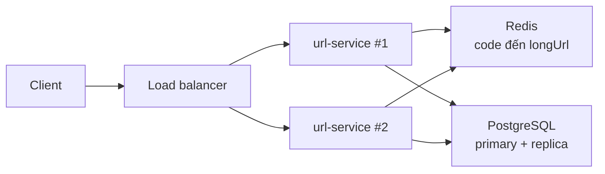
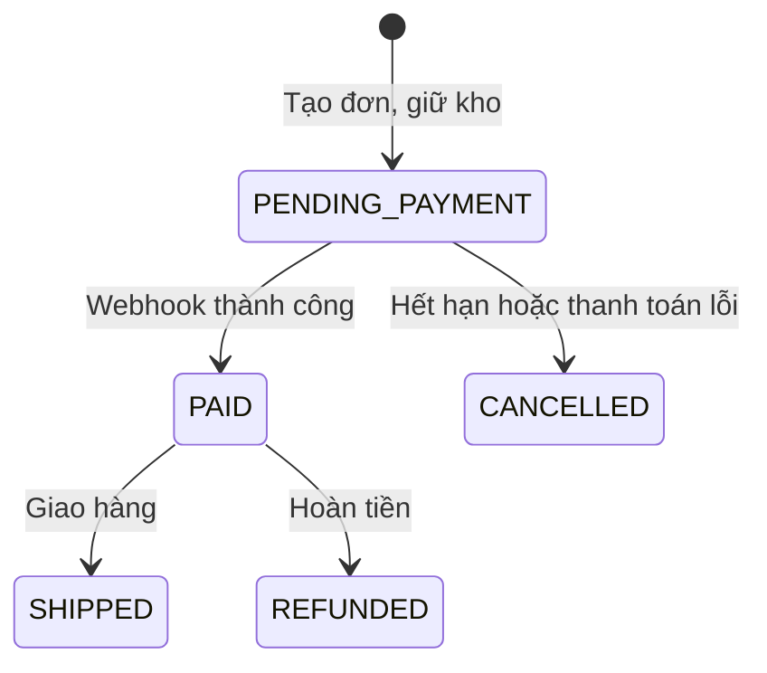
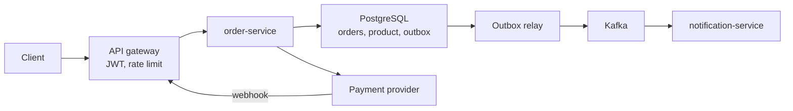
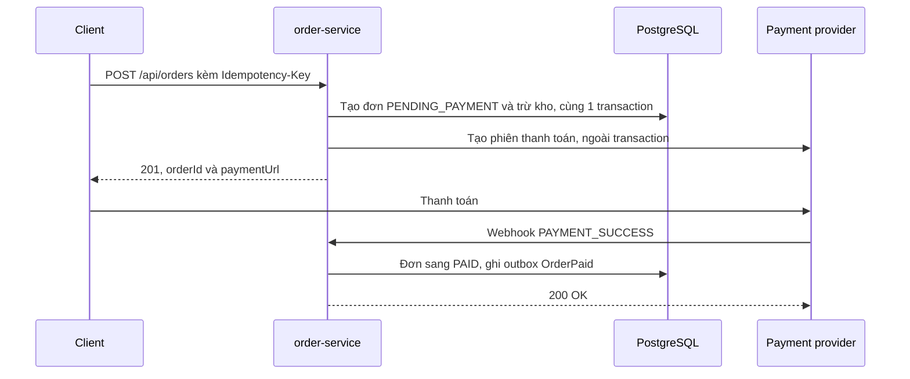

# System Design Practice

> **Tuần 8 · Ngày 51** · Thuộc [[10 - System Design & Behavioral]] · Bài trước: [[10.01 - System Design Concepts]] · Bài sau: [[10.03 - Project Story & STAR]]
> Vòng system design cho level 2 năm thường kéo dài 20–40 phút với một đề quen thuộc. Điểm cộng không nằm ở việc vẽ thật nhiều hộp, mà ở chỗ bạn **hỏi lại yêu cầu, ước lượng có căn cứ, và tự nêu trade-off**.
> Đoạn code Base62 trong bài đã chạy thử trên JDK 21. Mọi con số tải và dung lượng là **giả định để luyện tính nhẩm**, phép tính được ghi đầy đủ; khi phỏng vấn, hãy hỏi interviewer con số của họ.

**Mục lục**
1. [[#1. Khung trả lời 7 bước|Khung trả lời 7 bước]]
2. [[#2. Ước lượng nhanh|Ước lượng nhanh]]
3. [[#3. Thiết kế URL shortener|Thiết kế URL shortener]]
4. [[#4. URL shortener, câu hỏi nối tiếp|URL shortener, câu hỏi nối tiếp]]
5. [[#5. Thiết kế order và checkout service|Thiết kế order và checkout service]]
6. [[#6. Tồn kho, idempotency và thanh toán|Tồn kho, idempotency và thanh toán]]
7. [[#7. Order service, câu hỏi nối tiếp|Order service, câu hỏi nối tiếp]]
8. [[#8. Lỗi hay gặp khi trả lời system design|Lỗi hay gặp khi trả lời system design]]
9. [[#9. Kịch bản Feynman hôm nay|Kịch bản Feynman hôm nay]]

---

## 1. Khung trả lời 7 bước

### Hiểu bản chất
Đề system design cố tình **mơ hồ**. Interviewer muốn xem bạn có biết **thu hẹp bài toán** và **dẫn dắt cuộc trò chuyện** không. Có một khung cố định giúp bạn không bị lạc khi căng thẳng.

| Bước | Làm gì | Câu nói mẫu |
|---|---|---|
| 1. Yêu cầu | Chức năng (làm được gì) và phi chức năng (tải, độ trễ, độ nhất quán) | "Em xin hỏi lại phạm vi: có cần custom alias không, link có hết hạn không?" |
| 2. Ước lượng | Request/giây, dung lượng, tỉ lệ đọc/ghi | "Giả sử 1 triệu link mới mỗi ngày, đọc gấp 100 lần ghi…" |
| 3. API | Vài endpoint chính, method, request, response | "`POST /urls` trả về short code, `GET /{code}` redirect" |
| 4. Data model | Bảng, cột chính, index, chọn SQL hay NoSQL | "Bảng `short_url`, unique index trên `code`" |
| 5. High-level design | Vẽ các khối: client, LB, service, cache, DB, queue | Vẽ sơ đồ, đi một lượt theo luồng request |
| 6. Deep dive | Đào sâu 1–2 chỗ khó nhất | "Chỗ khó nhất là sinh mã ngắn không trùng" |
| 7. Trade-off | Nêu điểm yếu của thiết kế và hướng mở rộng | "Nếu tải tăng 10 lần thì em sẽ…" |



### Bẫy hay gặp
- **Lao vào vẽ ngay** mà không hỏi yêu cầu: dễ thiết kế thừa (Kafka, sharding cho hệ thống vài request/giây) hoặc thiếu chức năng quan trọng.
- **Im lặng suy nghĩ quá lâu**: nghĩ thành tiếng. Interviewer chấm cả cách bạn suy luận.
- **Nhồi buzzword** (Kubernetes, service mesh, CQRS) mà không giải thích vì sao cần. Ở level 2 năm, một thiết kế **đơn giản, đúng, có lý do** ăn điểm hơn.
- **Không tự nói điểm yếu**: mọi thiết kế đều có trade-off; tự nói ra trước là dấu hiệu trưởng thành.

> **Trả lời mẫu (câu mở đầu):** "Trước khi thiết kế, em xin làm rõ yêu cầu một chút. Về chức năng em hiểu là cần A, B; còn C có cần không ạ? Về quy mô, em giả định khoảng X người dùng, đọc nhiều hơn ghi, anh chị thấy có hợp lý không? Sau đó em sẽ ước lượng nhanh, đưa ra API, data model, vẽ sơ đồ tổng thể, rồi đào sâu vào phần khó nhất là Y."

### Câu hỏi xoáy

**Q1.** Interviewer nói "em tự giả định đi". Làm sao?
> [!success]- Gợi ý trả lời
> Nói rõ giả định và lý do, ghi lên bảng: "Em giả định 1 triệu link mới mỗi ngày, đọc gấp 100 lần ghi, vì link rút gọn thường được chia sẻ và click nhiều lần." Giả định hợp lý quan trọng hơn con số chính xác. Nếu interviewer muốn khác, họ sẽ sửa.

---

## 2. Ước lượng nhanh

### Hiểu bản chất
Ước lượng (back-of-envelope) không cần chính xác. Mục đích là trả lời: **"Một máy có đủ không? DB có chứa nổi không? Có cần cache không?"**

Vài mẹo tính nhẩm:

| Mẹo | Giá trị |
|---|---|
| Một ngày | 86.400 giây, tính nhẩm là khoảng 10^5 giây |
| 1 triệu việc mỗi ngày | 10^6 / 10^5 = khoảng 10 việc mỗi giây (chính xác là 11,6) |
| Peak | Giả định gấp vài lần trung bình (hỏi interviewer, hoặc tự nêu hệ số) |
| Dung lượng | số bản ghi × kích thước mỗi bản ghi × số ngày lưu |
| Đơn vị | 10^3 = KB, 10^6 = MB, 10^9 = GB, 10^12 = TB |

Quy trình: **số người dùng → số thao tác mỗi ngày → mỗi giây → peak → dung lượng**.

### Bẫy hay gặp
- Tính ra số rất nhỏ (vài request/giây) rồi vẫn thiết kế sharding: chính phép ước lượng phải dẫn tới quyết định. **Số nhỏ thì nói thẳng là một DB đủ**.
- Quên tính **peak**: hệ thống chết vào giờ cao điểm, không phải lúc trung bình.
- Không ghi phép tính: interviewer cần thấy cách bạn nghĩ, không chỉ con số cuối.

---

## 3. Thiết kế URL shortener

### Bước 1: Yêu cầu
**Chức năng:**
- Nhận URL dài, trả về mã ngắn, ví dụ `https://sho.rt/aZ3kQ9x`.
- Truy cập mã ngắn thì redirect tới URL gốc.
- (Tuỳ chọn, hỏi interviewer) custom alias, thời hạn link, thống kê số click.

**Phi chức năng:**
- Đọc nhiều hơn ghi rất nhiều.
- Redirect phải nhanh.
- Mã ngắn **không được trùng**, link đã tạo không được mất.

### Bước 2: Ước lượng (giả định)

| Đại lượng | Giả định và phép tính | Kết quả |
|---|---|---|
| Link mới | 1.000.000 link/ngày ÷ 86.400 giây | khoảng 12 ghi/giây |
| Redirect | Đọc gấp 100 lần ghi: 12 × 100 | khoảng 1.200 đọc/giây |
| Peak | Giả định gấp 5 lần trung bình | khoảng 60 ghi/giây, 6.000 đọc/giây |
| Số link sau 5 năm | 1.000.000 × 365 × 5 | 1,825 tỉ link |
| Dung lượng | 1,825 tỉ × 500 byte mỗi bản ghi | 912,5 GB, khoảng 1 TB |
| Cache link nóng | Giả định 10 triệu link nóng × 500 byte | khoảng 5 GB, vừa một Redis |

**Mã dài bao nhiêu ký tự?** Dùng Base62 (`0-9`, `a-z`, `A-Z`):

| Độ dài | Số mã có thể tạo | So với 1,825 tỉ link |
|---|---|---|
| 6 ký tự | 62^6 = 56.800.235.584 (khoảng 56,8 tỉ) | Đủ, dư khoảng 30 lần |
| 7 ký tự | 62^7 = 3.521.614.606.208 (khoảng 3.500 tỉ) | Rất dư |

Kết luận từ ước lượng: lượng ghi nhỏ, một PostgreSQL thừa sức; **lượng đọc là chỗ cần tối ưu**, nên cache là trọng tâm.

### Bước 3: API

```http
POST /api/urls
Content-Type: application/json

{ "longUrl": "https://example.com/very/long/path?x=1", "expiresAt": null }

201 Created
{ "code": "aZ3kQ9x", "shortUrl": "https://sho.rt/aZ3kQ9x" }
```

```http
GET /aZ3kQ9x

302 Found
Location: https://example.com/very/long/path?x=1
```

### Bước 4: Data model

```sql
CREATE TABLE short_url (
    id          BIGINT       PRIMARY KEY,          -- lấy từ sequence
    code        VARCHAR(10)  NOT NULL UNIQUE,      -- index để tra cứu khi redirect
    long_url    TEXT         NOT NULL,
    user_id     BIGINT,
    created_at  TIMESTAMPTZ  NOT NULL DEFAULT now(),
    expires_at  TIMESTAMPTZ
);
```

Truy vấn chính chỉ là tra theo `code`, không có join. SQL hay NoSQL key-value đều làm được; với dung lượng khoảng 1 TB sau 5 năm thì PostgreSQL vẫn ổn, và team Spring thường quen nó hơn.

### Bước 5: Sơ đồ tổng thể



Luồng redirect: tra Redis → hit thì trả 302 ngay; miss thì tra DB, ghi vào Redis kèm TTL, rồi trả 302 (cache-aside, xem [[10.01 - System Design Concepts]]).

```java
@GetMapping("/{code}")
public ResponseEntity<Void> redirect(@PathVariable String code) {
    String longUrl = shortUrlService.resolve(code);   // Redis trước, DB sau; không có thì 404
    return ResponseEntity.status(HttpStatus.FOUND)
            .location(URI.create(longUrl))
            .build();
}
```

### Bước 6: Deep dive, sinh mã ngắn

| Cách | Hoạt động | Ưu | Nhược |
|---|---|---|---|
| **Sequence + Base62** | Lấy id tăng dần từ DB, đổi sang Base62 | Không bao giờ trùng, mã ngắn | Mã **đoán được** (id kế tiếp), phụ thuộc nguồn sinh id |
| **Hash** (MD5, SHA-256) rồi cắt 7 ký tự | Băm URL dài | Cùng URL ra cùng mã | Cắt ngắn thì **có thể trùng**, phải kiểm tra và xử lý |
| **Random 7 ký tự** | Sinh ngẫu nhiên, insert, trùng unique thì sinh lại | Không đoán được | Cần retry khi trùng, càng nhiều link thì càng hay trùng |

Đổi id sang Base62 (đã chạy trên JDK 21):

```java
public class Base62Demo {
    private static final String ALPHABET =
            "0123456789abcdefghijklmnopqrstuvwxyzABCDEFGHIJKLMNOPQRSTUVWXYZ";

    static String encode(long id) {
        if (id == 0) return "0";
        StringBuilder sb = new StringBuilder();
        while (id > 0) {
            sb.append(ALPHABET.charAt((int) (id % 62)));
            id /= 62;
        }
        return sb.reverse().toString();
    }

    static long decode(String code) {
        long id = 0;
        for (char c : code.toCharArray()) {
            id = id * 62 + ALPHABET.indexOf(c);
        }
        return id;
    }
}
```

| Lời gọi | Output thật |
|---|---|
| `encode(125)` | `21` (vì 125 = 2 × 62 + 1) |
| `encode(1_000_000_000L)` | `15FTGg` |
| `decode(encode(1_000_000_000L))` | `1000000000` |
| `encode(62^6 - 1)` | `ZZZZZZ` (mã 6 ký tự lớn nhất) |

**Nhiều instance cùng lấy id thì sao?** Mỗi lần tạo link gọi `nextval` của sequence PostgreSQL là đủ với khoảng 60 ghi/giây ở peak. Nếu muốn giảm số lần gọi DB, mỗi instance xin trước **một dải id** (ví dụ 1.000 id) rồi cấp dần trong bộ nhớ, giống cơ chế `allocationSize` của Hibernate sequence.

### Bước 7: Trade-off
- **301 hay 302?** `301 Moved Permanently` cho phép browser cache redirect: lần sau browser tự đi thẳng, server đỡ tải nhưng **không đếm được click**. `302 Found` thì mỗi lần click đều qua server: tốn tải hơn nhưng có thống kê và có thể đổi hoặc vô hiệu hoá link. Cần analytics thì chọn 302.
- Sequence + Base62 làm mã đoán được. Nếu đó là vấn đề (link chia sẻ riêng tư), dùng random hoặc xáo trộn id trước khi mã hoá.
- Cache chỉ giúp đọc. Nếu ghi tăng rất lớn thì mới tính tới sharding theo `code`.

> **Trả lời mẫu:** "Em làm rõ yêu cầu: rút gọn, redirect, có thể có thời hạn và thống kê. Giả định 1 triệu link mỗi ngày, khoảng 12 ghi và 1.200 đọc mỗi giây, 5 năm khoảng 1,8 tỉ link, gần 1 TB, nên một PostgreSQL đủ và trọng tâm là tối ưu đọc. Base62 6 ký tự cho khoảng 56,8 tỉ mã, em chọn 7 ký tự cho dư. API có `POST /api/urls` và `GET /{code}` trả 302. Mã sinh bằng sequence đổi sang Base62 nên không bao giờ trùng, đổi lại là đoán được. Redirect đi qua Redis theo cache-aside. Em chọn 302 thay vì 301 để còn đếm click."

---

## 4. URL shortener, câu hỏi nối tiếp

**Q1.** Cùng một URL dài được rút gọn 2 lần thì trả cùng mã hay mã mới?
> [!success]- Gợi ý trả lời
> Tuỳ yêu cầu, nên hỏi lại. Nếu muốn trả cùng mã: thêm cột hash của `long_url` có index, tra trước khi tạo. Nhưng nếu mỗi user cần thống kê riêng thì mỗi lần tạo phải là một mã mới. Cách sequence + Base62 mặc định cho mã mới mỗi lần.

**Q2.** Đếm số click thế nào mà không làm chậm redirect?
> [!success]- Gợi ý trả lời
> Không `UPDATE count = count + 1` trên DB mỗi lần click: một link hot sẽ biến dòng đó thành điểm tranh chấp. Thay vào đó, khi redirect thì publish event click lên Kafka (hoặc `INCR` một counter Redis), một consumer gom lại và ghi theo lô vào bảng thống kê. Redirect vẫn nhanh; số liệu thống kê trễ vài giây là chấp nhận được.

**Q3.** Link hết hạn được dọn thế nào?
> [!success]- Gợi ý trả lời
> Khi redirect, kiểm tra `expires_at`, quá hạn thì trả 404 hoặc 410 Gone. Đặt TTL của Redis không dài hơn thời gian còn lại của link. Một job định kỳ xoá hoặc chuyển trữ các link quá hạn, nhớ dùng distributed lock nếu chạy nhiều instance.

**Q4.** Chặn người dùng rút gọn link độc hại hoặc spam tạo link?
> [!success]- Gợi ý trả lời
> Rate limit `POST /api/urls` theo user hoặc API key, kiểm tra URL với danh sách đen hoặc dịch vụ kiểm tra link độc hại khi tạo, cho phép vô hiệu hoá link sau khi có báo cáo. Đây cũng là một lý do chọn 302: link đã vô hiệu hoá thì server chặn được.

**Q5.** Redis chết thì sao?
> [!success]- Gợi ý trả lời
> Hệ thống vẫn chạy vì DB là nguồn dữ liệu chính, chỉ chậm hơn và tải DB tăng vọt. Cần timeout ngắn khi gọi Redis để không bị kéo chậm theo, read replica cho DB, và chạy Redis có replica (Sentinel hoặc Cluster) nếu yêu cầu cao.

---

## 5. Thiết kế order và checkout service

Đây là đề **sát nhất với `order-service` bạn đã làm ở lab**. Hãy tận dụng: những gì đã làm (N+1, `@Version`, `@Cacheable`, JWT, outbox) đều là chất liệu deep dive.

### Bước 1: Yêu cầu
**Chức năng:**
- User đặt đơn gồm nhiều sản phẩm, hệ thống giữ tồn kho.
- Thanh toán qua cổng thanh toán bên ngoài (payment provider).
- Thanh toán thành công thì đơn chuyển PAID, gửi email; quá hạn không trả thì huỷ và trả kho.

**Phi chức năng:**
- **Không bán vượt tồn kho** (oversell).
- **Không trừ tiền hai lần**, không tạo đơn trùng khi user bấm hai lần hoặc mạng retry.
- Chịu được đợt flash sale.

### Bước 2: Ước lượng (giả định)

| Đại lượng | Giả định và phép tính | Kết quả |
|---|---|---|
| Đơn bình thường | 50.000 đơn/ngày ÷ 86.400 giây | khoảng 0,6 đơn/giây |
| Peak thường ngày | Giả định gấp 10 lần | khoảng 6 đơn/giây |
| Dung lượng | 50.000 đơn × 1 KB (đơn + item) × 365 | khoảng 18 GB/năm |
| Flash sale | 20.000 người bấm mua 500 sản phẩm trong 60 giây | khoảng 333 request/giây **vào cùng một dòng `product`** |

Kết luận quan trọng: **thông lượng tổng không lớn**, một PostgreSQL xử lý được. Vấn đề thật là **tranh chấp trên cùng một dòng tồn kho** (hot row) và **tính đúng đắn**: oversell, đơn trùng, trừ tiền trùng.

### Bước 3: API

```http
POST /api/orders
Authorization: Bearer eyJ...
Idempotency-Key: 6f1c2a9e-4b7d-4c1a-9a51-0d2f3e8b7c11

{ "items": [ { "productId": 42, "quantity": 2 } ] }

201 Created
{ "orderId": 1001, "status": "PENDING_PAYMENT", "paymentUrl": "https://pay.example/..." }
```

| Endpoint | Ý nghĩa |
|---|---|
| `POST /api/orders` | Tạo đơn, giữ kho, trả link thanh toán. Bắt buộc `Idempotency-Key` |
| `GET /api/orders/{id}` | Xem trạng thái đơn |
| `POST /api/payments/webhook` | Payment provider gọi về báo kết quả thanh toán |

### Bước 4: Data model

```sql
CREATE TABLE product (
    id       BIGINT PRIMARY KEY,
    name     TEXT    NOT NULL,
    price    NUMERIC(12,2) NOT NULL,
    stock    INT     NOT NULL CHECK (stock >= 0),   -- lưới an toàn cuối cùng
    version  BIGINT  NOT NULL DEFAULT 0
);

CREATE TABLE orders (
    id               BIGINT PRIMARY KEY,
    customer_id      BIGINT      NOT NULL,
    status           VARCHAR(20) NOT NULL,
    total            NUMERIC(12,2) NOT NULL,
    idempotency_key  VARCHAR(64) NOT NULL UNIQUE,
    expires_at       TIMESTAMPTZ NOT NULL,
    created_at       TIMESTAMPTZ NOT NULL DEFAULT now()
);

CREATE TABLE payment (
    id               BIGINT PRIMARY KEY,
    order_id         BIGINT      NOT NULL REFERENCES orders(id),
    provider_txn_id  VARCHAR(64) UNIQUE,      -- chống xử lý webhook trùng
    status           VARCHAR(20) NOT NULL,
    amount           NUMERIC(12,2) NOT NULL
);
-- order_item(order_id, product_id, quantity, price) và outbox như bài 10.01
```

Vòng đời đơn hàng:



### Bước 5: Sơ đồ tổng thể



Luồng checkout:



---

## 6. Tồn kho, idempotency và thanh toán

### Deep dive 1: chống oversell

Hai request cùng đọc `stock = 1`, cùng thấy đủ hàng, cùng trừ: bán 2 cái khi chỉ có 1. Đây là **lost update** (đã gặp ở tuần 6). Các cách xử lý:

| Cách | Hoạt động | Hợp khi |
|---|---|---|
| **UPDATE có điều kiện** | Trừ và kiểm tra trong **một câu SQL**, DB tự khoá dòng | Mặc định nên dùng: đơn giản, đúng |
| **Optimistic lock `@Version`** | Đọc, sửa, lưu; version đổi thì `OptimisticLockException`, retry | Tranh chấp thấp. Flash sale thì retry liên tục |
| **Pessimistic lock** `SELECT ... FOR UPDATE` | Khoá dòng tới hết transaction | Cần đọc rồi tính toán phức tạp trước khi trừ |
| **Redis `DECR` trước** | Trừ trên Redis (atomic, rất nhanh), thành công mới tạo đơn trong DB | Flash sale cực đông; phải đối soát Redis với DB |

```sql
UPDATE product
SET stock = stock - :qty
WHERE id = :productId AND stock >= :qty;
-- 1 dòng bị ảnh hưởng: giữ kho thành công
-- 0 dòng: hết hàng, báo lỗi cho user
```

```java
@Modifying
@Query("update Product p set p.stock = p.stock - :qty where p.id = :id and p.stock >= :qty")
int decreaseStock(@Param("id") Long id, @Param("qty") int qty);
```

**Bẫy:**
- Câu `@Modifying` là bulk update: **bỏ qua persistence context** và **không tăng `@Version`**. Entity `Product` đã load trước đó trong cùng transaction sẽ giữ giá trị cũ (dùng `clearAutomatically = true` nếu cần đọc lại).
- Đơn nhiều sản phẩm: luôn trừ kho **theo thứ tự `productId` tăng dần**. Hai đơn trừ cùng 2 sản phẩm theo thứ tự ngược nhau có thể **deadlock**.
- `CHECK (stock >= 0)` là lưới an toàn cuối cùng: code có lỗi thì DB vẫn chặn.

### Deep dive 2: idempotency khi tạo đơn

User bấm "Đặt hàng" hai lần, hoặc app mobile retry vì timeout: không được tạo 2 đơn.

1. Client sinh một UUID cho mỗi lần checkout, gửi qua header `Idempotency-Key`, **retry thì gửi lại đúng key đó**.
2. Server lưu key vào `orders.idempotency_key` có **unique constraint**.
3. Request tới với key đã có thì trả lại **đơn cũ**, không tạo mới.
4. Hai request cùng key tới đồng thời: cả hai không thấy key, cả hai insert, **unique constraint** bắt một bên. Bên thua bắt `DataIntegrityViolationException` rồi đọc lại đơn đã tạo. Lưu ý: exception này làm transaction hiện tại bị đánh dấu rollback, nên phải bắt **bên ngoài** method `@Transactional` và đọc lại trong một transaction mới.

### Deep dive 3: thanh toán và webhook
- **Không gọi payment provider bên trong transaction DB** (bài học tuần 5): gọi mạng chậm sẽ giữ connection và lock. Commit đơn và giữ kho trước, gọi provider sau.
- Gửi `orderId` làm idempotency key cho provider để **retry không trừ tiền hai lần**.
- **Webhook có thể tới nhiều lần và sai thứ tự**: xác minh chữ ký của provider, `provider_txn_id` unique để bỏ qua bản trùng, và chuyển trạng thái **có điều kiện**:

```sql
UPDATE orders SET status = 'PAID'
WHERE id = :orderId AND status = 'PENDING_PAYMENT';
-- 0 dòng: đơn đã PAID hoặc đã CANCELLED, không xử lý lại
```

- **Giữ kho có hạn**: đơn `PENDING_PAYMENT` quá `expires_at` (ví dụ 15 phút, do nghiệp vụ quyết) thì một job huỷ đơn và cộng lại kho. Job cũng dùng UPDATE có điều kiện trạng thái để không đụng đơn vừa được trả tiền.
- **Webhook không bao giờ tới?** Job đối soát định kỳ hỏi provider trạng thái các đơn còn PENDING.

### Deep dive 4: event sau khi thanh toán
Khi đơn sang PAID, ghi `OrderPaid` vào bảng outbox **cùng transaction**, relay đẩy lên Kafka; notification-service gửi email, các service khác (giao hàng, điểm thưởng) tự nghe. Consumer idempotent theo `eventId`. Đây là saga dạng choreography; huỷ đơn chính là hành động bù cho bước giữ kho.

> **Trả lời mẫu:** "Lượng đơn bình thường nhỏ, một PostgreSQL đủ, nên trọng tâm là tính đúng đắn. Chống oversell em dùng UPDATE có điều kiện `stock >= qty` và kiểm tra số dòng bị ảnh hưởng, kèm `CHECK stock >= 0`; ở lab em đã thử `@Version` và thấy khi tranh chấp cao thì retry rất nhiều. Chống đơn trùng em dùng `Idempotency-Key` với unique constraint. Thanh toán gọi ngoài transaction, truyền orderId làm idempotency key; webhook xác minh chữ ký, chống trùng bằng `provider_txn_id` unique, và chỉ chuyển PENDING_PAYMENT sang PAID bằng UPDATE có điều kiện. Đơn quá hạn thì job huỷ và trả kho. Event OrderPaid đi qua outbox lên Kafka để gửi email."

---

## 7. Order service, câu hỏi nối tiếp

**Q1.** Flash sale 20.000 người tranh 500 sản phẩm. DB có chịu được không, cải thiện thế nào?
> [!success]- Gợi ý trả lời
> Mọi request đè lên **một dòng** `product`, nên chúng xếp hàng chờ khoá dòng đó. Cải thiện theo mức: (1) rate limit và hàng đợi ở gateway, trả "hết hàng" sớm khi đã bán đủ; (2) trừ kho trên Redis bằng `DECR` (atomic), chỉ request trừ thành công mới đi vào DB tạo đơn, nên DB chỉ nhận khoảng 500 lệnh ghi; (3) chia tồn kho thành nhiều dòng con (ví dụ 5 dòng, mỗi dòng 100) để giảm tranh chấp. Phải có đối soát giữa Redis và DB.

**Q2.** Trừ kho lúc đặt đơn hay lúc thanh toán xong?
> [!success]- Gợi ý trả lời
> Trừ lúc đặt đơn (giữ chỗ có hạn): user không bị "trả tiền xong mới báo hết hàng", nhưng hàng bị giữ bởi người không trả tiền, nên cần hạn giữ và job trả kho. Trừ lúc thanh toán: không giữ hàng ảo, nhưng có thể nhiều người cùng trả tiền cho món cuối cùng, phải hoàn tiền. Đa số hệ thống thương mại điện tử chọn giữ chỗ có hạn.

**Q3.** Nếu tách inventory thành service riêng thì sao?
> [!success]- Gợi ý trả lời
> Không còn transaction chung giữa `orders` và `product`, nên dùng saga: order-service tạo đơn PENDING, gọi inventory-service giữ kho (đồng bộ có timeout, hoặc qua event), thất bại thì huỷ đơn. Inventory phải idempotent theo `orderId` để retry không giữ kho hai lần. Đây là lúc đáng nói "em bắt đầu với một service, tách khi có lý do".

**Q4.** Xem lịch sử đơn của user nhanh thế nào khi bảng orders rất lớn?
> [!success]- Gợi ý trả lời
> Composite index `(customer_id, created_at DESC)`, phân trang keyset (`WHERE created_at < :last`) thay cho offset lớn, tránh N+1 khi lấy items (`JOIN FETCH` hoặc `@EntityGraph`, đã làm ở lab tuần 6), đọc từ read replica nếu chấp nhận trễ. Rất lớn nữa thì partition bảng theo thời gian.

**Q5.** Giá sản phẩm đổi sau khi user cho vào giỏ thì sao?
> [!success]- Gợi ý trả lời
> Lúc tạo đơn, server **tự đọc giá từ DB** và lưu `price` vào `order_item` (snapshot), không tin giá client gửi lên. Đơn cũ giữ giá lúc mua, sau này đổi giá sản phẩm không ảnh hưởng.

---

## 8. Lỗi hay gặp khi trả lời system design

| Lỗi | Thay bằng |
|---|---|
| Vẽ ngay không hỏi yêu cầu | Hỏi 2–3 câu về phạm vi và quy mô trước |
| Đưa microservices, Kafka, sharding vào mọi thiết kế | Để ước lượng quyết định; bắt đầu đơn giản rồi nói hướng mở rộng |
| Chỉ vẽ "happy path" | Tự hỏi: request trùng, service chết, hai người cùng mua món cuối |
| Nói "dùng cache cho nhanh" | Nói cache cái gì, TTL bao lâu, invalidate thế nào, dữ liệu cũ có chấp nhận được không |
| Bịa con số hiệu năng của công nghệ | Nói giả định rõ ràng, hoặc nói "em sẽ đo bằng load test" |
| Không nhắc tới kinh nghiệm thật | Nối vào lab: "ở order-service em đã gặp N+1 và dùng `@Version`…" |

---

## 9. Kịch bản Feynman hôm nay

1. "Đọc to 7 bước của khung trả lời, mỗi bước kèm một câu nói mẫu."
2. "Tự ước lượng lại URL shortener với 10 triệu link mỗi ngày: ghi/giây, đọc/giây, dung lượng 5 năm, 6 ký tự Base62 còn đủ không."
3. "Hai user cùng mua sản phẩm cuối cùng. Trình bày 3 cách chống oversell và chọn một."
4. "User bấm đặt hàng hai lần và webhook thanh toán tới hai lần. Hệ thống của em xử lý thế nào?"

Ghi vào [[08 - Nhật ký học tập]].

## Tự kiểm tra nhanh (không mở tài liệu)

- [ ] Kể 7 bước của khung trả lời system design
- [ ] 1 triệu việc mỗi ngày là khoảng bao nhiêu việc mỗi giây?
- [ ] 62^6 xấp xỉ bao nhiêu, vì sao 7 ký tự là dư?
- [ ] So sánh 3 cách sinh mã ngắn; 301 vs 302
- [ ] Viết câu UPDATE chống oversell và nói vì sao nó an toàn
- [ ] Idempotency-Key hoạt động thế nào khi 2 request cùng key tới đồng thời
- [ ] Vì sao không gọi payment provider trong transaction DB
- [ ] Vẽ state diagram của đơn hàng và nói webhook trùng được chặn ở đâu
