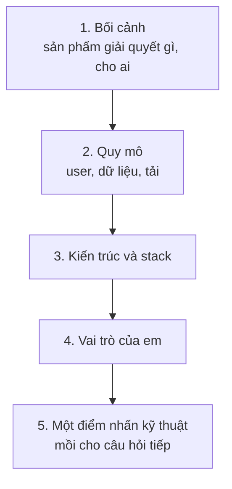

# Project Story & STAR

> **Tuần 8 · Ngày 52** · Thuộc [[10 - System Design & Behavioral]] · Bài trước: [[10.02 - System Design Practice]]
> Ở level 2 năm, câu "Giới thiệu dự án gần nhất của em" gần như luôn được hỏi, và interviewer dùng chính câu trả lời đó để chọn câu hỏi kỹ thuật tiếp theo. Kể tốt thì bạn **dẫn dắt được buổi phỏng vấn** về phần mình mạnh.
> Bài này không có code. Mọi chỗ `<...>` là chỗ để **điền trải nghiệm và số liệu thật của bạn**; bài cố tình không bịa ví dụ công ty hay con số. Điền vào [[09 - Hồ sơ dự án & STAR]], lấy chất liệu từ [[08 - Nhật ký học tập]].

**Mục lục**
1. [[#1. Giới thiệu dự án trong 1–2 phút|Giới thiệu dự án trong 1–2 phút]]
2. [[#2. Phương pháp STAR|Phương pháp STAR]]
3. [[#3. Tám chủ đề behavioral|Tám chủ đề behavioral]]
4. [[#4. Các câu hỏi chung hay gặp|Các câu hỏi chung hay gặp]]
5. [[#5. Biến lab order-service thành câu chuyện|Biến lab order-service thành câu chuyện]]
6. [[#6. Câu hỏi ngược cho interviewer|Câu hỏi ngược cho interviewer]]
7. [[#7. Checklist tuần cuối|Checklist tuần cuối]]
8. [[#8. Kịch bản Feynman hôm nay|Kịch bản Feynman hôm nay]]

---

## 1. Giới thiệu dự án trong 1–2 phút

### Hiểu bản chất
Interviewer không cần biết **mọi tính năng**. Họ muốn trả lời 3 câu: "Dự án này có độ khó cỡ nào? Em đóng vai trò gì? Em hiểu sâu tới đâu?" Phần giới thiệu là **mồi câu**: bạn đặt vào đó 1–2 điểm kỹ thuật mình nắm chắc để họ hỏi tiếp vào đúng chỗ đó.

| Phần | Thời lượng gợi ý | Nói gì |
|---|---|---|
| Bối cảnh | 2–3 câu | Domain, người dùng, giá trị nghiệp vụ |
| Quy mô | 1–2 câu | Chỉ những số bạn **chắc chắn** biết |
| Kiến trúc, stack | 2–3 câu | Monolith hay microservices, DB, cache, queue |
| Vai trò | 2–3 câu | Phần **em** phụ trách, dùng "em" chứ không "team em" |
| Điểm nhấn | 2–3 câu | Một vấn đề khó em đã xử lý, chỉ nêu tên, chờ họ hỏi |

### Khung trả lời

> **Trả lời mẫu (khung):** "Dự án gần nhất của em là `<tên chung chung, ví dụ: hệ thống quản lý đơn hàng cho chuỗi bán lẻ>`, giúp `<ai>` làm `<việc gì>`. Hệ thống có khoảng `<số liệu thật của bạn: user, đơn/ngày, kích thước dữ liệu>`. Kiến trúc là `<monolith hoặc N microservices>` viết bằng Spring Boot `<phiên bản>`, dùng `<PostgreSQL, Redis, Kafka…>`, deploy trên `<Docker, Kubernetes…>`. Team có `<số người>`, em là backend developer, phụ trách chính `<module cụ thể>`. Phần em thấy có giá trị nhất là `<vấn đề kỹ thuật, ví dụ: tối ưu API danh sách đơn bị N+1>`, em có thể kể chi tiết nếu anh chị quan tâm."

### Bẫy hay gặp
- **Kể lan man mọi tính năng** suốt 5 phút: interviewer mất tập trung và không biết hỏi gì.
- **"Team em làm…"** từ đầu tới cuối: họ không biết **bạn** làm gì. Nói rõ phần của mình, ghi nhận phần của người khác.
- **Bịa hoặc phóng đại số liệu**: họ sẽ hỏi "đo bằng cách nào?". Không nhớ chính xác thì nói khoảng và nói nguồn: "theo dashboard Grafana lúc đó khoảng `<…>`". Không biết thì nói không biết.
- **Lộ thông tin mật** của công ty (tên khách hàng, kiến trúc nội bộ chi tiết, số liệu kinh doanh): nói chung chung đủ để hiểu là được.
- **Đặt mồi vào chỗ mình không vững**: nhắc Kafka thì phải trả lời được partition, consumer group, idempotent consumer.

### Câu hỏi xoáy

**Q1.** "Nếu được làm lại dự án này, em sẽ thay đổi gì?"
> [!success]- Gợi ý trả lời
> Chọn 1–2 điểm cụ thể, có lý do kỹ thuật, không đổ lỗi: "Em sẽ thêm integration test với Testcontainers ngay từ đầu, vì `<sự cố thật>` lẽ ra đã bắt được trong CI" hoặc "em sẽ thêm `traceId` vào log sớm hơn vì lúc điều tra `<…>` mất nhiều thời gian ghép log". Tránh câu "em sẽ viết lại bằng microservices" nếu không có lý do.

**Q2.** "Phần khó nhất trong dự án là gì?"
> [!success]- Gợi ý trả lời
> Đây là lời mời kể một câu chuyện STAR kỹ thuật (mục 2). Chuẩn bị sẵn một câu chuyện dài khoảng 2 phút, có điều tra, có lựa chọn giữa các phương án và có kết quả đo được.

---

## 2. Phương pháp STAR

### Hiểu bản chất
Câu hỏi behavioral ("Kể về một lần em…") dựa trên giả định: **hành vi trong quá khứ dự đoán hành vi tương lai**. STAR giúp câu chuyện có cấu trúc, không lạc đề.

| Phần | Nội dung | Tỉ trọng gợi ý |
|---|---|---|
| **S**ituation | Bối cảnh ngắn: dự án, thời điểm, vấn đề | Ít |
| **T**ask | **Em** chịu trách nhiệm gì, mục tiêu là gì | Ít |
| **A**ction | **Em** đã làm gì, theo thứ tự, **vì sao** chọn cách đó | **Nhiều nhất** |
| **R**esult | Kết quả đo được + bài học | Vừa |

Nhiều người thêm **L (Learning)**: sau chuyện đó em thay đổi cách làm gì. Với level 2 năm, phần bài học rất được đánh giá cao.

### Ví dụ yếu và ví dụ mạnh
Câu hỏi: *"Kể về một vấn đề hiệu năng em đã xử lý."*

**Ví dụ yếu:**
> "Có lần API bị chậm, em phát hiện bị N+1 nên dùng JOIN FETCH để sửa, sau đó API nhanh hơn nhiều."

Vì sao yếu: không có bối cảnh, không biết em phát hiện **bằng cách nào**, không có phương án nào khác được cân nhắc, "nhanh hơn nhiều" không đo được, không có bài học.

**Ví dụ mạnh (khung, điền số liệu thật):**
> **S:** "Ở `<dự án hoặc order-service>`, API `GET /orders` trả danh sách đơn kèm sản phẩm. Khi dữ liệu tăng lên `<số đơn thật>`, thời gian phản hồi lên tới `<số đo thật>`."
> **T:** "Em `<được giao hoặc tự nhận>` tìm nguyên nhân và sửa mà không đổi API contract."
> **A:** "Em bật log SQL và đếm được 1 câu lấy danh sách đơn cộng thêm 1 câu cho mỗi đơn để lấy items: đúng dạng N+1. Em thử 3 cách. `JOIN FETCH` gom về 1 câu nhưng kết hợp với phân trang thì Hibernate cảnh báo phải phân trang trong bộ nhớ. `@EntityGraph` gặp vấn đề tương tự. `default_batch_fetch_size` giữ phân trang ở DB và gom phần lấy items thành vài câu `IN`. Em chọn `<cách bạn chọn>` vì `<lý do>`. Em viết thêm test đếm số câu SQL bằng Hibernate statistics để lỗi không quay lại."
> **R:** "Số câu SQL mỗi request từ `<1 + N>` xuống `<số thật>`, thời gian phản hồi từ `<số thật>` xuống `<số thật>`. Bài học: từ đó mỗi API trả danh sách em đều kiểm tra log SQL trước khi merge."

### Bẫy hay gặp
- **Situation quá dài**: 1 phút kể bối cảnh, 20 giây cho phần mình làm.
- **"Chúng em"** ở phần Action: interviewer đánh giá **bạn**.
- **Chuyện không có xung đột hay khó khăn**: không có gì để học từ chuyện quá suôn sẻ.
- **Kết quả không đo được** hoặc **bịa số**. Không có số thì nói kết quả định tính trung thực: "lỗi đó không tái diễn trong `<thời gian>`", "team áp dụng checklist này".
- **Học thuộc lòng từng chữ**: nghe như đọc. Chỉ thuộc **khung và các ý chính**, nói tự nhiên.

> **Trả lời mẫu (nói về cách mình chuẩn bị):** "Em chuẩn bị khoảng 8 câu chuyện theo STAR từ dự án thật và project cá nhân. Mỗi câu chuyện em chỉ ghi ý chính: bối cảnh một câu, việc của em, các bước em làm và lý do, kết quả có số liệu và bài học. Một câu chuyện có thể dùng cho nhiều câu hỏi, ví dụ chuyện tối ưu N+1 dùng được cho câu về hiệu năng, câu về vấn đề khó nhất và câu về chủ động cải thiện."

### Câu hỏi xoáy

**Q1.** Không có câu chuyện nào hợp với câu hỏi thì sao?
> [!success]- Gợi ý trả lời
> Nói thật và chuyển sang chuyện gần nhất: "Em chưa gặp đúng tình huống đó, nhưng gần nhất là `<…>`" hoặc nói cách em **sẽ** làm, kèm lý do. Đừng bịa chuyện: câu hỏi xoáy tiếp theo sẽ lộ.

**Q2.** Interviewer hỏi sâu "vì sao em không chọn cách khác?"
> [!success]- Gợi ý trả lời
> Đây là lý do phần Action phải có **các phương án đã cân nhắc**. Trả lời bằng trade-off cụ thể (độ phức tạp, rủi ro, thời gian, hiệu quả đo được), và thừa nhận nếu bây giờ nhìn lại có cách tốt hơn.

---

## 3. Tám chủ đề behavioral

Tám chủ đề dưới đây khớp với danh sách trong [[09 - Hồ sơ dự án & STAR]]. Mỗi chủ đề: câu hỏi hay gặp, interviewer tìm gì, khung trả lời, điều nên tránh.

### 3.1 Bất đồng kỹ thuật với đồng nghiệp
**Hay hỏi:** "Kể về lần em không đồng ý với đồng nghiệp hoặc leader." / "Tell me about a time you disagreed with a teammate."
**Họ tìm:** em tranh luận bằng **dữ liệu**, tôn trọng người khác, biết **chấp nhận quyết định chung** kể cả khi mình không thắng.

> **Khung trả lời:** "Khi làm `<tính năng>`, em và `<vai trò, không nêu tên>` khác ý về `<vấn đề kỹ thuật>`. Em lo rằng `<rủi ro>`. Thay vì tranh cãi, em `<làm PoC, đo, tìm tài liệu>` và trình bày `<dữ liệu>`. Cuối cùng team chọn `<phương án>` vì `<lý do>`. Kết quả `<…>`. Em học được là `<…>`."

**Tránh:** kể đồng nghiệp sai hoàn toàn còn mình đúng hoàn toàn; nói xấu người cũ.

### 3.2 Deadline gấp
**Hay hỏi:** "Kể về lần em phải làm việc dưới áp lực thời gian."
**Họ tìm:** em biết **ưu tiên**, **báo sớm** rủi ro, cắt phạm vi có cân nhắc chứ không âm thầm cắt test.

> **Khung trả lời:** "`<Tính năng>` phải xong trước `<mốc>`, còn `<thời gian>` mà phần việc ước tính `<…>`. Em chia việc thành phần bắt buộc và phần làm sau, báo `<leader hoặc PO>` ngay từ `<thời điểm>` kèm đề xuất `<cắt hoặc lùi phần nào>`. Em giữ `<test hoặc review cho phần rủi ro>`. Kết quả `<…>`. Lần sau em `<ước lượng hoặc báo rủi ro sớm hơn thế nào>`."

**Tránh:** khoe "em thức trắng 3 đêm" như thành tích chính; nghe giống quản lý thời gian kém.

### 3.3 Mắc lỗi và cách khắc phục
**Hay hỏi:** "Kể về một sai lầm của em." / "Một lần em làm hỏng production?"
**Họ tìm:** em **nhận trách nhiệm**, xử lý nhanh, tìm **nguyên nhân gốc**, và thay đổi **quy trình** để không lặp lại.

> **Khung trả lời:** "Em `<làm gì>` dẫn tới `<hậu quả, mức độ>`. Khi phát hiện, em `<báo ai, rollback hoặc hotfix thế nào>`. Nguyên nhân gốc là `<…>`. Sau đó em `<thêm test, thêm review checklist, thêm alert>`. Từ đó `<lỗi không lặp lại hoặc quy trình mới của team>`."

**Tránh:** chọn lỗi vô hại kiểu "em quá cầu toàn"; đổ lỗi cho người khác hoặc cho quy trình.

### 3.4 Học nhanh công nghệ mới
**Hay hỏi:** "Kể về lần em phải học một công nghệ mới trong thời gian ngắn."
**Họ tìm:** em có **cách học** (tài liệu chính thức, PoC nhỏ, hỏi người biết), và áp dụng được vào việc thật.

> **Khung trả lời:** "Dự án cần `<công nghệ>` mà em chưa dùng, thời gian `<…>`. Em đọc `<tài liệu chính thức>`, làm một PoC nhỏ để thử `<điểm rủi ro nhất>`, rồi `<hỏi ai hoặc review với ai>`. Em áp dụng vào `<phần việc>`. Kết quả `<…>`. Em cũng viết lại `<ghi chú hoặc tài liệu>` cho team."

**Tránh:** "em xem vài video là biết" mà không có kết quả cụ thể.

### 3.5 Chủ động cải thiện việc không ai giao
**Hay hỏi:** "Kể về lần em làm nhiều hơn yêu cầu." / "Một cải tiến em tự đề xuất?"
**Họ tìm:** ownership, nhìn thấy vấn đề và **đo được** giá trị, nhưng vẫn **xin ý kiến** chứ không tự ý.

> **Khung trả lời:** "Em để ý `<vấn đề lặp lại, ví dụ build chậm, test hay vỡ, log khó đọc>`, mỗi `<tuần hoặc sprint>` team mất `<…>`. Em đề xuất với `<leader>` cách `<…>`, làm thử trong `<phạm vi nhỏ>`. Sau đó `<số liệu hoặc thay đổi thật>`."

**Tránh:** tự ý refactor lớn không báo ai rồi gây lỗi.

### 3.6 Giúp đỡ hoặc hướng dẫn người khác
**Hay hỏi:** "Kể về lần em giúp một đồng nghiệp." / "Em đã onboard ai chưa?"
**Họ tìm:** tinh thần đồng đội, khả năng **giải thích**, kiên nhẫn. Ở 2 năm kinh nghiệm, kèm một bạn mới hoặc intern là ví dụ rất hợp.

> **Khung trả lời:** "`<Bạn mới hoặc intern>` gặp khó ở `<…>`. Em `<pair programming, giải thích, chỉ tài liệu>` thay vì làm hộ. Em `<chuẩn bị gì, ví dụ checklist setup môi trường>`. Sau `<thời gian>`, bạn ấy `<tự làm được gì>`."

**Tránh:** giọng kể "người kia kém".

### 3.7 Nhận feedback tiêu cực
**Hay hỏi:** "Kể về lần em nhận góp ý khó nghe." / "Code review bị nhiều comment thì em làm gì?"
**Họ tìm:** em **không phòng thủ**, hỏi rõ, thay đổi thật.

> **Khung trả lời:** "Trong `<code review hoặc buổi 1-1>`, `<vai trò>` góp ý rằng `<nội dung>`. Lúc đầu em `<cảm nhận thật, ngắn>`, nhưng em hỏi thêm để hiểu `<…>`. Sau đó em `<thay đổi cụ thể>`. Kết quả `<lần review sau, phản hồi sau>`."

**Tránh:** feedback "giả" kiểu "anh ấy bảo em làm việc chăm quá".

### 3.8 Đánh đổi chất lượng và tốc độ
**Hay hỏi:** "Có lần nào em phải chọn giữa làm nhanh và làm đúng?"
**Họ tìm:** em hiểu **technical debt là lựa chọn có ý thức**: ghi lại, có kế hoạch trả, không đánh đổi ở chỗ rủi ro cao (tiền, bảo mật, dữ liệu).

> **Khung trả lời:** "Khi `<bối cảnh>`, làm đầy đủ thì cần `<…>`, nhưng `<lý do nghiệp vụ cần nhanh>`. Em đề xuất làm `<phiên bản đơn giản>` trước, giữ nguyên `<phần không được đánh đổi, ví dụ validate, transaction, test luồng tiền>`, và tạo ticket `<nợ kỹ thuật>`. `<Khi nào>` em quay lại xử lý. Kết quả `<…>`."

**Tránh:** "em luôn chọn chất lượng" (nghe thiếu thực tế), hoặc "làm nhanh rồi tính" (nghe vô trách nhiệm).

---

## 4. Các câu hỏi chung hay gặp

**Q1.** "Giới thiệu bản thân."
> [!success]- Gợi ý trả lời
> Khoảng 1 phút, không đọc lại CV: em là ai (backend Java, `<số năm>` năm), đang làm gì (domain, stack chính), điểm mạnh kỹ thuật với 1 ví dụ, vì sao quan tâm vị trí này. Kết thúc bằng một câu mở đường tới dự án: "dự án gần nhất em có thể kể chi tiết hơn".

**Q2.** "Vì sao em muốn chuyển việc?"
> [!success]- Gợi ý trả lời
> Hướng về **điều muốn có**, không về điều chán ghét: "Em muốn làm hệ thống `<quy mô hoặc domain>` lớn hơn, được làm sâu hơn về `<…>`." Không nói xấu công ty cũ, không lấy lương làm lý do chính trong vòng kỹ thuật.

**Q3.** "Điểm yếu của em là gì?"
> [!success]- Gợi ý trả lời
> Chọn điểm yếu **thật**, không chí mạng với vị trí, và **đang cải thiện có bằng chứng**: "Trước đây em hay ước lượng thời gian quá lạc quan. Giờ em chia việc nhỏ và cộng thêm thời gian cho test, review, sai số của em đã giảm `<…>`." Tránh "em quá cầu toàn".

**Q4.** "2–3 năm tới em muốn thế nào?"
> [!success]- Gợi ý trả lời
> Cụ thể và liên quan tới vị trí: "Em muốn vững về thiết kế hệ thống và vận hành production, tự chịu trách nhiệm một service từ thiết kế tới monitoring, và bắt đầu hỗ trợ các bạn mới."

**Q5.** "Em có câu hỏi gì cho anh chị không?"
> [!success]- Gợi ý trả lời
> Luôn có câu hỏi. Xem mục 6.

---

## 5. Biến lab order-service thành câu chuyện

### Hiểu bản chất
Nếu dự án thật thiếu ví dụ, các lab bạn đã làm trên `order-service` **là trải nghiệm thật**: bạn đã tự tái hiện lỗi, đo, sửa. Điều kiện duy nhất: **nói rõ đó là project cá nhân**, không trình bày như production của công ty.

Câu mở hợp lý: *"Ở công ty em chưa gặp đúng vấn đề này ở quy mô lớn, nên em dựng một project cá nhân để tái hiện và đo, cụ thể là…"* Interviewer thường đánh giá cao tinh thần tự học có bằng chứng.

| Lab (tuần) | Dùng cho chủ đề | Ý chính của câu chuyện |
|---|---|---|
| N+1 trên `GET /orders` (tuần 6) | Vấn đề khó nhất, hiệu năng | Bật log SQL, đếm 1 + N câu, so sánh `JOIN FETCH`, `@EntityGraph`, batch size, ghi số câu SQL mỗi cách: `<số liệu bạn ghi lại>` |
| `@Version` khi 2 thread cùng trừ kho (tuần 6) | Concurrency, "tưởng đúng mà sai" | Code trừ kho nhìn đúng, test 2 thread lộ ra lost update; thêm `@Version` thấy `OptimisticLockException`; bàn retry và UPDATE có điều kiện |
| Composite index + `EXPLAIN` (tuần 6) | Tối ưu query | Seed dữ liệu, `EXPLAIN` trước và sau: `<plan và thời gian bạn đo>` |
| `@Cacheable` Redis + evict (tuần 7) | Trade-off | Cache giảm tải đọc nhưng sinh dữ liệu cũ; chọn TTL `<…>` và evict khi update; không cache tồn kho dùng để bán |
| JWT + phân quyền (tuần 7) | Học nhanh công nghệ mới | Đọc tài liệu Spring Security, hiểu filter chain, dựng login cấp token, phân quyền `ADMIN`/`USER` |
| Lỗi `@Transactional` (tuần 5) | Mắc lỗi, bài học | Tái hiện self-invocation làm mất transaction, checked exception vẫn commit; rút ra checklist review |
| Testcontainers (tuần 7) | Chủ động cải thiện chất lượng | Test với H2 pass nhưng `<khác biệt thật bạn gặp>` với PostgreSQL; chuyển sang Testcontainers |

### Cách viết một câu chuyện từ nhật ký
1. Mở [[08 - Nhật ký học tập]], tìm dòng **Dự án** của tuần có lab.
2. Viết lại theo STAR vào mục 6 của [[09 - Hồ sơ dự án & STAR]], **chỉ dùng số bạn đã thật sự đo**.
3. Nói to bấm giờ: mỗi câu chuyện khoảng 2 phút.
4. Chuẩn bị 2–3 câu hỏi xoáy có thể bị hỏi cho từng câu chuyện (ví dụ chuyện N+1: "Vì sao không dùng DTO projection?", "Batch size bao nhiêu là hợp lý?").

### Bẫy hay gặp
- Trình bày lab như hệ thống production có hàng triệu user: một câu hỏi về vận hành là lộ.
- Kể lab mà **không có số liệu đã ghi lại**: hãy chạy lại và ghi số trước buổi phỏng vấn.
- Chỉ kể "em làm theo hướng dẫn": nhấn vào chỗ **em tự quan sát, so sánh, kết luận**.

> **Trả lời mẫu (khung):** "Ở dự án công ty, phần em phụ trách chưa gặp tranh chấp tồn kho, nên em tự dựng order-service để tìm hiểu. Em viết test cho 2 thread cùng trừ kho một sản phẩm và thấy kết quả bị mất một lần cập nhật. Em thêm `@Version` thì một thread nhận `OptimisticLockException`, rồi so sánh với UPDATE có điều kiện `stock >= qty`. Em kết luận `<kết luận của bạn>`, vì `<lý do>`. Từ đó khi review code có đọc rồi ghi cùng một dòng, em luôn hỏi chuyện gì xảy ra nếu hai request chạy song song."

---

## 6. Câu hỏi ngược cho interviewer

Hỏi ngược cho thấy bạn **nghiêm túc chọn môi trường**, và giúp bạn quyết định có nên nhận offer. Chuẩn bị 5–6 câu, chọn 2–3 câu tuỳ người phỏng vấn.

| Nhóm | Câu hỏi | Vì sao nên hỏi |
|---|---|---|
| Công việc | "Một ngày làm việc điển hình của vị trí này thế nào?" | Biết thực tế công việc |
| Công việc | "Trong 3 tháng đầu, anh chị kỳ vọng em làm được gì?" | Biết tiêu chí đánh giá |
| Kỹ thuật | "Hệ thống hiện tại đang gặp thách thức kỹ thuật lớn nhất là gì?" | Mở ra thảo luận, cho thấy quan tâm thật |
| Kỹ thuật | "Team review code, test và deploy thế nào?" | Biết chất lượng quy trình |
| Kỹ thuật | "Khi có sự cố production, team xử lý và rút kinh nghiệm ra sao?" | Biết văn hoá on-call, postmortem |
| Phát triển | "Người làm tốt ở vị trí này thường phát triển theo hướng nào?" | Biết lộ trình thăng tiến |
| Team | "Team có bao nhiêu người, chia việc thế nào?" | Biết quy mô và vai trò |

**Tránh:** hỏi điều có sẵn trên website; hỏi lương, ngày nghỉ ở vòng kỹ thuật (để dành cho HR); nói "em không có câu hỏi gì".

---

## 7. Checklist tuần cuối

### Trước buổi phỏng vấn (vài ngày)
- [ ] Giới thiệu bản thân 1 phút và giới thiệu dự án 2 phút: nói to, bấm giờ, ghi âm nghe lại
- [ ] 8 câu chuyện STAR đã điền số liệu thật trong [[09 - Hồ sơ dự án & STAR]]
- [ ] Ôn câu trả lời yếu đã ghi ở checkpoint và trong các buổi mock
- [ ] Đọc lại JD, đánh dấu công nghệ họ dùng, chuẩn bị 1 ví dụ cho mỗi công nghệ mình đã dùng
- [ ] Tìm hiểu sản phẩm của công ty để có câu hỏi ngược thật
- [ ] Luyện 1 đề system design (URL shortener hoặc order service) theo khung 7 bước

### Ngày phỏng vấn
- [ ] Phỏng vấn online: thử camera, micro, mạng, chia sẻ màn hình trước 15 phút
- [ ] Có giấy bút để vẽ và ghi câu hỏi
- [ ] Mở sẵn [[09 - Hồ sơ dự án & STAR]] để liếc ý chính nếu cần (không đọc nguyên văn)

### Trong lúc trả lời
- [ ] Không hiểu câu hỏi thì hỏi lại, đừng đoán
- [ ] Không biết thì nói "em chưa làm cái này, nhưng em hiểu là…" rồi suy luận thành tiếng
- [ ] Trả lời có cấu trúc: ý chính trước, chi tiết sau, ví dụ dự án cuối

### Sau buổi phỏng vấn
- [ ] Ghi ngay các câu bị hỏi và câu trả lời chưa tốt vào [[08 - Nhật ký học tập]]
- [ ] Bổ sung câu trả lời tốt hơn vào note tương ứng

---

## 8. Kịch bản Feynman hôm nay

1. "Giới thiệu dự án gần nhất trong 90 giây, có quy mô, vai trò và một điểm nhấn kỹ thuật." Ghi âm và nghe lại.
2. "Kể chuyện tối ưu N+1 theo STAR, phần Action dài nhất, có ít nhất 2 phương án đã cân nhắc."
3. "Kể một lần em mắc lỗi: nguyên nhân gốc là gì, em thay đổi quy trình thế nào."
4. "Nói 3 câu hỏi ngược em sẽ hỏi và vì sao."

Ghi vào [[08 - Nhật ký học tập]].

## Tự kiểm tra nhanh (không mở tài liệu)

- [ ] 5 phần của bài giới thiệu dự án, theo thứ tự
- [ ] STAR là gì, phần nào dài nhất, vì sao
- [ ] Nói được 3 lý do ví dụ "yếu" ở mục 2 bị yếu
- [ ] Kể tên 8 chủ đề behavioral và điều interviewer tìm ở mỗi chủ đề
- [ ] Trả lời "điểm yếu của em" mà không dùng "quá cầu toàn"
- [ ] Chọn 3 lab order-service sẽ dùng làm câu chuyện và chủ đề tương ứng
- [ ] Kể 3 câu hỏi ngược và 2 điều không nên hỏi ở vòng kỹ thuật
- [ ] 8 câu chuyện STAR trong [[09 - Hồ sơ dự án & STAR]] đã có số liệu thật
