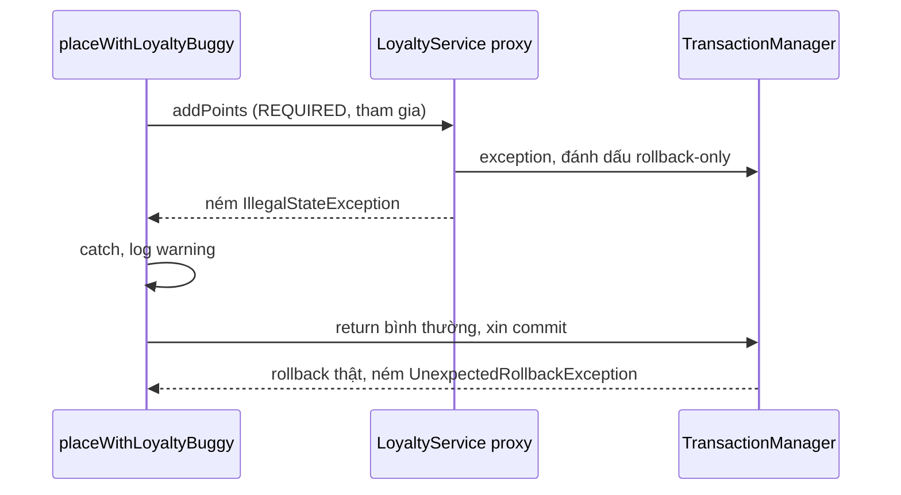

# Lab 5: Transaction Bugs

> **Tuần 5 · Ngày 34** · Thuộc [[11 - Labs thực hành]] · Lab trước: [[11.04 - Lab 4 order-service Setup]] · Lab sau: [[11.06 - Lab 6 N+1, Locking & Index]] · Bài liên quan: [[05.01 - Transaction Proxy Mechanism]], [[05.02 - Khi @Transactional không hoạt động]], [[05.03 - Propagation]], [[05.05 - TransactionTemplate & Transaction Events]] · Lời giải: `labs/order-service/` (package `lab5`, `audit`, `notification`; test `src/test/java/com/shop/orderservice/lab5/`)
> Mục tiêu: trên chính `order-service`, viết test **tái hiện** 5 lỗi transaction kinh điển rồi **sửa**, mỗi lỗi có số liệu (số đơn, số tồn kho, số email, message exception) để kể khi phỏng vấn. Thời gian khoảng 2 giờ.
> Lab này là project bạn tự làm; lời giải tham khảo nằm trong repo. Mọi output trong bài là output thật của lời giải: Spring Boot 3.5.16 (Spring 6.2, Hibernate 6.6), JDK 21, **PostgreSQL 16 qua Testcontainers** (không dùng H2 cho lab này).

**Mục lục**
1. [[#Chuẩn bị|Chuẩn bị]]
2. [[#Bài 1: Self-invocation làm mất transaction|Bài 1: Self-invocation làm mất transaction]]
3. [[#Bài 2: Checked exception vẫn commit|Bài 2: Checked exception vẫn commit]]
4. [[#Bài 3: Audit log REQUIRES_NEW sống sót khi rollback|Bài 3: Audit log REQUIRES_NEW sống sót khi rollback]]
5. [[#Bài 4: UnexpectedRollbackException|Bài 4: UnexpectedRollbackException]]
6. [[#Bài 5: Gửi email sau commit với @TransactionalEventListener|Bài 5: Gửi email sau commit với @TransactionalEventListener]]
7. [[#Câu hỏi phỏng vấn liên quan|Câu hỏi phỏng vấn liên quan]]
8. [[#Ghi lại sau buổi lab|Ghi lại sau buổi lab]]
9. [[#Checklist hoàn thành|Checklist hoàn thành]]

---

## Chuẩn bị

Dùng tiếp project của [[11.04 - Lab 4 order-service Setup]]. Thêm vào:

| Thành phần | Vai trò |
|---|---|
| Package `lab5` | Các service "bản lỗi" và "bản sửa" đặt cạnh nhau. Mọi bean gắn `@Profile("lab5")`, app thật không nạp chúng |
| `audit/AuditService` | Ghi audit với `REQUIRES_NEW` (dùng thật, không chỉ cho lab) |
| `notification/OrderEmailListener` | Gửi email `AFTER_COMMIT` khi `OrderService.placeOrder` publish `OrderPlacedEvent` |
| `notification/EmailSender` | Thay SMTP: log email và giữ danh sách đã gửi để test assert |
| `support/PostgresTestcontainersConfig` | Bean `PostgreSQLContainer` có `@ServiceConnection` |

Lớp test gốc, dùng chung cho cả 5 bài:

```java
@SpringBootTest(properties =
        "logging.level.org.springframework.orm.jpa.JpaTransactionManager=debug")
@ActiveProfiles({"test", "lab5"})
@Import(PostgresTestcontainersConfig.class)
abstract class Lab5TestBase {      // KHÔNG có @Transactional

    @BeforeEach
    void resetDatabase() {
        orders.deleteAll();        // cascade sang order_items
        products.deleteAll();
        customers.deleteAll();
        auditLogs.deleteAll();
        notificationLogs.deleteAll();
        emailSender.clear();
        customer = customers.save(new Customer("An", "an@example.com"));
        keyboard = products.save(new Product("Keyboard", new BigDecimal("100.00"), 10));
        monitor = products.save(new Product("Monitor", new BigDecimal("50.00"), 1));
    }
}
```

Hai quyết định quan trọng:
- **Không** đặt `@Transactional` trên test. Nếu có, service sẽ tham gia transaction của test: không bao giờ commit, nên `UnexpectedRollbackException` và listener `AFTER_COMMIT` không bao giờ xảy ra (đã đo ở [[05.05 - TransactionTemplate & Transaction Events]]). Thay vào đó, mỗi test tự xoá và seed lại dữ liệu.
- Bật log `JpaTransactionManager` mức DEBUG: console in ra chỗ transaction được tạo, tham gia, tạm dừng, commit, rollback. Đây là "bằng chứng" để đọc trong từng bài.

Hai request dùng lại nhiều lần:

| Request | Nội dung | Kết quả nếu chạy qua `OrderService.placeOrder` |
|---|---|---|
| `validOrder()` | 2 Keyboard | Thành công, total 200.00 |
| `orderFailingOnSecondLine()` | 2 Keyboard, rồi 5 Monitor (kho chỉ còn 1) | `InsufficientStockException` ở dòng 2 |

Chạy: `./mvnw test -Dtest='com.shop.orderservice.lab5.*Test'` (cần Docker đang chạy).

---

## Bài 1: Self-invocation làm mất transaction

### Yêu cầu

1. Viết `SelfInvocationOrderService` có method public `placeOrderBuggy(req)` gọi `this.reserveStock(req)`; `reserveStock` có `@Transactional`, với mỗi item: `findById`, `decreaseStock`, `save`.
2. Trong `reserveStock`, ghi lại `TransactionSynchronizationManager.isActualTransactionActive()`.
3. Gọi `placeOrderBuggy(orderFailingOnSecondLine())`. Đoán trước: kho Keyboard sau đó là 10 hay 8?
4. Sửa, rồi chứng minh kho về đúng 10.

### Gợi ý

> [!tip]- Gợi ý
> - `this` là object thật, không phải proxy, nên `TransactionInterceptor` không chạy. Mỗi lời gọi repository khi đó tự mở và commit transaction riêng (`SimpleJpaRepository` có `@Transactional` của nó).
> - Dòng 1 (Keyboard) đã `save` và commit **trước** khi dòng 2 ném exception: dữ liệu ghi dở.
> - Cách sửa phổ biến nhất: gọi qua **bean khác** (ở đây là `OrderService.placeOrder`). Cách khác: `TransactionTemplate`, hoặc tự inject chính mình với `@Lazy` (khó đọc).
> - Viết thêm một test gọi thẳng `service.reserveStock(...)` từ ngoài để thấy cùng method đó có transaction khi đi qua proxy.

### Kết quả mong đợi

| Cách gọi | `isActualTransactionActive()` trong `reserveStock` | Exception | Kho Keyboard (ban đầu 10) |
|---|---|---|---|
| `placeOrderBuggy` (qua `this`) | `false` | `InsufficientStockException` | **8** (ghi dở) |
| `reserveStock` gọi từ test (qua proxy) | `true` | không | 8 (đơn hợp lệ) |
| `placeOrderFixed` (qua `OrderService`) | `true` | `InsufficientStockException` | **10**, số đơn 0 |

Log thật của bản lỗi (rút gọn): sau `reserveStock txActive=false`, mỗi lời gọi repository là một transaction riêng.

```text
reserveStock txActive=false
Creating new transaction with name [...SimpleJpaRepository.findById]
Creating new transaction with name [...SimpleJpaRepository.save]
Committing JPA transaction on EntityManager [SessionImpl(308791217<open>)]
Creating new transaction with name [...SimpleJpaRepository.findById]
```

Không có dòng nào nhắc tới `reserveStock` trong log của `JpaTransactionManager`: annotation hoàn toàn bị bỏ qua, không lỗi, không cảnh báo.

### Lời giải

> [!success]- Lời giải
> File: `labs/order-service/src/main/java/com/shop/orderservice/lab5/SelfInvocationOrderService.java`
> ```java
> /** BUG: this.reserveStock(...) is a plain Java call on the target object. */
> public void placeOrderBuggy(CreateOrderRequest req) {
>     reserveStock(req);
> }
>
> /** FIX: go through another bean, so the call passes its transactional proxy. */
> public void placeOrderFixed(CreateOrderRequest req) {
>     orderService.placeOrder(req);
> }
>
> @Transactional
> public void reserveStock(CreateOrderRequest req) {
>     lastCallHadTransaction =
>             TransactionSynchronizationManager.isActualTransactionActive();
>     for (OrderItemRequest line : req.items()) {
>         Product p = products.findById(line.productId()).orElseThrow();
>         p.decreaseStock(line.quantity());
>         products.save(p); // without a transaction, each save() commits on its own
>     }
> }
> ```
> Test: `lab5/SelfInvocationTest.java`
> ```java
> assertThatThrownBy(() -> service.placeOrderBuggy(orderFailingOnSecondLine()))
>         .isInstanceOf(InsufficientStockException.class);
> assertThat(service.lastCallHadTransaction()).isFalse();
> assertThat(stockOf(keyboard)).isEqualTo(8); // first line committed on its own
> ```

---

## Bài 2: Checked exception vẫn commit

### Yêu cầu

1. Tạo checked exception `PaymentFailedException extends Exception` và một `DecliningPaymentGateway.charge(...)` luôn ném nó.
2. `CheckoutService.checkoutBuggy(req)` có `@Transactional`: gọi `orderService.placeOrder(req)` rồi `paymentGateway.charge(...)`.
3. Sau khi gọi (và nhận exception), đếm: số đơn, kho Keyboard, email xác nhận đã gửi chưa.
4. Sửa bằng rollback rule, đếm lại.

### Gợi ý

> [!tip]- Gợi ý
> - Rule mặc định: rollback khi gặp `RuntimeException` và `Error`; **checked exception thì commit**. Lý do lịch sử từ EJB: checked exception được coi là "kết quả nghiệp vụ dự kiến".
> - Sửa: `@Transactional(rollbackFor = PaymentFailedException.class)`. Nhiều team đặt `rollbackFor = Exception.class` làm quy ước chung.
> - Đừng chỉ đếm số đơn. Hậu quả thật còn là kho bị trừ cho đơn chưa thanh toán, và listener `AFTER_COMMIT` gửi email xác nhận vì transaction **đã commit**.

### Kết quả mong đợi

Exception (cả hai bản): `PaymentFailedException: Card declined for order 1, amount 200.00`.

| Bản | Số đơn | Kho Keyboard (ban đầu 10) | Email "Order #... confirmed" |
|---|---|---|---|
| `checkoutBuggy` (`@Transactional`) | **1** | **8** | **Có** gửi |
| `checkoutFixed` (`rollbackFor = PaymentFailedException.class`) | 0 | 10 | Không |

Log của bản lỗi (rút gọn): exception đi qua proxy nhưng `TransactionInterceptor` vẫn commit, rồi listener `AFTER_COMMIT` chạy:

```text
Initiating transaction commit
Committing JPA transaction on EntityManager [SessionImpl(222599264<open>)]
EMAIL to=an@example.com subject="Order #1 confirmed"
```

Khách bị từ chối thẻ nhưng vẫn nhận email "đơn đã xác nhận", và kho mất 2 sản phẩm.

### Lời giải

> [!success]- Lời giải
> File: `labs/order-service/src/main/java/com/shop/orderservice/lab5/CheckoutService.java`
> ```java
> /** BUG: PaymentFailedException is checked, so order and stock are committed. */
> @Transactional
> public OrderResponse checkoutBuggy(CreateOrderRequest req)
>         throws PaymentFailedException {
>     OrderResponse order = orderService.placeOrder(req);
>     paymentGateway.charge(order.id(), order.total());
>     return order;
> }
>
> /** FIX: declare the checked exception as a rollback rule. */
> @Transactional(rollbackFor = PaymentFailedException.class)
> public OrderResponse checkoutFixed(CreateOrderRequest req)
>         throws PaymentFailedException {
>     OrderResponse order = orderService.placeOrder(req);
>     paymentGateway.charge(order.id(), order.total());
>     return order;
> }
> ```
> Test: `lab5/CheckedExceptionRollbackTest.java`. Trong dự án thật, gọi cổng thanh toán **bên trong** transaction DB là thiết kế cần cân nhắc (giữ connection trong lúc chờ mạng, xem [[05.04 - Isolation & readOnly]]); ở đây giữ đơn giản để tập trung vào rollback rule.

---

## Bài 3: Audit log REQUIRES_NEW sống sót khi rollback

### Yêu cầu

1. Nghiệp vụ: mọi lần **thử** đặt hàng đều phải có một dòng audit `ORDER_ATTEMPT`, kể cả lần thất bại.
2. Bản lỗi `placeWithAuditSameTx`: `auditLogs.save(...)` rồi `orderService.placeOrder(req)`, cả hai trong cùng `@Transactional`.
3. Bản sửa `placeWithAuditRequiresNew`: gọi `AuditService.record(...)` có `propagation = REQUIRES_NEW`.
4. Chạy cả hai với `orderFailingOnSecondLine()`, đếm số dòng audit, số đơn, kho.

### Gợi ý

> [!tip]- Gợi ý
> - REQUIRED (mặc định): audit tham gia transaction ngoài, ngoài rollback thì audit mất theo.
> - REQUIRES_NEW: Spring **tạm dừng** (suspend) transaction ngoài, mở transaction mới trên **connection khác**, commit ngay khi method xong, rồi resume transaction ngoài.
> - `record` phải ở **bean khác** (`AuditService`), nếu không lại dính self-invocation của Bài 1.
> - Cái giá: một request chiếm 2 connection cùng lúc. Pool nhỏ + tải cao có thể cạn pool ([[05.03 - Propagation]] mục 6).

### Kết quả mong đợi

Cả hai bản đều ném `InsufficientStockException` (dòng 2 hết hàng):

| Bản | Dòng audit `ORDER_ATTEMPT` | Số đơn | Kho Keyboard |
|---|---|---|---|
| `placeWithAuditSameTx` (REQUIRED) | **0** | 0 | 10 |
| `placeWithAuditRequiresNew` | **1** | 0 | 10 |

Log thật của bản sửa (rút gọn), đọc từ trên xuống:

```text
Creating new transaction with name [...AuditedOrderService.placeWithAuditRequiresNew]
Suspending current transaction, creating new transaction with name [...AuditService.record]
Committing JPA transaction on EntityManager [SessionImpl(982891593<open>)]
Resuming suspended transaction after completion of inner transaction
Participating transaction failed - marking existing transaction as rollback-only
Initiating transaction rollback
```

Dòng audit đã commit ở dòng 3, trước khi transaction ngoài rollback ở dòng 6.

### Lời giải

> [!success]- Lời giải
> File: `labs/order-service/src/main/java/com/shop/orderservice/audit/AuditService.java`
> ```java
> @Transactional(propagation = Propagation.REQUIRES_NEW)
> public void record(String action, String detail) {
>     auditLogs.save(new AuditLog(action, detail));
> }
> ```
> File: `lab5/AuditedOrderService.java`
> ```java
> /** BUG: the audit insert joins this transaction and is rolled back with it. */
> @Transactional
> public OrderResponse placeWithAuditSameTx(CreateOrderRequest req) {
>     auditLogs.save(new AuditLog(ACTION, "customer=" + req.customerId()));
>     return orderService.placeOrder(req);
> }
>
> /** FIX: AuditService.record() is REQUIRES_NEW, committed before the rollback. */
> @Transactional
> public OrderResponse placeWithAuditRequiresNew(CreateOrderRequest req) {
>     auditService.record(ACTION, "customer=" + req.customerId());
>     return orderService.placeOrder(req);
> }
> ```
> Test: `lab5/AuditRequiresNewTest.java`.

---

## Bài 4: UnexpectedRollbackException

### Yêu cầu

1. `LoyaltyService.addPoints(...)` có `@Transactional` (REQUIRED) và luôn ném `IllegalStateException("Loyalty service unavailable")`.
2. `LoyaltyCheckoutService.placeWithLoyaltyBuggy(req)` có `@Transactional`: đặt hàng, rồi gọi `addPoints` trong `try/catch` và chỉ log warning ("tích điểm là việc phụ, lỗi thì bỏ qua").
3. Đoán trước: đơn hàng có được lưu không? Caller nhận được gì?
4. Assert **chính xác** class và message của exception. Sửa sao cho đơn hàng được lưu dù loyalty lỗi.

### Gợi ý

> [!tip]- Gợi ý
> - Inner và outer cùng REQUIRED là **một** physical transaction. Exception đi qua proxy của `addPoints` làm interceptor của nó đánh dấu transaction chung là **rollback-only**.
> - Outer bắt exception rồi return bình thường, interceptor của outer gọi commit. Transaction manager thấy cờ rollback-only nên rollback thật và ném `UnexpectedRollbackException` để báo "anh tưởng commit nhưng thực ra đã rollback".
> - Sửa (khi loyalty đúng là việc phụ): cho nó `REQUIRES_NEW`, lỗi chỉ rollback transaction riêng của nó. Nếu lỗi bên trong phải làm hỏng cả luồng thì đừng nuốt exception.



### Kết quả mong đợi

Exception nhận được ở caller (nguyên văn):

```text
org.springframework.transaction.UnexpectedRollbackException: Transaction silently
rolled back because it has been marked as rollback-only
```

(Message thật nằm trên một dòng, ở đây xuống dòng cho dễ đọc.)

| Bản | Exception ra ngoài | Số đơn | Kho Keyboard |
|---|---|---|---|
| `placeWithLoyaltyBuggy` (inner REQUIRED) | `UnexpectedRollbackException` | **0** | 10 |
| `placeWithLoyaltyFixed` (inner REQUIRES_NEW) | không | **1** | 8 |

Log thật của bản lỗi (rút gọn):

```text
Participating transaction failed - marking existing transaction as rollback-only
Setting JPA transaction on EntityManager [SessionImpl(81237012<open>)] rollback-only
Loyalty points skipped: Loyalty service unavailable
Initiating transaction commit
Committing JPA transaction on EntityManager [SessionImpl(81237012<open>)]
```

Điều bất ngờ đo được: log vẫn ghi `Initiating transaction commit` và `Committing JPA transaction`, nhưng số đơn sau đó là 0. Spring chuyển lời commit xuống Hibernate, Hibernate thấy cờ rollback-only nên rollback, rồi Spring ném `UnexpectedRollbackException`. Đừng tin chữ "Committing" trong log; tin số liệu trong DB.

### Lời giải

> [!success]- Lời giải
> File: `labs/order-service/src/main/java/com/shop/orderservice/lab5/LoyaltyService.java`
> ```java
> @Transactional
> public void addPoints(Long customerId, BigDecimal orderTotal) {
>     throw new IllegalStateException("Loyalty service unavailable");
> }
>
> @Transactional(propagation = Propagation.REQUIRES_NEW)
> public void addPointsInNewTx(Long customerId, BigDecimal orderTotal) {
>     throw new IllegalStateException("Loyalty service unavailable");
> }
> ```
> File: `lab5/LoyaltyCheckoutService.java` (bản sửa chỉ khác dòng gọi `addPointsInNewTx`)
> ```java
> @Transactional
> public OrderResponse placeWithLoyaltyBuggy(CreateOrderRequest req) {
>     OrderResponse order = orderService.placeOrder(req);
>     try {
>         loyaltyService.addPoints(req.customerId(), order.total());
>     } catch (RuntimeException ex) {
>         log.warn("Loyalty points skipped: {}", ex.getMessage());
>     }
>     return order;
> }
> ```
> Test: `lab5/UnexpectedRollbackTest.java`
> ```java
> assertThatThrownBy(() -> service.placeWithLoyaltyBuggy(validOrder()))
>         .isInstanceOf(UnexpectedRollbackException.class)
>         .hasMessage("Transaction silently rolled back because it has been marked"
>                 + " as rollback-only");
> assertThat(orders.count()).isZero();
> ```

---

## Bài 5: Gửi email sau commit với @TransactionalEventListener

### Yêu cầu

1. `OrderService.placeOrder` publish `OrderPlacedEvent(orderId, customerEmail, total)`. `OrderEmailListener` nghe với `@TransactionalEventListener(phase = AFTER_COMMIT)` và gửi email "Order #id confirmed".
2. Để so sánh, thêm `EagerEmailListener` dùng `@EventListener` thường, gửi email có tiền tố `[EAGER]`.
3. Tình huống commit: gọi `orderService.placeOrder(validOrder())`. Tình huống rollback: `CheckoutService.checkoutWithTimeout(req)` đặt hàng xong thì ném `IllegalStateException`. Đếm email mỗi loại.
4. Bẫy ghi DB trong `AFTER_COMMIT`: listener ghi `NotificationLog` bằng REQUIRED (bản lỗi `LostWriteListener`) và bằng `REQUIRES_NEW` (bản đúng trong `OrderEmailListener`). Đếm số dòng mỗi loại.

### Gợi ý

> [!tip]- Gợi ý
> - `@EventListener` chạy **ngay lúc publish**, bên trong transaction, nên gửi email kể cả khi sau đó rollback.
> - `AFTER_COMMIT` chỉ chạy khi commit thành công, chạy **đồng bộ** trên cùng thread, sau commit nhưng trước khi method trả về. Email chậm thì response chậm: dự án thật thêm `@Async`.
> - Trong `AFTER_COMMIT`, transaction đã commit nhưng resource **chưa unbind** khỏi ThreadLocal. `save()` với REQUIRED thấy "đang có transaction" nên tham gia, và không ai commit lần nữa: mất dữ liệu im lặng. Ghi DB ở đây phải dùng `REQUIRES_NEW`.
> - In `isActualTransactionActive()` và `getCurrentTransactionName()` bên trong listener để tự thấy điều đó.

### Kết quả mong đợi

| Tình huống | Số đơn | Email `AFTER_COMMIT` | Email `@EventListener` |
|---|---|---|---|
| Commit (`placeOrder`) | 1 | `[Order #7 confirmed]` | `[[EAGER] Order #7 confirmed]` |
| Rollback (`checkoutWithTimeout`) | **0** | **`[]`** | `[[EAGER] Order #6 confirmed]` |

Exception ở tình huống rollback: `IllegalStateException: Payment provider timeout for order 6`. Listener thường đã gửi email cho **đơn số 6 không tồn tại**; listener `AFTER_COMMIT` thì im lặng đúng như mong muốn. (Số id 6, 7 là id thật của lần chạy, tăng dần qua các test.)

Bẫy ghi DB trong `AFTER_COMMIT`, sau một lần đặt hàng thành công:

| Listener ghi `NotificationLog` bằng | Số dòng trong DB |
|---|---|
| `NotificationLogService.record` (`REQUIRES_NEW`) | **1** |
| `logs.save(...)` (REQUIRED, `LostWriteListener`) | **0**, không exception, không cảnh báo |

Log thật bên trong listener:

```text
Committing JPA transaction on EntityManager [SessionImpl(1650792202<open>)]
AFTER_COMMIT txActive=true txName=com.shop.orderservice.order.OrderService.placeOrder
Found thread-bound EntityManager [SessionImpl(1650792202<open>)] for JPA transaction
Participating in existing transaction
Suspending current transaction, creating new transaction with name [...record]
Opened new EntityManager [SessionImpl(1611262123<open>)] for JPA transaction
```

Dòng 1: transaction gốc đã commit. Dòng 2: nhưng trong listener nó vẫn "active", vẫn mang tên `placeOrder`. Dòng 3–4: `save` REQUIRED tham gia vào **đúng EntityManager cũ** (cùng số `1650792202`), nên dòng này mất. Dòng 5–6: `REQUIRES_NEW` mở EntityManager mới và commit thật.

### Lời giải

> [!success]- Lời giải
> File: `labs/order-service/src/main/java/com/shop/orderservice/notification/OrderEmailListener.java`
> ```java
> @TransactionalEventListener(phase = TransactionPhase.AFTER_COMMIT)
> public void onOrderPlaced(OrderPlacedEvent event) {
>     emailSender.send(event.customerEmail(),
>             "Order #" + event.orderId() + " confirmed");
>     notificationLogs.record(event.orderId(), ORDER_CONFIRMATION); // REQUIRES_NEW
> }
> ```
> File: `notification/NotificationLogService.java`
> ```java
> @Transactional(propagation = Propagation.REQUIRES_NEW)
> public void record(Long orderId, String type) {
>     logs.save(new NotificationLog(orderId, type));
> }
> ```
> Bản lỗi `lab5/LostWriteListener.java`:
> ```java
> @TransactionalEventListener(phase = TransactionPhase.AFTER_COMMIT)
> public void onOrderPlaced(OrderPlacedEvent event) {
>     logs.save(new NotificationLog(event.orderId(), TYPE)); // REQUIRED: lost
> }
> ```
> Test: `lab5/TransactionalEventTest.java`. Nếu email tuyệt đối không được mất (app sập ngay sau commit thì listener không chạy), cần outbox pattern ([[05.05 - TransactionTemplate & Transaction Events]] mục 4).

---

## Câu hỏi phỏng vấn liên quan

**Q1.** Kể các trường hợp `@Transactional` không có tác dụng mà anh/chị đã gặp.
> [!success]- Gợi ý trả lời
> Em đã tái hiện trên project `order-service` bằng test với PostgreSQL thật. Một: self-invocation, method gọi `this.reserveStock()` có `@Transactional`; em đo được `isActualTransactionActive` là false, và khi dòng hàng thứ 2 hết kho thì dòng 1 đã bị trừ kho vĩnh viễn (10 còn 8). Sửa bằng cách gọi qua bean khác. Hai: checked exception, `PaymentFailedException` không làm rollback nên đơn chưa thanh toán vẫn được lưu, kho bị trừ và khách còn nhận email xác nhận; sửa bằng `rollbackFor`. Ngoài ra còn method private/final, object tự `new`, chạy trên thread khác như `@Async`.

**Q2.** Vì sao bắt exception rồi mà vẫn bị `UnexpectedRollbackException`?
> [!success]- Gợi ý trả lời
> Vì method trong và ngoài cùng REQUIRED, tức chung một physical transaction. Method trong ném RuntimeException qua proxy của nó nên transaction bị đánh dấu rollback-only; log ghi "Participating transaction failed - marking existing transaction as rollback-only". Outer bắt exception rồi xin commit, Spring thấy cờ nên rollback và ném "Transaction silently rolled back because it has been marked as rollback-only". Em đo được số đơn là 0. Nếu bước trong là việc phụ như tích điểm, em cho nó REQUIRES_NEW, khi đó đơn vẫn lưu được; nếu là bước bắt buộc thì không nên nuốt exception.

**Q3.** Ghi audit log thế nào để không mất khi nghiệp vụ rollback? Có rủi ro gì?
> [!success]- Gợi ý trả lời
> Đặt method ghi audit ở bean riêng với `propagation = REQUIRES_NEW`: Spring suspend transaction ngoài, mở transaction mới trên connection khác và commit ngay. Em test: đặt hàng thất bại vì hết kho, đơn bị rollback nhưng vẫn còn 1 dòng `ORDER_ATTEMPT`; bản REQUIRED thì audit về 0. Rủi ro là mỗi request chiếm 2 connection cùng lúc, pool nhỏ và tải cao có thể cạn pool; và nếu audit commit rồi mà nghiệp vụ rollback thì audit phải được thiết kế để ghi "lần thử", không ghi như thể đã thành công.

**Q4.** Gửi email sau khi lưu đơn hàng thì làm thế nào cho đúng?
> [!success]- Gợi ý trả lời
> Publish event trong transaction và nghe bằng `@TransactionalEventListener(phase = AFTER_COMMIT)`, để chỉ gửi khi đã commit. Em đo được: rollback thì listener `AFTER_COMMIT` không gửi gì, còn `@EventListener` thường đã gửi email cho một đơn không tồn tại. Hai lưu ý: listener chạy đồng bộ nên em thêm `@Async`; và nếu trong listener cần ghi DB thì phải `REQUIRES_NEW`, vì em đo được `save` với REQUIRED trong đó trả về 0 dòng, mất im lặng. Email bắt buộc không được mất thì dùng outbox.

---

## Ghi lại sau buổi lab

Vào [[08 - Nhật ký học tập]], mục **Ngày 34**:
- **Tóm tắt**: bảng 5 lỗi với số liệu của chính bạn (kho 10 còn 8, số đơn 1 thay vì 0, audit 0 và 1, message `UnexpectedRollbackException`, email 0 khi rollback, dòng ghi trong `AFTER_COMMIT` bằng 0).
- **Hổng**: những chỗ đoán sai trước khi chạy (ví dụ: tưởng bắt exception là outer commit được; tưởng log "Committing" nghĩa là đã commit; tưởng checked exception chỉ ảnh hưởng số đơn mà quên email).
- **Dự án**: tìm trong code thật: method `@Transactional` nào bị gọi qua `this`; chỗ nào ném checked exception trong transaction mà không có `rollbackFor`; listener nào gửi email bằng `@EventListener` thường.

Vào [[09 - Hồ sơ dự án & STAR]], mục **5. Ví dụ theo chủ đề**, thêm dòng cho Transaction. Nếu dự án thật từng gặp một trong 5 lỗi này (dữ liệu ghi dở, email gửi cho đơn bị huỷ, audit bị mất), viết STAR: tình huống, cách tái hiện bằng test, cách sửa, kết quả (chỉ dùng số liệu thật của dự án).

---

## Checklist hoàn thành

- [ ] `Lab5TestBase` chạy trên PostgreSQL Testcontainers, không có `@Transactional`, mỗi test tự seed lại
- [ ] Bài 1: đo được `txActive=false` qua `this`, kho bị trừ dở; bản sửa giữ kho 10
- [ ] Bài 2: checked exception để lại 1 đơn + email; `rollbackFor` đưa về 0
- [ ] Bài 3: audit REQUIRED mất, REQUIRES_NEW còn 1 dòng; đọc được dòng `Suspending current transaction`
- [ ] Bài 4: assert đúng message `Transaction silently rolled back because it has been marked as rollback-only`
- [ ] Bài 5: rollback thì `AFTER_COMMIT` không gửi, `@EventListener` có gửi; ghi DB trong `AFTER_COMMIT` cần REQUIRES_NEW
- [ ] `./mvnw test` xanh toàn bộ
- [ ] Trả lời to 4 câu phỏng vấn ở trên, có số liệu của mình
- [ ] Đã ghi Ngày 34 vào [[08 - Nhật ký học tập]] và thêm ví dụ vào [[09 - Hồ sơ dự án & STAR]]
